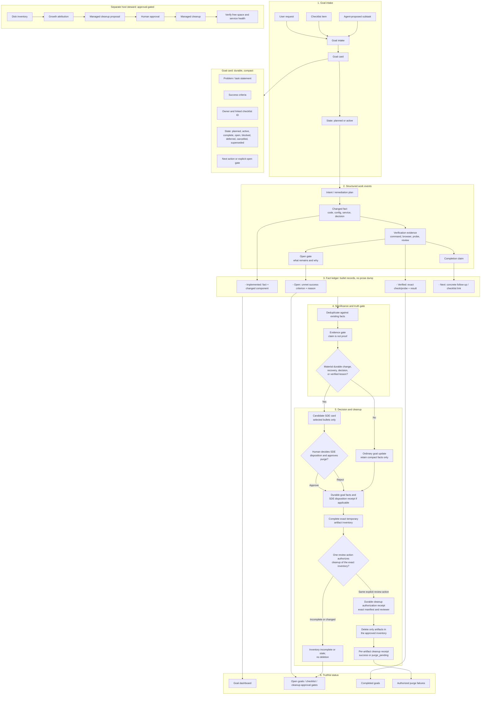

# Curator V2: goal-ledger intelligence, not transcript curation

## Summary

Curator V2 is a standalone rewrite. It does not import V1 runtime code, state,
or raw artifacts. References to `*-v1` contracts and schemas in this repository
mean the first version of a V2-owned interface; they do not imply V1 runtime
compatibility. Per owner direction, the deprecated and previously inoperable V1
runtime is outside this plan: V2 must not use it as an import source, fallback,
or rollback target. V1 shutdown and any artifact disposition belong to their
owning runtime and repository, not this V2 implementation.

The missing primary object is a **goal**, created from a user request, a checklist item, or an explicit agent subtask. V2 continuously records compact, evidence-backed lifecycle facts against that goal. A real SDE is a derived durable outcome—not the unit of capture.



## Core behavior

- At task start, V2 records: **problem**, **success criteria**, linked checklist item, and initial state.
- Parent goals may contain bounded child tasks with independent success
  criteria, evidence, dependency links, status, and next action. A parent stays
  open until every child is complete or explicitly retired and every declared
  dependency is complete.
- During work, agents emit compact typed facts rather than preserving full chats: intent, change, verification, open gate, completion, and cleanup.
- At task finish, V2 records one of:
  - **Completed:** every success criterion has direct evidence.
  - **Open/deferred:** completed facts, remaining criteria, blocker, and next action.
  - **Blocked:** exact failed dependency plus recovery path.
  - **Cancelled/superseded:** explicit reason; superseded work links to an
    active same-project replacement. Neither outcome asserts that criteria
    passed.
- Reopening a completed goal starts a new evidence epoch: prior facts remain
  immutable and visible, but pre-reopen verification does not satisfy current
  success criteria. Reopen requires a reason and concrete next action. Reopen a
  completed parent before its completed child, and reopen every completed
  dependent before reopening the dependency it references. A completed goal
  whose parent is cancelled or superseded, or whose dependency is cancelled or
  superseded, cannot be reopened; resume with a new goal under a nonterminal
  parent and valid dependencies, using an active same-project replacement for
  any cancelled or superseded dependency. Preserve the old links and terminal
  history. Criteria changes, cancellation, and supersession require separate
  explicit lifecycle events.
- A significance gate derives an SDE only when evidence supports a durable implementation, decision, recovery, or lesson. Routine progress remains a goal update.
- Every durable record is short bullets, separating observed facts from planned or unverified claims.
- One explicit SDE approve/reject action also authorizes purge of the complete
  exact artifact inventory displayed with the decision. Store a distinct
  cleanup-authorization receipt for audit, and persist both receipts canonically
  before deletion. Neither an incomplete inventory nor expiry eligibility
  authorizes deletion. Purge only the approved inventory; report failed deletion
  as `purge_pending` and never hide it behind green health. Missing or changed
  inventory remains a fail-closed gate.

## Token and disk discipline

- No raw transcript store, cue queue, scratch archive, or paragraph synthesis pipeline.
- One bounded goal card plus deduplicated fact bullets; new events merge into the existing goal rather than creating duplicate records.
- Evidence references carry hashes, path/command identifiers, and outcomes—not command output or chat history.
- Status reports show: active goals, completed goals, explicit open gates, SDE candidates, and failed purges.
- The separate Host Steward reports disk growth and proposes managed cleanup; it performs no deletion without approval.

## Interfaces and tests

- `goal.start`, `goal.fact`, `goal.finish`, `goal.defer`, `goal.status`,
  `goal.reopen`, `goal.criteria_amended`
- `sde.assess`, `sde.confirm`, `artifact.purge_status`
- `artifact.cleanup_approve` (implemented as `artifact_cleanup_approve` in the
  API/MCP surface; the same explicit review action creates a distinct durable
  cleanup receipt bound to a complete exact inventory)
- `steward.inventory`, `steward.propose_cleanup`, `steward.execute_cleanup`

Tests must prove that:

- a checklist task preserves its original success criteria through completion;
- an incomplete task stays open with a concrete next action;
- unsupported agent claims cannot close a goal;
- ordinary updates do not become SDEs;
- confirmed/rejected SDEs preserve compact facts and disposition receipts; the
  same explicit review action authorizes only the exact complete inventory, and
  no transient artifact is deleted until both receipts are canonically durable;
- an interrupted purge is retried and visibly reported;
- no host cleanup happens without explicit approval.

## V1 boundary

Per owner direction, the deprecated/inoperable V1 runtime is not a Curator V2 dependency. This plan does not freeze, inventory, migrate, clean, or use V1 as a rollback target. Do not inspect or modify the V1 repository or its data from this V2 project. At the owner's request, the Vhost Manager Hermes profile's legacy Curator MCP entry is disabled and its `curatormd-observer` hook now declares no events; the profile hook loader skips it. The profile-scoped gateway status showed only the default profile process. Host checks found no V1-named systemd unit, Docker container, or matching process. These checks cover the known Vhost profile integration and name-matched host runtimes; they are not an exhaustive proof that every possible V1 runtime elsewhere is stopped.

## Development-only product scope

Owner decision (2026-10-28): Curator V2 is a local development utility used by
the OS account `eaglesvn`, for one active repository at a time. There is no
production deployment or multi-user product requirement. Local authorization
uses the invoking OS account and its owner-only host configuration; hosted
person identity, remote trust services, public availability, and production
operations are outside this product's acceptance scope.

The owner-approved local evidence set is repository diff/tests, local service
probes, loopback browser checks when a task has a browser interface, and
attended human review. These are the complete source set for this utility; each
source is used only when relevant to the task. No remote credentials, hosted
identity mapping, or credential rotation is required.

SQLite is the authoritative structured ledger. Consumer `persistence/HISTORY.md`
is a readable projection generated from that ledger. If the copies disagree,
preserve both, stop automatic projection or recovery, and ask `eaglesvn` to
review the difference. Only after review may the Markdown projection be rebuilt
from SQLite. Do not recover or overwrite SQLite from Markdown automatically.

Checklist rows that mention hosted identity, production adapters or schedulers,
external services, or production release are not blockers for this local
utility. Preserve their historical evidence and checkbox state unless the row
is rewritten to a concrete local acceptance criterion. Local SQLite durability,
safe recovery, one-repository isolation, and the local integrations actually
used by the alpha remain in scope. This scope decision does not itself close
any implementation row.

Owner scope amendment (2026-10-30): Vhost Manager application behavior and its
certificate, DNS, Nginx, and other utility workflows are outside Curator V2
completion. Do not modify or test those workflows for this goal. Existing
Vhost-specific runs and target comparisons remain historical context, not open
Curator V2 gates. Continue work on the Curator V2 backend, Hermes Core
integration, and V2-owned local editor plugin. The previously accepted alpha
snapshot remains immutable evidence for its recorded digest; this amendment
does not authorize artifact deletion or other policy changes.

## Delivery checklist

This is the implementation and rollout checklist for the proposed V2 landscape.
Checkboxes describe verified repository state, not architectural intent:

- `[x]` Implemented in this repository and covered by the current unit tests.
- `[ ]` Open: proposed, not implemented, or not yet verified end to end.
- `[!]` Decision or external dependency required before the item can close.

Progress counts include top-level delivery rows in numbered sections 0–10 and
12 plus the Definition of done acceptance rows. Section 11 reusable workflow
templates are excluded. The authoritative recount is
`python3 tools/count_curator_v2_delivery.py`; the raw all-file checkbox total
also includes section 11 and is not the delivery-progress count. Current
recount (2026-10-30): **171 of 178 delivery rows are complete; 7 are open**.
The full raw checkbox count is **186 of 194 complete; 8 are open**. Section 11
contributes 15 complete rows and one open row; do not compare these two scopes
as if their totals were the same. Historical narrative counts below are not
current.

An item closes only when its listed observable evidence exists. Unit tests prove
the behavior of this library slice; they do not prove that a local consumer
plugin or Hermes integration is installed and working end to end.

### 0. Product contract and bounded ownership

- [x] Define a goal as the primary record, with problem, success criteria,
      status, owner/checklist references, and next action.
- [x] Keep the global backend in this repository; keep repository-specific
      plugin and config in each consuming repository.
- [x] Keep Hermes runtime, event router, gateway, profiles, and Host Steward
      outside CuratorMD ownership. Host Steward belongs to the Hermes Core account.
- [x] Define raw chats, transcripts, imports, cues, and scratch as temporary
      evidence only, never canonical knowledge.
- [x] Define a strict, versioned, project-context lifecycle event envelope with bounded UTF-8 serialization and typed goal/fact payloads.
- [x] Publish versioned event, goal, fact, SDE, receipt, error, and plugin
      data-shape contracts with compatibility and migration rules; validate
      runtime events and records against the machine-readable schema bundle.
- [x] Record supported data-retention, privacy, threat-model, and operator
      requirements from the actual deployment owners. The owner-approved local
      alpha policy records the eaglesvn UID-bound reviewer, same-action exact-
      inventory cleanup authorization, 72-hour maximum and prompt expiry, artifact
      holds, privacy/canonical-data boundary, fail-closed missing identity, and
      Hermes Core root-account ownership of Host Steward. Shared identity and
      remote hold discovery are outside the one-user alpha; local retention,
      recovery, and runtime evidence are tracked in the open storage, privacy,
      and alpha acceptance items below.
- [x] Record boundary-changing decisions in architecture decision records.
      [`ADR 0001`](adr/0001-managed-markdown-projection-integrity.md) documents
      the managed Markdown checksum, legacy behavior, and why it does not settle
      the deployment system-of-record policy; future boundary changes still
      require their own ADR.

### 1. Goal intake and lifecycle

- [x] Start a goal with a compact problem statement, one or more named success
      criteria, and optional owner/checklist references.
- [x] Constrain goal and criterion fields so they stay bounded and readable.
- [x] Preserve the initial criteria on the goal record through lifecycle
      transitions.
- [x] Record typed intent, change, verification, open-gate, completion-claim,
      outcome, cancellation, and supersession facts as single compact bullets.
- [x] Keep a goal open when a completion claim lacks passing evidence for any
      criterion; record the unmet criteria and a concrete next action.
- [x] Permit completion only when every criterion has independently verified
      passing evidence.
- [x] Represent blocked and deferred outcomes with a reason and recovery or
      next-action path.
- [x] Make goal/fact transitions transactional and make duplicate facts
      idempotent.
- [x] Test criteria preservation, incomplete goals, evidence-gated completion,
      compact facts, duplicate facts, status filtering, and rollback on failure.
- [x] Add bounded source IDs and optional monotonic source sequences to the
      versioned event envelope; atomically advance per-project/source cursors with
      goal/fact changes and keep sequence gaps retryable without applying facts.
- [x] Serialize fact append against completion across SQLite connections and
      reject a fact if the goal is complete at the transaction's write boundary;
      cover with a deterministic two-connection regression test.
- [x] Reopen a completed goal with a reason and next action, preserve its prior
      facts, require a completed parent to reopen before its child and completed
      dependents to reopen before their dependency, and prevent pre-reopen
      evidence from satisfying the new work epoch.
- [x] Amend a non-complete goal's criteria only through an explicit
      revision-checked event; preserve append-only criteria history and require
      fresh evidence after amendment. Completed goals must be reopened first;
      history is bounded to 16 versions per goal.
- [x] Define cancellation/supersession as append-only terminal outcomes, require
      an active same-project replacement for supersession, reject retirement while
      children/dependents remain unfinished, and serialize competing terminal
      transitions so the first wins and later transitions conflict. Reopen,
      dependency, evidence, and parent-completion consequences are specified in
      `docs/event-contract-v1.md` and covered by lifecycle/event/concurrency tests.
- [x] Add `lifecycle_revision` to goal status; atomically advance it for
      status/criteria transitions and require MCP clients to submit their
      observed revision for finish/defer/block/reopen/amend operations. Stale
      writes leave facts and state unchanged; legacy raw events without a
      revision are interpreted as revision 1 and fail closed after transition;
      migrated goal rows receive a revision-2 fence because prior transition
      counts cannot be reconstructed.
      Tests cover stale defer/block and criteria writes, event failure receipts,
      and verified multi-connection terminal races.
- [x] Exercise every public lifecycle action against every persisted goal
      status. Dedicated activation/reopen/retirement operations own their state
      changes; rejected actions preserve status, revision, and facts. The
      generic transition primitive cannot set those dedicated target states or
      finish a planned goal.
- [x] Generate mixed lifecycle action sequences across planned, active, open,
      blocked, deferred, complete, cancelled, and superseded states; verify
      revision progression, criteria revisions, evidence-epoch resets, and
      rejection atomicity after each action.
- [x] Generate parent/child/dependency action sequences; prove finish requests
      preserve explicit open gates until related work resolves, parent/dependent
      retirement is rejected while work remains unfinished, and rejected actions
      leave every linked goal and fact list unchanged.
- [x] Exhaust all reopen orders for a nested parent/child tree with a completed
      prerequisite; enforce completed-parent-before-child and
      completed-dependent-before-dependency reopen order while preserving prior
      facts and requiring fresh criterion evidence.
- [x] Add regressions for reopen attempts whose parent or dependency is
      cancelled or superseded, matching the relationship rules in
      [`event-contract-v1.md`](event-contract-v1.md). Confirm the completed goal
      and its links remain unchanged; resuming work requires a new goal with a
      nonterminal parent and valid dependencies, including an active
      same-project replacement for any cancelled or superseded dependency.
      Direct rejection must leave status, revisions, relationships, and facts
      unchanged. For rejected event delivery, retain one durable failure receipt
      without advancing the source cursor; exact replay keeps the same
      project/event receipt identity and failure state, with retry attempts
      updated under the normal retry policy, but creates no second receipt or
      goal/relationship mutation. Covered by
      `test_reopen_rejects_terminal_parents_and_dependencies_atomically` and
      `test_terminal_parent_reopen_failure_keeps_one_receipt_and_source_cursor`.
- [x] Implement reference-plugin adapters for explicit user requests, bound
      checklist rows, and accepted child subtasks; every route requires caller-
      supplied success criteria, checklist intake preserves an exact source
      line/revision, and child intake preserves its parent link. Tests prove
      criteria are unchanged and missing criteria are rejected. Hermes-authored
      intake and a real consumer workflow remain separate open integration gates.
- [x] Capture an optional bounded next action at goal intake through the
      versioned event, MCP, and repository-plugin paths; report a missing action
      explicitly and include the concrete step in TODO/report output. Legacy
      payloads remain valid. Event round-trip/schema, project-plugin persistence,
      report, and MCP regressions cover the local contract; this does not prove
      a live consumer emits the action.
- [x] Demonstrate the lifecycle through a real consumer workflow, from request
      capture to a truthful planned/active/completed/open/blocked/deferred/
      cancelled/superseded status view. Progress (2026-10-20): the installed
      alpha MCP launcher ran against the actual Vhost Manager repository config
      and a separate V2 smoke database. A goal and fact were written, exact
      retries across fresh subprocesses were idempotent, changed event content
      conflicted, and a finish request without criterion evidence remained open.
      `goal_report` showed the open TODO and `goal_status` retained the unmet
      criterion. This uses manually supplied Hermes context and test-only write
      access; a Vhost Manager application producer and live profile route remain
      open, so the real consumer workflow item is not closed. Progress
      (2026-10-21): all six Vhost installed-package contracts pass, including
      a bounded hook-to-installed-MCP round trip through the installed profile
      launcher; Hermes discovers 45 tools and the Vhost profile endpoint reports
      ready. The global 335-test suite, strict Pyright, errors-only Pylint,
      Bandit, locked dependency audit, and diff check pass. This remains
      synthetic consumer evidence: no live Vhost Manager session or real user
      request has traversed the endpoint, so this item remains open.
      Progress (2026-10-21): a one-shot Hermes Codex app-server session was
      run from the Vhost Manager checkout. Read-only Hermes and Curator state
      confirms source sequences 10 and 11 (`codex:turn:start` and
      `codex:turn:end`) were each acknowledged once and processed/applied by
      Curator; both match the active profile/project/goal binding. Curator
      activity is now 12 processed receipts, with event payload JSON cleared
      after processing; the existing intent/change facts remain deduplicated.
      The V2 database passes `PRAGMA quick_check=ok`. This proves the one-shot
      profile CLI route only. Hermes gateway status reports only the default-
      profile PID, V2 `project_health` remains `unknown`, and no Vhost Manager
      application UI/request workflow or canonical application-target write
      was exercised, so this item remains open.
      Progress (2026-10-21): a read-only Hermes profile prompt attempted
      `goal_report` for the existing smoke goal, but the profile returned
      `user rejected MCP tool call`. Read-only V2 SQLite still shows the goal
      active at lifecycle revision 1 and the existing 12 processed receipts;
      no state changed. The approval boundary was not bypassed, so the real
      consumer lifecycle/status workflow remains open.
      Follow-up (2026-10-21): the profile tool-selection list had omitted
      `goal_report`; it now selects that read-only tool (12 selected Curator V2
      tools total), with the prior mode-0600 profile config backed up. Hermes
      MCP connection/discovery still succeeds. Hermes' session store confirms
      the one-shot session issued `mcp.curator_v2.goal_report` and received the
      tool result `user rejected MCP tool call`; read-only V2 state remains
      unchanged. The omitted tool was a real configuration gap, but was not
      sufficient to explain the rejection; the actual profile call/approval
      path remains open.
      Additional verification (2026-10-21): re-ran the seven installed Vhost
      consumer contracts against the current alpha wheel; all seven pass,
      including `goal_report` through the installed stdio launcher, configured-
      target persistence in disposable state, and two-consumer isolation. This
      verifies the installed plugin/tool path and synthetic consumer contracts,
      but does not clear the rejected Hermes model-session call or establish a
      Vhost application workflow; this checklist item remains open.
      Follow-up profile smoke (2026-10-21): after the profile-local plugin
      passed Hermes discovery/doctor, a bounded one-shot request from the
      Vhost Manager checkout asked the configured profile to create one planned
      smoke goal and read its status. Hermes returned `goal_start` rejected;
      the requested goal was absent on a read-only SQLite check, the goal count
      remained one, all 12 existing receipts remained processed, and SQLite
      `quick_check` remained `ok`. No direct-MCP or database-write workaround
      was used. The live consumer workflow remains open pending an allowed
      profile tool call. Additional verification (2026-10-22): built the
      current Curator source as a wheel, installed it into a disposable Python
      3.12 environment, and reran the Vhost-owned Hermes managed-MCP harness.
      The actual Hermes `HookRegistry`/`HookContext` acknowledged three
      bounded lifecycle events, exact replay, and failed-delivery retry;
      planned-goal binding and reviewer-only persistence stayed denied, the
      Vhost projection reconciled, and private metadata/out-of-scope targets
      remained absent/unchanged. The seven Vhost installed-consumer contracts
      also pass against this wheel. This is current-wheel local composition,
      not a live user request or production deployment; the item remains open.
      Local alpha install (2026-10-22): the wheel from commit `060b325` is now
      installed in the dedicated `renew-ssl-coding` Curator V2 environment;
      the seven Vhost contracts and Hermes managed-MCP harness pass there too.
      The installed core module hashes match source. MCP discovery reports 47
      tools and `auth=none`; gateway status shows only the default-profile PID,
      so interactive profile authorization and a live application request
      remain unverified.
      Latest local alpha package (2026-10-22): built from Curator commit
      `24cae4c`, wheel SHA-256
      `3f552edf5edafa9f509a491e385dfc6286751e99ebf1cf5dd7dddead5d62ca1a`,
      and installed in the dedicated profile environment. All 35 installed
      Python module hashes match source. Seven Vhost consumer contracts and the
      Hermes Core managed-MCP harness pass; the harness processes three
      lifecycle events and verifies retry/replay, binding denial, reviewer
      denial, projection reconciliation, and privacy canaries. Hermes MCP
      discovery exposes 47 tools with `auth=none`. Read-only SQLite reports
      schema 20, `quick_check=ok`, one goal, two facts, 12 inbox receipts, and
      two project grants. Gateway status lists only the default-profile PID.
      This verifies the current package/plugin composition and stored database
      integrity, not an interactive Vhost request or authenticated identity;
      the lifecycle checklist item remains open.
      Current-source wheel check (2026-10-22): built `0.1.0a1` into a temporary
      output directory after splitting the MCP registration modules. The wheel
      SHA-256 is
      `1c390fded18292a3abc6ade03de8b4cc1a34eeac10e68c2d91dc478bf59277a0`;
      its manifest contains `mcp_server.py`, `mcp_tool_registration.py`, and
      `mcp_tool_support.py`. Installed to a temporary target without replacing
      the profile wheel; an import check with that target first on `PYTHONPATH`
      loaded the package from the extracted wheel and resolved the registrar and
      parser exports. This is package-content evidence only; no consumer profile
      or Vhost application was changed or exercised. Proposed closure: for the
      integration portion, use the consumer's supported user-facing entrypoint
      and the separately authorized single real request in Slice I; do not
      substitute a manually constructed Hermes context, direct MCP write, or
      database edit. Capture the source checklist item and original criteria,
      then follow that request through its allowed lifecycle events to the
      consumer's user-facing status view. Reload the view and reopen the backing
      report to prove that the displayed state, current criterion evidence, and
      next action match the durable goal revision; a finish request without
      passing evidence must remain open. For status-display coverage beyond
      that authorized request, use disposable non-production goals through the
      same supported consumer surface to exercise planned, active, completed,
      open, blocked, deferred, cancelled, and superseded states, including
      rejected transition attempts and any permitted reopen. Verify every state
      persists after a fresh read/restart, prior terminal history remains
      distinguishable from current status, and unsupported claims never appear
      complete. Keep the real-consumer item open until the actual user-facing
      route, real-request trace, and status/reload evidence are reviewed; local
      state-machine tests or a disposable profile do not prove application
      capture, and the one-run authorization does not extend to additional real
      requests.
      Vhost route progress (2026-10-25): the actual local HTTP apply and
      rollback handlers emit durable Curator receipts through the installed
      MCP launcher. Two reserved disposable `.test` sites were applied and
      rolled back through the running root service; exact receipts were
      processed, site accounts and webroots were removed, and the root Vhost
      service retained valid Nginx/OpenLiteSpeed configuration. A fake scheduled
      ACME result also reached a processed receipt without retaining command
      output. The authorized `eaglesvn` reviewer saved five exact operation
      goals to the Vhost `HISTORY.md`; read-only reconciliation matched all
      five document hashes to SQLite and found no fixture paths, database path,
      or output canary. This is a real local consumer request and saved-record
      workflow, superseding the older statements that no application request or
      canonical write had occurred. The Vhost operation history shows applied,
      rolled-back, and scheduled-renewal outcomes; the Curator goals remain
      accurately `planned` pending human disposition. The consumer history is
      the readable status view for these real requests. This closes request
      capture through truthful status for the local workflow. The separate
      authenticated aggregate dashboard, all-state deployment coverage,
      stale-page behavior, and complete read/write-path evidence remain open
      under their own rows.

### 2. Evidence and fact ledger

- [x] Store evidence references (kind, locator, SHA-256, outcome), not raw
      command output, chat content, or transcript bodies.
- [x] Require evidence references on verification facts and link each
      verification fact to a success criterion.
- [x] Default to reject-all evidence verification when no trusted adapter is
      configured.
- [x] Separate completion claims from verification facts in the domain model.
- [x] Define trusted evidence adapters and their authentication, freshness,
      scope, and revocation rules in
      [`evidence-adapters-v1.md`](evidence-adapters-v1.md). Local typed receipt
      adapters enforce the documented bindings and source ceilings; tests use
      synthetic host receipts and do not prove source authentication.
- [x] Persist compact host-provided verification attestations beside immutable
      verification facts, include them in fact digests and capacity accounting,
      and revalidate source revision, adapter, and subject on each criterion
      check. Legacy facts receive no invented provenance and remain unverified.
- [x] Integrate the approved local evidence sources: repository diff/tests,
      local service probes, loopback browser checks, and attended human review.
      A separate owner-only host config binds the evidence resolver to the one
      active project. The invoking `eaglesvn` OS UID is the human subject;
      missing or invalid config fails closed. Consumer config and event payloads
      cannot select a verifier or supply identity. Remote credentials, hosted
      identity, and credential rotation are outside the approved product scope.
- [x] Implement and verify each local source path. `GitCommitDiffResolver` and
      `LocalGitTestRunnerResolver` bind receipts to a full commit; service probes
      run a fixed host-configured argv; browser checks render only credential-free
      loopback URLs in isolated Chrome and return content-free digests; human
      observations require a one-time terminal challenge and bind the OS UID to
      the exact project, goal, and criterion. Invalid, expired, changed, and
      cross-project evidence fails closed. The host config was last rechecked as
      owner-only (`eaglesvn`, mode 0600) on 2026-10-27. Local captures are recorded
      for repository diff, test runner, service probe, and browser. The attended
      human path is exercised by focused capture/verification tests; no human
      receipt is recorded until a specific criterion is reviewed interactively.
      The focused source suites and local Vhost route evidence are documented
      above. This closes implementation of the approved local sources; it does
      not claim that every task has used every source.
- [x] Bound immutable fact history to 512 facts/512 KiB per goal and 10,000
      facts/16 MiB per project; reject over-limit appends atomically without
      pruning, expose capacity gates in goal/project status, and test count/byte
      exhaustion plus idempotent retries at the ceiling.
- [x] Implement reviewer-approved fact-cap recovery: propose only eligible
      routine facts; preserve their exact source bullets and immutable IDs in a
      compressed, project-scoped archive with hashes for both canonical source
      records and compressed bytes; require an authenticated reviewer decision
      before removing any fact from the active ledger. Never compact verification,
      outcome, open-gate, lifecycle/criteria, decision, SDE-supported, or otherwise
      evidence-bearing facts. **User-selected policy:** retain the compressed,
      hash-verified source-bullet archive and compact only eligible routine facts
      after reviewer approval. **Exit evidence:** tamper detection, interrupted
      archive/ledger recovery, approval attribution, idempotent replay, archived
      fact retrieval, authenticated receipt reads, byte/count reporting, and
      capacity-resume tests pass; failed archive verification or persistence
      leaves active facts and the capacity gate unchanged. Maintenance progress
      (2026-10-22): the storage approval path now accepts one immutable typed
      request and separates replay, fact/hash validation, SDE protection,
      capacity accounting, and archive persistence into focused helpers. All
      nine existing fact-compaction tests and strict Pyright pass; targeted
      warning-level Pylint no longer reports this path's argument, local-variable,
      branch, or statement complexity findings, while other `store.py` warnings
      remain; `git diff --check` passes. This preserves the same transaction
      boundary and does not establish a Hermes-authenticated reviewer identity.
- [x] Bound the global event inbox to 250,000 receipts and 128 MiB of retained
      logical row bytes across all projects; reserve room for failure metadata,
      reject new IDs before writes at the ceiling, preserve idempotent replays,
      never auto-prune, and expose aggregate-only capacity/gate status.
- [x] Define an approved retention/compaction and recovery workflow for a full
      event inbox, plus budgets for every other permanent data class; prove safe
      recovery before enabling broad automatic capture. Proposed owner-gated
      closure: inventory every durable data class in the current schema and
      migrations, including event receipts/tombstones and retained retry payloads,
      facts and their approved archives, SDE/review/cleanup/recovery receipts,
      project registrations/audit records, indexes, WAL, and backups. For each,
      name the data owner, logical count/byte measure, physical-storage overhead,
      retention/replay horizon, capacity threshold, and recovery source; classify
      omissions and shared overhead explicitly. Source accounting check
      (2026-10-23; [storage queries](../src/curatormd_v2/store.py),
      [schema migrations](../src/curatormd_v2/schema_migrations.py),
      [usage read model](../src/curatormd_v2/read_models.py), and
      [rate limiter](../src/curatormd_v2/rate_limiter.py)):
      `ProjectStorageUsage` reports logical bytes for project
      domain records and separate global database/WAL file sizes, but it does
      not include global/unassigned `event_payload_scrub_queue` rows. Durable
      `project_registry`, `project_registry_audit`, `project_grants`,
      `project_grant_revocations`, and `request_rate_buckets` now have separate
      project-scoped logical count/byte aggregates exposed only through the
      existing host-authorized attended access `view`; they are not included in
      ordinary project reads. Focused tests verify `VIEW` authorization, class
      attribution, and that identifiers are not returned. The global inbox byte
      total includes `event_retry_audit` bytes, while its receipt count counts
      only `event_inbox` rows. Owner-approved local-alpha default (2026-10-28):
      retain goals, facts, SDE decisions, review/cleanup/recovery receipts,
      grants/audit rows, and processed receipts until `eaglesvn` approves
      cleanup of an exact displayed inventory; never automatically prune these
      classes. Existing hard caps remain unchanged, and the 250 MiB backup-tree
      threshold is warning-only. Owner decision (2026-10-29): retain failed and
      quarantined inbox payloads until the event is processed or explicitly
      resolved; do not discard them solely because of age. The seven-copy
      backups may retain unresolved payloads; once the live payload is scrubbed,
      those copies age out within seven days. Owner-approved local-alpha budget
      rule (2026-10-29): retain each durable database class under its existing
      hard cap, if any; apply the shared main-database-plus-WAL warning at
      250 MiB to all classes together; never prune based on that warning. Keep
      the seven-copy backup-tree warning separate and warning-only. No new
      per-class hard caps or automatic deletion are authorized. This is a
      local-alpha policy, not complete physical accounting of unclassified
      legacy backup files or live proof. Implementation recheck (2026-10-29):
      the host-authorized SQLite storage view now includes the combined main
      database-plus-WAL byte count and warning state. A focused regression
      covers exactly 250 MiB, one byte above it, and a successful project write
      above the warning. The backend change is not installed or observed above
      threshold in the live alpha; the full accounting and recovery checklist
      remains open.
      Existing local controls include a 10,000-row maximum for request-rate
      buckets with idle-only pruning and deletion of WAL-scrub queue rows after
      a successful checkpoint. Other durable receipt classes rely on the shared
      warning and owner-approved exact-inventory cleanup; they have no separate
      row caps.
      Further accounting progress (2026-10-23): the host-authorized access
      storage view now reports unassigned `event_payload_scrub_queue` rows as
      a separate global class with record count and logical bytes. It does not
      add the same global rows to a project's logical total or expose scrub or
      event IDs. A VIEW authorization regression verifies exact attribution and
      the content-free result. This closes the previously identified class
      measurement omission only; data ownership, retention/recovery horizons,
      physical overhead, thresholds, and approval remain open.
      Local-alpha measurement (2026-10-28): the attended Vhost access view
      reports 3,145 logical control-plane bytes across 11 classes, zero
      unassigned scrub-queue bytes, a 524,288-byte SQLite main file, a 168,952-
      byte WAL, and 32,768 unattributed database bytes. The sibling backup
      inventory is incomplete: one recognized 524,288-byte daily snapshot and
      20 unclassified top-level entries. The installed bounded V2 scanner sees
      21 top-level entries and 19 regular files (4,618,625 logical bytes and
      4,636,672 allocated bytes) without reading contents or following
      symlinks. It does not descend into the two group-writable directories
      (mode 0775), so this is not a complete tree-size observation. A separate
      bounded metadata-only walk at 2026-10-28 11:52 +07:00 followed neither
      symlinks nor file contents and counted 29 entries: 27 regular files, two
      directories, zero symlinks, 4,642,256 logical file bytes, and 4,681,728
      allocated bytes across files and directories. Twelve entries have
      group/world permissions: the two directories, one package archive, one
      editor-settings file, and eight nested files. The nested suffix counts
      are two JavaScript, two JSON, two Markdown, and two suffixless files; no
      filenames or contents are recorded. No entries or permissions were
      changed. This supplements the scanner result but does not complete its
      trusted inventory or establish class-level retention. Owner decision
      (2026-10-28): warn at 262,144,000 allocated bytes (250 MiB) for the whole
      backup tree; keep every file and never prune based on this budget. The
      current legacy entries remain untouched until `eaglesvn` reviews and
      approves deletion of an exact inventory. The seven-copy rotation applies
      only to verified daily snapshots created by Curator's backup routine.
      bounded backup reader now returns `warning_status`: `warning` at or above
      the observed-byte threshold, `below_threshold` only for a complete
      supported byte measurement below it, and `unknown` when the bounded size
      measurement is incomplete or allocation units are unsupported. A reached
      threshold remains a warning even when backup classification is incomplete
      because observed bytes are a lower bound. The refreshed installed read
      (2026-10-28 19:03 +07:00) traversed all 29 entries, including both
      group-writable directories, using descriptor-relative no-follow opens.
      It measured 4,642,256 logical file bytes and 4,685,824 allocated bytes
      including the root directory. One daily SQLite snapshot was recognized;
      28 entries remain unclassified. Classification is `incomplete`, while
      the separate byte `warning_status` is `below_threshold` because that
      bounded measurement completed under 262,144,000 bytes. The 13 focused
      backup tests passed, including threshold and keep-files behavior. This
      implements the approved local warning rule and legacy-file deletion
      boundary; long-term class retention/recovery horizons and permanent-data
      accounting remain open. By top-level name/type only, the
      20 unclassified entries are
      three older SQLite snapshots, eight WAL/SHM sidecars, five package
      rollback archives, one YAML profile-config snapshot, one VS Code settings
      snapshot, and two prior VS Code extension-backup directories;
      archive/settings contents were not opened. A content-free size breakdown
      by these classes is recorded in
      [`Curator V2 Pilot Default Policy.md`](Curator%20V2%20Pilot%20Default%20Policy.md).
      Fresh local-alpha accounting (2026-10-28 11:49:06 +07:00): the authorized
      Vhost project read reports 43,912 logical project-record bytes across
      25 goals, 22 facts, 56 event receipts, and zero SDE candidates or retained
      event payload bytes. The inbox has 18,885 retained logical row bytes of
      its 134,217,728-byte limit and can accept new events. Original payload
      bytes received total 37,859; processed payloads are no longer retained in
      the live ledger. The separate host-authorized view reports 3,145 logical
      control-plane bytes across 11 classes, a 524,288-byte SQLite file, and a
      383,192-byte WAL. Staging is complete and empty. The sibling backup scan
      remains incomplete at 21 entries and 4,636,672 allocated bytes. This
      refreshes current measurements only; durable-class retention, recovery
      horizons, and permanent-storage warning thresholds remain open.
      Fresh measurement (2026-10-29): the TTY-gated `VIEW
vhost-manager-alpha ACCESS` returned 3,145 logical bytes across the same
      11 project control-plane classes, with zero unassigned scrub-queue rows.
      SQLite reports 132 pages at 4,096 bytes (540,672-byte main file), 276,072
      WAL bytes, 32,768 unattributed main-file bytes, and 507,904 table B-tree
      bytes across the listed tables. The bounded backup scan now observes 32
      entries and 30 files not classified as managed daily snapshots; it
      recognizes two snapshots totaling 1,064,960 bytes and measures 5,215,696
      file bytes / 5,259,264 allocated bytes overall. Classification remains
      incomplete, so these snapshot totals are not the backup tree's total.
      The warning-only 250 MiB threshold remains below its limit. The read-only
      view included one event status row; no event text or identifiers were
      retained in this report. This refreshes measured sizes and confirms that
      legacy backup classification has expanded since the prior scan; it does
      not close class-specific budgets, retention horizons, or recovery-source
      accounting.
      Supplementary backup metadata inventory (2026-10-29 16:35 +07): a bounded
      no-follow walk groups the same 32 entries by type/suffix: two daily
      snapshots, three older SQLite snapshots, ten WAL/SHM sidecars, five
      rollback archives, one YAML file, one VS Code settings file, two extension
      backup directories, and eight nested files (two each JavaScript, JSON,
      Markdown, and suffixless). Twelve entries are not owner-only. The V2
      scanner still recognizes only the two daily snapshots as managed backups;
      archive/suffixless contents and provenance remain unknown. No names or
      contents were recorded and no files or permissions were changed. This
      narrows metadata classification but does not close the storage item.
      Fresh profile-bound project read (2026-10-29): `project_storage_usage`
      reports 31 goals, 28 facts, and 70 processed event receipts. Logical
      project records total 54,951 bytes; the global inbox is 70/250,000
      receipts and 23,559/134,217,728 retained bytes, with zero retained source
      payload bytes and zero scrub-queue entries. New events are accepted.
      The configured staging inventory is complete and empty. Main database
      size is 540,672 bytes and WAL is 284,312 bytes at this read. The project
      counters and global inbox are separate from the 3,145-byte access-control
      classes above. This closes no retention or size-policy gap; file sizes and
      WAL contents remain global/shared. A content-free 30-table logical and
      physical census, retention/cap mapping, and explicit omissions are now
      recorded in [`storage-recovery-v2.md`](storage-recovery-v2.md); the
      unanswered SQLite warning rule and incomplete backup classification keep
      this checklist item open.
      Metadata-only `lstat` at 2026-10-28 12:34 +07:00 found the SQLite main file
      at 524,288 bytes, WAL at 457,352 bytes, and SHM at 32,768 bytes; each is a
      UID-1000-owned regular file with mode 0600. The backup directory is
      UID-1000-owned mode 0700. No file contents were read. WAL and SHM sizes
      are dynamic and this measurement does not establish per-class budgets.
      Progress (2026-10-23): project-authorized `ProjectStorageUsage` now reports
      project-scoped event cursor count and logical UTF-8 bytes, includes those
      bytes in `logical_record_bytes`, and exports aggregate-only cursor metrics.
      API, MCP, and two-project regressions verify the read boundary and
      attribution without exposing source IDs. It also reports project-scoped
      event retry-audit counts and bytes, includes them in the logical total, and
      exports aggregate-only metrics; retry and cross-project regressions cover
      attribution. Project staging artifact-age metadata is also included as a
      separate project-scoped count and logical-byte class. Attended expiry-purge
      receipts and target rows now have separate project-scoped counts and
      logical bytes, including
      retained targets after purge; API/MCP exposure and the authorized purge
      lifecycle are covered by focused tests and aggregate metrics.
      Exact cleanup authorizations now also have project-scoped counts and
      logical bytes, tested after canonical persistence and purge without
      exposing reviewer or target fields.
      Project-attributed payload-scrub queue rows have counts and logical bytes;
      rows with a null project are reported separately in aggregate global
      usage. Neither measure implies a retention policy or physical per-class
      allocation.
      Further progress (2026-10-23): the attended admin `view` now reports
      project registry, registry audit, grant, revocation, and token-bucket row
      counts plus logical bytes by class. Revocations are attributed through
      their grant's project; numeric values are measured as decimal text. The
      aggregate requires the existing host-level `VIEW` action and returns no
      row identifiers or contents. Ten focused access-manager/CLI tests pass.
      Terminal-disposition accounting follow-up (2026-10-28): the retired
      project lifecycle regression now creates a real authorized disposition,
      reads the project control-plane storage aggregate, and verifies its class
      count and UTF-8 logical-byte total against the persisted fields. The
      focused lifecycle suite, targeted Pyright, errors-only Pylint, and
      `git diff --check` pass. This verifies local logical attribution for this
      receipt class; retention horizons, recovery sources, capacity thresholds,
      and physical index/WAL/backup allocation remain open.
      Drain-record accounting follow-up (2026-10-28): the consumer drain
      lifecycle regression now verifies exact logical-byte totals and record
      counts for a persisted drain authorization session and its reviewed event
      inventory entry. The focused lifecycle suite, targeted Pyright,
      errors-only Pylint, and `git diff --check` pass. These checks validate two
      more local control-plane classes; the owner-approved budget, retention,
      recovery, and physical allocation decisions remain open.
      Project-administration accounting follow-up (2026-10-28): the scoped
      access-storage regression now compares reported bytes with the UTF-8
      lengths of persisted fields for consumer bindings and audit, project
      registry and audit, grants, revocations, and request-rate buckets. The
      access suite, targeted Pyright, errors-only Pylint, and `git diff --check`
      pass. This validates local logical accounting for the populated access
      classes; it does not establish owner-approved limits or physical budgets.
      Owner-approved retention horizons, recovery sources, per-class capacity
      thresholds, and physical index/WAL/
      backup allocation remain open.
      Further progress (2026-10-23): aggregate global event-inbox usage now
      separately counts all payload-scrub queue records and logical bytes, plus
      the unassigned subset. The value is available through the existing
      aggregate-only global capacity read and is not folded into event-inbox
      capacity totals. A regression verifies null-project rows are included
      globally and excluded from project attribution.
      Source-column accounting progress (2026-10-23): the schema audit found
      durable fields omitted from logical-byte formulas, including project and
      goal foreign keys, event disposition/retry metadata, SDE inventory and
      canonical-persistence flags, purge hold/reacquisition state, expiry
      filesystem identity, and cleanup dependency-map digests. The queries now
      count those stored fields; event-row metadata uses one shared expression
      for project totals and global inbox capacity, while retained event and
      archive BLOBs are counted by their actual byte lengths. A migration-backed
      guard now compares every column in all 24 application tables against the
      project or control-plane accounting inventory (19 and five tables). An
      exact event-row regression compares raw SQLite field bytes with both
      project logical bytes and global inbox bytes. Focused schema, event,
      archive, hold/cleanup, and expiry regressions pass; strict Pyright,
      errors-only Pylint on changed files, and `git diff --check` pass. This
      closes the local schema-column measurement gap only. The permanent-data
      budget item remains open for data owners, approved retention/recovery
      horizons, per-class thresholds, physical page/index/WAL/backup overhead,
      and deployment growth/restore evidence. The earlier
      `test_storage_accounting.py` check is currently maintained as
      `test_current_schema_columns_have_explicit_storage_classes` in
      `tests/test_migrations.py`.
      Physical page-accounting progress (2026-10-23): the host-authorized
      attended `VIEW` result now includes SQLite `dbstat` page counts and
      allocated/payload/unused bytes per application table, with its indexes
      attributed through `sqlite_master`. It also reports database page size,
      page count, free-list pages, allocated and file bytes, WAL file bytes, and
      the unattributed database-page remainder for SQLite schema/shared pages.
      If `dbstat` is unavailable, the result explicitly reports
      `status="unsupported"` and leaves per-class page attribution unknown.
      The aggregate is deliberately host-wide because SQLite pages cannot be
      allocated to one project without reading/rewriting the database; the
      project-authorized usage read remains project logical bytes plus global
      database/WAL sizes. Focused access-control and CLI serialization tests,
      strict Pyright, errors-only Pylint, and `git diff --check` pass on SQLite
      3.45.1. Backup files and retention/recovery policy are not measured or
      approved by this probe; per-class thresholds and production growth/restore
      evidence remain open.
      Backup-size accounting progress (2026-10-28): the host-authorized
      attended storage view now reports the count, file bytes, and allocated
      bytes for recognized daily SQLite backups in the private sibling
      `backups` directory. It inspects at most 32 directory entries, reads no
      snapshot contents, follows no symlink, checks owner-only file modes, and
      returns `incomplete` or
      `unavailable` rather than a clean total when entries are unexpected,
      unsafe, unreadable, or over the scan bound. The authorized project-access
      test verifies a denied caller cannot read the view and the owner view's
      backup totals match the files; the backup suite covers clean and
      incomplete inventories. The seven-copy retention and manual new-path
      restore policy remain as already approved. Failed and quarantined payloads
      remain until processed or explicitly resolved, and copies containing
      scrubbed payloads roll out within seven days. Replay-horizon retirement
      and budgets for every permanent class are still unresolved; no
      permanent-data budget marker changes here.
      Whole-tree measurement follow-up (2026-10-28 19:03 +07:00): the scanner now
      traverses owner-owned group-writable child directories using
      descriptor-relative `O_NOFOLLOW` opens and verifies each child inode
      after opening. Allocated-size completeness is independent of whether
      every legacy entry can be classified as a Curator daily backup. The
      installed alpha package measured all 29 entries and reports
      `warning_status=below_threshold` at 4,685,824 allocated bytes against
      262,144,000 bytes; its separate backup inventory remains `incomplete`
      because 28 legacy entries are unclassified. No backup contents were read
      and no files changed or were deleted. The 13 focused backup tests pass,
      as do targeted Pyright, errors-only Pylint, Bandit, module-hash matching,
      `uv pip check`, and the installed MCP launcher help check. This completes
      the local backup-tree byte-warning measurement; retention horizons and
      permanent-data class budgets remain open.
      Owner decision and warning implementation (2026-10-29): warn only when
      the shared SQLite main database plus WAL exceeds 262,144,000 bytes
      (250 MiB). The V2 dashboard and status-bar tooltip display this warning;
      writes continue and Curator leaves WAL checkpointing to SQLite. The
      focused status-extension suite verifies the exact threshold and an
      above-threshold case using the combined main-database-plus-WAL total
      (200 MiB main plus 50 MiB WAL at the boundary, then one byte over).
      Extension source/UI tests do not prove the updated
      package is loaded in the active VS Code window or that a live warning has
      rendered; class budgets, retention horizons, and recovery evidence remain
      open. No checklist marker changed.
      Schema-coverage guard (2026-10-26): the attended storage-view regression
      now compares the current SQLite application-table inventory with the
      `dbstat` physical-class results when that extension is available. The
      focused project-access suite passes all 12 tests, strict Pyright reports
      zero diagnostics, and `git diff --check` passes. This guards physical
      table attribution against future schema additions; it does not supply
      owner-selected retention horizons, backup accounting, class budgets, or
      deployment growth evidence. The permanent-data budget item remains open.
      `event_cursors` is keyed by `(project_id, source_id)` and updated in place;
      it has no cursor expiry or deletion path. The proposed source-epoch
      dimension adds retained rows. Owners must set source/epoch
      cardinality limits and a retirement horizon, preserve old fences until
      that horizon expires (indefinitely when it is unknown), and reject new
      enrollment before the approved cursor/tombstone storage reserve is
      exceeded. Track
      the exhaustive schema-to-budget case as
      `PERMANENT-DATA-BUDGET`, separately from event-inbox and staging budgets.
      For inbox records, the product
      and deployment owners must define state-specific retention for processed
      or duplicate digest receipts versus unresolved received, failed, and
      quarantined events, including the maximum source outbox/offline retry
      horizon. Any archive or compaction must preserve the event-ID/hash lookup
      and source-order fences needed to acknowledge exact replays and reject
      conflicting reuse; unresolved payloads cannot be discarded as if
      processed. Make fence retirement explicit per producer and project:
      specify the durable source acknowledgment/checkpoint, maximum offline
      outbox age, last-seen/retirement condition, and operator who may retire a
      source epoch. A receipt or sequence fence must not expire while a source
      can still replay it under the approved retry window. If source status or
      retry age is unknown or unbounded, retain the content-free deduplication
      tombstone/fence or keep the source retired from routing until an owner
      approves a new epoch; never infer retirement from inactivity alone. Test
      a producer reconnecting just before and after the proposed horizon, exact
      replay, conflicting ID reuse, stale sequence delivery, and sequence reset
      after re-enrollment. Prove that an old epoch cannot create a second
      lifecycle mutation or advance the current cursor, and that pending events
      remain visible until their durable disposition. Keep the current hard-cap
      behavior fail-closed: do not silently prune. For non-retired projects,
      acknowledge an event only after a durable `processed` receipt (including
      `suppressed_nonactive_goal` with its source cursor advanced in the same
      transaction) or exact `duplicate` receipt exists. The proposed retirement
      path must first extend the versioned event contract
      with a source epoch bound to the authenticated producer and a typed,
      content-free `terminal_rejection` disposition. Proposed v2 boundary (not
      implemented or owner-approved): the registry issues an opaque,
      non-reusable `source_epoch` bound to the authenticated producer, project,
      and registered `source_id`; an envelope value alone is never identity
      proof. Sequence cursors become scoped by `(project_id, source_id,
source_epoch)`, and resetting a sequence requires explicit enrollment of
      a new epoch. Keep `(project_id, event_id)` deduplication project-wide so a
      new epoch cannot reuse an old event ID while its replay horizon remains
      open. Preserve v1 cursors as legacy state during migration; do not
      silently relabel their producer identity or infer that they are retired.
      The owner must decide whether and how legacy sources can enroll in v2.
      Follow the proposed terminal-rejection receipt, approval-scope,
      trust/revocation, separate-cursor, contiguous-sequence, and exact-retry
      rules in Section 6's open `LC-RETIRE-FENCE` case; do not define a second
      receipt or cursor policy here. A terminal acknowledgment does not
      authorize payload deletion; removal still requires a separately approved
      retention rule and durable content-free scrub receipt. For a
      registry-confirmed retired project, acknowledge only after the separate
      owner-approved disposition and durable receipt; otherwise retain the event
      as pending and retryable.
      Preserve deduplication and source-order fences under the approved replay
      horizon.
      Before capacity exhaustion, owners must set a warning threshold and
      alert/stop-capture action; at the cap, retain source
      retries and expose the capacity gate until a separately approved remedy
      succeeds. Because the enforced inbox limits are global across projects,
      owners must explicitly choose a shared pool or per-project quotas or
      reservations, including any borrowing/reclamation rule and the reserve
      needed for failure metadata and retries. Do not imply per-project capacity
      isolation unless it is enforced. Track the noisy-neighbor case as
      `EVENT-CAP-ALLOCATION`: fill one project's approved allocation or the
      shared pool while a second project has new and retrying events; verify
      the approved accept/reject behavior, source acknowledgment, pending
      outbox state, read availability, aggregate health/alerts, and recovery
      after the approved remedy. Track archive/compaction, replay-fence, and
      restore acceptance separately as `EVENT-RETENTION-RECOVERY`; passing a
      capacity-threshold case does not prove the retention horizon or recovery
      policy. Measure representative normal, peak,
      retry-backlog, and full
      retention workloads; approve per-class and global budgets from those
      measurements, including the shared database/WAL/backup footprint. Drill
      archival/compaction and restore to a new isolated path with mixed receipt
      states, sequence gaps, exact replays, conflicting event-ID reuse, blocked
      payload scrubs, and injected interruption; prove no duplicate lifecycle
      facts, lost ordering, hidden pending work, or unauthorized deletion. Keep
      broad automatic capture disabled until the owners approve the retention,
      capacity, alert, and recovery policy and deployment evidence demonstrates
      safe operation at and after the threshold. This is a proposed policy, not
      authorization to prune receipts or enable broad capture; see
      [`event-contract-v1.md`](event-contract-v1.md) for the current local
      retry, acknowledgment, and capacity boundary.
      Additional local progress (2026-10-23): project storage usage now counts
      and measures the schema-v27 staging filesystem-occurrence registry as a
      separate project-owned class. Staging-age logical bytes also include its
      nullable device, inode, and occurrence-ID fields. API and MCP reads return
      aggregate values only; Prometheus exports fixed project labels and numeric
      counts/bytes. Focused API, two-project isolation, metrics, and MCP tests,
      strict Pyright, errors-only Pylint on touched files, and `git diff --check`
      pass. Owner retention horizons, physical index/WAL/backup allocation,
      source-epoch cardinality, and recovery budgets remain open; no checklist
      status changed.
      Schema coverage progress (2026-10-23): the migration test
      `test_current_schema_columns_have_explicit_storage_classes` in
      `tests/test_migrations.py`
      compares the migration-created SQLite application-table set with the
      explicit logical-usage classifications: 19 project-usage tables and five
      host-authorized control-plane tables. A newly added or removed durable
      table now requires an explicit accounting-classification update. This
      guards inventory coverage only; it does not verify every byte query,
      physical page/index/WAL/backup allocation, or policy. The focused
      regression, strict Pyright, errors-only Pylint, and Bandit pass; no
      checklist status changed.
      Archival accounting progress (2026-10-23): the fact-compaction regression
      now verifies the exact logical-byte delta across reviewer-approved
      compaction: archive bytes and audit-byte changes are balanced against
      active-fact bytes removed. This protects against omitting archives from
      the project total without treating the archive's logical payload as a
      net increase when active facts are moved. The focused scenario, strict
      Pyright, errors-only Pylint for the changed test, and `git diff --check`
      pass. Physical allocation and owner-approved budgets remain open.
      Event-inbox recovery (2026-10-29): schema v39 adds a review-authorized
      archive action for an exact page from the streamed, stable-digest proposal.
      The write transaction rechecks the complete manifest and exact ordered
      page before setting immutable reviewer, rationale, digest, and archive
      fields. It retains each original receipt, all audit references, and exact
      replay behavior while removing archived rows from the active inbox
      count/byte budget; it does not claim physical file-size reduction. Stale
      or changed inventories are rejected without partial updates. The current
      30-table census and recovery map are in
      [`storage-recovery-v2.md`](storage-recovery-v2.md); the approved shared
      250 MiB SQLite-main-plus-WAL and backup-tree rules are warning-only, while
      class-specific row/payload limits and no-auto-prune retention remain
      explicit. Focused coverage verifies the v38-to-v39 migration, exact review
      authority, page staleness, retained receipt/replay, and MCP archive call.
      Full-suite and quality results are recorded in `persistence/HISTORY.md`.
      This closes the approved local-alpha storage/recovery policy and
      replay-preserving event-inbox capacity-recovery implementation. The
      live alpha database has not yet migrated to schema v39, so installation
      and live capacity-recovery observation remain separate gates. Backup
      inventory completeness and full local-alpha evidence remain tracked in
      their separate criteria below.
- [x] Enforce explicit domain ceilings for criteria, dependencies, evidence
      references, SDE supporting facts, and per-receipt artifact paths, including
      direct callers that bypass serialized-event limits; cover limit and
      duplicate-manifest rejection with tests. Project-level fact ceilings are
      covered separately; backend-wide fact budgets and event-receipt retention
      remain open.
- [x] Add strict schema validation and reject-only high-confidence secret/PII
      pattern checks before lifecycle/domain writes; never auto-redact evidence.
      Regressions prove rejected event content is not written to the inbox or
      goal ledger. See `docs/content-safety-v1.md`.
- [x] Document the scanner's false negatives/positives, supported formats, and
      jurisdiction limits for the approved local-alpha collection boundary;
      require owner policy before expanding and never claim a clean scan is
      privacy certification.
      Local progress (2026-10-22): the detector now rejects unlabelled Stripe
      secret (`sk_live_`, `sk_test_`) and restricted (`rk_live_`, `rk_test_`)
      key forms in addition to existing high-confidence prefixes. Regressions
      cover both key classes and prove a synthetic unlabelled `sk_live_` value
      is rejected before API/MCP persistence; it is absent from returned errors,
      logs, SQLite sidecars, backup, and canonical output. Five focused tests,
      strict Pyright, errors-only Pylint, and `git diff --check` pass. Other
      credential formats, false positives, and jurisdiction/deployment policy
      remain open; no checklist status changed.
      Further progress (2026-10-22): GitLab's documented default `glpat-`
      personal/project/group token prefix with a 20-character body is now
      rejected as a high-confidence provider token. The scanner documentation
      records that administrator-configured custom prefixes remain uncovered.
      This does not claim generic secret detection or privacy certification.
      Additional progress (2026-10-22): added reject-only coverage for GitHub's
      `github_pat_` fine-grained PAT prefix and the current opaque/stateless
      `ghs_` installation-token format, including a synthetic 520-character
      JWT-shaped value. API and MCP persistence/privacy canaries prove both
      forms are rejected without echoing or persisting their contents; the API
      canary also checks backup absence. Official GitHub token-format and
      rollout references are recorded in
      `docs/content-safety-v1.md`. Five focused scanner/API/MCP tests, strict
      Pyright, errors-only Pylint, and `git diff --check` pass. Other provider
      formats, false positives, custom formats, jurisdictional rules, and
      deployment policy remain open; this is not a privacy certification.
      Further local progress (2026-10-23): decomposed the existing MCP
      credential-canary regression into explicit ingress/log and storage-scan
      phases without changing its assertions. The focused test passes, strict
      Pyright reports zero diagnostics, and `git diff --check` passes. Focused
      Pylint still exits on other structural findings in the large test module;
      the scanner evaluation, owner review, and deployment gates remain open.
      No delivery checklist status changed.
      Current targeted cleanup (2026-10-25): whole-tree Pylint still reports
      the repository's structural backlog. The new sensitive-input API canary
      initially added a local-variable warning; sink verification was extracted
      into a helper and the changed content-safety/API files now rate 9.96/10
      under warning-level Pylint with no warning on the new test. This does not
      close the repository-wide lint item.
      Progress (2026-10-24): added V2-owned
      [`content-safety-v2.md`](content-safety-v2.md) so the rewrite no longer
      points to a V1-named policy document. It records the current detector
      categories, validated input boundary, likely false negatives and false
      positives, unsupported media/evidence, and the jurisdiction/deployment
      decisions required before widening collection. This documents limits; it
      does not implement file/media scanning or select a jurisdiction policy.
      No checklist status changed.
      Local progress (2026-10-25): reject-only checks now recognize `pwd=` and
      labeled ACME DNS challenge TXT values with a 32-character base64url-like
      payload. Tests cover both matches and a benign `_acme-challenge` record
      name. This prevents those labeled values from entering validated durable
      text fields. API and MCP canaries verify those values are absent from
      errors, logs, metrics, SQLite/WAL, canonical history, and backups.
      Unlabeled values and broader producer paths remain outside this detector.
      Scope-expansion gate: product/privacy and deployment owners
      inventory sensitive-data categories, jurisdictions, supported source
      formats, and every scanner boundary; explicitly record unsupported and
      unobservable categories rather than calling them covered. Build a versioned,
      labeled synthetic corpus for supported and missed formats, including
      unlabeled, encoded, split-field, and jurisdiction-specific examples plus
      legitimate lookalikes to measure false positives. Do not use raw user or
      production secrets as test fixtures. Owners set per-category acceptance
      criteria and review the measured false-negative/false-positive results
      before expanding coverage. For each accepted pattern change, verify
      reject-only behavior at direct-domain, JSON/API, and MCP ingress: the value
      must not enter the inbox, goal/fact records, SQLite sidecars, backup, or
      canonical projection, and must not appear in errors or observable output.
      A rejection must direct the caller to provide an approved non-sensitive
      reference without altering evidence text. Record corpus and detector
      versions, category-level results, known gaps, owner decisions, and review
      date; require renewed review when formats, jurisdictions, or upstream
      sources change. Keep expanded collection and jurisdiction-specific
      evaluation open until owners approve the categories and review measured
      coverage; do not infer comprehensive detection or regulatory compliance
      from passing tests.
      Local-alpha closure (2026-10-25): the owner clarified Curator is a
      documentation system, not a security product, and directed that manual
      DNS codes, passwords, keys, and raw command output must not be recorded
      verbatim. The consumer bridge sends only bounded operation summaries; the
      local reject-only detector blocks recognized labeled password and DNS
      challenge values before durable writes. `content-safety-v2.md` records
      supported patterns, benign lookalikes, unsupported formats, and the limit
      that a clean scan is not a privacy or security certification. A versioned
      synthetic corpus exercises ten rejected examples and three benign
      neighbors. The focused four-test suite passes. This closes the documented
      single-user local-alpha scanner boundary. The approved Vhost standalone
      producer/source-artifact audit is also closed for its reviewed local
      development scope (see the owner-reviewed matrix and 2026-10-26 snapshot
      recheck below). Broader collection and jurisdiction-specific evaluation
      stay open.
- [x] Write a preliminary threat register for the local implementation boundary,
      explicitly separating implemented controls from deployment assumptions and
      residual risks; see [`threat-model-v1.md`](threat-model-v1.md). Owner review,
      deployment-specific policy, and validation remain open.
- [x] Provide project-scoped `goal_bullet_projection` output with separate
      recorded, evidence-verified, unverified-claim, and current-open-gate
      categories; stale gate facts remain labeled as history. Test open and
      complete states through service and MCP.
- [x] Provide a bounded, authenticated `goal_report` read with problem,
      criterion evidence, paged fact bullets, TODOs, dependencies, review, and
      canonical-write/purge state. Keep evidence locators/hashes in
      `goal_status`; verify open/unverified truth, paging limits, MCP exposure,
      and that evidence checks do not run under a SQLite write transaction.
      Child, pending-SDE, and receipt details are also paged (32/16/16 per
      report) with exact SQL aggregate totals; the report never hydrates their
      full histories to render a bounded page. Tests reject the former unpaged
      service calls and verify child totals and offsets. The report also shows
      the exact captured checklist item and a separate bounded list of current
      open gates, distinct from historical gate facts and TODO actions.
- [x] Keep `goal_status` and its bullet projection bounded as well: facts are
      capped per goal, criteria history is capped by lifecycle policy, and SDE
      candidates/purge-pending receipts are returned in 32/16-record pages with
      exact totals, candidate state counts, and next offsets through
      service/API/MCP/plugin. More backlog is an explicit open gate, not silent
      omission.
- [x] Provide an authenticated `goal_list_page` that returns only compact goal
      cards, total matches, and the next offset; apply status filters before
      paging. Keep the legacy full-snapshot list available only up to 100 goals
      and fail with a capacity error above that bound, so overview reads do not
      materialize unbounded fact/review history. Tests cover filter/order,
      pagination, authorization, and the compatibility guard.
- [x] Verify deduplication across retries and semantically duplicate adapter
      events without collapsing distinct evidence or decisions; see event,
      lifecycle, property/fuzz, and immutable-review replay tests.

### 3. Significance and human SDE review

- [x] Distinguish routine progress from implementation, decision, recovery,
      or verified-lesson materiality.
- [x] Refuse a routine SDE candidate and require selected supporting facts.
- [x] Require a selected passing verification fact before creating an SDE
      candidate; keep candidate facts within the assessed goal.
- [x] Deduplicate repeated assessments over the same supporting facts.
- [x] Keep SDE candidates pending explicit human approval or rejection.
- [x] Require a fail-closed host review-authorizer before decisions; store the
      author's opaque authenticated subject and optional single-line rationale in
      the immutable receipt. The default has no reviewer and rejects decisions.
- [x] Document qualification examples and non-examples for each materiality
      category, including how expected impact differs from measured outcomes;
      see `docs/sde-review-policy-v1.md`.
- [x] Provide a bounded, project-scoped in-process review queue and candidate
      detail containing the goal and selected supporting facts/evidence.
- [x] Expose project-scope-authorized SDE review queue, detail, packet, and
      decision operations through the API/MCP surface. Decision calls also
      require a separately injected fail-closed reviewer authorizer; API/MCP
      tests cover permission denial, both dispositions, immutable receipts,
      rationale, timestamp, and conflicting retries.
- [x] Bind single-user development review decisions to the owner-approved
      `eaglesvn` OS identity and exact project/action grants. Curator V2 is used
      only during development, with one repository active at a time; no
      multi-user feature or Hermes-authenticated person subject is required for
      this alpha. The attended review CLI binds authorization to the current
      Linux UID and an owner-owned SQLite database. The installed alpha ledger
      has active `read`, `write`, and `review` grants only for `local-uid:1000`
      on `vhost-manager-alpha`; the OS maps that UID to `eaglesvn`. The live
      `renew-ssl-coding` MCP profile has no Hermes-authenticated person subject,
      but this does not block the approved local review path. Defer verified
      Hermes person binding unless Curator expands to shared or multi-user use.
      A disposable end-to-end CLI test now exercises its actual grant ledger,
      pending SDE, exact staged inventory, canonical write, and purge. Schema
      v21 now records a distinct cleanup receipt from the same review action,
      bound to the complete exact manifest and canonical projection proof;
      focused lifecycle
      and MCP regressions cover missing, mismatched, stale, and approved cleanup.
      Progress (2026-10-22): the attended review authorizer now also requires
      the invoking UID to own the SQLite ledger before opening it. The focused
      review CLI suite passes 9 tests, strict Pyright reports zero diagnostics,
      errors-only Pylint passes, and `git diff --check` passes. A scoped
      warning-level Pylint run rates the touched CLI/test pair 9.90/10 with no
      remaining findings in `review_cli.py`; five fixture/helper findings
      remain in `test_review_cli.py`. This enforces the selected local
      development account boundary; no live SDE decision was available during
      this alpha check.
      Local alpha authorization follow-up (2026-10-22): the attended access
      command added exact `read` and `review` grants for `local-uid:1000` on
      `vhost-manager-alpha`; the read grant is required to inspect the review
      queue and the review grant gates disposition. The installed reviewer CLI
      now returns the queue successfully (empty), while the database remains
      schema 21 with `quick_check=ok`. This verifies local UID-bound reviewer
      access; no SDE was present to exercise a live decision. Hermes-authenticated
      person binding is deferred outside the current single-user development
      scope.
      Runtime compatibility check (2026-10-22): the system-installed Hermes
      CLI for `renew-ssl-coding` connects and discovers 48 tools but reports
      `Auth: none`, indicating no conventional MCP credentials but not showing
      Hermes' separate trusted request-context path. The configured local stdio
      server opts into `hermes_context`; the installed managed-MCP call path derives
      the profile ID from Hermes Core's active profile and attaches it with
      the current session ID as host-owned request metadata. Two focused
      Hermes trust-gating tests pass. The CLI connection test itself only
      discovers tools, and no actual gateway tool call or live Vhost event
      workflow has been exercised. Hermes-authenticated person identity
      remains separate and open.
      It does not close the Hermes identity gate.
      Implementation-boundary audit (2026-10-24): Hermes Core has an
      `authenticated_subject` helper for identities from authenticated
      sessions, but its opted-in Curator MCP metadata currently carries only
      profile and session IDs. Curator's local profile server constructs one
      fixed caller at startup from its local account, so no per-request
      authenticated human subject currently reaches Curator MCP. Therefore
      `Auth: none` on the local profile does not mean the approved `eaglesvn`
      UID-bound alpha reviewer is unassigned; that local grant is separate.
      Scope amendment (2026-10-28): the approved alpha uses the OS UID-bound
      `eaglesvn` reviewer and one local repository. Shared subject forwarding
      and remote role mapping are outside this scope. A direct Codex tool call
      without Hermes context is denied; the supported local profile call is
      verified below.
      Additional verification (2026-10-22): the current Codex client attempted
      the read-only Curator V2 `goal_list` tool without Hermes profile context;
      the server returned `unauthenticated` / trusted Hermes context required,
      and no goal state changed. This is distinct from the successful
      disposable Hermes managed-MCP harness and does not prove this session's
      user identity. Persistent goal-ledger updates from this client remain
      unverified.
      Later verification (2026-10-22): the Hermes Core checkout CLI's
      `--probe-curator-status` run connects through the configured
      `renew-ssl-coding` stdio profile and reads both `project_activity_status`
      and paginated `goal_list_page`: 12 processed receipts, one goal, two
      facts, zero failed/quarantined events, zero pending SDEs, and goal-list
      total 1. Direct Codex calls without Hermes metadata remain
      `unauthenticated` by design. Local profile-context ledger reads are now
      verified; person identity, reviewer authority from the profile,
      managed-gateway delivery, live capture, and writes from the direct Codex
      client remain open.
      Current runtime evidence (2026-10-28 12:36 +07:00): the supported
      `renew-ssl-coding` profile probe exited successfully, discovered 50 tools,
      and read 56 processed receipts, 25 goals, 22 facts, and zero SDE
      candidates. Its separate health observation was `healthy`, with complete
      database/staging observations, seven healthy dependency observations, and
      no gate codes. A direct Curator tool call from the current Codex context
      returned `unauthenticated`; this caller has no Hermes-injected profile
      context. This confirms the supported local profile path and expected
      denial of the untrusted direct path; it does not establish app-server
      lifecycle delivery or refresh project token usage.
- [x] Make an SDE decision and its artifact manifest immutable after the first
      durable receipt; repeated requests with changed decision or targets conflict.
- [x] Record bounded, idempotent corrections as linked append-only follow-up
      records rather than rewriting prior decisions; require reviewer
      authorization and persist reviewer identity, rationale, and timestamp.
      Review detail and canonical Markdown expose the correction; project usage
      counts its records/UTF-8 bytes. Covered by store, API, MCP, and projection
      tests. The original decision receipt remains unchanged.
- [x] Verify every generated SDE review packet uses a single-line rationale
      linked to selected compact fact bullets and evidence references; multiline
      session recaps are rejected by the domain model and regression-tested.
- [x] Keep pending and rejected SDE candidate narratives out of canonical
      Markdown; only approved candidates project, while every human decision stays
      represented by compact facts and its immutable audit receipt.
- [x] Add reviewer-quality feedback and evaluation metrics without claiming
      autonomous learning or improvement absent measured evidence. Schema v12
      stores one append-only, host-authorized label per reviewer/candidate after
      a durable disposition; identical retries are idempotent and conflicting
      second submissions fail. Project summaries and Prometheus counts exclude
      identities and rationales, and storage usage accounts for the feedback
      bytes. Labels are human QA observations, not ground truth or model-training
      signals. Local API/MCP, persistence, schema, and migration tests cover the
      flow; production review authorization and feedback-retention policy remain
      open.

### 4. Receipt, artifact inventory, and purge transaction

- [x] Commit a review receipt, decision, fact digest, and artifact references
      before any purge attempt.
- [x] Gate purge on a project plugin's successful canonical Markdown write;
      record the allowlisted target and projection hash immutably before releasing
      cleanup, and leave the receipt pending if the write fails.
- [x] Require explicit human authorization for every destructive purge, bound
      to the complete exact inventory and recorded in its own durable receipt.
      The same SDE approve/reject action authorizes only the displayed complete
      inventory; expiry eligibility alone does not authorize deletion. Schema
      v21 stores the distinct cleanup receipt and its canonical projection
      proof; the plugin rechecks the live complete inventory, persists both
      receipts before deletion, and retries only approvals whose projection
      proof is durable. Focused local CLI and MCP lifecycle regressions prove
      immediate purge of unheld artifacts only after canonical persistence,
      retention of held artifacts, and exclusion of transient content from
      Markdown. Stale and changed manifests remain rejected by focused cleanup
      coverage. The attended expiry approval remains a separate path.
- [x] Require the adapter to mark the full artifact inventory complete before
      deleting any artifact, including an explicitly confirmed empty inventory.
- [x] Restrict purge to exact regular files below the configured staging root;
      reject path escapes, directories, symlinks, unsafe platforms, and hash
      mismatches.
- [x] Make missing-file retries idempotent and persist per-artifact purge
      outcomes and attempts.
- [x] Keep incomplete inventories and failed deletions visible as
      `purge_pending`; preserve canonical facts and receipts across store reopen.
- [x] Test approval and rejection, incomplete and partial inventories, empty
      complete inventory, hash mismatch, path escape, symlink/directory, retry,
      crash-after-delete recovery, replayed decisions, and durable receipts.
      Additional progress (2026-10-20): the MCP SDE lifecycle acceptance test
      now includes both a held and an unheld transient artifact. After canonical
      persistence, the unheld file is purged in the same operation while the
      held file remains pending; a unique transient-content canary is absent
      from canonical Markdown. This is local end-to-end test evidence, not a
      live consumer or production purge scheduler. The current full Curator
      suite passes 320 tests; Pyright reports zero diagnostics, errors-only
      Pylint, Bandit, locked dependency audit, and `git diff --check` pass.
      Additional progress (2026-10-21): the regression now explicitly asserts
      that canonical persistence completes before the unheld artifact is
      immediately purged, the held artifact remains, and a unique transient
      content canary is absent from Markdown. The current full V2 suite passes
      336 tests; strict Pyright, errors-only Pylint, Bandit, locked dependency
      audit, and `git diff --check` pass. This remains local synthetic-reviewer
      evidence of canonical persistence, held-artifact exclusion, and purge
      recovery. The distinct cleanup receipt is created by the same explicit
      review action and projected before purge; production purge scheduling and
      retention approval remain open.
- [x] Implement inventory discovery in each staging adapter and prove it
      accounts for every temporary artifact class (raw chat, cue, import, scratch,
      generated intermediate, and duplicate). Progress (2026-10-18): the
      reference-plugin scanner regression inventories representative files for
      all six classes under its configured staging root, including same-content
      files at distinct paths. This does not prove real producers route every
      artifact into that root; producer adapters and out-of-root coverage remain
      open. Additional progress (2026-10-20): the producer API now has a
      regression that stages all six supported classes through atomic publication
      and verifies one complete fresh inventory retains each distinct path and
      matching digest, including same-content artifacts. The reference producer
      contract is covered; real producer routing and out-of-root coverage remain
      open. The focused plugin module passes 37 tests and the full suite passes
      321 tests; strict Pyright, errors-only Pylint, Bandit, locked dependency
      audit, and `git diff --check` pass for this local delta.
      Additional local progress (2026-10-21): the project-wide manifest is now
      reachable through the authenticated API and a read-only MCP tool guarded
      by the project's `review` grant, matching per-goal manifest access. API
      coverage proves orphaned files appear in the complete project snapshot
      and a read-only-only grant is denied; the MCP contract confirms the new
      tool returns a project-scoped manifest. A root-scan regression covers all
      six configured artifact classes plus unrecognized files under an
      orphaned goal directory. This still does not prove real
      producers route every artifact into staging; out-of-root coverage remains
      open. The local launcher now has an explicit `--allow-review` ceiling
      for this tool; review stays disabled by default and requires the exact
      durable project grant. The clean Python 3.12 wheel acceptance covers the
      installed review-gated inventory call without using a Vhost profile.
      Local reference-adapter acceptance is complete: its scanner inventories
      all six declared artifact classes, duplicate-content paths, orphaned goal
      directories, and unrecognized classes, while subprocess coverage verifies
      artifacts staged through the bounded producer CLI. This row covers the
      local reference adapter only; real producer routing and out-of-root
      artifact discovery remain open integration work.
- [x] Implement reference-plugin discovery for every regular file inside the
      selected goal directory beneath the configured staging root, with bounded
      streaming SHA-256, an explicit incomplete state on skipped/changed/over-
      limit entries, and a fresh exact manifest comparison before a reviewer-
      declared complete inventory can release purge. The packet carries the
      goal scope, and tests prove another goal's artifacts cannot enter its
      manifest; producer routing and out-of-root coverage remain open.
- [x] Define retention exceptions and legal/operational holds; ensure held
      artifacts cannot be accidentally purged. Local v9 storage now accepts
      reviewer-selected `legal` and `operational` holds, exposes `held` state,
      excludes held targets from explicit and scheduled retries, and keeps the
      receipt pending. Local v10 adds exact authorized release with durable
      actor/time/rationale audit and resumes purge only after release commits.
      There is no implicit expiry or release. The owner approved the local-alpha
      rule that SDE disposition clears only its review hold; legal/operational
      artifact holds require a separate release. Purge and retry tests prove a
      held file remains present with zero purge attempts through store reopen,
      then is deleted only after the separate audited release. The MCP lifecycle
      test also keeps a held artifact while purging an unheld artifact after
      canonical persistence. This local-alpha checklist item is complete.
      Production retention policy, discovery of holds from external source
      systems, authenticated Hermes reviewer identity, and deployed operations
      remain separate open gates.
      Additional verification (2026-10-22): the full locked suite passes 368
      tests; strict Pyright, errors-only Pylint, Bandit, locked dependency
      audit, lock sync, and `git diff --check` pass. A read-only check of the
      configured local V2 SQLite database reports `quick_check=ok`, schema
      version 20, one goal, two facts, 12 inbox rows, one project registration,
      and two grants. The MCP ledger read still returns `unauthenticated`, so
      trusted-profile protocol access and live capture remain unverified. A
      full Pylint inventory reports 293 non-blocking refactor/convention
      findings; repository-wide structural cleanup remains open.
- [x] Implement persisted per-artifact capped exponential backoff, a bounded
      scheduler-facing due-retry pass, and status visibility for each retry
      deadline; preserve the authenticated explicit retry as an immediate
      operator override. Test delayed selection, due execution, and recovery.
- [x] Operate the approved local-alpha purge-retry timer for one development
      repository. Production dead-letter alerting and crash/reconciliation
      requirements remain open in the deployment release gates. Live local
      verification (2026-10-24): the enabled `eaglesvn` user timer for
      `vhost-manager-alpha` is active and waiting; eight recent scheduled
      service runs exited successfully and each reported zero pending and
      processed purge targets. The service directs output to the user journal.
      This closes local alpha timer operation only. Progress (2026-10-19):
      added the
      `curatormd-v2-maintenance` one-shot entrypoint. It requires explicit
      `--execute-due-purges`, binds one repository-owned config/project, caps a
      pass at 1,000 receipts, and delegates only to the due/backoff-aware purge
      service while holding the project's staging lock. It reports aggregate
      complete/pending counts and exits nonzero on pending work or sanitized
      runtime failure; no review decision, hold release, or backoff override is
      available. CLI tests cover opt-in, batch binding, pending alert status,
      sanitized errors, and store closure; a plugin test proves lock ownership.
      A disposable end-to-end test injects a purge failure, closes/reopens the
      SQLite store through the CLI, and proves the exact previously reviewed
      artifact is removed only after its retry deadline. The full 282-test
      suite, Pyright, errors-only Pylint, Bandit, and `git diff --check` pass.
      Progress (2026-10-23): the runner now requires the durable registration's
      repository fingerprint, exact config digest, and backend version to match
      the loaded project config, then holds `project_revision_fence` through
      both authorized SDE and expiry retry queues. The runner acquires the
      staging lock before that SQLite fence; authenticated API effect fences use
      the same order, with nested plugin locks reusing the thread-held root FD.
      A regression suspends a
      registered project after an approved purge becomes due and confirms the
      runner fails closed while the artifact and `purge_pending` receipt remain
      intact. The maintenance (5) and purge (28) focused suites pass, as do
      the API (38), concurrency (7), and plugin (46) focused suites; together
      these 124 tests cover the effect-fence, nested-lock, scheduler, and
      suspension paths. Strict Pyright, errors-only Pylint, and
      `git diff --check` pass. This closes the local maintenance suspension
      bypass and lock-order defect only; production scheduling, dead-letter
      delivery, and crash/reconciliation drills remain open.
      This remains a local scheduler job unit, not an installed production timer,
      dead-letter delivery, or crash/reconciliation drill; those gates remain
      open. Operator usage and
      trust constraints are in
      [`consumer-operations-v1.md`](consumer-operations-v1.md#run-one-due-purge-retry-pass).
      Proposed owner-gated deployment sequence: approve the scheduler owner and
      service identity, database/config/staging bindings, cadence and timezone,
      overlap/lease policy, execution timeout and batch ceiling, retry/backoff
      limits, dead-letter threshold, alert route/recipient, and reconciliation
      runbook. Install the worker only against a disposable deployment-shaped
      project first. Exercise simultaneous invocations and failures before and
      after every durable receipt, canonical-projection, unlink, and final-status
      boundary, including process termination, database lock/unavailability,
      staging-lock loss, and host restart. On restart, prove the exact approved
      manifest resumes idempotently: absent files are not treated as new work,
      held or changed targets are not deleted, no target outside the receipt is
      touched, and incomplete or failed cleanup remains `purge_pending`. Verify
      new legal/operational hold requests racing with target selection, durable
      attempt claim, and unlink, including interruption after unlink but before
      result persistence. The hold registry and purge worker must share an
      owner-approved linearization/fencing rule: a hold accepted before unlink
      prevents deletion even when the worker already selected the target, and a
      hold request cannot be acknowledged as protecting the target until any
      in-flight attempt is fenced or its outcome is known. If unlink already
      occurred, report that outcome explicitly and escalate; never claim the
      target was preserved by the later hold. If hold state or coordination is
      unavailable or ambiguous, stop retrying and retain visible
      `purge_pending`/unknown state until reconciled. After authorized hold
      release, recheck the exact occurrence and require the separate release
      audit before another attempt. Exercise each race across worker restart and
      stale-claim recovery. Progress (2026-10-24): added reusable systemd
      user-service and timer templates plus an operator guide. The service is
      restricted to this project instance's Curator V2 state/staging
      directories, invokes only the existing explicitly opted-in due-retry
      command, and reports via the journal. `systemd-analyze verify` accepts
      both templates and the five-minute calendar expression resolves. These
      templates are not
      installed or enabled and provide no dead-letter receiver, alert route,
      restart drill, or production health evidence; the scheduler/alert gate
      remains open and health remains degraded. No checklist checkbox changed.
      Path-isolation follow-up (2026-10-24): the template's write allowlist and
      example database/staging paths now use one per-project instance directory
      instead of granting access to every Curator V2 project directory. Both
      units still pass `systemd-analyze verify`; this remains an uninstalled
      template, not runtime evidence.
      Hermes Core integration progress (2026-10-24): the readiness bridge now
      reads the project-specific user timer and service state without a shell,
      and reports the scheduler ready only when the timer is enabled/active and
      its latest trigger has a recent successful service run. Missing units
      report unavailable as false; an unreadable manager reports unknown. The
      15-minute freshness window matches three default five-minute timer
      intervals and must be reviewed if cadence changes. Seven focused Hermes
      health-probe tests and Ruff pass. This changes probe
      capability only: the updated Hermes source is not installed here, no
      timer is active, and alert delivery/restart reconciliation remain open.
      Local-alpha runtime progress (2026-10-24): with owner approval, installed
      and enabled the `eaglesvn` user timer for `vhost-manager-alpha` using the
      dedicated alpha CLI, shared alpha database, exact Vhost staging path,
      five-minute cadence, 15-second spread, five-minute timeout, and 100-item
      limit. A project-specific `ReadWritePaths` drop-in grants only the
      database directory and staging directory; the unit retains strict system
      and home protection. `systemd-analyze --user verify` passes, a direct
      oneshot run succeeds, and the first scheduled run also succeeds with zero
      due or pending purge/expiry targets. The user manager cannot apply
      `PrivateDevices` or `ProtectKernelModules`; those two settings were
      removed from the user-unit template. This proves a local scheduler run,
      not production alerting or restart/reconciliation. A fresh Hermes
      profile probe now reports `purge_scheduler` ready; overall local health is
      degraded only for the unconfigured `alert_delivery`. Production identity
      is deferred outside the approved single-user development scope.
      Local-alpha health progress (2026-10-24): Hermes Core's readiness bridge
      now checks that this project's maintenance service sends stdout and
      stderr to journald and that `journalctl --user --disk-usage` succeeds,
      without reading or exposing journal records. The live service properties
      are `StandardOutput=journal` and `StandardError=journal`; the user's
      journal query succeeds. Nine focused Hermes health tests and targeted
      Ruff pass. Calling the updated checkout probe against the host reports
      both `purge_scheduler` and journal-only `alert_delivery` ready. The
      modified Hermes checkout is not the active `/usr/local/lib/hermes-agent`
      install, so this does not yet change the installed profile's health.
      External alerting, dead-letter delivery, production monitoring, and
      restart/reconciliation remain outside local alpha evidence. No delivery
      checkbox changed.
      Cadence adjustment (2026-10-24): the owner changed the local alpha retry
      interval from five minutes to six hours. Both the repository timer
      template and enabled user timer now run at 00:00, 06:00, 12:00, and 18:00
      with the existing 15-second spread. `systemd-analyze --user verify`
      passes; systemd reports the timer enabled and active with its next
      trigger at 00:00. Hermes Core's source-checkout readiness bridge now
      accepts a successful run up to 18 hours old, and its focused health suite
      passes nine tests. The profile-bound probe reports local health healthy.
      The next scheduled run has not occurred since the cadence change; verify
      that run separately. The active `/usr/local` Hermes install is unchanged.
      Production alert delivery and restart/reconciliation remain open.
      Fresh profile-health recheck (2026-10-26T22:41:09+07:00): the checkout CLI's
      host-injected `renew-ssl-coding` profile read reports
      `project_health=healthy` for `vhost-manager-alpha`, with all seven
      required dependencies healthy, no gate codes, a complete zero-file
      staging inventory, and zero pending review, purge, or expiry work. This
      confirms the configured local-alpha probes; it does not prove active
      system-gateway delivery, production alerting, or production identity.
      Scheduled local-alpha recheck (2026-10-26 18:00:11 +07): the enabled
      `curatormd-v2-maintenance@vhost-manager-alpha.timer` fired the six-hour
      service successfully (exit status 0). Its content-free journal summary
      reports zero processed or pending purge/expiry targets; the timer remains
      active with its next trigger at 2026-10-27 00:00:02 +07. This supersedes
      the earlier note that the first post-cadence scheduled run was pending.
      Production scheduler, external alerting, and restart/reconciliation
      evidence remain open.
      Current timer recheck (2026-10-27 00:51 +07): systemd reports the
      owner-approved `eaglesvn` timer enabled and active, with its next run at
      06:00:09 and last run at 00:00:03. The service exited 0 and the journal
      reports zero processed or pending targets for `vhost-manager-alpha`.
      This verifies the six-hour local retry cadence and an idle pass; it does
      not prove deletion or close production scheduler/alert/recovery gates.
      Fresh source-checkout/profile read (2026-10-24T23:14:47+07:00): the Hermes
      `renew-ssl-coding` probe connects through the configured V2 stdio server,
      discovers 48 tools, and returns 12 processed receipts, one goal, two
      facts, and `project_health=healthy` with no gates. The active timer remains
      scheduled every six hours, next at 2026-10-25 00:00:04 +07; its last run
      at 20:55 preceded the cadence change, so the first scheduled six-hour
      execution is still unverified. No Vhost application workflow was run,
      and the system Hermes install remains unchanged.
      Fresh local timer verification (2026-10-25): systemd reports the
      `vhost-manager-alpha` user timer enabled and active with the configured
      six-hour schedule, 15-second spread, and next trigger at 18:00. Journal
      records show scheduled service runs after the cadence change at 00:00,
      06:00, and 12:00; each exited successfully. The latest JSON result is
      scoped to `vhost-manager-alpha` and reports zero pending or processed
      purge/expiry targets. This closes the first-scheduled-run check for the
      approved local timer only; it does not exercise a deletion, event router,
      production scheduler, external alert path, or restart/reconciliation.
      Also verify approval binding for a replacement occurrence at the same
      path: after review, replace a target with a newly published file whose
      bytes and SHA-256 are identical to the approved file. The old receipt must
      not authorize unlink of this new occurrence; mark its binding stale,
      preserve it, and require a fresh complete inventory and explicit review.
      Bind cleanup authorization to a durable content-free occurrence/generation
      ID as well as path, class, hash, and hold state; device/inode checks during
      hashing are not a substitute for identity that survives restart, copy, or
      restore. Exercise replacement before the first unlink and after a partial
      purge followed by restart, while exact replay of the original occurrence
      remains idempotent and does not reset its retention age. For legacy purge
      receipts that lack occurrence IDs, never synthesize identity from path,
      hash, timestamps, or inode data. Preserve receipt history and completed
      target outcomes, but mark unpurged approvals stale and non-retriable until
      a fresh complete inventory receives explicit review; retain active holds
      and do not recreate or reclassify already purged files. Exercise migration
      from partial, failed, held, and completed receipts, plus interruption and
      rollback, and reconcile target state and approval references afterward.
      Local progress (2026-10-23): schema v23 persists inventoried device/inode
      on SDE purge targets, and the purger rejects a same-content replacement
      after review. Schema v24 carries the identity through expiry targets and
      retries. Schema v25 binds staging-age metadata to that identity and does
      not transfer old expiry age to a same-content replacement. Schema v26
      persists generation IDs on new age and purge records; schema v27 adds a
      content-free occurrence registry for directly written staging files.
      Local regressions cover stable IDs across scans and database reopen,
      changed IDs for same-byte replacement, and the rule that direct files
      without producer age metadata remain ineligible for expiry. This still
      passes in the 406-test full suite; strict Pyright reports 0 diagnostics,
      errors-only Pylint passes, and `git diff --check` is clean. This does not
      satisfy copy/restore reconciliation, legacy-target review, hold-race, or
      owner-approval requirements of this open gate, so no checklist count
      changes in this slice.
      Local progress (2026-10-24): when an approved target fails with
      `path_changed`, `hash_mismatch`, or `artifact_changed`, both SDE and
      expiry receipts now mark that target's approval stale and remove it from
      automatic and manual retry selection. Focused regressions verify a
      same-byte replacement remains untouched, the stale state survives an SDE
      store reopen, and expiry retries remain excluded. A multi-target test now
      verifies partial purge followed by restart: the completed target remains
      completed, while a same-byte replacement remains present and its old
      approval stays stale after retry. Existing migration regressions cover
      legacy pending, failed, held, purged, and expiry targets with missing
      occurrence IDs. Replaying the same staged occurrence retains its original
      age; the regression verifies it becomes expiry-eligible at the existing
      72-hour ceiling without a new grace period. Copy/restore reconciliation
      remains fail-closed when its inode changes and no age evidence matches.
      After successful purge, staging the same project/goal/class artifact ID
      is now rejected using the retained occurrence history; producers must use
      a new ID for a genuinely new artifact. This prevents a duplicate publish
      from silently receiving a fresh age. A failure injected into the v28
      migration now proves its DDL, target-state repair, and schema-version
      stamp roll back together; after removing the fault, retry preserves the
      failed target and stales the old approval. Abrupt process interruption
      during migration remains unverified. The combined purge and
      project-plugin suites pass 85 tests; strict Pyright, errors-only Pylint,
      Bandit, and `git diff --check` pass. This plan item remains open.
      Then verify bounded backoff and the approved dead-letter transition
      preserve the receipt and exact targets for operator review. Dead-lettering
      neither discards work nor grants retry, hold-release, or deletion approval.
      Alerts and reconciliation records must identify only project/receipt and a
      fixed failure code, never payload, secrets, or raw paths. Health must remain
      degraded for known overdue/pending work and unknown for missing/stale
      scheduler heartbeats, failed database observations, or incomplete staging
      inventories. Capture the configured identity, binding fingerprints,
      schedule/alert version, scenario IDs, receipt transitions, delivery result,
      and recovery outcome in content-free evidence. Keep production scheduling
      disabled until deployment owners review the failure/restart drills, alert
      delivery, runbook, and rollback procedure; the local one-shot command is
      not deployment proof.
- [x] Expose project-scoped per-receipt and per-artifact status, creation age,
      attempt count/timestamp/age, last error, and read-only safe recovery action
      through the service/API/MCP status path; persist each attempt before file
      deletion so crash-after-delete remains observable. Schema v3 migrates
      existing targets with receipt creation time; migration, failure, pending,
      completed, and interrupted-deletion tests cover the local slice.
- [x] Aggregate local-alpha purge and other required-work states into truthful
      project health; green is impossible while required work is pending,
      overdue, failed, or unaccounted for, and missing/stale observations remain
      unknown. The owner-approved local scheduler and journal reporting feed the
      same project-scoped health snapshot. Production monitoring and external
      alert delivery remain separate release gates.
      Additional progress (2026-10-20): API regressions now prove that a pending
      SDE review and a held artifact with a pending purge receipt/artifact each
      force `degraded` status even when every dependency probe is healthy. The
      existing local aggregator's exact pending-work counts and gate codes are
      exercised directly. Production scheduler state, alert delivery, and
      storage-adapter failure accounting remain open. Additional progress
      (2026-10-21): local health now emits `staging_budget_reached` when a
      complete bounded staging scan observes bytes or file count at or above
      the consumer's configured project limit; the open-gate metric exposes
      the condition for monitoring. Regressions cover both byte and file
      limits. Incomplete scans retain their separate degraded gate, and no
      retention policy or deletion behavior is inferred. Production scheduler
      state and alert delivery remain open. Additional local progress
      (2026-10-21): staging-root and lock acquisition failures in health inputs
      now map to fixed error codes and a `staging_adapter_unavailable` gate;
      project health remains readable but degraded, and Prometheus exposes the
      gate. A focused regression covers both surfaces. This does not cover
      production storage adapters or scheduler/alert failures. Additional
      local progress (2026-10-22): operational counts, health gates, and
      Prometheus metrics now include schema-v20 attended expiry receipts and
      their remaining targets. A regression proves an incomplete expiry
      receipt forces degraded status even when host dependency probes are
      healthy. This remains local SQLite evidence; production scheduler,
      alerting, and process/database reconciliation remain open.
      Additional local progress (2026-10-23): the required dependency contract
      now includes explicit `database_storage_adapter` and `alert_delivery`
      observations. API regressions prove either missing timestamped probe
      yields `unknown`, and either unhealthy observation yields `degraded`, even
      when the other configured dependencies are healthy; Prometheus exports the
      matching health state and dependency labels. The API suite (38 tests), MCP
      suite (6 tests), strict Pyright, and errors-only Pylint pass. The health
      provider still needs deployment-owned storage and alert probes, and no
      production alert delivery was exercised.
      Additional local progress (2026-10-23): separated provider-call failure
      from per-dependency observation failure. A missing or malformed probe
      still makes project readiness unknown and adds a gate, but no longer
      masks later healthy observations as unknown. The focused API regression
      now asserts sibling probes remain healthy when `database_storage_adapter`
      or `alert_delivery` is absent; that one test passes. Strict Pyright and
      focused Pylint on the health evaluator/API test pass. This remains local
      aggregation evidence; production scheduler state, probe ownership, and
      alert delivery remain open.
      Observation-scope progress (2026-10-23): the health response now labels
      the SQLite aggregate timestamp/completeness, staging scan timestamp and
      completeness, and each host probe's own status/time. The SQLite counts
      remain one consistent read transaction; staging and host probes are
      explicitly separate samples. Three focused API/store/MCP tests pass,
      including the snapshot-isolation regression and MCP response fields;
      strict Pyright is clean. The API and MCP
      tool docs list all seven required dependencies, including storage and
      alert delivery. Database read failures, deployed freshness/alert wiring,
      authenticated dashboard use, and cross-source reconciliation remain open.
      Local probe bridge progress (2026-10-23): opted-in Hermes Core calls now
      attach seven bounded, content-free observations for all required health
      dependencies. The previously missing five cover the event outbox, purge
      scheduler, host profile/session context, local reviewer grant, and
      configured Curator hook manifest; SQLite storage integrity and the absent
      alert receiver are also reported explicitly. Curator validates probe names and
      value shapes, evaluates freshness, and scopes observations to the active
      MCP request. The read-only local probes report a missing outbox or
      manifest as unknown, a pending outbox or absent reviewer grant as
      degraded, and the unimplemented local purge scheduler and alert receiver
      as degraded rather than healthy. Two Curator health-bridge regressions
      and 28 Hermes probe/trust
      tests pass. The hook-manifest check is not exhaustive producer coverage;
      no production scheduler heartbeat, alert receiver, deployment freshness,
      or cross-source reconciliation was exercised, so this checklist item
      remains open.
      Local runtime progress (2026-10-24): the Hermes health bridge now uses
      Hermes Core's `hermes_yaml` parser instead of undeclared PyYAML, which is
      absent from the Hermes runtime. The focused Hermes health suite passes
      four tests, including a BOM-prefixed hook manifest and a platform without
      `os.geteuid`. A fresh read-only `renew-ssl-coding` profile probe through
      the development checkout discovers all 48 Curator tools and returns
      project activity, goal total 1, and `project_health=degraded` with only
      `purge_scheduler` and `alert_delivery` unavailable. The other required
      local observations no longer appear unknown. This is local profile
      evidence. Hermes `scripts/check --base HEAD^` was attempted; its
      code-health scan timed out while running `git grep` against the shallow
      base after 120 seconds, so the repository-wide check is not verified.
      Production scheduler/alert services and the active installed Hermes
      build remain unverified, so this item remains open.
      Hermes Core source-checkout follow-up (2026-10-24): the health bridge now
      probes the six-hour timer's latest successful run and journal-only failure
      route; profile-authenticated session subjects are propagated only when
      the live session belongs to the same profile home. Nine health-probe
      tests, 25 MCP trust tests, three focused session-identity tests, Ruff, and
      `git diff --check` pass. The broader gateway file had 638 passes and one
      unrelated quick-command test failure because it read the real Hermes
      manifest under the test I/O guard. `scripts/check` ran all 12 checks but
      could not run its blob-size and health base comparisons because this
      shallow branch has no merge base with `main` or `origin/main`; its Ruff
      check passes separately. These are checkout-source results, not evidence
      that the modified Core is installed or that the next six-hour timer pass
      has run. Slice G and deployment/runtime gates remain open.
      Proposed owner-gated production acceptance: enumerate every required
      observation (event router, purge scheduler, database/storage adapter,
      staging inventory, identity/review services, and alert delivery), name its
      owner/source, freshness limit, failure threshold, and recovery condition.
      At runtime, retain the current distinction between one SQLite aggregate
      snapshot, separately sampled staging inventory, and timestamped external
      probes; publish their observation times/completeness rather than implying
      an atomic cross-system snapshot. Require `degraded` for known pending,
      failed, overdue, or over-budget work; require `unknown` for a missing,
      stale, malformed, or failed required observation; permit `healthy` only
      after all required sources are fresh, complete, and clear. Alert on each
      owner-approved threshold and on alert-route failure itself; keep delivery
      attempts and recovery/escalation state visible, and do not clear a service
      gate merely because a notification was sent or acknowledged. In a
      deployment-like run, inject backlog, adapter outage, expired heartbeat,
      incomplete inventory, threshold crossing, dropped/duplicate alert
      delivery, and recovery; reconcile health, dashboard, and alert receipts
      to the underlying observations and prove recovery clears gates only after
      the source state recovers. Keep alerts content-free and correlate them by
      fixed project/gate/receipt identifiers only. Keep this item open until the
      actual production probes, scheduler heartbeats, metrics/dashboard, and
      alert receiver have been exercised together and owners review the result;
      local health API tests are not deployment evidence.
      Local-alpha completion (2026-10-24): the owner-approved `eaglesvn` timer
      is active for `vhost-manager-alpha`, and Hermes Core's development
      profile bridge supplies the scheduler and journal observations to the
      Curator health snapshot. A read-only profile probe reports `healthy` with
      no gates. Focused API health tests pass (14), covering healthy only with
      all required observations, degraded for pending/failed work or incomplete
      staging, and unknown for missing/stale probes or failed database reads.
      The Hermes health suite passes nine tests, including acceptance of the
      six-hour timer's 17-hour-old successful run and rejection of a 19-hour-old
      run. This closes the single-user local-alpha health contract. External
      alert delivery, production monitoring, and cross-system reconciliation
      remain open in [release gates](release-gates-v2.md).
      Fresh health recheck (2026-10-25 13:24 +07:00): the Hermes development
      checkout's `renew-ssl-coding` profile probe connects to the installed
      Curator V2 stdio package, discovers 48 tools, reads the same 12 retained
      receipts, one goal, and two facts, and reports `project_health=healthy`
      with no gates. The global installed Hermes CLI remains on
      `0.22.2+1558` and rejects the probe flag; the read used the development
      checkout at `0.22.2+2263`. No active Hermes installation was changed.
      This refreshes local profile health only; it does not exercise a Vhost
      application request or verify a Curator receipt from that workflow.
- [x] Complete a failure-injection matrix for the local SQLite database and
      staging files used by the one-user development utility. Cover SQLite
      full/read-only/unavailable errors, failed writes and commits, and supported
      backup/restore boundaries. Cover staging root/lock/enumeration failures,
      unreadable or changed files, size limits, symlink or concurrent replacement,
      and unlink failures. Exercise interruption around durable receipts,
      Markdown projection, and purge, then retry the same event/operation ID.
      Expected behavior: no success acknowledgment without its durable receipt;
      no overwrite of a changed destination or deletion outside the approved
      inventory; incomplete inventory blocks purge; failed writes/projection/
      purge remain visible and retryable; replay is idempotent; and local health
      is not green while required work is pending or failed. Use the actual local
      SQLite/filesystem adapters with disposable data. Preserve failed inputs for
      review, keep output free of payloads and raw paths, and verify retry/stop
      behavior for every fault that the utility supports. Hosted services and
      multi-user infrastructure are outside this item under the development-only
      scope above.
      Local purge-outcome progress (2026-10-26): schema v38 records each target
      as `deleted`, `already_absent`, `held`, `changed`, or `failed`; purge
      status exposes that outcome. A retry clears the in-flight outcome and
      records `already_absent` if a prior unlink succeeded before its receipt
      write. The v37 migration leaves historical outcomes null rather than
      guessing. Focused purge, migration, and contract suites pass. This closes
      the local outcome-reporting gap only; the remaining local fault cases
      above remain open.
      Local alpha fault progress (2026-10-28): a real SQLite page-limit
      (`SQLITE_FULL`) failure now has focused API coverage. The transaction
      wrapper skips rollback-to-savepoint after SQLite has already rolled back
      the outer transaction, preserving the original storage error. The test
      verifies the request fails with `SQLITE_FULL`, no event receipt or goal is
      created, and the database remains full. Focused unittest, strict Pyright,
      errors-only Pylint, and `git diff --check` pass. This closes only this
      local fault case. Under the development-only scope above, external and
      hosted adapter cases are out of scope; the remaining applicable local
      SQLite/staging fault cases and the SQLite/Markdown recovery decision stay
      open.
      SQLite read-only follow-up (2026-10-28): a read-only SQLite connection
      injected under the authenticated API rejects event processing with
      `SQLITE_READONLY`; the exact event has no receipt or goal and the
      connection has no open transaction afterward. The focused storage-fault
      suite passes both the `SQLITE_FULL` and read-only cases; targeted Pyright,
      errors-only Pylint, and `git diff --check` pass. Remaining local SQLite
      boundary and filesystem fault cases stay open.
      SQLite-unavailable follow-up (2026-10-28): after the real store
      connection is closed, the authenticated API raises before acknowledging
      the event. Reopening the same SQLite file confirms neither the receipt nor
      the goal was persisted. The focused storage-fault suite passes all three
      storage exhaustion/read-only/unavailable cases; targeted Pyright,
      errors-only Pylint, and `git diff --check` pass. The full matrix remains
      open for the listed local filesystem fault cases.
      Additional local fault evidence (2026-10-26): an injected OS unlink
      failure after durable review, cleanup authorization, and canonical
      projection leaves the exact file present and reports `purge_pending` with
      the fixed `filesystem_error` outcome. Retrying the same receipt after the
      injected failure clears the pending state and removes only the approved
      target. The focused filesystem suite passes 13 tests; strict Pyright,
      errors-only Pylint, and `git diff --check` pass. This adds local-adapter
      retry evidence and does not close the deployment-shaped matrix.
      Staging-lock fault follow-up (2026-10-26): an injected lock-acquisition
      `OSError` now has a health regression. Project readiness stays degraded,
      inventory remains incomplete, and both the health response and metrics
      omit the private error path while exposing the fixed adapter-unavailable
      gate. The focused health suite passes 15 tests; strict Pyright and
      errors-only Pylint pass. Root-open failure is covered separately. The
      wider production adapter and recovery matrix remains open.
      Staging-enumeration fault follow-up (2026-10-27): an injected directory
      permission error yields an incomplete inventory with no manifest or
      adopted artifacts; the fixed `permission_denied` code is exposed without
      the private path. The focused staging suite passes 12 tests; strict
      Pyright and errors-only Pylint pass. This covers another local staging
      boundary only; the deployment-shaped failure matrix remains open.
      Changing/unreadable-file fault follow-up (2026-10-27): the patched open
      fixtures now preserve the `os.open` dir-fd capability check so they reach
      the real descriptor-read path. A same-file mutation produces
      `changed_during_scan`; an injected `EACCES` is separately classified as
      `permission_denied`. Both leave the manifest absent and inventory
      incomplete; after removing the fault, a fresh read returns a complete
      manifest. The focused storage suite passes 20 tests; targeted Pyright and
      errors-only Pylint pass. These local file-read cases do not prove external
      filesystem races or deployment-adapter recovery.
      SQLite rollback/close failure follow-up (2026-10-27): injected commit and
      rollback errors preserve the original commit failure; connection close is
      attempted, and sanitized exception-type notes record both cleanup
      failures if close also fails. The focused store-resource suite passes five
      tests; targeted Pyright and errors-only Pylint pass. This verifies the
      local cleanup-error path only.
      SQLite commit-failure follow-up (2026-10-27): a deferred foreign-key
      violation now injects a failure at the actual commit boundary. The store
      rolls back the failed transaction; reopening confirms the invalid row was
      not persisted and a subsequent valid transaction is durable. The full
      suite passes 483 tests, strict Pyright reports zero diagnostics, and
      errors-only Pylint plus `git diff --check` pass. This closes the local
      commit-cleanup bug only; disk, sync, production adapter, and deployment
      recovery faults remain open.
      Staging file-sync follow-up (2026-10-27): an injected `fsync` failure
      before publication removes the partial file, leaves no final artifact,
      and returns a complete empty inventory. The focused staging suite passes
      13 tests; strict Pyright, errors-only Pylint, and `git diff --check` pass.
      This covers the file-data sync boundary only; directory-sync and
      deployment filesystem failures remain open.
      Staging ENOSPC follow-up (2026-10-27): an injected storage-full error
      after a prefix is written leaves no final artifact or `.partial` file;
      the next inventory is complete and empty. The staging suite passes 16
      tests; targeted Pyright and errors-only Pylint pass. This verifies local
      compensation for a failed write, not a quota-controlled deployment
      filesystem.
      Staging short-write follow-up (2026-10-27): the bounded writer now checks
      that each target write accepted the entire source chunk before hashing or
      publishing it. A short-write fixture writes only a prefix and returns its
      actual byte count; staging rejects it, removes the fragment, and reports
      a complete empty inventory. The staging suite passes 17 tests; targeted
      Pyright and errors-only Pylint pass. Deployment-adapter behavior remains
      open.
      Directory-sync follow-up (2026-10-27): an injected directory `fsync`
      failure after the file is linked returns an error without acknowledging
      publication. The complete file remains discoverable under its exact
      target path; inventory hashing and occurrence binding recover it as one
      complete artifact, with no `.partial` file. The focused staging suite
      passes 14 tests; strict Pyright, errors-only Pylint, and `git diff --check`
      pass. This makes local uncertain publication visible for review; it does
      not prove directory durability or production-filesystem recovery.
      Staging-receipt write follow-up (2026-10-27): an injected SQLite metadata
      write failure after file publication removes the final file and any
      temporary file; the next inventory is complete and empty. The focused
      staging suite passes 15 tests; strict Pyright, errors-only Pylint, and
      `git diff --check` pass. This closes the local compensation path for an
      ordinary receipt-write failure; crash/power loss and production storage
      remain open.
      Directory-sync retry follow-up (2026-10-27): retrying the same ID and
      digest now adopts only the unchanged published inode and its existing
      occurrence identity. The missing age receipt is recorded once; repeating
      the retry preserves that age. A purged path still rejects reuse even if
      the filesystem recycles its inode. The staging and storage suites pass
      15 and 17 tests; strict Pyright and errors-only Pylint pass. This improves
      local recovery after uncertain publication without proving directory
      durability or deployment-filesystem behavior.
      Current full verification (2026-10-27): the locked Curator suite passes
      491 tests. Repository-wide strict Pyright reports zero diagnostics;
      errors-only Pylint and Bandit pass, with Bandit reporting only existing
      `nosec` warnings. The locked dependency audit also passes. These results
      include the changing-file, rollback/close failure, ENOSPC, and short-write
      regressions. Deployment-shaped failure injection and recovery remain open.
      SQLite interruption follow-up (2026-10-27): a `KeyboardInterrupt` after
      a write is rolled back before it is re-raised; the next transaction sees
      no interrupted row and commits a new one. The focused store-resource
      suite passes four tests; strict Pyright, errors-only Pylint, and
      `git diff --check` pass. This verifies handled process interruption at a
      transaction boundary, not SIGKILL, power loss, or deployment recovery.
      Restore-destination race follow-up (2026-10-27): a fault-injected
      concurrent file creation at the restore install boundary now proves the
      winning destination is not overwritten and the verified snapshot and
      temporary-file cleanup are preserved. The focused backup suite passes
      six tests. This closes the local restore-target race case only; the
      deployment-shaped storage/staging matrix and owner-reviewed recovery
      evidence remain open.
      Unsupported-schema restore follow-up (2026-10-27): a structurally valid
      snapshot with `user_version` newer than this build is copied only to a new
      isolated review path. Opening that copy through `CuratorStore` fails with
      the supported-schema error, and source, snapshot, and restored copy retain
      the future version unchanged. The focused backup suite passes seven tests.
      Production storage and owner-reviewed recovery remain open.
      Held-reader WAL backup follow-up (2026-10-27): a real SQLite reader keeps
      an earlier WAL snapshot open while a later committed fact remains in the
      WAL and a truncate checkpoint reports busy. `backup_database` still
      captures a consistent snapshot containing both committed facts, while
      the held reader continues to observe its original snapshot. All eight
      focused backup/restore tests pass. This is local SQLite evidence, not a
      production filesystem or power-loss recovery drill.
      Staging callback/rollback follow-up (2026-10-27): an unexpected runtime
      error while saving the age receipt now removes the just-published file
      before re-raising; a regression confirms no final or partial artifact
      remains. A second injected fault makes rollback unlink fail as well: the
      original receipt error remains primary with only the cleanup exception
      type added as a note, and the surviving file remains visible in a
      complete inventory. The focused staging suite passes 20 tests; strict
      Pyright, focused Pylint, and `git diff --check` pass. This is local
      adapter evidence only; production interruption and recovery remain open.
      OS root/lock boundary follow-up (2026-10-27): health regressions now fail
      the real staging-root `os.open` and `fcntl.flock(LOCK_EX)` calls rather
      than replacing the complete lock context. Each failure yields degraded
      health with incomplete inventory and omits the injected private path; the
      lock path closes its descriptor, and a subsequent unpatched read returns
      healthy with complete inventory. The focused health suite passes 18
      tests; targeted Pyright and errors-only Pylint pass. These local boundary
      checks do not close the production-adapter matrix or reviewed retry/stop
      classifications.
      Canonical directory-sync retry follow-up (2026-10-28): after atomic
      Markdown replacement succeeds but parent-directory `fsync` fails, a
      retry now synchronizes the directory even when the projection bytes are
      already identical. The first call remains an error; the retry returns a
      projection only after a successful directory sync. The focused Markdown
      persistence suite passes 18 tests; targeted Pyright, errors-only Pylint,
      and `git diff --check` pass. This is local filesystem retry evidence;
      power-loss and deployment-shaped recovery remain open.
      Canonical short-write follow-up (2026-10-28): the atomic Markdown writer
      now requires its temporary-file write to accept the complete payload
      before flushing or replacing the target. An injected short write leaves
      the original projection unchanged and removes the partial temporary file.
      The focused Markdown persistence suite passes 19 tests; targeted Pyright,
      errors-only Pylint, and `git diff --check` pass. This covers the local
      writer boundary only; production filesystem fault injection remains open.
      Canonical file-sync fault follow-up (2026-10-28): an injected `fsync`
      failure on the unpublished temporary Markdown file leaves the prior
      target byte-identical and removes the temporary file. The focused
      Markdown persistence suite passes 20 tests; targeted Pyright,
      errors-only Pylint, and `git diff --check` pass. This is local failure
      evidence only; deployment storage and power-loss behavior remain open.
      Local matrix verification (2026-10-28): 150 focused tests pass across
      `test_api_storage_faults`, `test_store_resources`, `test_backup`,
      `test_project_plugin_config`, `test_project_plugin_staging`,
      `test_project_plugin_storage`, `test_purge_filesystem`,
      `test_purge_lifecycle`, `test_markdown_persistence`,
      `test_api_health_metrics`, and `test_router`. Together they cover the
      local SQLite full/read-only/unavailable and commit failures; online
      backup/restore boundaries; staging root, lock, enumeration, unreadable,
      changed, oversized, symlink, replacement, and sync failures; exact-inventory
      purge/unlink retries; interrupted event, projection, and cleanup receipts;
      idempotent replay; and degraded/unknown health for required pending work.
      The changed API-fault test also passes strict Pyright and errors-only
      Pylint, and `git diff --check` passes. This closes the applicable local
      development-utility matrix; power-loss guarantees and external filesystem
      behavior are not provided by this local adapter contract.

### 5. Global backend, persistence, and operations

- [x] Provide a SQLite-backed application-service/store slice with private
      database-file permissions and atomic transitions.
- [x] Expose in-process goal start/fact/finish/defer/block/status/list and
      SDE assess/confirm/purge-status operations.
      SDE confirmation records disposition only. Destructive cleanup now uses
      the separate schema-v21 cleanup-authorization receipt and canonical
      projection proof described in section 4 above.
- [x] Expose an authenticated, project-scoped paginated goal-card list that
      reports total/next offset, supports lifecycle filters, and avoids loading
      fact/review histories for overview reads. Keep the legacy full-snapshot
      list bounded to 100 matching goals and return a capacity error above that
      ceiling; request `goal_report` or `goal_status` for details. Tests cover
      pagination, filtering, authorization, and fail-closed legacy behavior.
- [x] Expose the same compact pagination for child-task listings and bound the
      legacy full-snapshot child view to 100 siblings. Parent ownership,
      lifecycle filtering, authorization, and compact-card results are tested;
      internal completion checks still inspect every child independently.
- [x] Validate version-1 lifecycle event envelopes, reject unknown/duplicate
      fields and payloads over 16 KiB; persist idempotent inbox receipts and
      discard payload text after explicit processed-state transition, without
      treating project IDs as authentication. Typed MCP retries now compare a
      durable semantic digest that excludes only regenerated transport time;
      changed event content still conflicts. Migration v17 backfills the digest
      only for still-retained payloads, while processed legacy receipts keep
      the strict raw-digest fallback.
- [x] Apply supported goal/fact lifecycle events and their processed receipts
      in one SQLite transaction through a service bound to one project ID; failed
      events roll back ledger mutations and remain retryable with safe error codes.
- [x] Add a transport-neutral fail-closed API facade with project/action
      authorization hooks, bounded version-1 event JSON ingress, request-limiter
      interface, goal/review/status/purge operations, and cross-project denial
      tests.
- [x] Implement actual MCP SDK v2 tools over stdio with host-bound caller,
      project, and producer identity; cover list/schema and goal lifecycle using
      in-memory client and real subprocess stdio tests. Progress (2026-10-19):
      the installed `curatormd-v2-mcp` console launcher also passed an isolated
      temporary-consumer round trip: an explicitly write-granted profile started
      and read back a typed planned goal with its configured project ID, problem,
      and success criterion intact. The MCP schema exposes neither project nor
      caller identity arguments. The stdio client context shut down cleanly;
      this is local launcher evidence, not live Hermes identity or deployment
      verification.
- [x] Connect the local MCP factory to host-derived Hermes profile/session
      selection, exact project/action grants, and the shared SQLite
      per-subject/project rate limiter; verify permissions through the real
      Hermes local stdio transport. This completes the current development
      scope of one local user and one active repository. Progress (2026-10-19):
      the local stdio factory
      now injects a bounded SQLite token bucket shared by workers using the same
      database (120 requests per subject/project per 60 seconds; at most 10,000
      tracked buckets). Migration v13 and cross-connection/concurrency tests
      cover quota enforcement, restart persistence, full-refill-only idle-bucket
      cleanup, clock rollback, and fail-closed registry bounds. Verified Hermes
      identity, production quota policy/configuration, distributed limiting, and
      real Hermes transport remain open.
      Progress (2026-10-20): the local profile-bound launcher now rejects every
      MCP tool call unless Hermes-injected profile and session metadata are
      present and the profile exactly matches the operator-pinned launcher
      identity. In-memory and real stdio regression tests cover missing,
      mismatched, and valid context; all 298 Curator tests, strict Pyright,
      errors-only Pylint, and Bandit pass. This is fail-closed local
      host-context binding, not cryptographic authentication or proof of a live
      Hermes transport; those and production
      limiter policy remain open.
      Progress (2026-10-20): the launcher now also requires an active durable
      project registration matching the canonical repository-root fingerprint,
      exact config-file hash, and backend API version, and reads exact grants
      from SQLite on every request. A separate attended `curatormd-v2-access`
      command can provision and audit local grants outside MCP; its operator
      identity is only the local OS UID. Progress (2026-10-20): 300 full-suite
      tests pass on Python 3.13.15, strict Pyright, errors-only Pylint, Bandit,
      lock audit, and diff check pass, including attended registration, exact
      grants, launcher enforcement, and noninteractive/wrong-confirmation
      denial. Verified Hermes identity, authenticated administrator identity,
      and live Hermes transport remain open; profile metadata is not
      cryptographic authentication.
      Source audit (2026-10-20): Hermes Core's opted-in MCP metadata currently
      contains host-derived profile/session coordinates and an optional durable
      event marker. Gateway `AIAgent` objects also hold source `user_id` and
      platform values, but registry-tool dispatch forwards only session and
      turn IDs to the MCP handler. The Vhost alpha path is local/stdio and
      exposes no authenticated human subject. Do not treat profile, session,
      or unqualified source user IDs as verified identity; identity mapping
      and per-user permission checks remain open.
      Identity plumbing follow-up (2026-10-24): Hermes Core now stores the
      server-validated login subject on authenticated WebSocket-created
      sessions, carries it across session branches, checks the session's
      profile-home boundary, and forwards it only to an opted-in local stdio
      MCP server. Curator V2 validates the bounded subject, maps provider
      subjects to a stable opaque grant ID, binds that ID to the request's
      authorizer/audit caller, and offers an opt-in
      `--require-authenticated-subject` denial mode. Core forwarding and
      profile-scoping tests pass (3 focused tests); Curator's request-context
      and subject-mapping regressions pass (2 tests), strict Pyright and
      errors-only Pylint pass. This is local code-path evidence. The current
      `renew-ssl-coding` stdio profile still has no authenticated person subject;
      its local `eaglesvn` OS-UID grants remain valid for single-host alpha.
      Do not enable strict mode for that profile or claim production identity
      until Hermes supplies an authenticated human subject, exact project
      grants are provisioned, and the deployed transport is exercised.
      Current verification (2026-10-21): `hermes -p renew-ssl-coding mcp test
curator_v2` connects to the installed local stdio server and discovers
      46 tools. Hermes reports transport auth as `none`; this proves profile
      configuration and tool discovery only, not an authenticated identity or
      a tool-call authorization round trip. Identity and permission checks
      remain open. Additional disposable consumer acceptance (2026-10-21):
      `/home/eaglesvn/dockerz/renew_ssl/tests/vhost-manager/test_curatormd_v2_hermes_managed_integration.py`
      passed against Hermes Core's actual `HookContext`, managed stdio MCP,
      and the installed Curator launcher. Three events were processed; exact
      replay was acknowledged, a failed delivery retried, explicit active-goal
      binding passed while planned-goal binding failed, and the configured
      Vhost Markdown projection reconciled. The private model canary and cwd
      path were absent from Markdown, the out-of-scope target stayed unchanged,
      and review-authorized persistence remained denied. This disposable run
      uses synthetic registration/grants and profile metadata; authenticated
      identity, the interactive Vhost application workflow, and deployment
      remain open.
      Progress (2026-10-22): `project_activity_status` now advertises the MCP
      `readOnlyHint=true` annotation so Hermes can safely classify the status
      read as non-mutating on untrusted-server profiles. The current Hermes
      Core checkout's CLI correctly reports host-injected profile/session
      context and discovers 47 tools; the installed global CLI does not display
      its separate Hermes request-context path and reports `Auth: none`. An
      earlier one-shot request was rejected by MCP approval before Curator
      execution, while direct Codex access still returns `unauthenticated`.
      SQLite `quick_check` is `ok` with one goal, two facts, and 12 inbox rows,
      proving local at-rest integrity only. Profile-context MCP ledger status,
      verified below, is separate from human identity and live runtime.
      Additional verification (2026-10-22): Hermes Core now offers
      `hermes mcp test curator_v2 --probe-curator-status`, which calls fixed
      read-only activity and paginated goal-list tools over configured local
      stdio using Hermes-generated profile/session metadata. The probe succeeded for
      `vhost-manager-alpha` and returned 12 retained/processed event receipts,
      one goal, two facts, and zero SDE candidates. This verifies profile-context
      MCP reads, including the paginated goal-list route; the CLI emits only its
      aggregate total and does not display goal-card text. It does not
      authenticate a human, exercise the gateway, or establish production
      persistence. The installed
      global Hermes CLI remains older than this checkout. Human identity,
      gateway/runtime, and deployment gates remain open.
      Additional hardening (2026-10-22): every read-only MCP status, goal,
      projection, listing, review-inspection, storage, reconciliation, and purge
      status tool now advertises `readOnlyHint=true`; write/review/retry actions
      remain unmarked as read-only. A protocol regression checks both sets.
      Clarification (2026-10-22): the direct Codex `goal_list` call without
      Hermes host context remains correctly unauthenticated. The supported
      Hermes profile/session probe now also calls `goal_list_page` and returns
      only the total; goal-card content is suppressed. A fresh run returned 12
      processed receipts, one goal, two facts, and no failed/quarantined events.
      This verifies the local profile-to-ledger read route without establishing
      a human subject or live gateway event delivery.
      Additional verification (2026-10-23): ran the Hermes Core checkout's
      `hermes mcp test curator_v2 --probe-curator-status` path for
      `renew-ssl-coding`. It connected to the profile's installed Curator V2
      stdio launcher, discovered 48 tools, and read 12 processed receipts,
      one goal, two facts, and zero SDE candidates; failed and quarantined
      event counts were zero. The paginated goal-list total was one. Project
      health correctly remained `unknown` for missing event-router,
      purge-scheduler, host-identity, human-review, and artifact-producer-
      inventory observations. A direct Codex MCP status call without Hermes
      metadata still returns `unauthenticated`; this is the expected boundary,
      not evidence of a failed ledger read. The profile has no authenticated
      human subject, and deployment/runtime gates remain open.
      Proposed owner-gated closure sequence: Hermes Core and product/deployment
      owners first specify the trusted authentication source, verified subject
      format, profile-to-project mapping, project roles/actions, administrator
      authority, token expiry/revocation behavior, trust-root ownership, and
      audit fields. Make identity provenance explicit at the Hermes transport
      boundary; host-derived profile/session coordinates and unqualified source
      `user_id` values remain context only unless a documented verifier binds
      them to an authenticated principal. Then pass that verified principal and
      scoped permissions into the Curator factory without caller-controlled
      identity fields. In a deployment-like stack, use the actual Hermes
      transport and authenticated test accounts to exercise read, write,
      review, retry, and administration routes; prove missing, forged, expired,
      revoked, wrong-role, wrong-profile, and cross-project credentials fail
      before data disclosure or mutation, while each allowed operation records
      the verified subject and exact project/action. Rotate and revoke a test
      credential and prove old credentials stop working. Also disable a test
      account, remove its project/action membership, and change its subject
      mapping while a profile or session remains cached; after the approved
      revocation-propagation bound, prove those cached contexts cannot read,
      decide, or mutate. Keep prior approval receipts bound to the issuer and
      opaque subject that actually made each decision; account deprovisioning or
      subject remapping must not transfer authority or rewrite historical
      attribution. If the provider cannot establish current account status or
      stable subject binding, protected actions fail closed. Separately configure
      the shared production limiter across worker processes: owners set the
      per-subject/project policy, then concurrency and restart tests prove the
      aggregate limit cannot be bypassed by switching workers, sessions, or
      caller-supplied project IDs; limiter unavailability fails closed and
      exposes a bounded health gate. Exercise independent verified subjects and
      projects concurrently: exhausting one subject/project quota must not
      consume another project's allowance, while an over-limit request must be
      denied before sensitive reads or writes. Compare ledger, inbox, review,
      projection, and staging state before and after denied requests; after the
      approved window resets, replay the exact request and confirm one durable
      result. Inject limiter-store capacity exhaustion, restart, clock movement,
      stale worker state, and service outage; prove no early quota reset, worker-
      local bypass, or false healthy status. Keep metric labels bounded to
      approved fixed categories and do not expose subjects, sessions, event IDs,
      or caller-provided project values. Record the quota-policy version,
      deployment binding, scenario IDs, denial outcomes, and state hashes without
      request content. Preserve content-free decision evidence,
      and keep identity, administrator provisioning, and production quota gates
      open until the verified transport path, revocation, audited permissions,
      and shared limiter are independently reviewed. `Auth: none`, tool
      discovery, profile metadata, and synthetic authorizers do not satisfy
      the future shared/multi-user deployment criterion. Scope decision
      (2026-10-24): local profile selection, exact project grants, Hermes
      request context, real stdio transport, and the bounded SQLite quota are
      verified for this dev-only single-user scope. Hermes-authenticated person
      binding, production revocation, and distributed production quotas are
      deferred and do not block the local alpha.
- [x] Implement a local bounded durable router pass with a fixed trusted
      project/service map, transactional idempotent processing, attempt-counted
      retries, capped persisted exponential retry due times, source-sequence
      ordering, poison-event quarantine with retained payload, audited human-
      authorized retry, and aggregate queue-age metrics; cover
      failure/retry/order/auth/migration behavior with unit/API/MCP tests.
- [x] Add local cross-process worker coordination using atomic SQLite event
      claims with expiring owner leases, expired-claim recovery, owner-fenced
      processing/failure commits, and aggregate active/expired claim counts;
      cover competing connections, reclaim, stale-owner rejection, and schema
      migration with tests. This does not prove a deployed worker topology.
- [x] Provide bounded, explicit local routing for the one configured repository.
      `curatormd-v2-router` requires `--route-events`, validates the repository's
      V2 config, processes only that fixed project ID, caps the batch, and emits
      aggregate-only results. Local tests cover ordering, duplicate replay,
      retry/quarantine, SQLite worker claims, and restart recovery. The installed
      Vhost consumer integration routes its configured project and leaves an
      unbound project's event untouched. The one-repo development utility does
      not require a background event scheduler, shared-project fairness, external
      alert delivery, or deployment lag objectives. Local scheduled maintenance
      and journal reporting are recorded in the maintenance checklist above.
- [x] Implement an explicitly invoked, project-scoped Markdown projection with
      target revalidation, per-goal idempotent blocks, atomic replacement, bounded
      UTF-8 reads/writes, and preservation of unrelated document content.
- [x] Add deterministic reconciliation between the structured ledger and the
      Markdown projection, including safe recovery when either side is updated
      before a crash. Progress (2026-10-18): a read-only per-goal comparison now
      reports `synced`, `missing`, `divergent`, or `malformed` with block hashes
      and does not mutate either store. The comparison is now surfaced through
      project-authorized API and MCP `goal_reconcile`; API/MCP tests cover missing,
      synced, and divergent states and prove caller denial and no rewrite on
      manual document edits. Tests cover ledger-first updates followed by an
      explicit projection retry across a reopened SQLite store, plus an
      interruption after Markdown replacement but before the canonical receipt
      update; after reopening SQLite, retry commits the receipt and only then
      releases the empty-inventory purge gate. This is recovery across a store
      connection restart, not process-kill or power-loss testing.
      Project-level `project_reconcile` now pages at most 100 SQLite goals,
      scans the configured target once (maximum 8 MiB), identifies orphan and
      malformed marker hashes plus unrecognized-marker counts, and marks
      inventories over 5,000 markers incomplete. Tests prove pagination, orphan
      detection, scan-bound reporting,
      project authorization, and no mutation. Manually edited/malformed conflicts
      are not auto-resolved. Additional progress (2026-10-19): generated goal
      blocks now carry an unkeyed SHA-256 content checksum. New projections
      update stale checksummed blocks, but checksum-mismatched edits fail closed;
      exact legacy blocks may be upgraded only when they match the current
      SQLite projection, and stale unsealed legacy blocks are preserved. Tests
      cover manual-edit rejection, legacy upgrade/refusal, reconciliation, and
      purge ordering. This is accidental-edit detection, not authentication or
      an authoritative-store decision. Production recovery and system-of-record
      policy remain open.
- [x] Define local SQLite/Markdown authority and conflict recovery. SQLite is
      authoritative for structured goals, facts, and receipts; repository
      `persistence/HISTORY.md` is a readable projection. On mismatch, preserve
      both copies, stop automatic projection/recovery, and require `eaglesvn` to
      review before rebuilding Markdown from SQLite. Never recover SQLite from
      Markdown automatically. [`ADR 0001`](adr/0001-managed-markdown-projection-integrity.md)
      records the decision. Existing checksum and reconciliation tests verify
      divergent Markdown is preserved, reported read-only, and not overwritten.
- [x] Provide local verified database backups and manual restore to a new path.
      Each six-hour local maintenance pass creates one local-day-dated backup when
      needed, retains the newest seven verified daily copies in a private
      directory, and prunes older dated backups only after a successful new
      snapshot. A backup failure stops the purge pass and leaves older backups
      untouched. **Owner decision (2026-10-28):** seven retained daily snapshots
      may contain pending retry/quarantine event payloads, even when that keeps
      a backup copy beyond the live-ledger 72-hour transient limit. This is a
      backup-retention exception only; it does not delay live expiry or purge.
      Restore remains an explicit `eaglesvn` command to a new path;
      it never replaces or switches the live database automatically. Existing
      migration rollback, integrity, destination-race, and isolated-restore
      tests remain in place. New daily-rotation tests cover seven-copy retention,
      same-day idempotency, unrelated-file preservation, and failure-before-prune.
      Focused backup (9), maintenance CLI (5), and purge lifecycle (15) suites,
      strict Pyright, errors-only Pylint, and `git diff --check` pass. The updated
      wheel is installed in the dedicated local Curator environment; all 88
      installed modules match source and `uv pip check` passes. The prior
      190-file package/entrypoint snapshot is preserved with SHA-256
      `9ed9abb956dbf5212d901afa9f4b0183527966a02318a55502f06f6472651ebc`.
      The active local systemd service exited 0 after the refresh, reported a
      verified backup and zero due purge/expiry work, and produced one owner-
      private SQLite backup dated 2026-10-28 that passes `integrity_check`.
- [x] Provide the local single-user dashboard and attention alerts for event
      intake, goal state, evidence rejection, review backlog, inventory
      completeness, purge backlog, storage growth, and adapter errors.
      A local authorized `project_metrics` / `project_prometheus_metrics`
      exporter now renders bounded, content-free Prometheus exposition for
      health, queues, goals, dependencies, project-attributed logical storage,
      bounded staging measurements, and current failed/quarantined receipts by
      fixed evidence-rejected, evidence-adapter-error, and other categories.
      Categories derive from sanitized exception type codes; raw exception
      text, event payloads, and evidence references are never metric labels.
      Event-ingress regressions distinguish unsupported proof from an operational
      resolver exception and prove neither failure accepts verification facts.
      This is a snapshot function, not deployed scrape infrastructure or
      alerting. Local editor follow-up (2026-10-27): the CuratorMD V2 VS Code
      dashboard now also reads `project_storage_usage` and displays project
      logical record bytes, retained event-payload bytes, fact count/byte
      capacity, shared SQLite database/WAL file sizes, and the bounded staging
      byte scan/completeness. It labels physical database sizes as shared and
      says model/token use is not reported. One focused extension suite verifies content-free
      rendering, project binding, and graceful storage-read failure. This is
      local operator visibility only; it does not establish complete producer
      artifact coverage, token usage, or deployed scrape/alert infrastructure.
      Local alert-summary progress (2026-10-27): the V2 editor now combines
      project-matched health, queue, and staging snapshots into a concise
      attention line for unknown/degraded readiness, event backlog/failures,
      pending review/purge/expiry work, incomplete staging inventory, and the
      warning-only staging byte threshold. Failed event counts direct the
      operator to fixed `project_metrics` categories for evidence rejection vs
      adapter errors. Missing counts remain unknown. The focused extension suite
      passes 14 tests, including mismatch, incomplete-counter, queue, and
      warning-only cases. Extension 0.8.4 is packaged and installed; its
      `extension.js` hash matches source at
      `d97a0d4134a8e6012c81f8cfc3edbc1628d5bea2e904735948a5ae9a5fba9319`, and
      the VSIX SHA-256 is
      `2b33577de7aa0b625e188a1afa271e7ddda08678b5157ce5da773a6d0d86b917`.
      The prior 0.8.3 installation is preserved at
      `/home/eaglesvn/.hermes/profiles/renew-ssl-coding/backups/curatormd-v2-vscode-0.8.3-before-0.8.4-20261027/installed-0.8.3.tar.gz`
      (SHA-256 `7f7b23a8cbd013bbe8bd44565973ccb1e0bce7fa891b675a15c49b03c13b1874`).
      Existing editor hosts still load 0.8.0/0.8.1; 0.8.4 activation remains
      unverified. This is a local snapshot alert, not external alert
      delivery; the checklist item stays open for deployed alert routing,
      producer coverage, and monitoring acceptance.
      Follow-up (2026-10-27): the editor reads bounded project metrics and shows
      evidence-rejected, adapter-error, and other failed-event counts only when
      they reconcile with health receipt totals. Missing or inconsistent
      metrics remain unknown. Status-bar tooltips include the installed V2
      extension version in neutral and health states. Extension 0.8.6 is
      packaged and installed; focused tests pass 14/14, `node --check` and
      `git diff --check` pass, and installed/source `extension.js` hashes
      match. At that checkpoint, editor-host activation and rendered tooltip
      were unverified; no plan checkbox changed.
      Activation refresh (2026-10-27): the current VS Code extension-host log
      for workspace `renew_ssl` records module loading of
      `/home/eaglesvn/.vscode/extensions/curatormd.curatormd-v2-status-0.8.6/extension.js`
      at 15:17:28 +07. This confirms package activation in that window; the
      owner reports the visible status-bar tooltip shows version 0.8.6. No
      screenshot or automated UI capture was retained. Activation in the
      unconfigured Curator backend workspace remains unverified. The plan
      marker stays unchanged.
      Latest status-item update (2026-10-27): the V2 extension is now 0.8.7.
      After reloading the ordinary `renew_ssl` VS Code window, the status-item
      hover rendered `CuratorMD V2 0.8.7. Project health has not been checked.
Click to open the dashboard.` The gray item and version are directly
      visible in the editor. Package and source `extension.js` hashes match at
      `6209202ed1fac1f5a73398b4c4625e882a71a957fae5a9c276fe5686ac860188`; the
      VSIX SHA-256 is
      `f26efef88fb0459c4338216dff7a09b5125d7e8fada32c5b20dae847be530834`.
      Purple now marks pending SDE review only when no other degraded health
      gate takes precedence; green, red, yellow, and gray retain their documented
      meanings. The initial hover confirms only the pre-read version/gray state.
      Post-hover read in the same window: clicking the status item
      rendered project health `unknown` with seven unverified dependency gates;
      the item changed from gray to yellow. Its hover then rendered `CuratorMD V2
0.8.7. Project health: unknown, no SDE reviews pending. Click to open the
project-scoped dashboard.` The dashboard showed 41 processed receipts, 18
      goals, 14 facts, zero pending SDEs, and a complete empty staging inventory.
      Purple was not exercised in the live editor because no real candidate is
      pending; focused UI tests cover that branch. This local project read is not
      deployment readiness evidence.
      Direct hover recheck (2026-10-27 17:58 +07): the current `renew_ssl`
      editor renders `CuratorMD V2 0.8.7. Project health: unknown, no SDE reviews
pending. Click to open the project-scoped dashboard.` The yellow item is
      immediately right of Git Graph. This supersedes the earlier owner report
      of 0.8.6 for this window; no production or pending-review color is inferred.
      Ordinary-window acceptance update (2026-10-27): after `Developer: Reload
Window`, the installed 0.7.0 extension activated and opening its status
      item rendered the configured project's health, retained-activity, and
      storage panels. Health was `unknown` with seven unverified dependency
      gates; activity showed 41 processed receipts, 18 goals, 14 facts, and no
      pending SDEs. Storage showed a complete empty staging scan below the
      250 MiB warning threshold. Model/token usage was not reported. This proves
      the ordinary editor's live project read and truthful unknown state, not
      alert delivery, complete token coverage, or deployment readiness. No
      checklist marker changed.
      Status-bar follow-up (2026-10-27): V2 extension 0.8.1 now places its
      item immediately to the right of Git Graph and uses green for healthy,
      red for degraded, yellow for unknown, and gray before a health read.
      It now explains when the workspace has no consumer `.curatormd-v2.toml`
      and stops before launching the backend. Eleven focused extension tests
      pass; the VSIX is installed and the installed extension source hash
      matches this tree. The Curator V2 backend checkout has no consumer config
      by design, so opening its dashboard cannot resolve a project. The
      `renew_ssl` consumer config matches the active `vhost-manager-alpha`
      registration and the `renew-ssl-coding` read grant; a direct read-only
      launcher call there successfully read health, activity, storage, the
      first goal page (18 goals), and review cards, all bound to
      `vhost-manager-alpha`; health was `unknown` with seven missing dependency
      observations. After reloading the `renew_ssl` window, its extension-host
      log records activation from 0.8.1. The rendered dashboard shows the same
      project-scoped health result; the yellow `CuratorMD V2: unknown` item is
      immediately to the right of Git Graph. The separate backend window still
      now also runs 0.8.1; its dashboard displays the missing-consumer-config
      guidance before starting the launcher. No consumer configuration or grant
      was changed; no checklist marker changed.
      Error-message follow-up (2026-10-27): the dashboard now gives fixed
      actionable guidance for denied reads, launcher start/exit, timeouts, and
      malformed MCP responses. Backend exception text and process output remain
      hidden. Focused extension tests cover the mapping and verify that a
      private-path/traceback string is not exposed. Package 0.8.2 was installed;
      see the subsequent 0.8.4 update for the current package and activation state.
      Queue and status follow-up (2026-10-27): the dashboard now displays all
      eight goal-state totals plus project-matched event age/counts and pending
      review, purge, and expiry queues. Incomplete health/activity snapshots and
      cross-project results display `unknown`. Before any health read—including
      when consumer config or User settings are absent—the status item remains
      gray; yellow is reserved for an attempted read that is unavailable,
      mismatched, or reports unknown. Thirteen focused extension tests pass.
      Current host check (2026-10-27): the installed extension list reports
      0.8.4, but the two existing `curatormd-v2.0` extension-host logs still
      load 0.8.0 and 0.8.1. No newer activation was observed after requesting
      a new window. The visible backend-window color therefore is not verified
      against the current package; reload/activation remains open.
      Package 0.8.4 is installed and its `extension.js` hash matches source;
      activation of 0.8.4 in existing editor hosts remains unverified. This adds
      local dashboard visibility only; external alert delivery and the complete
      operational dashboard gate remain open. A fresh direct read-only
      `renew-ssl-coding` launcher call returned same-project health/activity
      snapshots for `vhost-manager-alpha`; the new formatters rendered 5 planned
      and 13 active goals, with zero event/review/purge/expiry queue work. Health
      remained `unknown`. This validates the installed API data shape and
      project binding, not the VS Code webview activation or alert delivery. No
      checklist marker changed.
      Host scrape endpoint, dashboards, alert rules/delivery, and
      operator budgets remain open. Proposed owner-gated deployment sequence:
      choose an authenticated scrape path and service identity, define its
      network/storage boundary and retention, and publish only fixed bounded
      metric names, labels, and enum values. Enforce a documented cardinality
      ceiling; never label by goal, event, session, reviewer, evidence locator,
      artifact path, exception text, or other unbounded user content. Keep
      project-authorized views separate from a host/service-level storage view;
      do not expose global database/WAL sizes through a project scrape. Define
      the scope of `event_capacity_available` explicitly: the local renderer
      emits it with a project label, but its value is the shared global inbox
      gate, not that project's quota. Deployment owners must approve whether
      this global boolean remains visible in each authorized project scrape or
      moves to a service-only view. If exposed per project, dashboards must
      deduplicate it as one shared state and never sum it into per-project
      capacity or interpret it as independent reserved space. Do not expose
      global inbox receipt counts or another project's event details through
      the project scrape. Define
      dashboards for event rate/lag and queue states, goal lifecycle, evidence
      rejection versus adapter failure, review backlog, inventory completeness,
      purge retries/dead-letter state, storage growth, and dependency freshness.
      Each alert rule must name its measured source, threshold/window, owner,
      runbook, delivery route, escalation, deduplication key, and recovery
      condition; preserve `unknown`/incomplete input rather than graphing it as
      zero. In a deployment-like test, trigger and clear every alert class,
      exercise duplicate and dropped notifications and receiver outage, then
      reconcile scrape samples and alert receipts with the underlying bounded
      observations and confirm no private content appears in metrics, dashboard
      labels, or notifications. Local-alpha progress (2026-10-27): the
      installed single-user V2 editor dashboard and attention summary display
      project-matched health, all goal states, event/review/purge/expiry queues, staging
      completeness and the 250 MiB warning, storage measurements, and
      reconciled evidence-rejection/adapter-error categories. Its attention
      summary preserves unknown input and surfaces degraded/unknown readiness,
      backlog, failed receipts, incomplete inventory, and threshold warnings.
      The focused extension suite passes 14 cases, including queue, mismatch,
      incomplete-counter, warning-only, and error-category behavior. Live
      `renew-ssl-coding` access reads the bound alpha project; the six-hour
      `eaglesvn` maintenance timer is active, its latest run exited 0 with no
      work pending, and service output is journaled. This closes the approved
      local-alpha dashboard and attention-alert requirement. External
      notification delivery, receiver-outage behavior, and shared monitoring
      are outside this one-user development utility. The separate lifecycle,
      retention, and release rows remain gated by their own evidence.
- [x] Define local truthful health semantics: green requires every required
      host dependency explicitly healthy, a complete empty staging inventory,
      available event/fact capacity, and zero event/review/purge backlog or
      expired claims; degraded/unknown states expose exact bounded gate codes.
      The authenticated API and MCP `project_health` read aggregate these local
      observations without event/artifact content; missing/failed probes remain
      unknown, while known failures/backlogs remain degraded. Exact review/purge
      counts use SQL aggregates, not bounded queue samples. Host readiness must
      include timezone-aware observation timestamps no older than 60 seconds;
      stale, malformed, missing, or over-five-second-future observations remain
      unknown. Local database aggregates share one SQLite read snapshot while
      staging is scanned separately through its bounded no-follow traversal.
      Tests cover auth,
      unknown probes, probe exceptions, backlog, staged artifacts, healthy
      preconditions, timestamp freshness/skew, malformed probes, and MCP output.
      Production probes, schedulers, alerting, and dashboard wiring remain open.
- [x] Expose content-free project activity separately from operational health:
      retained event receipts by processing state, last received/processed
      times, goal/fact totals, and pending/approved/rejected SDE counts. The
      project-authorized API/MCP read reveals no event or record identifiers or
      content. `events_observed` reports retained inbox history only; it is not
      a producer connection or capture-completeness guarantee. Tests distinguish
      an empty project with unknown and healthy host readiness from a project
      with observed events but zero SDEs, and verify pending-SDE counts through
      the API/MCP.
- [x] Report project-attributed logical record counts/UTF-8 bytes by data class
      and lifecycle event class/status, plus separately labeled global SQLite
      database/WAL file sizes and a bounded, content-free scan of each configured
      project staging tree; expose only through project-authorized API/MCP reads
      and test processed-payload discard, denied access, scan bounds, symlink
      rejection, and SDE correction accounting.
- [x] Provide non-overwriting SQLite online backup and restore-to-new-file
      helpers with integrity checks, private file permissions, symlink rejection,
      and corruption/round-trip tests; see [`storage-recovery-v2.md`](storage-recovery-v2.md).
- [x] Version the local SQLite schema; migrate unversioned legacy databases to
      v13 atomically, preserve records, prove v0 rollback on injected failure,
      migrate v1 router metadata without losing receipts, backfill v2 purge
      target timestamps, add v3 retry scheduling, and refuse unsupported future
      versions; see
      [`schema-migrations-v1.md`](schema-migrations-v1.md).
- [x] Measure staging/temp bytes and model/token use per project, then define
      budgets, retention thresholds, and alerts. Fact-history limits exist, but
      staging bytes and file counts are now locally measurable by fixed
      temporary-artifact class through the authorized API/MCP and metrics; files
      outside the goal/class layout are grouped as `other`, with completeness
      reported separately. Progress (2026-10-19): the per-project plugin config
      can opt into byte and file-count staging budgets; budgeted writes fail
      closed on incomplete inventory, surface the configured limits in the
      authorized storage read, and never delete artifacts. The bounded scan is
      an observation, not a retention policy or delete authorization. Backend-
      wide budgets, retention thresholds, age policy, and alerts remain open.
      The staging decision must separately approve project and backend byte/file
      ceilings, threshold and alert windows, incomplete-scan behavior, artifact
      age classes, and the human approval and receipt required before deletion;
      reaching a budget can stop new writes but cannot authorize retention
      cleanup. Record an owner-selected policy and prove it under
      `PROJECT-STAGING-BUDGET`; do not infer approval from the existing opt-in
      project write limits or local metrics.
      Local-alpha progress (2026-10-27): the owner set the `vhost-manager-alpha`
      staging alert threshold to 262,144,000 bytes (250 MiB) and later clarified
      that it is warning-only and that project file count is irrelevant. Its
      consumer config now sets only the byte threshold. Curator reports the
      warning at 75% and a critical warning at or above the threshold; new
      staging writes continue above it, subject to per-file/per-goal safety
      limits. The 18-test staging suite verifies writes above the threshold,
      exact retries, complete-inventory checks, and no automatic deletion. The 19-test
      storage/expiry suite now verifies eligible cleanup proposals are ordered
      by staged age, oldest first, with path as a stable tie-breaker; this
      grants no purge authority. This closes only the local alpha project-cap
      decision and implementation slice. Project health and the Prometheus
      open-gate metric now emit `staging_budget_warning` at 75% of a configured
      byte or file threshold; at or above the threshold the
      `staging_budget_reached` gate is a critical warning only and does not
      reject new files in Curator's configured temporary staging area. The
      local Vhost policy uses only a 250 MiB byte threshold and no project
      file-count limit; normal Vhost operations are unaffected. Per-artifact
      and per-goal hard limits still apply. Neither gate deletes artifacts. The
      local health/dashboard warning is the approved alpha notification; an
      external journal or alert service is not required. The 16-test health/metrics suite checks the
      75% boundary and below-threshold behavior, and the updated wheel is
      installed in the isolated alpha venv; existing MCP processes were not
      restarted. The owner-approved config fingerprint is now registered at
      ledger revision 2; a fresh Hermes profile-context probe connects and
      reads the alpha ledger with `healthy` project health and a complete empty
      staging inventory. The alpha does not require additional backend-wide
      budgets, a model/token budget, or external alerts. Measured growth,
      complete temporary-data classes, and token-usage source completeness
      remain open; the checklist row stays unchecked.
      Warning-only install (2026-10-27): owner clarification changed the local
      250 MiB project byte value from a write ceiling to a warning threshold
      and removed the project file-count setting. The replacement alpha wheel
      matches all 87 source modules; `pip check`, the 18 staging tests, the 16
      health/metrics tests, targeted Pyright, errors-only Pylint, and both
      repository diff checks pass. Attended project registration is revision 3
      at the new config fingerprint, and the profile status probe reads 35/35
      processed receipts and reports healthy status with empty staging. The live
      profile has not crossed the threshold; growth measurement and broader
      token-coverage acceptance remain open. No external alert service is
      required for this local alpha.
      Owner scope decision (2026-10-28): for this one-repository development
      alpha, the configured 250 MiB staging threshold is warning-only, file
      count is irrelevant, and the threshold does not block writes or authorize
      cleanup. The local project health/dashboard warning is the required
      notification; no external alert service or model/token budget is
      required. Token use remains report-only. A read-only report at
      2026-10-28 20:10 +07:00 returned seven retained bound turns (six reported,
      one unknown), sourced only from Codex app-server, with latest retained
      event age 26,401 seconds. `coverage_complete=false` and
      `tokens_complete=false`; it lists auxiliary calls outside active-turn
      context, attempts without a response, and unbound sessions as exclusions.
      This confirms that the report refreshed from a real bound turn; it does
      not resolve those coverage gaps or support complete token totals. At this
      point the alpha's explicit coverage-exclusion decision was still pending;
      the later owner-approved boundary is recorded below.
      Progress (2026-10-29): the enabled `renew-ssl-coding` profile's read-only
      usage plugin now counts durable unmatched Codex starts as unknown turns,
      so interrupted attempts do not disappear and later end-event retries do
      not double-count them. Its focused Hermes suite passes 7 tests; the
      profile-local reader was synchronized to the tested checkout and reports
      a current measurement time, seven retained turns (six reported, one
      unknown), and a 98,323-second age for the newest underlying usage event.
      Coverage remains explicitly incomplete and report-only; known excluded
      sources and stale event data remain open, and no token budget is enforced.
      Cap-bound retry fix (2026-10-27): a new artifact path is rejected at the
      byte or file cap, but an exact retry of an already inventoried path is
      now streamed against the existing file and accepted without creating a
      second temporary copy or changing its occurrence/age. Different bytes at
      the same ID still conflict. The focused staging suite passes 18 tests and
      the storage/expiry suite passes 19; repository-wide strict Pyright,
      errors-only Pylint on the changed files, and `git diff --check` pass. This
      closes the cap-edge idempotency defect only; backend budgets and broader
      usage/alert policy remain open, so the checklist row stays unchecked.
      Report-only token-usage refresh (2026-10-27): the opt-in Hermes
      `project_usage` profile tool returned an available aggregate for
      `vhost-manager-alpha`: six retained turns, five with reported usage and
      one with unknown usage. `coverage_complete` and `tokens_complete` were
      both false; the observed source was Codex app-server. The view is
      report-only and does not define or enforce a budget. This confirms the
      local usage read works while coverage remains incomplete; it does not
      support complete project token totals, billing, or alert claims.
      Fresh read-only recheck (2026-10-28): the profile-installed plugin matches
      the Hermes source copy and returns the same six turns, five reported and
      one unknown. The latest retained event is 2026-10-21, 576,123 seconds old
      at measurement time; `coverage_complete` and `tokens_complete` remain
      false. No synthetic or live usage event was added. The source is installed
      and honest about its age, but current capture and complete token coverage
      remain unverified, so this requirement stays open.
      Active-install source check (2026-10-28): `/usr/local/lib/hermes-agent`
      records this usage table from `codex:turn:end`; the enabled profile plugin
      currently sees only `codex_app_server` rows. A read-only ledger query
      confirms six turns (five reported, one unknown), with the latest still
      `2026-10-21T17:40:21+07:00`. This Codex session has not generated a new event
      in that Hermes profile. Do not insert synthetic usage to refresh it; the
      next proof must come from a real turn through the bound profile.
      Profile-runtime progress (2026-10-28 11:58 +07:00): the configured Codex
      binary pointed to a removed VS Code extension path. Updated only the
      `renew-ssl-coding` profile's `codex_bin` to the installed Codex CLI
      `0.162.0-alpha.17.2` and retained a mode-0600 config backup. A one-shot
      Hermes CLI turn returned successfully, but the read-only usage report
      stayed at six turns (five reported, one unknown; last event
      `2026-10-21T17:40:21+07:00`): the CLI session had no durable project/goal
      binding and is correctly excluded. A fresh profile MCP probe connected
      with host-injected profile/session context, discovered 50 tools, read
      56/56 processed Curator receipts, and returned a separate healthy project
      health observation at 2026-10-28 11:58 +07:00. This verifies the profile
      runtime repair and ledger read, not a bound usage event; a real
      project/goal-bound turn and complete source coverage remain open.
      Provider/model token usage is not collected by Curator. It belongs to
      Hermes Core's local project-usage accounting; Host Steward remains a
      separate root-account host-disk concern and must not own project token
      records. Hermes source now records reported Codex app-server token counts
      locally only when a durable project binding exists, excludes counts from
      hook/Curator event payloads, and distinguishes missing usage from zero.
      Progress (2026-10-20): the Hermes Core fork now
      includes an opt-in, read-only `project_usage` profile plugin pinned to one
      configured project ID. It reports source totals and provider/model
      groups, distinguishes unknown usage from zero, and does not expose
      goal/session/event IDs or create a missing ledger. Its focused tests and
      Hermes lint/health checks pass; enabling and verifying it in a real
      project profile remains open. Progress (2026-10-21): Hermes Core now also
      accounts for reported main provider API responses by the selected
      provider/model, aggregates multiple provider/model groups within one
      turn, and marks missing or unassignable usage unknown. The opt-in
      read-only plugin reports both sources while excluding auxiliary calls and
      unbound sessions; private turn/session identifiers and token counts stay
      out of Curator events and ordinary hooks. Focused Gateway, accounting, and
      plugin coverage passes locally. Progress (2026-10-21): enabled the
      read-only tool in the isolated `renew-ssl-coding` profile for the exact
      `vhost-manager-alpha` project. Its old local ledger was backed up and
      migrated; the profile-scoped PluginManager registered the tool and its
      read-only call returned six Codex turns (five reported, one unknown),
      with no claim of complete usage. This proves local profile configuration,
      schema upgrade, registration, and read path only; the profile has not yet
      captured a Hermes provider API turn using the new writer, and billing
      reconciliation remains open. Additional progress (2026-10-21): a
      composed local regression passes mocked provider responses through
      `record_response_usage`, the finalizer's private usage handoff helper, and
      the bound SQLite writer, preserving the reported group and marking the
      missing group unknown. Separate Gateway coverage proves the hook writer
      consumes these fields and excludes them from ordinary hook payloads. This
      is local source-to-ledger evidence, not a live provider call. Progress
      (2026-10-21): the project-usage tool and README now clarify that token
      bucket definitions follow source normalization: input may exclude cache
      buckets, while the source-reported total may already include them. The
      provider fixture and aggregate assertions now use canonical cache-aware
      totals. Event-receipt retention, backend-wide budget policy, retention
      thresholds, alert delivery, and age-based
      cleanup approval remain open before broad capture. Further progress
      (2026-10-21): attempted provider calls that fail after entering the
      transport now mark that provider/model group unknown, and the common
      conversation result boundary attaches usage accumulated on terminal
      retry/error paths that return before finalization. A focused regression
      verifies the failed-call group remains unknown and is available to the
      private Gateway handoff. The provider-accounting, plugin, and Gateway
      suites pass 24 tests; Hermes `scripts/check` passes all 12 checks. The
      full Curator suite passes 336 tests, strict Pyright reports zero
      diagnostics, and errors-only Pylint, Bandit, dependency audit, lock, and
      diff checks pass. Budget policy, retention thresholds, alert delivery,
      billing reconciliation, and live provider capture remain open. Further
      progress (2026-10-21): the
      read-only Hermes `project_usage` response now separates captured-row
      token completeness from project-wide coverage completeness. It reports
      `coverage_complete=false` and names auxiliary calls outside the active-turn
      callback, attempts without a returned response, and unbound sessions as
      exclusions. Normalized auxiliary responses in an active turn are grouped
      under their own provider/model; a returned response with missing usage
      marks that route unknown. The focused accounting/plugin/Gateway/auxiliary
      suites pass 36 tests and Hermes `scripts/check` passes all 12 checks.
      Project-wide usage completeness, auxiliary attempts without responses,
      budgets, billing reconciliation, and retention/alert policy remain open.
      Current profile-local verification (2026-10-21): installed the source
      plugin files only under
      `/home/eaglesvn/.hermes/profiles/renew-ssl-coding/plugins/project-usage`;
      Hermes lists it enabled for that profile and `plugins doctor --ci`
      confirms runtime discovery, import, and one registered read tool. A
      bounded handler read returns six `vhost-manager-alpha` turns (five
      reported, one unknown), source `codex_app_server`,
      `coverage_complete=false`, and `tokens_complete=false`; token values were
      not printed. Curator's separate V2 store remains schema 17 with
      `quick_check=ok`, 12 processed/applied receipts, cursor 11, two facts,
      one active goal, zero retained inbox payloads, and no purge targets.
      This verifies the local read-only plugin and V2 persistence state, not
      provider API capture by the installed Hermes runtime, a Vhost application
      request/canonical write, authenticated identity, or healthy production
      readiness. Provider capture, project-wide completeness, budgets, billing
      reconciliation, and retention/alert policy remain open.
      Current verification (2026-10-21): Hermes Core's profile usage accounting,
      Gateway persistence, and project-usage plugin pass 26 tests across three
      files; `python3 scripts/check` passes all 12 checks and the Hermes diff
      check is clean. A direct Curator V2 `project_health` read from this
      unauthenticated Codex context returns `unauthenticated`; current runtime
      health and persistence status therefore remain unknown. No checklist item
      closes from this verification. Additional verification (2026-10-22):
      the focused Hermes project-usage/Codex-accounting/hook/outbox suite passes
      46 tests across five files. Its first run exposed a test-isolation issue:
      bootstrap read the neighboring real-home install manifest because this
      checkout is beneath `~/.hermes`; the two affected test fixtures now bypass
      dependency activation while retaining the isolated test home and HTTP
      fakes. Ruff, `git diff --check`, and `python3 scripts/check` pass, with all
      12 Core checks green. This is local source/test evidence only; it does not
      prove a live provider response, production profile health, complete usage,
      budget policy, retention policy, or alert delivery.
      Define token budgets only after the usage owner approves provider sources,
      normalized token buckets, project attribution, accounting window,
      threshold behavior, and relationship to billing. Keep unknown or
      incomplete coverage distinct from zero; budgets and alerts must not treat
      excluded auxiliary attempts, missing responses, or unbound sessions as
      complete usage. Retain the read-only Hermes project-usage boundary and do
      not copy token counts or private turn/session identifiers into Curator
      events or facts. Prove the approved policy with `PROJECT-USAGE-BUDGET`;
      live capture, project-wide coverage, and billing reconciliation remain
      separate evidence requirements.
      Current profile recheck (2026-10-26): Hermes reports `project-usage`
      enabled for `renew-ssl-coding`; `plugins doctor --ci` passes runtime
      discovery, import, and its single tool registration. A read-only call to
      the installed ledger reader for `vhost-manager-alpha` reports six turns,
      five with usage and one unknown, from `codex_app_server`; both
      `coverage_complete` and `tokens_complete` are false. Token values were not
      printed. This refreshes local ledger evidence only; it is not a live
      provider API call or a runtime tool invocation, and it does not define
      owner-approved budgets, alert thresholds, or retention policy.
      Freshness recheck (2026-10-27): a query-only read of the profile-local
      Hermes ledger passes `PRAGMA quick_check` and still shows the same six
      turns: five reported and one unknown, with the retained interval ending
      at `2026-10-21T17:40:21.453664+07:00`. The unknown row has no provider/model route
      labels. The last usage is six days old; no token counts, event IDs, or
      session IDs were displayed, and no row was changed. The retained event
      envelope excludes provider/model fields, so the missing route cannot be
      reconstructed from that envelope without inventing attribution. Keep the
      local usage report explicitly stale/partial; live capture, project-wide
      coverage, budget policy, billing reconciliation, and alerting remain open.
      Local freshness-measurement progress (2026-10-27): the Hermes
      `project_usage` report now returns a machine-normalized measurement instant for local-time display and the age in
      seconds of the latest retained usage event. Empty or invalid timestamps
      report a null age; no freshness cutoff is inferred. Five focused plugin
      tests pass, the installed profile tool registers successfully, and its
      read reports a latest-event age of 518,900 seconds while keeping
      `coverage_complete=false` and `tokens_complete=false`. This makes staleness
      measurable but does not supply missing usage, approve a budget, or close
      this checklist item.
      Local usage refresh (2026-10-28 12:57 +07:00): the read-only installed
      `project-usage` handler matches the Hermes checkout source by SHA-256
      `28bdc821866b2814737dd9cdca155f19389b008044435121af1a79d5ea302428`.
      After the real local app-server turn, the report shows seven retained
      turns (six reported, one unknown), ending at `2026-10-28T12:50:47+07:00`; the
      latest event age was 380 seconds. Both completeness flags remain false
      and the report lists auxiliary calls outside active-turn context,
      auxiliary attempts without response, and unbound sessions as exclusions.
      No token totals were displayed. This refreshes freshness evidence only;
      project-wide completeness, budget/alert policy, and retention remain open.
      Read-only profile usage refresh (2026-10-29 04:40 +07:00): the installed
      `project_usage` handler returns seven retained turns for
      `vhost-manager-alpha` (six reported, one unknown), sourced from
      `codex_app_server`. The newest retained usage event is
      `2026-10-28T12:50:47+07:00`, 56,953 seconds old at measurement. Both
      `coverage_complete` and `tokens_complete` remain false; the report lists
      the known auxiliary-call and unbound-session exclusions. No token totals
      were displayed and the read changed no ledger rows. This refreshes the
      report measurement, not source coverage; the item remains open until the
      approved completeness boundary is resolved or explicitly excluded.
      Owner-approved alpha acceptance (2026-10-29): complete project-wide token
      coverage and a model/token budget are not required for this one-repository
      development utility. The owner directed that usage remain report-only and
      asked to close this item despite the known incomplete source coverage. The
      installed profile reader explicitly returns the fixed exclusions,
      measurement time, latest-event age, and separate `coverage_complete=false`
      / `tokens_complete=false` flags; unknown usage stays distinct from zero,
      and totals are not used for budgets or enforcement. A read-only profile
      query at 2026-10-29 16:26:14 +07:00 returned seven turns (six reported, one
      unknown), with latest-event age 99,326 seconds; no token values or private
      IDs were copied into this record. Staging bytes remain measured through a
      complete project-scoped scan and the owner-approved 250 MiB warning-only
      threshold, 72-hour live transient-file maximum, and project-health alert.
      **Closed for the approved alpha scope only:** the remaining usage-source
      gaps are visible report limitations, not an unmet alpha acceptance gate;
      no claim of complete token accounting is made.
- [x] Verify local restart recovery, duplicate delivery, delayed ordering,
      SQLite worker locking, and backup restore for the single active repository.
      Local unit coverage explicitly closes/reopens SQLite with a sequence-gap event
      pending, applies the missing predecessor and queued event in order, then
      replays the same stable event ID without a duplicate fact. Separate tests
      cover retries/quarantine, cross-connection claim fencing, backup restore,
      and two repository plugins sharing one store without sharing goals. The
      local-alpha acceptance is one active repository, not sustained load.
      Additional progress (2026-10-19): a subprocess regression now kills a
      worker with `SIGKILL` immediately after it durably claims an event, waits
      for the one-second lease to expire, then routes the event from a second
      process and verifies the goal mutation/receipt exactly once. This proves
      local crash-lease recovery. The same test then takes a consistent SQLite
      snapshot, restores it to a new file, and verifies both the processed
      receipt and goal state survived. Production worker topology, load, and
      power-loss durability remain unverified. Hermes Core's project-usage
      ledger also has a local close/reopen/replay regression: persisted
      provider/model counts survive reopening, and replaying the same
      turn-end event leaves counts unchanged. Cross-process Hermes delivery,
      full end-to-end integration, and production restart/load behavior remain
      open. Progress (2026-10-21): a new eight-way concurrent replay test uses
      two independent Hermes outbox connections against the same SQLite file;
      exactly one provider-usage row is inserted and aggregate tokens remain
      unchanged. This verifies local cross-connection serialization and
      idempotency for one repeated turn. Further local progress
      (2026-10-22): a dedicated SQLite WAL-scrub regression keeps a blocked
      content-free cleanup receipt across store reopen, then proves constructor
      recovery clears it and removes the payload canary after the reader exits.
      The four focused scrub tests pass; strict Pyright and errors-only Pylint
      pass. Local alpha acceptance closes the restart, ordering, replay,
      worker-locking, and backup-restore requirements for one active repository.
      Sustained deployment load and power-loss durability are outside this
      dev-only utility. Staging and token measurement budgets are tracked in
      their separate open checklist item above; this reliability item does not
      claim those budgets or authorize cleanup.

### 6. Per-project plugin and repository boundary

- [x] Define the version-1 config contract and a minimal reference plugin
      adapter in a module separate from the global application service.
- [x] Parse a repository-owned `.curatormd-v2.toml` with strict schema, bounded
      size, project identity, read scope, checklist bindings, registered evidence
      adapter names, staging root, and Markdown persistence targets.
- [x] Bind the reference plugin to a configured project ID; validate checklist
      and read paths against repository scope, re-check staging at bind time, and
      expose only project-scoped goal/event operations.
- [x] Test two separate repository configs sharing a backend while retaining
      isolated goal listings, plus traversal, symlink, unknown-field, adapter,
      target, size-limit, and project-binding rejection.
- [x] Add a bounded staging usage observer that reports only regular-file count
      and sizes, does not open artifact contents or follow symlinks, and marks
      skipped/over-limit scans incomplete; this is not complete purge inventory
      discovery and cannot authorize cleanup.
- [x] Add reviewer-authorized staging manifest discovery with streaming hashes;
      verify the complete manifest at approval/inventory finalization and leave
      receipt pending when a file is skipped, changed, or absent from the user's
      submitted list. Cooperating plugin writers, review/finalization, and purge
      operations now serialize through an exclusive staging-directory lock; a
      concurrent streaming-writer regression proves a review scan sees the
      atomically published file, not a partial. Direct filesystem writers bypass
      this advisory lock; external producer coordination remains open.
- [x] Install a plugin package and its config in an actual consumer repository;
      the template is not an installed integration. The current alpha consumer
      is Vhost Manager under `/home/eaglesvn/dockerz/renew_ssl`. Its repository-
      owned config binds project `vhost-manager-alpha` and separate V2 staging
      and persistence paths. The rebuilt `0.1.0a1` wheel is installed in the
      isolated `renew-ssl-coding` profile environment. Hermes connects and
      discovers 45 tools; a project-bound `goal_list` returns an empty list
      from the isolated V2 database. The profile now has a bounded write grant
      and installed local lifecycle hook. A separate disposable V2 lifecycle smoke exercised goal/fact
      writes, fresh-process exact retries, changed-content conflict, incomplete
      finish remaining open, and report TODO visibility. This is local package
      and plugin evidence only. A fresh consumer-bound smoke (2026-10-20) used
      the installed alpha stdio launcher with Vhost Manager's actual config and
      a disposable database: goal start, exact event replay, and project-bound
      status passed under synthetic test-only registration/grants; it touched
      no consumer persistence or staging files. GPTMD remains a separate
      consumer and is outside this Vhost Manager alpha evidence; no GPTMD state
      was inspected or changed. Authenticated identity, app-side producer,
      live gateway delivery, canonical persistence by an approved pilot, and
      deployed runtime remain open. Additional local package acceptance
      (2026-10-21) built `0.1.0a1`, installed its wheel into a fresh Python
      3.12 environment, passed the installed consumer-bound MCP launcher
      lifecycle test, exercised all five operational command entrypoints, and
      verified the installed backup/restore round trip on disposable SQLite
      files. This validates the packaged local alpha artifact; it is not a
      production deployment or authorization to broaden capture. The Vhost
      profile's installed `0.1.0a1` MCP server connects and exposes 45 tools;
      all seven repository-owned Vhost integration contracts pass, including
      bounded event delivery, project isolation, and configured Markdown
      persistence in disposable state. Hermes reports transport auth as `none`,
      so this is local alpha integration, not authenticated identity evidence.
      Additional deployment progress (2026-10-21): rebuilt the repository's
      `dist/curatormd_v2-0.1.0a1-py3-none-any.whl` and installed that exact wheel
      into the isolated Vhost profile. SHA-256 is
      `fcce3c0e343c79a7e800153131e0dd4b43a02087055dd6a6a257f9cbe01e688f`;
      all 32 installed Python module hashes match this source tree. Fresh MCP
      discovery and all seven Vhost contracts pass. The Vhost application
      workflow and production gates remain open. Additional source-package
      validation (2026-10-22): built the current working tree to a wheel in
      `/tmp/curator-v2-alpha-wheel`, installed it into an isolated target, and
      imported the package from that target. The artifact includes the split
      MCP modules and SQLite v22 migration; the hosted-MCP builder and server
      factory import successfully. Wheel SHA-256 is
      `afebd122c466237bd23b795280f4012bb66ab139bf416a010618760461a16ef6`.
      This is packaging/import evidence only; the wheel was not installed into
      a consumer profile at that checkpoint. The follow-up profile test below
      exercises the artifact through Hermes Core; authenticated human identity,
      Vhost application writes, and production runtime remain separate gates.
      Vhost alpha profile test (2026-10-22): before installation, a verified
      SQLite backup of the configured V2 database passed `integrity_check` at
      schema v21. Installed this exact wheel only into the isolated
      `renew-ssl-coding` Curator V2 profile environment and ran Hermes Core's
      read-only MCP probe. Hermes connected over local stdio, discovered 48
      tools, and read 12 processed event receipts, one goal, two facts, and
      paginated goal total 1. The probe migrated the V2 database to schema 22;
      post-run integrity is `ok` and payload-scrub queue count is zero. This
      verifies the local Hermes/profile/Vhost-project read path and migration,
      not authenticated human identity, Vhost application writes, or production
      deployment. GPTMD was not touched. Installed-wheel consumer follow-up
      (2026-10-22): ran the seven Vhost-owned Curator V2 contract tests using
      the `renew-ssl-coding` profile Python environment. All pass, covering
      bounded hook delivery/receipt acknowledgement, the installed stdio
      launcher, configured Markdown projection, router project scoping, and
      two-consumer isolation. Each write test uses disposable repositories and
      SQLite; no Vhost app or project data was changed. This is local adapter
      integration evidence, not a real application-originated request or
      production identity/runtime proof.
      Current dirty-source package check (2026-10-23): `uv build --wheel`
      produced `/tmp/curator-v2-alpha-wheel-current/curatormd_v2-0.1.0a1-py3-none-any.whl`
      from HEAD `860ca84328dda9e3085460f257d1d5429519aa0f`; SHA-256 is
      `0108355d990a1862c0dc7dd08d2ad3e99464d3f0c085e8440859fad8bb336b9e`.
      The wheel contains the new `cli_interaction` and `store_requests` modules,
      and imports resolved directly from the wheel archive. This validates
      packaging of the current dirty source only; it was not installed into
      the Vhost profile and does not update the earlier installed-package
      evidence or close live-consumer gates.
      Package refresh (2026-10-23): rebuilt after the local health-failure and
      test-structure changes. The same output path now contains a wheel with
      SHA-256 `d754ffb6bb4337dd758993aed09cf6edbe477e71ff890bfc81a76702124d1814`.
      All 48 top-level Python modules match the current source byte for byte,
      with no missing or extra modules; package, health, observability, and new
      helper imports resolve directly from the archive. This supersedes the
      earlier `0108355d...` artifact at that output path. It remains a dirty-
      source packaging check only and was not installed into a consumer.
      Clean-environment acceptance (2026-10-23): installed this exact
      `d754ffb6...` wheel in a disposable CPython 3.12 venv without the source
      tree on `PYTHONPATH`. Both installed stdio-launcher lifecycle tests pass;
      all six installed operational CLI `--help` entrypoints run; the installed
      storage CLI backs up and restores a disposable SQLite database to a new
      path, where `quick_check` and the stored row verify. This is exact-wheel
      local packaging acceptance only; no consumer repository or live profile
      was changed.
      Current alpha package acceptance (2026-10-26): built wheel SHA-256
      `c1c3eb614e0dc85f5c9ebe28842316c6db8c59a748b14f05eb720ebb3bf3cee9`
      and installed it only in the dedicated `renew-ssl-coding` V2 virtualenv
      after verifying a 117-entry rollback archive (SHA-256
      `a865a4ff3ae737bdee5a9df538b9cba330bf6fd6c8aab0c28e7c49a6360b3452`).
      All 61 installed Python module hashes match source; `pip check` passes.
      The full current Curator suite passes 465 tests; strict Pyright,
      errors-only Pylint, Bandit, and locked dependency audit pass. Clean-wheel
      acceptance passes both installed MCP tests, seven CLI entrypoints, and
      SQLite backup/restore verification. The read-only Hermes profile probe
      connects and discovers 48 tools; its reconciled `vhost-manager-alpha`
      snapshot at `2026-10-26T01:57:17+07:00` reports 29/29 processed event receipts,
      12 goals, eight facts, a complete empty staging inventory, and seven
      healthy local dependencies. The Vhost consumer contract passes eight
      disposable tests, and its Hermes-managed harness passes five events with
      exact replay/retry/re-enrollment, projection reconciliation, privacy
      checks, and reviewer-write denial. No gateway, web, or editor process was
      restarted; existing process memory is not claimed to use the new wheel.
      This is current local-alpha package and consumer-contract evidence, not
      production identity, general live-gateway delivery, or release approval.
- [x] Ship and install a Curator V2-owned VS Code status-bar extension labeled
      `CuratorMD V2`. Its local dashboard reads project health, retained
      activity, storage usage, and paged goals/reports. It does not prove capture
      completeness, canonical-write reconciliation, or human identity. The
      installed package is `0.8.9`; its `extension.js` hash matches this repository
      at `6c2aa3a4376394e55a6eacd9f86f26c86eb6ea5085c95eda958bd0b61622af7b`.
      The 2026-10-27 follow-up below records its current placement, color states,
      active-color tooltip explanations, consumer-config guidance, and live
      read verification. A
      previously captured screenshot visibly shows `CuratorMD V2` in the bottom
      status bar. This is a local editor label, not runtime or readiness
      evidence. The latest installed `0.8.9` tooltip states the active
      color meaning. In the reloaded `renew_ssl` window, gray rendered
      `Gray means no health read has been attempted`; after the project read,
      yellow rendered `Yellow means health or the SDE review count is unknown`
      with project health `unknown`. Source and installed extension hashes
      match; the focused extension suite passes 14 tests. At the time of this
      earlier 2026-10-27 check, the active extension host still logged version
      `0.8.7`; that was later superseded by the owner hover report and the
      direct 0.8.9 verification recorded below. This local color explanation
      does not close the separate deployed monitoring gate.
      Owner hover follow-up (2026-10-27): the user reports that the visible
      tooltip currently shows `8.8`. The installed package and source remain
      `0.8.9`; the prior `0.8.7` host log is stale relative to this report.
      The latest `renew_ssl` window extension-host log loads
      `curatormd-v2-status-0.8.8/extension.js`; it has not loaded the installed
      `0.8.9` package. Reload that window, then verify the rendered tooltip
      against `0.8.9`. The version mismatch is confirmed; current rendered
      tooltip behavior was then unverified.
      Current-window acceptance (2026-10-28): a fresh VS Code window opened
      `renew_ssl`; its extension-host log records activation of
      `curatormd.curatormd-v2-status`, and `code --list-extensions` reports
      `0.8.9`. The installed `extension.js` SHA-256 matches this repository at
      `6c2aa3a4376394e55a6eacd9f86f26c86eb6ea5085c95eda958bd0b61622af7b`.
      The rendered status item is immediately to the right of Git Graph. Hover
      shows `CuratorMD V2 0.8.9` and the gray explanation; clicking it opens the
      dashboard and reads project health, retained activity, storage, and the
      first page of goals. The post-read yellow tooltip shows version `0.8.9`,
      explains yellow as unknown health or SDE review count, and reports health
      `unknown` with no SDE reviews pending. The health snapshot has seven
      `dependency_unknown` gates; retained activity shows 51 processed
      receipts, 23 goals, 19 facts, and no pending SDEs. Storage renders the
      250 MiB warning-only threshold and staging usage; goals render page 1 of 2.
      This closes the local editor extension acceptance. It does not close
      deployment monitoring, runtime dependency probes, or any other open
      Definition-of-Done gate.
      Tooltip reason follow-up (2026-10-28): extension 0.9.0 lists up to 12
      syntactically valid health gate codes only when the health result matches
      the configured project; malformed and cross-project codes are omitted.
      The focused 14-test suite passes, the VSIX packages and installs, and the
      installed/source JavaScript hashes match. The active editor window still
      needs a reload before its hover can show the new gate details. Yellow
      remains the correct state while health is unknown; the gate list explains
      the backend result and does not change readiness.
      Final plugin verification (2026-10-28): the installed extension is
      `0.9.2`; its `extension.js` SHA-256 matches this repository at
      `1f863844c655c0ddd9bb76ecbb8f609fb61f4b9ade920896065def34525551bf`.
      The focused Node suite passes all 16 tests, including Git Graph placement,
      all five colors, versioned color explanations, project-bound reads, and
      dashboard failure handling; `git diff --check` passes. The already
      recorded current-window hover/read check confirms the `0.9.2` tooltip and
      unknown-health explanation. No status-extension checklist work remains.
- [x] Validate config schema, ownership, path confinement, secrets policy,
      and supported backend version at plugin startup. The reference loader
      requires config ownership to match the repository root, rejects
      group/world-writable config, recursively applies the reject-only
      sensitive-content policy without echoing values, and requires exact
      `backend_api_version = 1`; regression coverage exercises each rejection.
      The current local wheel/config installation is recorded below; released
      upgrade compatibility and live Hermes authorization remain unverified.
- [x] Implement local project registration and exact authorization so a plugin
      cannot read or write another project's goals, artifacts, or records.
      Progress (2026-10-19): the API registry rejects project IDs that do not
      match each plugin's repository config, and `ProjectGrantAuthorizer` now
      provides immutable exact subject/project/action grants with no wildcard
      access. Schema v11 adds durable project registration, host-supplied
      repository/config fingerprints, separate audited registry lifecycle,
      exact scoped grants, and append-only revocation records. The SQLite
      authorizer denies unregistered/suspended projects; host-admin operations
      require a separate injected policy and are not exposed through MCP. The
      API still defaults to deny. Trusted Hermes identity, authorized registry
      provisioning, and deployment denial tests remain open. Progress
      (2026-10-20): repository config loading now derives
      a root-path fingerprint and SHA-256 of the exact validated config bytes.
      The local launcher is wired to the durable registry/grants: it requires
      an active fingerprint/version match plus exact `read` and optional
      `write` grants, rechecks registration and revocation on every API action,
      and never self-registers or grants access. Cross-project stdio isolation,
      missing registration, config drift, and live suspension denial are
      covered. Trusted Hermes authentication and authenticated host-admin
      provisioning remain open; injected request metadata is not cryptographic
      identity, and deployment denial tests remain open. Progress
      (2026-10-22): `test_two_stdio_projects_sharing_database_remain_isolated`
      proves local launchers cannot list or read each other's goals, while
      `test_two_repository_plugins_share_backend_without_sharing_goals` now
      also places a file under project A's staging root and proves project B's
      plugin rejects a per-goal scan for that foreign goal and excludes the
      file from its complete project inventory. Separate canonical projections
      remain confined to each configured consumer path.
      This closes local project registration/grant and plugin-isolation
      behavior only. Verified Hermes human identity, authenticated registry
      administration, and deployment-level denial tests remain open.
      Proposed owner-gated project lifecycle acceptance: define temporary
      suspension, consumer deregistration, and permanent project retirement as
      distinct transitions with an authenticated administrator, reason,
      effective time, and immutable receipt. Consumer deregistration removes one
      repository/plugin binding through `deregistration_pending` to
      `deregistered`: stop new capture and fresh claims, and fence stale
      sessions/configs. During an owner-approved bounded drain, permit only exact
      retries of inventoried pre-cutover envelopes under the same config and
      source epoch through a transition-scoped drain capability; reject new
      event IDs. Drain or cancel admitted operations
      before revoking the binding's exact grants and routing identity. If the
      drain expires or an owner revokes early, fence the old binding and keep
      unresolved events pending; activation of a new source epoch remains
      blocked until they are reconciled. Preserve the backend project, facts,
      audit receipts, source backlog/cursors, and cleanup obligations;
      deregistration neither retires the project nor authorizes data deletion.
      Record the old source's final checkpoint and a content-free inventory of
      its unacknowledged events.
      Re-enrollment requires resolving each old event against a durable receipt
      or separately approved terminal disposition; missing receipts and
      ambiguous acknowledgments remain pending and block activation of the new
      source epoch. Never copy or resequence old envelopes into the new epoch.
      After reconciliation, activate only with a fresh authorized
      repository/config binding, exact grants, and a new source epoch; do not
      resume event replay or purge automatically.
      A direct registration update must not bypass this boundary. A config-only
      update with the same repository fingerprint requires an authenticated,
      reviewed compare-and-set against the prior config digest and binding
      revision; it preserves project status and cannot broaden or silently copy
      grants. Any grant change is a separate audited decision. A repository
      fingerprint change is a binding replacement: revoke the old binding's
      grants and source epoch, then require deregistration and fresh enrollment.
      Reject stale update requests and updates against deregistered or retired
      bindings without changing grants, status, or project data. Test that a
      direct repository-fingerprint update cannot bypass deregistration, and
      race an old config update against re-enrollment; it must not revert the
      new binding or restore prior grants.
      Local progress (2026-10-23): the current project-registration update API
      now rejects a repository-fingerprint change with a conflict requiring
      deregistration and fresh enrollment. A focused regression confirms the
      registration revision/status, grants, and audit history remain unchanged.
      Further local progress (2026-10-23): schema v33 now stores consumer
      binding status, revision, and source epoch separately from project
      lifecycle, with append-only transition receipts. Fresh registration
      creates project and binding state atomically; existing registrations are
      backfilled active at epoch/revision 1 without invented historical audit.
      Auth checks and project effect fences require an active binding. The
      active -> deregistration_pending transition increments its own revision,
      closes existing grants with revocation receipts, and fences cached
      launchers while leaving project status/revision unchanged. Finalization is
      an exact-retryable CAS to deregistered and fails while any event lacks a
      processed receipt. Focused access and migration tests cover the state
      transitions, grants, independent project state, stale launcher denial,
      unresolved backlog, and migration backfill. This is local reference-store
      behavior and an attended local CLI surface only. Further local progress
      (2026-10-23): schema v35 records a reviewed, expiring drain against a
      digest of the unprocessed event list. The API and Hermes event handler
      permit only the same event identity, payload digest, source, sequence,
      account, profile, config, and binding revision; the effect fence checks
      approval again while writing. A new event or changed envelope stays
      denied. Permanent retirement writes an irreversible tombstone after the
      binding is fenced, preserves unresolved inbox rows, and prevents
      reactivation, registration changes, or re-enrollment. Local profile
      launchers now use the OS UID (`local-uid:<uid>`) as the project access
      subject while keeping Hermes profile/session context separate for
      routing. Schema v36 adds an attended terminal disposition for one exact
      failed/quarantined event after binding cutover. The `view` operation
      exposes bounded event IDs, prior status, payload digests, source ordering,
      and page completeness; disposition records the operator, rationale, and
      prior status, advances source order only when contiguous, scrubs transient
      payload, and returns a processed durable receipt for Hermes outbox
      acknowledgement. Vhost alpha deployment (2026-10-23): backed up the
      schema-v35 database and installed the current `0.1.0a1` wheel after
      migration to schema v36 passed on a disposable copy. The live alpha database now
      passes `PRAGMA quick_check`, retains its active project and binding, and
      grants read/write/review to the owner-approved `local-uid:1000` subject;
      legacy profile-string grants are revoked. The isolated Hermes profile
      starts the package and discovers all 48 MCP tools. Hermes still reports
      transport auth as `none`; this verifies the approved local OS identity,
      not a Hermes-authenticated human or production identity. Source-side
      acknowledgement is receipt-gated: the Hermes hook returns success only
      for a processed or duplicate Curator receipt. A read-only check of the
      deployed profile outbox found 11 acknowledged events, 0 pending, and 22
      attempts; the Vhost ledger has 12 processed receipts. The deployed
      attended `view` now returns one time-stamped SQLite snapshot of project
      revision/status, binding/source epoch, tombstone, complete event-status
      counts, active leases, unresolved inventory digest, and a bounded
      terminal-event page. The current Vhost read reports `complete=true`, 12
      processed events, and no unresolved events. Authenticated production
      lifecycle evidence remains open. Focused lifecycle refresh (2026-10-23):
      eight local access/CLI regressions pass for separate binding
      deregistration, unresolved-event blocking, exact drain identity and
      digest checks, terminal disposition, irreversible retirement,
      source-epoch re-enrollment, and attended CLI state. This confirms the
      local slices only; review-bound reactivation, source-acknowledgement and
      unlink race coverage, production identity, and deployment acceptance
      remain open.
      Additional local lifecycle progress (2026-10-24): the Hermes hook test
      against the real Curator MCP server now loses the first response after
      the server commits the processed event receipt, suspends the project,
      then replays the exact event. The hook declines the unconfirmed first
      delivery and accepts only an exact retry backed by the existing durable
      receipt; changed event
      context stays denied. Four focused Hermes-hook tests pass, strict Pyright
      is clean, and the module's full Pylint run scores 10.00/10. Existing
      expiry-purge coverage separately proves an admitted unlink and receipt
      finish before suspension cutover. These local adapter/reference-store
      tests do not exercise the installed Hermes outbox or a deployment-bound
      authenticated operator; the lifecycle acceptance gate remains open.
      Represent binding state separately from project lifecycle state and expose
      `active`, `deregistration_pending`, or `deregistered` in content-free
      operator status; deregistration must never appear as project retirement.
      Bind each command to a stable transition ID and the
      observed status and revision for its project or consumer binding;
      atomically compare-and-set only that scope and append an immutable receipt.
      Advance a monotonic project revision on every lifecycle transition,
      including pending/effective suspension, reactivation, and retirement;
      advance a separate binding revision for each
      consumer-binding change. Old operation tokens remain invalid after the
      project returns to `active`. Exact retries with the same transition ID are
      idempotent; a stale revision or changed-input reuse conflicts without
      changing project state, binding state, or grants. Inject deregistration
      against cached launchers and in-flight work; during drain, accept only an
      exact old ID/digest retry and reject new event IDs. Reconcile each admitted
      write at the cutover and prove no later mutation, replay, or purge occurs.
      Expire the drain with an unresolved event and prove it remains pending and
      blocks new-epoch activation. Inject a lost source acknowledgement and
      missing old-epoch receipt before finalization; keep deregistration pending
      and deny new-epoch activation until reconciliation resolves each event.
      After final deregistration, reject every old grant and session. Re-enroll
      with changed config and credentials; stale sessions, grants, and source
      epochs must remain fenced,
      while preserved records and backlogs remain visible to authorized
      operators. Inject
      concurrent suspend/reactivate decisions and a lost response; only one
      transition may win, and the retry must recover that same receipt. Specify
      which reads, writes, event claims, retries, reviews, and scheduled cleanup
      are denied or frozen in each pending and terminal state.
      Suspension does not authorize data deletion or keep a prior cleanup
      approval executable. Define project suspension, consumer deregistration,
      and project retirement cutovers as atomic transitions on their respective
      revisions; each blocks new claims and write-side actions and invalidates
      prior operation/lease tokens. The sole deregistration-drain exception is an
      exact retry with a transition-scoped drain capability, bound to its ID,
      digest, source epoch, unchanged config, and expiry. Ordinary work requires
      both project and binding state to be `active`; during deregistration, only
      the exact retry is allowed while the project remains active and the
      binding is `deregistration_pending`. Recheck both project status/revision
      and consumer-binding state/revision at each claim and final effect boundary,
      including persistence, source acknowledgement, and unlink. Reject any
      stale token or non-exempt action without effects or acknowledgement. Where
      a sink cannot enforce the revision fence atomically, expose the applicable
      pending state until each admitted operation durably completes or is
      canceled and quiescence is verified. Commit `suspended` or `deregistered`
      status, or the final retirement tombstone, only after that barrier; never
      report a pending state as healthy. Include in-flight work in bounded
      operator counts. Leave
      unacknowledged source events and sequence cursors intact, visible, and
      retryable; never drop or acknowledge backlog merely because the project is
      suspended.
      Provide an authenticated, content-free operator status separate from
      ordinary project access; it must show `suspension_pending`, `suspended`,
      `retirement_pending`, or `retired`
      with bounded counts of pending/failed events, in-flight operations,
      reviews, incomplete inventories, and purge work, plus an observation time
      and completeness for each. Missing, stale, or incomplete counts remain
      unknown, never zero; neither suspended nor retired projects are reported
      healthy. Do not expose event IDs or payloads. Reactivation requires an
      explicit authorized transition after repository/config fingerprints,
      grants and credentials, backlog/cursors, and pending purge inventories are
      revalidated. Persist an immutable review receipt bound to the suspended
      transition, observed registry revision, exact fingerprints and grant or
      credential versions, source cursor/backlog snapshot, and complete purge
      inventory digests and counts. The activation compare-and-set must consume
      that receipt and reject any changed revision, binding, cursor, count, or
      inventory, and any stale or incomplete observation, without changing
      status; require a fresh review. Record explicit dispositions for held work.
      Do not automatically replay events or resume purge from project status;
      cleanup still requires its independent current approval. Permanent
      retirement must be an irreversible compare-and-set that leaves a durable
      tombstone tied to the final project revision and retired source epoch. Never
      reuse the project ID or retired epoch; retain the tombstone and source
      deduplication/order fences through the approved replay horizon, indefinitely
      if that horizon is unknown or unbounded. Reject delayed envelopes, stale
      grants/configs, and pre-retirement tokens before effects. Retirement alone
      does not authorize discarding existing backlog or later events: require a
      separate authenticated human approval from the authorized data/policy
      owner, bound to the complete backlog inventory digest or to a named source
      epoch, event class, and sequence/cutoff policy. Persist the verified
      approver subject/role, exact decision, bounded rationale, time, scope,
      expiry, and trust/revocation version in the approval reference. Recheck the
      current approver grant, revocation, expiry, project revision, and bindings
      before committing each terminal receipt. Missing, stale, or revoked
      approval leaves the event pending; project retirement never implies
      approval. Bind each content-free terminal-rejection receipt to the final
      project revision, authenticated source ID/epoch, event ID and payload
      digest, sequence, and approval reference; retain no event payload and do
      not advance the retired project's active cursor. Snapshot each producer's
      exact last committed active sequence at retirement and initialize a
      separate terminal-disposition cursor from it. Require an authenticated
      source epoch and known sequence baseline. If either is absent or ambiguous,
      mark the baseline unknown and keep events pending; do not auto-reject or
      acknowledge them. Reconcile only under owner approval by fencing the old
      epoch and enrolling a new epoch with an explicit starting sequence; never
      reset a sequence in the same epoch or infer a baseline from inactivity.
      Require a source sequence for automated terminal rejection; atomically
      commit only the next contiguous sequence with its receipt and cursor
      advance. A gap, missing sequence, or conflicting sequence remains visible
      and pending; never acknowledge a later sequence across a gap. Exact
      same-digest retries recover the same receipt; conflicting event-ID reuse
      remains visible and pending. Receipt
      commit is the terminal disposition's authorization
      boundary: an exact retry may finish acknowledgement from that receipt even
      if approval later expires or is revoked, but the receipt cannot authorize
      another event. Acknowledge only after the approved disposition and receipt
      are durable. Inject approval expiry, revocation, or scope change before
      receipt commit and after commit but before source acknowledgement; before
      commit, leave the event pending without a receipt or ack, and after commit,
      allow only the exact idempotent retry. Test replay, lost response, restart,
      ID/epoch reuse, digest conflict, missing/out-of-order sequences, and
      missing/ambiguous baseline, sequence reset, and separate-cursor continuity
      without changing the active cursor;
      none may reactivate or mutate the retired identity. Data retention or
      deletion remains independently gated by a complete inventory and explicit
      approval.
      Inject suspension or retirement before claim, during event processing,
      after durable receipt but before source acknowledgement, and around
      purge/unlink; restart and verify each operation completes exactly once or
      remains visibly pending. Inject config, grant,
      cursor, purge-inventory, and observation-expiry changes between review and
      activation; reject the stale receipt without changing status or grants and
      require a fresh review. Exercise reactivation with unchanged and changed
      bindings; after reactivation, replay pre-suspension operation and lease
      tokens at claim and effect boundaries and reject them. Also reject stale
      grants and old source epochs. Keep these semantics open until registry
      owners approve the lifecycle policy and deployment-bound recovery evidence.
      Reactivation review progress (2026-10-24): the local lifecycle regression
      now changes the exact project grant history after a complete reactivation
      packet is reviewed. The compare-and-set rejects the old packet and leaves
      the project suspended with its audit unchanged; a fresh packet then allows
      reactivation and its distinct digest is persisted in the transition
      receipt. The same test also rejects a request that presents a different
      valid-format staging manifest digest after review, preserving suspended
      status and audit history. This binds the supplied snapshot values; it does
      not prove a filesystem rescan. The preexisting stale-backlog scenario
      remains covered.
      It also inserts a source cursor after review and confirms that the prior
      packet is rejected with suspended status and audit unchanged. The focused
      test advances the store clock beyond the staging observation TTL and
      confirms that activation is rejected without a status or audit change.
      The test passes, strict Pyright reports zero diagnostics, and the test
      module introduces no new Pylint finding. Purge inventory, real binding
      transition, and deployment-bound cases remain open. No checklist checkbox
      changed.
- [x] Implement reference-plugin checklist mapping that records the configured
      source ID, exact selected source line, and SHA-256 file revision; source edits
      do not mutate an existing goal snapshot. Format-specific consumer adapters
      remain open; the local package/config installation evidence is recorded
      in the preceding consumer-install item.
- [x] Keep repository inspection read-only by default and require explicit
      allowlisting for any action adapter. The optional repository config
      `actions.adapters` defaults to empty and accepts only adapter IDs also
      registered by the trusted host. This reference plugin exposes no action
      execution API; future execution still needs its own scoped policy and
      tests. See [project plugin config](project-plugin-v1.md).
- [x] Implement local ephemeral staging with bounded retention and a complete
      purge inventory; do not treat local staging as canonical persistence.
      Progress (2026-10-19): review inventories now bind to
      `.curatormd-v2/staging/<goal-id>/`, carry `scope_goal_id`, treat a missing
      directory as an explicit complete-empty manifest, and fail closed on
      symlinked/unsafe scopes; fixtures prove cross-goal files are excluded. A
      producer-facing streaming writer now writes atomically beneath the
      configured goal/class directory, rejects path injection and replacement,
      and applies hard technical ceilings (64 MiB/file, 256 MiB and 500 files
      per goal). These are not age/retention policy. Age-based retention,
      approved retention budgets/thresholds, network-filesystem lock behavior,
      and evidence that every source producer writes beneath the correct goal
      directory remain open. Additional progress (2026-10-19): the package now
      includes `curatormd-v2-stage`, a local stdin-only producer adapter that
      delegates to `ProjectPlugin.stage_artifact` after loading the consumer's
      validated config and shared database. Two subprocess tests prove exact
      payload streaming into `0600` staging, SHA-256 output without payload
      disclosure, sanitized failure, and no partial artifact for an unbound
      goal. This is a generic local producer entrypoint, not integration with
      any real transcript/import/test producer or a remote authentication path.
      The end-to-end MCP SDE/review test now stages its import through this CLI,
      includes it in the reviewer inventory, writes canonical bullets before
      cleanup, retains the file under an explicit operational hold, and purges
      the exact file immediately when the test reviewer releases that hold.
      The test uses synthetic host authorization; real reviewer identity and
      source-producer wiring remain open.
      Additional local progress (2026-10-21): `ProjectPlugin` now exposes a
      bounded project-wide artifact inventory in addition to per-goal review
      inventories. It hashes regular files through the existing no-follow
      scanner and includes orphaned/unregistered goal directories, preventing
      them from disappearing from the project snapshot. A regression verifies
      a complete manifest across two active goals and one orphaned directory.
      This remains read-only inventory; it does not authorize purge, define age
      retention, or prove every producer uses the staging adapter. Additional
      policy decision (2026-10-22): the owner approved a local-alpha default
      under which raw chat/transcript, cue, import, scratch, generated
      intermediate, and duplicate artifacts become eligible for expiry once
      compact facts are recorded and any related SDE is approved or rejected,
      with 72 hours as the absolute maximum age. That SDE decision clears
      only its pending-review hold; legal/operational artifact holds require
      separate release. The same explicit review action authorizes cleanup
      only for the exact complete inventory displayed; expiry eligibility by
      itself is not authorization to delete. Schema v19 stores content-free publication times for
      files written through the producer adapter. Expiry discovery hashes the
      full project inventory and marks artifacts eligible after facts are
      recorded following staging and related SDE disposition. Pending SDE
      review delays prompt expiry but never extends the 72-hour maximum age:
      at that ceiling, transient source files may become eligible while the
      SDE remains separately reviewable from its canonical facts. Explicit
      legal/operational holds remain excluded until separately released.
      Unknown ages or incomplete
      scans fail closed. This
      scan is exposed through the project-review-authorized
      `project_expiry_inventory_discover` API/MCP tool; it does not approve or
      delete files. Local progress (2026-10-22): schema v20 adds an attended
      local-UID decision for the exact displayed inventory, persists the
      reviewer/hash/target receipt before unlink, skips and rechecks active
      holds, and retains content-free `purge_pending` failures for backoff
      retries. The review CLI refuses hidden prompts and can retry only a prior
      receipt; the one-shot maintenance command retries SDE and expiry receipts
      without creating approvals. The hard age threshold is 72 hours, and
      eligibility begins promptly after recording and related SDE disposition.
      This local-alpha checklist item is complete: it covers goal-scoped bounded
      staging, full fail-closed inventory, separate canonical facts, an attended
      exact-inventory approval for expiry, and durable purge receipts with retry
      status. SDE-related cleanup separately requires the schema-v21 approval,
      bound to the complete exact manifest and canonical projection proof.
      Real source-producer wiring and network-filesystem locking remain open in
      their respective integration work. Production retention policy, scheduler
      deployment, and Hermes-authenticated reviewer identity remain separate
      release gates; this local implementation does not close them.
- [x] **Audit actual consumer producer coverage and out-of-root artifacts.**
      For each approved pilot consumer, build an owner-reviewed source-to-class
      matrix of real producers, transient artifact classes, lifecycle owners,
      and expected destinations. Mark a class absent only with owner
      confirmation. Proposed acceptance: exercise each mapped producer/class
      through the consuming application's real adapter in disposable state and
      verify atomic publication to the exact project staging root; compare the
      results with a fresh complete project inventory, including duplicates and
      orphaned goals. Confirm skipped, changed, unreadable, or over-limit entries
      inside the root keep the inventory incomplete. Classify every out-of-root
      source as either routed through an approved producer path or outside
      Curator-controlled deletion with a separately documented owner disposition;
      never expand scan or purge roots by inference. Keep the source-coverage
      gate open while any producer, artifact class, or destination is unknown;
      never treat an outside-scope artifact as purged by V2. Record only bounded
      source/class IDs, config/target fingerprints, hashes, counts, and outcomes.
      Completeness and freshness acceptance: bind each matrix to the consumer
      source revision, repository config fingerprint, and adapter version.
      Enumerate producer entrypoints and their create/copy/move/rename/temp-file
      paths, including imports, background/retry work, generated intermediates,
      cancellation and failure branches; identify absent classes only through
      named owner confirmation. Correlate that source review with bounded
      filesystem observations from each owner-approved disposable workflow,
      including out-of-root writes by the workflow process where the observation
      boundary permits them. State the process/namespace scope and exclusions of
      each observation; an unobserved host or provider boundary stays explicitly
      unknown and must not be represented as a complete scan. For every class,
      record its producer ID, expected destination class, publication point,
      hold/expiry owner, and approved disposition for outputs outside the
      Curator staging root. Include ordinary, retry, cancellation, and failed
      workflows when those branches can create artifacts. A source, config, or
      adapter fingerprint change invalidates the matrix for current coverage and
      requires a new owner review; prior observations remain historical evidence
      only. Report unknown producers or destinations as an open gate, never as an
      empty result. This proposal authorizes no capture or purge.
      Local source review (2026-10-23): the dirty `renew_ssl` checkout at
      `7d2b10f5433cfe566fc560741bbc9401265176f4` has Curator config SHA-256
      `4f3a34e84832b7e8ccfe4e91a68b0664c6aa603409318197f0b44e6454ece44a`
      (`backend_api_version = 1`) and a consumer Hermes hook. The hook accepts
      an explicit goal-bind command plus bounded Codex turn start/end events;
      its reviewed file SHA-256 is
      `381abaefcc34455472ea3ea9ef69f7ded80c7905255fec7a8d3e1fa34d3c623f0`.
      The hook routes those lifecycle events to `hermes_codex_event`; no
      Vhost Manager application producer or call to Curator staging,
      inventory, or expiry APIs was found in the reviewed server/UI source.
      Vhost Manager source does create site/config outputs, operation
      snapshots/archives, manager state, and security counters under its
      configured site, server, backup, or state paths. These are Vhost-owned
      outputs outside the Curator staging root, with their dispositions not
      reviewed or authorized here. This is a bounded source scan only: the
      checkout has unrelated dirty changes, no clean source revision can be
      attested, no owner-reviewed source/class matrix or workflow filesystem
      observation exists, and ordinary/retry/cancel/failure branches and
      out-of-root writes remain unverified. Do not treat absent Curator calls
      in this scan as owner-confirmed absent producers.
      Vhost route follow-up (2026-10-25): the dirty consumer source now emits
      scoped V2 receipts after confirmed `/api/apply` and `/api/rollback`
      operations. One focused disposable route test exercises the two producers
      and Curator outage/retry/replay; it proves the route writes only compact
      operation summaries to temporary V2 goals and excludes generated paths
      and database paths from those summaries. Certificate renewal, background
      work, failure/cancellation branches, a source-revision-bound producer
      matrix, filesystem observations, and owner dispositions for out-of-root
      artifacts remain open. This local test does not satisfy the proposed
      owner-reviewed source-coverage gate.
      Archive producer follow-up (2026-10-25): the Vhost `/api/archive/examples`
      route now records a scoped Curator V2 receipt after the archive snapshot
      is durably written, retains pending status when MCP is unavailable, and
      retries the same operation ID. The focused HTTP/MCP contract now covers
      archive, apply, rollback, outage retry, exact receipts, and path-free goal
      summaries in disposable state; the 22-test Vhost Node suite, ESLint,
      Prettier on changed JavaScript, and Vhost UI build pass. The root local
      Vhost service restarted and reports valid active Nginx/OpenLiteSpeed
      configuration; no live configuration archive was performed. Certificate
      renewal, background producers, failure/cancellation branches, the
      source-revision-bound matrix, filesystem observations, and owner review
      of out-of-root artifact dispositions remain open.
      SSL renewal producer follow-up (2026-10-25): the local Vhost Manager now
      records completed, failed, and interrupted SSL-renewal outcomes after saving a compact
      operation record, then sends only domain, outcome, and exit code through
      its configured Curator V2 MCP integration. Missing receipts remain
      retryable by the exact operation ID from Operation history. The disposable
      HTTP/MCP contract simulates all three outcomes, Curator outage/retry, and
      path/output exclusion; the focused contract and all 22 Vhost Node tests
      pass, along with JS lint/format, Python syntax, and diff checks. No real
      certificate was changed. This closes the local SSL receipt producer path;
      background work, interrupted/cancelled runs, source/config revision
      review, filesystem observations, and owner disposition of out-of-root
      artifacts remain open, so the full producer/artifact audit stays open.
      Background producer source review (2026-10-25): Vhost Manager's server
      source has no background operation loop; its UI only polls current job
      status. The active root crontab separately runs `/root/.acme.sh/acme.sh
--cron --home /root/.acme.sh` at 01:52, 07:52, 13:52, and 19:52, with
      output discarded. That scheduled certificate producer bypasses the Vhost
      route and currently emits no Curator receipt. The existing manual batch
      script is interactive; no Curator hook was found in its source. The root
      ACME schedule was not modified. This scan corrects the earlier incomplete
      background-source inventory and keeps the matrix open. The dirty Vhost
      source snapshot is bound to HEAD
      `7d2b10f5433cfe566fc560741bbc9401265176f4` plus aggregate SHA-256
      `ce9739a1fa8a15bc870a942f9bb819d7ae7b0b60e929cd29993a719d48d8bf67` over
      `.curatormd-v2.toml`, Vhost server and UI source, the V2 bridge, and the
      three certificate inventory/renewal scripts. Its tracked files are dirty
      and the bridge is untracked, so later edits invalidate this fingerprint.
      Actual scheduled-ACME destination observation, an in-flight systemd stop,
      workflow-bounded filesystem observations, and explicit
      out-of-root dispositions remain open.
      Source-coverage draft (2026-10-25): a bounded static scan now maps Vhost
      apply/archive/rollback, interactive renewal, root scheduled ACME, manual
      batch renewal, inventory refresh, standalone Nginx setup, security
      counters, and the Hermes lifecycle hook to their output classes and
      destination classes. It identifies app-owned configs/site/database/
      firewall data, backups, private ACME state, manager state, result queue,
      security counters, generated inventory, and bounded Curator events. The
      manual DNS script also leaves ACME issue/renew output `mktemp` files
      without an explicit unlink and writes a persistent terminal log that can
      include DNS challenge values. The source-derived matrix and exact file
      fingerprints are recorded in the Vhost `persistence/HISTORY.md`; they
      bind the dirty checkout, not a reviewed release revision. A focused
      disposable HTTP/MCP contract passed under `strace -f -e trace=%file` and
      observed 409 mutation/open-for-write operations, primarily in the
      temporary fixture/database tree. Relative/file-descriptor paths and two
      `/var/tmp` operands remained unclassified; test mode did not include the
      running systemd service, root cron, ACME service, or provider boundary.
      Manual/cron certificates were not renewed. Owner clarification
      (2026-10-25): manual DNS challenge values, passwords, and keys must not be
      recorded verbatim. Vhost's manual ACME script now filters its persistent
      log stream for labeled TXT/expected values, credential assignments,
      long token-like values, and PEM private-key blocks; a synthetic canary
      test verifies they are absent while ordinary status text remains. This
      is log handling only and does not add a Curator producer. Source scope,
      output retention, external destination disposition, and host-hook
      coverage have not been owner-confirmed. Keep this item open until the
      owner reviews the exact matrix and approved disposable workflows are
      observed within a stated process boundary. Managed integration recheck
      (2026-10-25): the Vhost-owned disposable harness passed against Hermes
      Core's current HookRegistry/HookContext, managed stdio MCP client, and the
      installed Curator V2 server. Five bounded events reached the isolated
      project and were acknowledged, with exact replay, queued-delivery retry,
      lost-ack recovery after re-enrollment, a fresh source epoch, explicit
      binding, planned-goal denial, canonical projection reconciliation, and
      reviewer-write denial verified. Private model/cwd canaries were absent and
      an out-of-scope target stayed unchanged. The test uses synthetic lifecycle
      events and disposable state; it does not prove a real Codex app-server turn
      or cover every producer/artifact class. The consumer worktree is dirty and
      this run is not bound to a clean source revision. Keep source-coverage and
      live workflow gates open. Vhost route recheck (2026-10-25): the focused
      `test_vhost_apply_route_persists_and_retries_exact_curator_receipt` also
      passes against a temporary HTTP server, project database, and filesystem.
      It exercises apply, archive, rollback, SSL/cron outcomes, Curator outage,
      exact-operation retry, and interrupted-operation recovery; it performs no
      real certificate renewal or live Vhost change. This is application-route
      contract evidence, not a live user workflow or full producer inventory.
      Current root-service workflow (2026-10-25 19:15 +07): after restarting
      the configured local service on current source, apply/rollback of the
      absent `curator-v2-smoke-20261025.test` target both returned exact V2
      receipts. Operation IDs were `b335561e-8417-4f76-9cff-5da7ba903e90` and
      `06ccae0b-ac13-4a96-aa30-db79f99ed045`; their event IDs are
      `vhost-apply-b335561e-8417-4f76-9cff-5da7ba903e90` and
      `vhost-rollback-06ccae0b-ac13-4a96-aa30-db79f99ed045`. The installed
      Curator ledger confirms both exact receipts are `processed`; the API
      reports no discovered site afterward, and post-run Nginx/OpenLiteSpeed
      are active with valid configs. No certificate was changed. This verifies
      the local live app route for this disposable site only. The checkout is
      dirty, and full producer inventory, review/disposition, standalone-script
      scope, and release gates remain open.
      Standalone-result route progress (2026-10-25 19:45 +07): the Vhost
      consumer now routes manual DNS renewal, batch renewal, inventory refresh,
      and standalone Nginx setup outcomes through a fixed producer allowlist.
      The payload contains only producer ID, operation UUID, and exit code; a
      private bounded queue retries after Vhost outage, and the app retains the
      exact operation for Curator receipt retry. A disposable installed-package
      HTTP/MCP contract exercises all four IDs, outage retry, processed receipts,
      path/canary absence, and an actual `update_domain_inventory.sh` run using
      fixture inputs and fake network binaries. The focused route test, shell
      syntax, Python compilation, Node syntax, ESLint, Prettier, Vhost helper
      Pylint (10.00/10), and Vhost `git diff --check` pass. This does not
      exercise manual DNS, batch renewal,
      or Nginx apply workflows, nor observe their full artifact trees or host/
      provider writes. The dirty source matrix is rebound in Vhost
      `persistence/HISTORY.md`; the consumer service was not restarted. Keep
      this checklist item open pending workflow-bounded artifact observations,
      explicit out-of-root owner dispositions, and review of the current dirty
      source/config binding. No Curator data was removed.
      Queue-cap follow-up (2026-10-25 19:55 +07): fixed a false retry message
      when all 100 private Vhost queue slots are occupied; the 101st result is
      rejected and reported as not queued. Its focused regression passes,
      Python compilation and shell syntax pass, and the helper/test pair scores
      10.00/10 under Pylint. Source binding is refreshed in Vhost
      `persistence/HISTORY.md`. Manual renewal, batch execution, and Nginx apply
      still need workflow observation; no broader checklist marker changed.
      Standalone workflow evidence (2026-10-25 19:59 +07): rootless private
      mount-namespace tests now execute the actual batch confirmation/progress
      path with a fixture renewal child, and the actual standalone Nginx
      --apply path with fixture Nginx mounts and service stubs. The bounded
      result payloads contain no domain/path data. The batch, setup, and queue
      tests pass, as does the synthetic manual-DNS secret-redaction test. This
      does not exercise the complete manual DNS issue/renew workflow or the
      root ACME cron, which still bypasses Curator. The refreshed 23-file dirty
      source/config/test binding and limitations are recorded in Vhost
      persistence/HISTORY.md. Owner-reviewed disposition of out-of-root
      writes and bounded observations for the remaining workflow are still
      absent; keep this full audit marker open.
      Owner-reviewed closure (2026-10-25): the owner confirmed the standalone
      Vhost scope and approved the no-verbatim rule for manual DNS values,
      passwords, keys, and raw output. The source-to-class matrix is now in
      [`vhost-producer-coverage-v2.md`](vhost-producer-coverage-v2.md). It binds
      the dirty consumer checkout at `7d2b10f5433cfe566fc560741bbc9401265176f4`,
      the unchanged config hash, and the 23-file source/config/adapter/test
      manifest hash. Current root crontab entries invoke the ACME bridge at the
      four recorded daily times; the installed wrapper hash matches the
      reviewed repository bridge. Six focused tests pass for the bounded queue,
      manual DNS failure/restore, batch renewal, inventory refresh, Nginx
      setup, and log redaction. `strace -f -yy` records 455 mutating file
      operations across those disposable test process trees; fixture paths and
      the observation exclusions are documented in the matrix. The configured
      physical staging root has zero entries, consistent with the supported
      profile snapshot at 2026-10-25 19:21 +07 reporting a complete zero-file
      inventory. The larger
      HTTP/MCP contract was interrupted in a later rollback-replay subprocess;
      it is not claimed as a passing full-suite run. This closes the local
      source/artifact audit for the approved dirty development snapshot only.
      Persistent-log retention, live renewal, unclassified test/runtime paths,
      production behavior, and release approval remain separate gates. Any
      included source or config change requires a fresh matrix and owner review.
      Standalone snapshot recheck (2026-10-26): the owner directed closure of
      the standalone-script coverage item. All four standalone workflows, the
      queue, and log-redaction regression pass against the current dirty Vhost
      checkout (6 tests). Current reviewed path/content manifest SHA-256:
      `390823695cf388aa91dda1003ae3d5b18f131f42990f0a09bc38b4e31f7d51f2`
      over 24 sorted source/config/adapter/test files; the checkout remains at
      `1924fa2`, and the V2 config hash is
      unchanged. The standalone coverage row was already checked by the prior
      owner-reviewed closure, so no checkbox count changed. This does not close
      persistent-log retention, actual certificate renewal, host/provider
      observations, production behavior, or release approval. The alpha
      is explicitly single-repository-at-a-time; shared multi-consumer
      runtime is out of scope and is not a release gate unless the owner
      expands scope.
      Manual DNS/root cron audit refresh (2026-10-26): successful manual DNS
      issue/renew now passes in a private fake-ACME/fake-DNS fixture, including
      challenge propagation, fixture certificate installation, staged-link
      retirement, temporary-output cleanup, log redaction, and a content-free
      result. The installed root cron wrapper also passes a fake-ACME invocation
      against a loopback mock receipt endpoint; only operation UUID and exit
      status are acknowledged and the pending queue clears. Its installed and
      source hashes match, and the four root schedule entries were read-only
      verified. Eight focused producer tests pass. Refreshed 24-path working
      tree manifest: `a5635ed8cbda33811a12603f6aa4453369a5c240c75c11d812db78c451cf8cfb`.
      The existing out-of-root disposition remains Vhost/OS-owned and outside
      Curator scan/purge. The local source/artifact audit row was already
      checked; this supplies its missing evidence without changing checklist
      totals. Actual cron execution, real renewal, persistent-log expiry,
      production identity/scheduling, and release approval remain open.
      Verification refresh (2026-10-26): reran the eight focused disposable
      producer tests on the current Vhost checkout; all pass. This confirms the
      checked local source/artifact audit, including manual DNS success and the
      installed root-wrapper invocation. The explicit Vhost/OS disposition
      keeps out-of-root files outside Curator scan/purge. Real scheduled cron
      execution and real renewal are separate gates; they do not reopen this
      local audit. Local persistent-log expiry is now enforced by a separate
      root-owned Vhost/OS six-hour timer, recorded in the coverage document.
      The local producer/artifact audit row is checked. Current delivery
      progress, using the defined sections 0–10 and 12 scope, is 153/178
      complete (25 open); the separate all-checkbox count is not delivery
      progress.
      Vhost log-retention follow-up (2026-10-26): installed the approved local
      72-hour maximum-age cleanup as a root-owned six-hour timer, outside
      Curator's scan/purge root. Its bounded one-shot run removed two matching
      expired logs without opening their contents; a path-only check found zero
      matching regular logs afterward. The service journals only a count. The
      manual-DNS redaction remains in place and no log data is sent to Curator.
      The six-file cleanup implementation/test manifest is
      `a3b07fadb8a08b50557b20f7008f86bcc0c90906d2991c2c7b2f46f65121da3f`;
      installed source and units match the reviewed repository files.
      Real ACME execution and production retention/scheduling evidence remain
      open.
      Status reconciliation (2026-10-26): the local source/artifact audit is
      complete for the approved single-repository development alpha. This
      includes manual DNS fixture success, installed root-wrapper invocation,
      owner-approved Vhost/OS disposition of out-of-root files, and local
      persistent-log expiry. Real cron execution and certificate renewal,
      production retention/scheduling, and release evidence remain open; they
      are separate deployment gates. Multi-consumer runtime is outside the
      approved alpha scope. The audit checkbox is checked and the current plan
      delivery count is 153/178 complete (25 open), counting only top-level
      rows in sections 0–10 and 12 as defined above.
      Targeted recheck (2026-10-26): both disposable manual-DNS paths pass
      (success and failed issue/restore), and the installed root cron wrapper
      passes its fake-ACME/loopback-receipt test. Read-only checks confirm the
      installed wrapper hash matches source and the root schedule still has
      four daily entries. `git diff --check` passes in both repositories. This
      confirms local fixture and wrapper coverage; it does not claim that cron
      executed on schedule or that real DNS/certificate renewal succeeded.
      Status correction (2026-10-26): this local producer/artifact audit is
      closed and its checkbox is already checked. Manual-DNS success/failure,
      installed-wrapper fixture, and owner-approved Vhost/OS disposition are
      evidenced in `docs/vhost-producer-coverage-v2.md`. Actual scheduled cron
      execution and real renewal remain runtime gates, not missing local audit
      work. The delivery count remains 153/178 (25 open); Section 11 contains
      reusable workflow-contract checklists and is excluded from delivery
      progress. Run `python3 tools/count_curator_v2_delivery.py` to recount.
      Current-snapshot verification (2026-10-26): reran the eight focused
      disposable producer tests, including manual-DNS success/failure and the
      installed root-wrapper fake-ACME receipt test; all pass. The wrapper and
      source hashes match, and read-only crontab inspection confirms the four
      daily entries. The owner-approved Vhost/OS disposition keeps all
      out-of-root artifacts outside Curator scan and purge. A fresh sorted
      24-path working-tree manifest is recorded in
      `docs/vhost-producer-coverage-v2.md`. The local audit remains closed;
      scheduled cron execution and real DNS/certificate renewal remain open
      runtime gates. The checkbox was already checked; no marker changed.
      Current verification (2026-10-26): reran all eight focused local producer
      regressions: manual-DNS success/failure, installed root-wrapper receipt,
      batch renewal, inventory refresh, Nginx setup, bounded retry queue, and
      log redaction. The installed wrapper was explicitly selected for its
      fake-ACME/loopback-receipt test. The 72-hour out-of-root log-expiry tests
      also pass, and `expire-manual-dns-logs.timer` is enabled and active on its
      six-hour schedule. Read-only root crontab inspection confirms the four
      daily ACME entries; installed and source wrapper hashes match. The
      owner-approved Vhost/OS disposition keeps all out-of-root artifacts
      outside Curator scan and purge. A fresh 33-path source/config/adapter/
      workflow/expiry/test manifest is recorded in
      `docs/vhost-producer-coverage-v2.md`. The local audit is closed for the
      approved single-repository alpha; actual scheduled ACME execution, real
      DNS/certificate renewal, and production controls remain open. Direct
      delivery checklist recount: 153 checked, 25 open, 178 total. This count
      includes only top-level rows in sections 0–10 and 12; no checkbox changed.
      Recheck (2026-10-26): seven focused producer tests pass, including manual-
      DNS success/failure and the installed root-wrapper fixture; both
      log-expiry tests pass. Read-only checks confirm four daily root cron
      entries, matching installed/source wrapper hashes, and the active six-
      hour expiry timer. The refreshed 33-path working-tree manifest is in
      [`vhost-producer-coverage-v2.md`](vhost-producer-coverage-v2.md). Both
      repositories pass `git diff --check`. The audit row was already checked;
      no marker changed. Actual scheduled cron execution and real renewal remain
      separate runtime gates.
      Owner-requested closure recheck (2026-10-26): reran the five standalone
      workflow tests, the installed root-wrapper fake-ACME test, the bounded
      result-queue test, and both log-expiry tests; all nine pass. Read-only
      checks confirm the four root cron entries, identical installed/source
      wrapper SHA-256, and the enabled, active six-hour expiry timer. The
      owner-approved Vhost/OS disposition keeps ACME state, keys/certificates,
      Nginx files, logs, inventories, and temporary state outside Curator scan
      and purge. This completes the local producer/artifact audit for the
      approved one-repository alpha; its checkbox was already checked. No
      scheduled cron run or real DNS/certificate renewal is claimed.
      Fresh rerun: the same nine focused disposable Vhost tests pass on the
      current dirty consumer checkout. Installed and source ACME wrapper hashes
      match; read-only crontab inspection confirms four daily entries, and the
      approved six-hour log-expiry timer is enabled and active. The Vhost/OS
      out-of-root disposition remains explicit. The local audit stays closed;
      scheduled ACME execution and real renewal remain separate runtime gates.
      Reverified (2026-10-26): all nine focused producer tests pass. The
      installed wrapper hash matches `vhost-manager/curatormd-v2/acme_cron_bridge.sh`;
      read-only crontab inspection confirms four daily entries, and the
      six-hour log-expiry timer is enabled and active. The approved Vhost/OS
      disposition keeps out-of-root artifacts outside Curator scan and purge.
      This closes the local alpha audit; it does not claim a scheduled cron run
      or real DNS/certificate renewal.
      Owner scope confirmation (2026-10-26): standalone utilities are included
      in this completed audit; the approved alpha uses one development
      repository at a time, so shared multi-consumer runtime is out of scope.
      The local audit checkbox remains checked. The current delivery count is
      154/178 complete (24 open); real scheduled cron execution and certificate
      renewal remain separate runtime gates.
      Status reconciliation (2026-10-27): this producer/artifact audit is
      complete for the approved local, single-repository alpha. The manual DNS
      success/failure fixtures, installed root-wrapper invocation and schedule
      inspection, standalone workflows, and owner-approved Vhost/OS disposition
      are recorded in `vhost-producer-coverage-v2.md`. The word “unverified”
      applies only to a real scheduled cron run and real DNS/certificate
      renewal; those runtime gates do not keep this local audit open. The
      checkbox was already checked. `python3 tools/count_curator_v2_delivery.py`
      reports 154/178 delivery rows complete (24 open); this is the defined
      sections 0–10 and 12 count, not the raw checkbox total. No marker changed.
      Consumer-config review (2026-10-27): the owner-approved staging limits
      add only `max_project_bytes = 262144000` and `max_project_files = 150` to
      the Vhost consumer's `[staging]` table. The current config fingerprint is
      recorded in `vhost-producer-coverage-v2.md`; project ID, staging root,
      source adapters, producer destinations, and out-of-root dispositions are
      unchanged. The prior aggregate source manifest is historical after this
      config edit; the dated coverage note binds the reviewed config-only
      delta. This does not close real cron execution or real renewal.
- [x] Verify project isolation for the approved one-repository-at-a-time alpha:
      the installed Vhost plugin uses its repository config, exact grants, and
      configured persistence target while an unrelated project is denied.
      Owner-scope closure (2026-10-25): the current alpha is single-user and one
      development repository at a time. The installed-package contract copies
      the real Vhost config and tests it alongside a synthetic adversarial
      project against one disposable store; cross-project reads are denied and
      each configured Markdown target contains only its own goal. The focused
      contract passes. Hermes managed integration also verifies exact project
      and session binding, planned-goal denial, reviewer-write denial, and an
      unchanged out-of-scope target. This closes alpha isolation without
      claiming two real consumers or multi-user authentication. Owner-approved
      production scope remains separate.
      Historical progress (2026-10-19): the local
      fixture test now projects two isolated goals through separate repository
      configs into each configured `persistence/HISTORY.md`, verifies neither
      projection contains the other project's goal, and refuses cross-project
      persistence. Real consumer repositories and trusted persistence adapters
      remain untested. Additional progress (2026-10-19): a subprocess MCP
      integration test now starts two separately configured consumer launchers
      against the same SQLite backend, writes one goal through each, verifies
      each project lists only its own goal, and verifies cross-project status
      reads return not-found. This proves local process/config/store isolation;
      real consumer persistence adapters and live Hermes identity/runtime
      isolation remain open. Progress (2026-10-21): the Vhost consumer contract
      now copies its actual `.curatormd-v2.toml` into a disposable Git checkout,
      starts and activates a goal through the installed MCP launcher, and
      verifies the installed `ProjectPlugin` writes and reconciles only the
      configured Vhost Markdown target. The test confirms an unconfigured
      target is rejected and a read/write-only launcher cannot persist without
      the separate review grant. All six installed-package Vhost contracts
      pass. This verifies one consumer config and the local Markdown adapter;
      authorized review persistence and live Hermes identity/runtime isolation
      remained open at this historical checkpoint. The second real consumer is
      no longer an alpha requirement under the current one-repository-at-a-time
      scope. Additional local progress
      (2026-10-21): the installed-package Vhost contract now starts two
      separately configured consumer launchers against one disposable SQLite
      store. Each has an exact project/profile grant; cross-project status
      requests return not-found, and each configured Markdown projection
      contains only its own goal. The first config is copied from Vhost's real
      repository; the second is a synthetic consumer config, so a second real
      consumer and trusted live identity remain open. All seven Vhost contracts
      pass under the installed alpha environment.
      Current-source recheck (2026-10-25):
      `test_two_installed_consumers_isolate_access_and_configured_persistence`
      passes using the installed alpha package, the actual Vhost config, and a
      synthetic second project. It verifies isolated configured projections
      and cross-project read denial. Two real consumer installations and live
      identity are deferred under the approved one-repository-at-a-time scope.
      Deferred generalization if scope expands: the Vhost owner and a second
      consumer owner identify the actual checkouts, repository-owned configs,
      exact project grants, and separate persistence/staging targets; synthetic
      configs do not count as the second consumer. Pin the same reviewed package
      artifact and record each config/root fingerprint. Through each installed
      plugin and its configured persistence adapter, write a checklist-bound
      goal and compact fact, then verify only that repository's configured
      projection changes and reconciles. From both consumers, request access to
      the other project's read and write surfaces and confirm denial without
      exposing its records. Snapshot both projects' scoped database state,
      receipts, staging inventories, and canonical targets before each denied
      request; verify all remain unchanged afterward, including after restarting
      the consumer launcher so a cached grant cannot mask the result. Attempt a
      project-ID substitution and a stale config/root binding through each
      consumer and confirm fail-closed denial with no side effect. Retain only
      package/config/target digests, record IDs, before/after hashes,
      reconciliation results, and denial outcomes as review evidence.
      Inject failure of one consumer's configured persistence adapter, including
      an unavailable adapter and a failed or incomplete reconciliation. Its
      operation must fail visibly and closed, with no fallback to global state,
      the other consumer's adapter, or another repository root; compare scoped
      records, receipts, staging inventories, and canonical targets before and
      after to prove the failed operation made no unauthorized change. While
      that adapter remains unavailable, complete and reconcile an authorized
      operation through the other consumer and verify it changes only its own
      target. Restore the failed adapter, restart that consumer launcher, and
      retry the same operation ID; prove durable replay handling creates no
      duplicate record or receipt and reconciles only the original consumer's
      target. Distinguish a known pre-commit failure from a lost acknowledgement
      or incomplete reconciliation after a possible commit: the latter is
      `unknown` and recovery-pending, not a no-op or success. Before retrying,
      recover under the same project/config binding and inspect that exact
      operation ID, its receipts, and its configured target. Retry only with
      the same ID after reconciling the prior outcome; if it remains ambiguous,
      leave it open for owner action. Inject failure before commit, after commit
      but before acknowledgement, during projection/reconciliation, and during
      retry; prove no duplicate mutation or receipt and no cross-consumer effect.
      Keep failure visibility and recovery evidence separate from readiness
      claims. Retain only package/config/target
      fingerprints, operation and receipt IDs, bounded before/after hashes,
      reconciliation results, and failure/retry outcomes. This scenario is
      outside the current alpha scope and is not a release prerequisite. Reopen
      it only after an explicit owner decision to support concurrent or shared
      multi-consumer operation.
      Keep human identity, real application event production, purge approval,
      and production isolation as separate gates. This proposal does not
      authorize installation or capture in a second repository.
- [x] Document plugin installation, upgrades, disablement, and recovery for a
      repository owner in [`consumer-operations-v1.md`](consumer-operations-v1.md).
      The runbook explicitly distinguishes a local profile-ID assertion from
      authenticated identity, separates on-disk configuration from live
      gateway state, and requires new-path backup/restore and owner approval for
      recovery decisions. It is guidance for the local reference binding, not a
      production deployment or recovery drill.

### 7. Hermes Core integration (including separate Host Steward)

- [x] Define the Hermes event envelope and map Codex app-server task/session
      lifecycle to Curator goal events without retaining raw session transcripts.
      Progress (2026-10-19): the Hermes Core source checkout now exposes
      profile-scoped `codex:turn:start` and `codex:turn:end` Gateway hook events
      with bounded runtime metadata only. Curator V2 now defines
      `goal.activity_observed` for compact Hermes activity. Facts apply only
      to active goals; non-active events receive a durable suppression receipt
      and advance the source cursor atomically, preventing a delayed event from
      wedging the producer queue. Exact replay stays suppressed after goal
      reopening, and the next ordered event is accepted. MCP-to-backend and
      lifecycle tests verify active write, terminal suppression, replay, and
      reopen/order recovery. This completes the local contract and mapping, not
      live gateway activation or authenticated profile/project identity.
      Curator V2 also now provides a
      local stdio launcher that pins one profile assertion to the project ID in
      that repository's config, defaults to read-only, and limits optional
      writes to that project. The profile ID remains an operator assertion,
      not authentication; a local source binding is not live identity or
      deployment evidence. The current Vhost Manager read-only alpha binding
      and its test limits are recorded under the consumer-plugin item above.
      Progress (2026-10-19): [`event-contract-v1.md`](event-contract-v1.md#proposed-hermes-codex-turn-mapping)
      now specifies the safe translation semantics: turn start is intent,
      normal turn end is a non-verifying change fact, and interrupted/failed
      turns are open-gate facts. It requires an authenticated profile/project/
      session/goal binding, stable source sequencing, exact-envelope retries,
      and no raw prompt/runtime metadata in durable facts. This is a contract
      only; host binding and live Curator delivery remain unimplemented.
      Progress (2026-10-19): the backend now has a tested
      reference translator from those bounded hooks to compact
      `intent`, non-verifying `change`, or `open_gate` fact events. It requires
      an exact session match against an explicit host-supplied goal binding,
      derives stable opaque IDs, requires producer-assigned sequence/timestamp,
      and rejects unknown hook fields;
      transient model/provider/cwd/turn/session IDs and failure details are not
      copied into facts. A local acceptance test routes mapped start/end events
      through the SQLite inbox/router into the bound goal ledger and confirms
      normal turn completion cannot satisfy criteria. Additional progress
      (2026-10-19): Hermes Core source now supports profile-pinned Codex hook
      registries and an opt-in, per-profile SQLite outbox. It commits a bounded
      event envelope, stable event ID, source ID/sequence, and timestamp before
      dispatch; only literal `True` acknowledges delivery, and pending records
      retry after gateway startup or the next event. Outbox storage excludes
      prompt/response/tool content, model/provider/cwd, and exception messages.
      Hermes hook and profile A→B→A tests pass locally. This is source/unit-test
      evidence only: the Curator consumer is not yet wired to the durable hook,
      no current session-to-goal binding is resolved, and no live lifecycle
      event has traversed the router. Hermes identity authentication, binding,
      consumer delivery, end-to-end privacy/replay proof, and runtime acceptance
      remain open.
      Progress (2026-10-20): Hermes now binds a session to the configured
      project and active goal only after Curator's `hermes_goal_bind` validates
      that exact goal; the profile-local SQLite outbox refuses unbound
      sessions. The shared opaque source ID is derived identically by Hermes
      and Curator, and session IDs are bounded before they enter the binding.
      The Curator adapter now routes the exact outbox envelope through the
      trusted MCP event tool and acknowledges only a durable `processed` receipt
      (including `suppressed_nonactive_goal` after atomic cursor advancement) or
      an exact `duplicate` receipt. A new in-memory acceptance test exercises
      adapter → trusted MCP metadata → translator → project authorization →
      durable goal fact; a
      matching Hermes regression verifies successful activation is persisted
      and an unbound session is not queued. A later grouped local run passed 86
      Hermes tests across six Codex-hook, profile-scope, MCP-trust, migration,
      and Host Steward files; Ruff passes on the changed Hermes Python files.
      This proves source-level
      local integration only. The profile ID remains a local assertion, the
      durable hook is not installed in an active profile, and no running
      gateway/session, authenticated identity, production router, or deployed
      event was exercised; those gates remain open. Terminal Hermes activity
      now produces a durable `suppressed_nonactive_goal` disposition, advances
      the per-source cursor atomically, and remains suppressed on replay after
      goal reopening; the next sequence is accepted. Live hook activation stays
      gated on the independent deployment and identity requirements.
      Additional progress (2026-10-20): the durable queue now retries after
      both process-level `gateway:startup` and profile-scoped `agent:start`, so
      a recovered profile drains pending deliveries at its next run even when
      no new lifecycle callback has arrived. A registry-restart regression
      proves ordered delivery and acknowledgment through `agent:start`; 14
      hook and multiplex-scope tests passed, as did Hermes Ruff/health checks.
      Real gateway restart and deployed-profile delivery remain unverified.
      Additional progress (2026-10-20): a Hermes subprocess regression commits
      an outbox event and exits without closing SQLite, then uses fresh
      processes to verify exact-envelope retry, duplicate enqueue idempotency,
      durable acknowledgment, and no replay after acknowledgment. The new
      process test and all 8 hook tests pass; Hermes `scripts/check` passes all
      12 checks with zero blocking/advisory findings. This proves local outbox
      process-crash recovery only; live gateway supervision, cross-process MCP
      delivery, identity, and deployment remain unverified. Additional
      progress (2026-10-20): a Curator subprocess acceptance test now sends a
      Hermes-format envelope through the repository-bound hook adapter into a
      separate Curator stdio MCP process, repeats the event, and reopens the
      child process's SQLite store to confirm one durable fact and receipt. It
      uses synthetic profile/session metadata and does not launch Hermes or its
      outbox; the full Curator suite passes 304 tests, strict Pyright and
      errors-only Pylint pass. Real gateway-to-MCP dispatch, authenticated
      identity, and deployment remain unverified.
- [x] Integrate profiles, runtime, global router, managed MCP gateway, and
      project-scoped plugin bindings under the Hermes Core account boundary.
      Additional progress (2026-10-20): Hermes gateway hooks now receive a
      public profile-scoped `ctx.call_mcp` capability only when a handler
      declares it. Calls are default-deny under a per-hook MCP allowlist and
      still pass through Hermes' managed MCP handler and local-stdio trust gate;
      profile identity remains host-derived. Curator's adapter now requires
      this public capability and no longer imports Hermes private internals.
      Its separate-process acceptance test uses the public call shape to send
      an event through Curator stdio MCP, retries it, and verifies one durable
      fact/receipt. A Hermes regression now exercises `HookContext.call_mcp`
      through the managed MCP handler and verifies the final request metadata
      contains only the Hermes-derived profile, host session, and literal
      durable marker. The Curator suite passes 304 tests, Pyright reports zero
      diagnostics, and Bandit, errors-only Pylint, and `git diff --check` pass.
      Hermes' expanded 24-test trust-gate suite and the final 46-test grouped
      hook/MCP/trust run pass; Ruff, `scripts/check` (12 checks), and
      `git diff --check` pass. These are local source/process checks using
      synthetic test identity; full profile/project authorization, a running
      Hermes outbox-to-Curator route, and deployment remain open. Additional
      progress (2026-10-20): refactored Curator's project hook adapter into
      bounded payload construction, public MCP invocation, and durable receipt
      validation helpers. The focused adapter tests pass (3), the full Curator
      suite passes 320 tests, strict Pyright and errors-only Pylint pass, and
      the adapter has no targeted branch/return/statement-count findings. The
      full warning-level inventory fell from 272 to 270; the adapter still has
      only synthetic Hermes identity and no live profile activation.
      Additional Hermes Core test progress (2026-10-20): a gateway regression
      now binds a session/goal in the profile-local outbox, persists a bounded
      Codex event, dispatches it through a real durable hook handler receiving
      public `ctx`, calls the allowlisted managed MCP handler with session and
      durable-event context, and acknowledges only a durable processed receipt,
      including terminal `suppressed_nonactive_goal` after its cursor advances
      atomically. The
      12-test hook module and all 12 Hermes `scripts/check` checks pass. The
      regression now invokes the production `_make_tool_handler` and its
      managed call path against a fake connected MCP session, with a separate
      test loop; it verifies the processed receipt, outbox acknowledgment, and
      Hermes-derived profile/session/durable-event request metadata. This still
      does not launch a configured Curator stdio process or prove authenticated
      identity, profile authorization, or live profile activation. Further
      progress (2026-10-20): extended that managed-MCP regression so a
      nonterminal `queued` result leaves the durable event pending, and a later
      `duplicate` receipt acknowledges it. All 12 focused gateway hook tests
      pass, and Hermes `python3 scripts/check` passes all 12 repository checks.
      The integration remains local source/test evidence; the configured
      Curator stdio server, authenticated identity, and live profile route are
      still unverified. Current recheck (2026-10-21): the Hermes gateway-hook,
      MCP trust-gating, and Host Steward focused suites pass 57 tests together;
      `python3 scripts/check` passes all 12 checks with zero blocking or
      advisory findings. The Vhost installed consumer contract passes seven
      cases. These results revalidate local integration and ownership boundaries
      only; no real Vhost event or authenticated Hermes user was exercised.
      Further local progress (2026-10-21): the Vhost source hook now accepts an
      exact `curator-v2 bind <goal-id>` instruction, forwards only the parsed
      active goal ID and host session ID through allowlisted managed MCP, and
      acknowledges binding only when Hermes reports the durable outbox write.
      Lifecycle delivery checks the Codex working directory against the
      consumer's `.curatormd-v2.toml` project ID and does not forward that path.
      Seven Vhost installed-package tests, 36 Hermes hook/trust tests, and all
      12 Hermes checks pass. This is source/test evidence only: the active
      `/usr/local/lib/hermes-agent` service lacks the matching public HookContext
      capability, so the updated profile hook was not left installed or loaded.
      A new composed Hermes regression now exercises public `HookContext.call_mcp`
      through the production MCP handler, confirms the bounded `bound` result,
      reopens the temporary profile outbox, and verifies the actual session to
      goal mapping. The focused 25-test trust-gate suite passes. This remains
      local source/process evidence; real session binding and delivery remain
      open.
      Live-route probe (2026-10-21): the selected profile is configured for the
      Codex app-server runtime and its V2 local-stdio server and hook allowlist
      are present. The profile outbox's sole active binding points to a session
      Hermes reports as nonexistent; a bounded resume probe therefore produced
      no new event or Curator receipt. The old binding and alpha records were
      left intact. A later bounded read-only check (2026-10-21) found the
      profile outbox integrity check clean, 11 acknowledged events at source
      sequences 1-11, and no pending events; the Curator V2 database has source
      cursor 11 and 12 processed receipts. The current installed alpha wheel
      was rebuilt from this checkout and reinstalled only in the dedicated
      `renew-ssl-coding` alpha virtualenv; all seven disposable Vhost consumer
      contracts pass, and the profile MCP test connects with 45 tools. This is
      local Vhost-profile route evidence; it does not verify the Vhost
      application UI/request workflow, cryptographic identity, or production
      authorization and runtime. A fresh profile ensure probe (2026-10-21)
      reports `state=ready` with a profile-scoped systemd endpoint, and the
      Curator MCP test still discovers 45 tools. The separate gateway status
      command reports only the default manual gateway PID; this does not prove
      profile event delivery or the Vhost application workflow.
      Additional composed integration verification (2026-10-22): the Vhost
      disposable managed-MCP harness was refreshed for the current typed
      `ProjectRegistrationRequest` API and now passes against the installed
      alpha package. It confirms exact profile/session/goal binding, planned-
      goal denial, three bounded lifecycle events, durable receipts, replay and
      retry behavior, canonical Vhost projection/reconciliation, out-of-scope
      target preservation, and reviewer-tool denial. All data is temporary;
      this composes Hermes Core's hook registry and gateway callback with the
      installed Curator stdio MCP server, but does not run the gateway service,
      exercise a real Vhost UI request, or authenticate a human. Those gates
      remain open.
      Alpha package refresh (2026-10-22): rebuilt the current V2 source into
      wheel SHA-256
      `cd8218a9c4423f17b7ec831ea15e97719fee9c56f05974e1cca94632c049d827`
      and installed it only in the dedicated `renew-ssl-coding` alpha
      virtualenv after archiving the previous installed package and launchers
      for rollback. All 40 installed Python module hashes match source; the
      seven disposable consumer contracts and the composed Hermes managed-MCP
      harness pass. The read-only profile-context probe connects to the
      configured stdio server, discovers 48 tools, and reports 12 processed
      receipts, one goal, two facts, and no failed or pending events. This does
      not restart or prove the live gateway, exercise the Vhost UI, or establish
      human identity, production policy, or runtime readiness.
      Follow-up alpha refresh (2026-10-22): after the local-health extraction,
      rebuilt and installed wheel SHA-256
      `e1ae63f63952d8c7953aa70c413b5446dec2b68c8984b5ea60272a34805ca778`
      in the same dedicated alpha virtualenv, preserving the preceding installed
      package and launchers in a separate rollback archive. All 41 installed
      module hashes now match source and `pip check` passes. The Hermes-context
      status probe still connects, discovers 48 tools, and reads the same
      12-receipt, one-goal, two-fact ledger aggregates. No gateway restart or
      live Vhost application request occurred.
      Hermes-managed package integration refresh (2026-10-26): the Vhost
      consumer's disposable harness used the newly installed Curator profile
      wheel and current Hermes Core checkout. It acknowledged five bounded
      lifecycle events, denied planned-goal binding and reviewer persistence,
      recovered exact replay and lost-ack/re-enrollment, advanced source epoch,
      reconciled only the configured Vhost projection, and excluded private
      model/cwd canaries while leaving an out-of-scope target unchanged. The
      result is `passed`; all state was temporary. The separate profile status
      read confirms 29 processed persistent receipts and the ledger aggregates
      documented above. Existing long-lived gateway/web/editor MCP processes
      were not restarted, and the harness does not exercise a real user turn or
      authenticate a human. Production routing and identity remain open.
- [x] Verify that profile/project selection and permission checks are explicit
      and that events cannot cross project boundaries. Additional progress
      (2026-10-20): the separate-process Hermes adapter acceptance test now
      preloads a goal under a second project in the same SQLite backend, sends
      an outbox-shaped event for that foreign goal through the project-A Curator
      MCP process, verifies the adapter does not acknowledge it, and confirms
      the foreign project's facts remain unchanged. The three focused adapter
      tests and full 317-test Curator suite pass; Pyright, errors-only Pylint,
      Bandit, and diff checks pass. This proves local project isolation in the
      synthetic stdio harness only; authenticated Hermes identity, live profile
      wiring, and deployed cross-project behavior remain open. Current focused
      re-run of `tests/test_hermes_hook.py`: all three separate-process, real-MCP,
      and project-routing tests pass.
- [x] Keep Host Steward inside Hermes Core. CuratorMD may receive only an
      approved cleanup result/reference when relevant; it does not own or execute
      host cleanup. Progress (2026-10-20): Curator's real stdio MCP tool list
      explicitly excludes Host Steward inventory and cleanup tools; Hermes
      Core's 19 focused Host Steward tests pass, including a named-project
      profile isolation check, and `python scripts/check` passes all 12 checks.
      Curator source contains no Host Steward executor or registration. This
      proves the local code ownership boundary only; live root-account
      installation and runtime isolation remain open in the deployment gate.
- [x] Host Steward inventory attributes configured filesystem/service-target
      growth to known owners and labels the remainder as unattributed instead
      of deleting it.
      Progress (2026-10-19): the Hermes Core source checkout now contains an
      opt-in `host-steward` plugin prototype, scoped to the root Hermes account
      and unavailable in named project profiles. Its tools inventory only
      operator-configured directories using bounded metadata-only traversal,
      retain a compact prior snapshot, and report review-only proposals with
      exact targets, owner, reclaim estimate, service impact, and recovery path.
      Symlinks, broad roots, and incomplete scans cannot produce proposals. Six
      focused plugin tests plus Ruff and strict type checks pass. This source
      change is not installed or enabled in the live account; no service-growth
      automatic owner attribution, service inventory, and live inventory have
      not been verified. The item remains open.
      Progress (2026-10-20): the bounded Host Steward prototype is commit
      `621d6facb6` on the upstream-based Hermes feature branch and is published
      to `eagles-edu/hermes-agent`. At that point six Host Steward tests passed
      in the combined 97-test batch; Ruff and `git diff --check` passed. No PR
      or hosted CI run was claimed. The branch was then observational only:
      human approval, managed cleanup, post-cleanup verification, and receipts
      had not yet been implemented; nothing was installed or enabled in the
      live Hermes account. Additional progress (2026-10-21): the Hermes Core
      implementation now compares complete, unchanged configured target scans
      against a prior snapshot, attributes measured growth by configured owner
      and associated service units, and reports the remaining filesystem
      increase as `unattributed_growth_estimate_bytes`. Incomplete, overlapping,
      or changed bindings suppress attribution. The focused Host Steward file
      passes 21 tests and Hermes `scripts/check` passes all 12 checks. This
      closes the local inventory behavior only; live root-account inventory,
      automatic service discovery, and observed host-growth attribution remain
      open deployment/runtime gates.
      Current account-boundary check (2026-10-21): `/root/.hermes` is owned by
      root with mode 0700 and its config is root-owned mode 0600, but the root
      config has no `host-steward` enablement and `/root/.hermes/plugins` has no
      plugin manifest. The Hermes Core focused Host Steward suite passes 21
      tests and `python3 scripts/check` passes all 12 checks. This verifies the
      local implementation and confirms that root-account activation is still
      open; no inventory or cleanup was run on the host.
- [x] Host Steward generates a bounded proposal with exact targets, expected
      reclaimed space, service impact, and recovery path.
- [x] Host cleanup requires a distinct human approval; the proposal generator
      cannot approve or execute its own proposal.
- [x] Host Steward uses managed cleanup interfaces, verifies free space and
      service health afterward, and records an auditable cleanup receipt.
- [x] Test that host inventory is observational, no deletion occurs without
      approval, Curator cannot invoke arbitrary host deletion, and host cleanup
      never writes project knowledge.
      Progress (2026-10-20): the Hermes Core plugin now registers only the
      fixed `empty_configured_cache` action; unknown action IDs are rejected,
      cleanup accepts a proposal ID (never a model-supplied path/command), and
      the standard Hermes pre-tool approval gate is bound to the proposal and
      exact inventory-manifest digest. A separate plugin receipt is required
      for a `once` choice, so yolo/off-mode bypasses and remembered
      session/permanent approvals cannot authorize cleanup. Approval tokens
      expire and are consumed atomically. The action rescans the target and
      uses bounded no-follow directory-descriptor operations to remove only
      unchanged regular files/directories. It checks free-space and configured
      systemd service health, and persists bounded decision/execution receipts
      in Hermes plugin state. Missing service probes, failed checks, partial
      cleanup, and approval identity unavailable from Hermes are reported as
      incomplete/failed rather than green. Ten Host Steward tests cover
      review-only inventory, approval bypass, once versus always, exact target
      revalidation, cleanup, receipt reads, and project-profile isolation; the
      grouped Hermes regression run passed 101 tests, Ruff, and
      `git diff --check`. These are local source/unit-test results only: cleanup was
      exercised against disposable test directories, disk/service verification
      used test doubles, and no real-host cleanup, live account install, hosted
      CI, authenticated reviewer identity, or deployment recovery drill was
      performed. Additional progress (2026-10-20): corrected the Hermes plugin's
      top-level ownership description and added regressions for symlink
      substitution after approval, unhealthy-service refusal, unconfigured
      service verification (`verification_incomplete`), and sanitized partial-
      cleanup receipts. All 14 focused Host Steward tests pass; `python scripts/check`
      reports all 12 checks passing, with 0 blocking/advisory
      findings. These remain local disposable-host tests; approval identity,
      live account install, host-level attribution, and deployment recovery
      remain open. Additional progress (2026-10-20): the Hermes Core fork now
      exposes explicit receipt reconciliation after operator-confirmed process
      stop. A simulated interruption after deletion leaves the durable receipt
      `running`; reconciliation preserves the receipt, marks it
      `interrupted_requires_review`, requires fresh inventory/verification, and
      does not retry deletion. All 15 focused Host Steward tests pass, and
      Hermes `python scripts/check` passes all 12 checks. This proves local
      recovery behavior only; cross-process supervision, authenticated
      approver identity, real host attribution, live installation, and
      deployment recovery drills remain open.
      Further progress (2026-10-20): a root-account regression confirms the
      Host Steward manifest and registrations contain exactly its five host
      tools, while its inventory/proposal/receipt paths leave a consumer
      `persistence/HISTORY.md` sentinel unchanged. The exact one-time approved
      cleanup test now also confirms cleanup of a separate disposable cache
      leaves that consumer history unchanged. All 21 focused Host Steward
      tests pass. This is local source evidence; live root-account installation,
      approved target inventory, and runtime isolation remain open.
      Further progress (2026-10-20): Host Steward inventory now compares the
      root filesystem used-byte delta with allocated-byte deltas for unchanged,
      complete configured targets, groups the measured growth by configured
      owner, and labels the remainder as an unattributed growth estimate.
      Baseline and partial-coverage states are explicit. Four disposable-path
      regressions verify unknown growth, owner-plus-remainder reporting, and
      suppression of owner attribution for incomplete scans and overlapping
      targets; all 19 focused Host Steward tests and Hermes `scripts/check`
      pass. This remains a configured-target estimate; attribution of
      unconfigured paths, service growth, and live host growth remain open.
      Additional progress (2026-10-20): inventory snapshots now retain each
      configured target's service-unit bindings and report positive allocated-
      byte growth for stable, complete targets with those bindings. A changed
      binding makes coverage partial and suppresses owner/service-target
      attribution. The focused regression suite and Hermes `scripts/check`
      pass. This is configured metadata association, not evidence that a named
      service caused writes; actual service-owned growth, unconfigured paths,
      live Host Steward inventory, and installation remain open. The local
      configured-target attribution item is verified by the current tests;
      actual service causality and live host attribution remain open.
- [x] Document independent failure and recovery paths for Hermes Core,
      CuratorMD backend, project plugins, and Host Steward in
      [`component-failure-recovery-v2.md`](component-failure-recovery-v2.md).
      This is local implementation guidance; production authority, identity,
      retention, backup, deployment, and recovery drills remain open.

### Fresh Hermes Core verification (2026-10-21, source head `9b8fc71e30`)

Repository `scripts/run_tests.sh` passes 61 tests across
`tests/gateway/test_hooks.py`,
`tests/agent/test_profile_usage_accounting.py`, and
`tests/agent/test_codex_app_server_integration.py`; Hermes Core
`python3 scripts/check` passes all 12 checks. The Hermes integration checkout
is clean. Host Steward remains Hermes Core-owned; these local checks do not
prove live root-account enablement, authenticated reviewer identity,
production supervision, or deployment recovery.

Additional verification (2026-10-22, unchanged Hermes source head
`9b8fc71e30`): focused Host Steward and gateway-hook suites pass 39 tests, and
Hermes Core `python3 scripts/check` passes all 12 checks. The Hermes checkout
remains clean. This rechecks local integration code only; root account
enablement, authenticated identity, live supervision, and deployment recovery
remain open.

Hermes source freshness (2026-10-22): the current clean Core checkout is
`cbf36955a2a0dab40224efa49af692300194f9df`, ten commits after the verified
source head `9b8fc71e30`. The recorded 61-test and 39-test lifecycle,
profile-usage, Host Steward, and gateway suites are for `9b8fc71e30`. The
current checkout is blob-filtered and non-shallow: `.git` is 145 MiB,
`v0.22.2..HEAD` contains 2,258 commits, and `git describe --tags --long
--always` returns `v0.22.2+canary.20261019T071120Z-279-gcbf36955a2`.
The worktree and index are clean. This confirms the version-distance history
at this checkout; it is not additional test or runtime evidence. The current
`cbf36955a2` trace-upload change has separate documented focused coverage:
seven trace-export tests (one optional-upload test skipped) and all 12
`scripts/check` checks. That covers trace rendering only; it does not
revalidate the broader integration suites at current `HEAD`. Rerun those suites
before treating Hermes integration verification as current.
No Hermes tests were run for this documentation update.

Vhost alpha package update (2026-10-21): rebuilt wheel SHA-256
`b141087b8f9359097d5246195d8c9a09cc60a8fae37dfb128539956c267f94b3`
was installed only in the dedicated `renew-ssl-coding` alpha virtualenv;
all 34 installed module hashes match Curator source. The seven Vhost
consumer contracts and the Hermes-managed disposable integration harness
pass. Profile MCP discovery connects with `auth=none` and discovers 46
tools. A read-only SQLite probe after the supported schema migration
reports `quick_check=ok`, schema 18, one project goal, two facts, 12
processed event receipts, zero retained inbox payload JSON bytes, and
both SDE context columns. No Vhost source or application data changed.
This package/profile integration result does not prove authenticated
identity, successful interactive MCP approval, application workflow,
production health, or deployment recovery.

Current local profile probe (2026-10-27): the Hermes Core checkout command
`./hermes -p renew-ssl-coding mcp test curator_v2 --probe-curator-status`
exits 0, connects to the profile's local stdio Curator server, and discovers
48 tools. Its bounded project response reports 37/37 event receipts processed,
16 goals, 12 facts, no pending SDEs, and a separate `healthy` project-health
snapshot with seven required dependencies healthy, complete staging inventory,
and no gate codes. The activity and health observations are timestamped at
`2026-10-27T02:11+07:00`; the latest event is `2026-10-27T01:52+07:00`. This is trusted
local profile-context evidence, not a live gateway/app-server lifecycle event,
human authentication, or production-readiness proof. The direct VS Code stdio
route still lacks Hermes readiness metadata and correctly shows host health as
unknown. The dashboard and live event-delivery gates remain open.

### 8. Security, privacy, token, and disk controls

- [x] Bound key goal, criterion, fact, evidence locator, and SDE rationale
      fields in the current domain model.
- [x] Create SQLite database files with owner-only permissions and ignore
      runtime database files in Git.
- [x] Hash-check staged artifacts and confine deletion to a configured root.
- [x] Threat-model untrusted prompts, malicious repository content, forged
      evidence, symlink/path races, compromised plugins, and replay attacks;
      [`threat-model-v1.md`](threat-model-v1.md) records local controls and
      residual risks. A deterministic purge regression now replaces a staged
      leaf after descriptor hashing and proves the replacement is not removed.
      The model remains proposed and does not close owner approval, same-user
      filesystem races, or deployment-specific adversarial testing.
      Additional progress (2026-10-21): Markdown target open/read/atomic-replace
      failures and staging-root open failures now raise fixed public errors
      after leaving the OS exception handler. Regression tests inject private
      filesystem paths and confirm they are absent from error text, causes, and
      contexts. The focused Markdown persistence and project-plugin suites pass
      19 and 38 tests. This is partial exception-path evidence; the broader
      log/WAL/trace/backup/upstream data-flow review remains open. Additional
      progress (2026-10-21): purge path-confinement and filesystem failures now
      raise fixed public errors without chaining path-bearing `ValueError` or
      `OSError` details. A regression checks the message, cause, and context;
      the purge suite passes 22 tests. This remains partial evidence for the
      broader raw-material flow criterion.
- [x] Enforce the local-alpha access boundary: `eaglesvn` is the sole OS
      operator; the installed `vhost-manager-alpha` binding grants `local-uid:1000`
      read, write, and review only. The Curator MCP transport is local stdio, so
      it has no network TLS endpoint or Curator-managed network credential to
      rotate. Database/config files are owner-only (0600); private state,
      backup, and staging directories are owner-only (0700). Project grants,
      revocations, audit records, and review receipts are covered by focused
      access tests. Curator does not encrypt these local files itself; host
      volume encryption is outside this utility and was not verified here.
      **Verification (2026-10-28):** a read-only ledger query confirmed exactly
      three active grants for `local-uid:1000` on `vhost-manager-alpha` (read,
      write, review); `stat` confirmed the recorded modes and `eaglesvn` ownership.
      The focused access, attended CLI, and rate-limiter suites pass 22 tests.
      No multi-user identity, network transport, or secret-rotation service is
      required for the approved one-repository development alpha.
- [x] Establish explicit maximum event sizes and stream large sources; add
      regression tests that demonstrate bounded memory for large imports.
      Event envelopes are limited to 16 KiB; repository plugin staging reads
      source streams in 64 KiB chunks and limits each artifact to 64 MiB. A
      generated 24 MiB import regression verifies the exact output size/hash,
      rejects any read request above 64 KiB, and measures peak traced Python
      allocations below 4 MiB. This proves the local staging implementation's
      allocation bound, not total process RSS or end-to-end producer behavior;
      see `tests/test_project_plugin.py`.
- [ ] Prove credential values and raw chat/transcript/import/cue/scratch content
      are absent from canonical facts and every unapproved log, exception,
      metric, trace, backup, crash/core dump, host journal, and command-history
      sink. Honor the owner's approved recovery exception: a bounded failed or
      quarantined event payload may remain only in SQLite retry state and the
      newest seven approved daily backups until processed or explicitly
      resolved; it must never be projected as a fact. Progress (2026-10-19):
      the hosted
      launcher now emits a generic startup failure instead of echoing exception
      text, and a backup regression proves a successfully processed event's
      serialized source envelope is absent from the SQLite snapshot while its
      digest receipt restores. This is bounded local evidence only: failed or
      quarantined events intentionally retain payloads for retry, and full
      logging/WAL/trace/upstream data-flow review remains open. Additional
      progress (2026-10-19): an MCP failure regression now captures the emitted
      warning and verifies it contains only the sanitized public error code and
      exception type, not the sensitive exception detail. Full cross-boundary
      log/trace and user-facing renderer verification remains open.
      Progress (2026-10-20): purge exception strings, including filesystem
      paths, are no longer persisted in artifact status; the store accepts only
      fixed failure codes, a regression injects a sensitive marker and checks
      it is absent from status, and SQLite v16 redacts legacy failed-target
      details while preserving retry state. This closes only the purge-status
      boundary; raw content may still remain in retry/quarantine payloads and
      full logs, WAL, backup, trace, upstream, and canonical data-flow review
      remains open.
      Progress (2026-10-20): a recognized credential-like event is rejected
      before inbox/goal writes; a regression checks the marker is absent from
      the public exception, project metrics, and a SQLite backup. Existing
      independent regressions cover sanitized MCP error/log output and
      successful-event backup receipts. This does not close failed/quarantined
      retry payload, full WAL/trace/upstream, or universal sensitive-data
      detection review. Additional progress (2026-10-20): the same rejection
      regression now scans the live SQLite main/WAL/SHM files and the configured
      canonical Markdown target for the marker. The focused API suite and full
      303-test suite pass. This covers one rejected-event path only; logs,
      traces, other artifact classes, and cross-boundary flow remain open.
      Retry-payload metrics check (2026-10-28): project metrics expose only
      aggregate failed-event counts while the failed inbox row retains its raw
      retry payload. A canary regression proves the event text is absent from
      Prometheus output. This covers one metrics boundary only; logs/traces in
      every producer path, backups outside the approved retry exception, host
      crash sinks, and broad source coverage remain open.
      Producer-boundary privacy progress (2026-10-30): Hermes's dedicated V2
      profile hook now accepts only the exact bounded work-summary fields,
      approved check labels, safe relative paths, and valid counts/codes. It
      drops malformed or sensitive optional summaries while still delivering
      the lifecycle event, so a rejected summary cannot stall event delivery.
      Focused hook tests pass 4/4 and Hermes `scripts/check` passes all 12
      checks. This protects the profile-to-Curator boundary; a real profile
      delivery and the remaining log, trace, backup, host, and renderer sinks
      still need local review.
      Core-dump guard progress (2026-10-30): every Curator V2 CLI entry point
      now disables POSIX core dumps before parsing arguments or opening local
      state; inability to apply the limit fails closed with a generic message.
      Access-reason progress (2026-10-30): the attended access CLI no longer
      accepts an audit rationale as a command-line argument. It reads one
      bounded line from stdin only after the exact confirmation phrase, rejects
      empty, multiline, or overlong input, and does not echo invalid argv values
      in parser errors. The focused access CLI suite passes five tests,
      including a credential-shaped canary supplied through the removed option;
      the attended reviewer and API review suites pass 15 tests with their
      local access setup updated to use the prompt. Operator instructions no
      longer put rationales in shell commands. Strict Pyright reports zero
      diagnostics. This covers local rationale input and its review setup only;
      shell/terminal recording configuration and the broader log, WAL, trace,
      backup, host, and producer data flows remain unverified, so this privacy
      item stays open.
      CLI parser progress (2026-10-30): all eight V2 command entry points now
      use a shared parser that discards malformed caller text and returns only
      a fixed command-specific error. A credential-canary regression invokes
      every CLI and verifies the marker is absent from stderr. The hosted MCP
      launcher now applies core-dump and file-mode limits before parsing. The
      focused command suites pass 55 tests; strict Pyright reports zero
      diagnostics, and errors-only Pylint passes. This prevents argument-parser
      echoing only; it does not inspect shell history, terminal recording, or
      runtime logs and cannot close the cross-flow privacy criterion.
      A focused regression covers successful application, failure, and a
      non-POSIX platform (3/3). This removes one local crash-dump sink only;
      system journal, logs, SQLite WAL, approved retry backups, and producer
      paths remain in the broader privacy review, so the item stays open.
      Summary-path privacy progress (2026-10-30): the Curator event boundary
      now omits changed paths whose components identify password, passphrase,
      token, API-key, client-secret, or private-key files, including names such
      as `passwords.txt` and `api_token.json`. Ten focused event tests pass;
      strict Pyright reports no diagnostics. This only protects canonical
      work-summary facts; producer outbox and other data sinks remain open.
      Cross-boundary filename filter (2026-10-30): Hermes's profile hook now
      rejects the same sensitive filename components before durable outbox
      forwarding, while Curator independently omits them from canonical facts.
      The focused Hermes hook test passes and `scripts/check` passes all 12
      checks. This closes neither the broader source coverage nor logs, journal,
      backup, and retry-payload review; the privacy item remains open.
      Passphrase-path follow-up (2026-10-30 18:35 +07:00): the Codex work-summary
      collector, Hermes outbox and profile hook, and Curator receiver now reject
      `passphrase`-named path components before durable storage or projection.
      Hermes boundary tests pass 15/15, Curator Hermes-event tests pass 10/10,
      and Hermes Ruff passes. This closes only that filename class; the full
      cross-source and cross-sink review remains open.
      Credential-label follow-up (2026-10-30 18:42 +07:00): Curator's shared
      content filter now rejects `passphrase`, `client_secret`, `auth_token`,
      and `private_key` labels in assignments and prose before facts or staged
      source payloads are persisted. The focused content-safety, event-scrub,
      event, and producer-staging suites pass 55/55, including a regression
      proving rejected import bytes create no artifact or partial file. Strict
      Pyright reports zero diagnostics. This closes those recognized labels
      only; universal detection and the remaining log, journal, WAL, backup,
      and producer sinks stay open.
      Credential-component follow-up (2026-10-30): the shared Curator filter
      now rejects `access_key`, `secret_key`, AWS access/secret key labels,
      authorization/bearer values, cookies, and session keys. Hermes applies
      matching path-component rejection in the Codex summary collector,
      durable outbox, and profile hook; Curator independently rejects those
      paths before creating work-summary facts. Regression tests caught the
      `aws_secret_access_key` form missing from the initial pattern, then pass
      across 14 Curator filter/adapter tests, an API ingress regression, and 15
      Hermes tests after the correction. The API regression checks the rejected
      canaries are absent from SQLite main/WAL/SHM, canonical Markdown,
      Prometheus output, and a SQLite backup. Strict Pyright, errors-only
      Pylint, and Hermes Ruff pass. This closes only these recognized labels and
      filename components; broad source-to-sink privacy evidence remains open.
      Environment-name follow-up (2026-10-30): the shared labels now also match
      when embedded in names such as `MY_AWS_SECRET_ACCESS_KEY`,
      `OAUTH_CLIENT_SECRET`, and `MY_BEARER_TOKEN`. Hermes path filters use the
      same embedded-component rule at collection, outbox, and hook boundaries.
      Curator's API ingress regression verifies these values are absent from
      SQLite main/WAL/SHM, canonical Markdown, metrics, and backup. Fifteen
      focused Curator tests and fifteen Hermes tests pass; strict Pyright,
      errors-only Pylint, and Hermes Ruff pass. Universal source-to-sink review
      remains open.
      Manual DNS phrasing follow-up (2026-10-30): the reject-only content
      filter now catches compound descriptions such as “manual DNS challenge
      value is …” as well as direct TXT/code labels. An API ingress regression
      confirms that DNS challenge text and `pwd=` values fail before any event
      or goal row is written; harmless instructions to create an ACME TXT record
      remain accepted. The content-safety and API ingress suites pass 16/16.
      Recognized phrase coverage does not establish universal secret detection
      or close the broad source-to-sink privacy item.
      Additional progress (2026-10-20): malformed event JSON and invalid UTF-8
      no longer retain request source through chained decoder exceptions, and
      duplicate-key errors no longer echo attacker-controlled field names.
      Regression tests inspect both exception cause/context and public text at
      the event decoder and API boundary. The focused 69-test run and full
      308-test suite pass; Pyright, errors-only Pylint, Bandit, and diff checks
      pass. This covers event-input exceptions only; the wider log, trace,
      archive, backup, and upstream data-flow review remains open.
      Further progress (2026-10-20): invalid TOML and invalid UTF-8 checklist
      errors also no longer retain raw source through chained exceptions. New
      regressions inspect public messages and exception cause/context. The
      focused event/API/config suite passes 104 tests and the full suite passes
      310; Pyright, errors-only Pylint, Bandit, and diff checks pass. This is
      still bounded local coverage; broader privacy review remains open.
      Further progress (2026-10-20): archived JSON decode and invalid archive
      enum failures now return content-free integrity errors without retaining
      raw archive data in exception causes or context. Nine focused archive
      tests and the full 312-test suite pass; Pyright, errors-only Pylint,
      Bandit, and diff checks pass. This closes two archive error paths only;
      broader archive, backup, logging, trace, and upstream review remains open.
      Further progress (2026-10-20): event/domain enum and timestamp parsing,
      maintenance batch-limit parsing, and canonical Markdown UTF-8 errors now
      raise sanitized errors without chained source-bearing exceptions.
      Regressions inspect exception causes/context and public messages. Focused
      event, evidence, lifecycle, maintenance, and Markdown suites pass 114
      tests; the full suite passes 317, with Pyright, errors-only Pylint,
      Bandit, and diff checks passing. Broader log, trace, upstream, and
      remaining exception-boundary review stays open.
      Further progress (2026-10-20): invalid API error codes and unresolved
      configured paths no longer expose caller-controlled values through
      exception causes or messages. Focused error/config tests pass (40), the
      full suite passes 319, and Pyright, errors-only Pylint, Bandit, and diff
      checks pass. The larger cross-boundary privacy review remains open.
      Further progress (2026-10-20): a new MCP stdio-client regression sends a
      credential-like event through `event_ingest`, captures the warning log,
      and proves the canary is absent from both the public tool error and log
      record. The focused regression and full 325-test suite pass; Pyright,
      errors-only Pylint, Bandit, and `git diff --check` pass. This proves one
      sanitized MCP log/error path. V2 has no trace exporter; this does not
      establish trace safety, nor close WAL/retry payload, backup, canonical,
      upstream, or other log paths. Further progress (2026-10-20): the same
      MCP regression now also scans the live SQLite main/WAL/SHM/journal files,
      the configured canonical Markdown target, and staging files for the
      canary. The focused regression and full 327-test suite pass; strict
      Pyright reports 0 diagnostics, errors-only Pylint and `git diff --check`
      pass. This extends only the rejected MCP event path; retry/quarantine,
      trace, and broader source-to-sink privacy reviews remain open. Further
      progress (2026-10-21): a router CLI regression injects a private marker
      through a project-config exception and verifies the command emits only
      its generic failure message. All three router CLI tests pass. This closes
      only that local stderr boundary; retry/quarantine, trace, backup, and
      broader source-to-sink privacy review remain open.
      Further progress (2026-10-21): a durable-router regression injects a
      private exception detail during delivery and verifies the router emits
      no log containing it, then drives the same event through quarantine, an
      audited operator retry, and another failed delivery. Routing results,
      receipts, and the retry audit omit a distinct private exception marker;
      `last_error` stores only the exception type, while inbox JSON retains the
      separate source-payload marker for retry. Together with existing API
      metrics tests, this covers one local failed-to-quarantined-to-retried
      source-to-sink path. It does not establish trace/exporter safety or cover
      every retry, quarantine, backup, canonical, and upstream path; the privacy
      item remains open. The focused router regression and full locked suite
      pass (338 tests); strict Pyright, errors-only Pylint, Bandit, locked
      dependency audit, and lock check pass.
      Additional progress (2026-10-21): the event router, service failure
      receipts, and MCP warning logs now use a fixed allowlist for exception
      labels; arbitrary plugin-defined exception class names become
      `unexpected_exception`. Regressions place a private marker in both the
      dynamic class name and exception message and verify it is absent from
      router results, durable error codes, MCP results, and logs. The full
      locked suite passes 340 tests; strict Pyright, errors-only Pylint,
      Bandit, dependency audit, and lock check pass. This closes only the
      dynamic exception-label path; retry payloads, traces, backup/WAL,
      canonical and upstream flows, and broader log review remain open.
      Progress (2026-10-22): Hermes Core now replaces argument excerpts with a
      fixed redaction marker for Curator V2 MCP tools in verbose tool-call
      diagnostics, malformed-argument repair warnings, trajectory conversion
      warnings, corrupt-call repair warnings, and the batch-admission debug
      log for invalid JSON. A focused Hermes regression verifies a unique
      content canary is absent from repair and batch-admission logs while the
      repaired arguments remain usable; non-Curator diagnostics retain their
      bounded excerpts. This is local source/test evidence only. Other Hermes
      logging paths, traces, backups, replay/trajectory content, and the wider
      source-to-sink review remain open, so this privacy checklist item stays
      unchecked. Additional progress (2026-10-22): malformed MCP sampling
      arguments are still preserved for in-memory recovery but omitted from
      Hermes warning logs. A dedicated canary regression passes, the Hermes
      12-check quality command passes, and `git diff --check` passes. The
      trajectory conversion helpers were moved into their topical module to
      satisfy Hermes' code-health ratchet. This does not close the privacy item
      or change checklist progress. Direct Codex-connector calls to Curator's
      read-only goal/activity tools return `unauthenticated` because that
      transport does not supply trusted Hermes profile context. The Hermes Core
      source-checkout CLI probe separately returned activity and paginated
      goal-list data for the configured local profile (12 processed receipts,
      one goal, two facts). This verifies local profile-to-ledger reads only;
      it does not authenticate a human or establish production authorization.
      Further Curator progress (2026-10-22): processed and permanently discarded
      event payloads now enqueue content-free scrub locators and attempt a
      SQLite WAL `TRUNCATE` checkpoint; a busy reader leaves the queue pending,
      increments retry metadata, and makes project health degraded until a
      later startup/router pass can scrub it. SQLite v22 schedules a one-time
      global scrub for pre-upgrade inboxes and enables `secure_delete`. Canary
      regressions prove successful truncation removes payload bytes from the
      WAL and that a blocked reader remains visible until retry. This closes
      only the processed/discarded event WAL-remnant path; retryable and
      quarantined payloads, other WAL/backup/trace/log paths, and broad
      source-to-sink privacy review remain open. No checklist item is closed.
      Quality follow-up (2026-10-22): locked sync and the full 397-test suite
      pass on the current source. Bandit flagged the bounded scrub-ID
      placeholder assembly, so the code now uses fixed parameterized
      `executemany` statements; the full suite was rerun after that change.
      Strict Pyright, errors-only Pylint, Bandit, locked dependency audit, and
      `git diff --check` pass.
      Further progress (2026-10-22): saved
      trajectory samples now retain the Curator V2 tool-call boundary but
      replace its arguments with a redaction sentinel. Two focused trajectory
      regressions and the sampling regression pass (3 tests total), Hermes'
      12-check quality command passes, and `git diff --check` passes. Other
      trajectory content, traces, backups, and provider paths remain in the
      broader source-to-sink review; the privacy item stays unchecked. Further
      progress (2026-10-22): paired tool responses for Curator V2 calls now
      retain call IDs/names but replace returned content with a redaction
      sentinel before trajectory serialization. Canary regressions cover both
      arguments and tool results while a non-Curator result remains intact;
      all 5 focused Hermes tests pass, the 12-check quality command reports
      zero blocking/advisory health findings, and `git diff --check` passes.
      This does not cover other trajectory content, logs, traces, backups, or
      provider-side retention, so the privacy item remains open. Further
      progress (2026-10-22): Hermes now substitutes a fixed marker for Curator
      V2 tool results in verbose diagnostics and failure warnings, preserving
      ordinary tool output behavior. Two canary tests cover the redaction
      helper; all 7 focused trajectory/log/sampling tests pass and the Hermes
      12-check quality command reports zero blocking/advisory findings. Other
      diagnostic sinks and the end-to-end source-to-sink audit remain open.
      Follow-up (2026-10-22): the executor's concurrent and sequential
      exception paths and concurrent failed-result preview now use the same
      Curator-specific redaction, suppressing exception tracebacks for those
      calls while retaining other tools' diagnostics. Seven focused executor
      and MCP-handler tests pass; the Hermes 12-check quality command and both
      repositories' `git diff --check` pass. The broader source-to-sink review
      remains open.
      Further follow-up (2026-10-22): the central Hermes dispatcher now avoids
      exception details in Curator V2 error logs, returned tool errors, and
      post-tool hook metadata, while preserving other tools' current behavior.
      Its canary regression and the focused executor/log-handler regressions
      pass (8 tests across the recent focused runs); Hermes `scripts/check`
      passes all 12 checks with zero blocking/advisory findings. The end-to-end
      privacy review remains open.
      Further follow-up (2026-10-22): Curator V2 exceptions from Hermes request
      middleware and post-tool hooks now use the same fixed diagnostic marker.
      The focused dispatcher/executor redaction suite passes 9 tests across
      recent runs, Hermes `scripts/check` passes all 12 checks, and both
      repositories pass `git diff --check`. Provider logs, other diagnostic
      sinks, and full source-to-sink review remain open.
      Further follow-up (2026-10-22): shared Hermes session-viewer events now
      keep Curator V2 tool names, call IDs, and failure status while replacing
      arguments, result text, previews, and argument-derived labels with fixed
      redaction markers. A focused managed-worker regression confirms the
      viewer stream contains no argument/result canaries while the initiating
      API observer still receives its in-call response. The two-test focused
      viewer suite passes; Hermes `scripts/check` passes all 12 checks and both
      repositories' `git diff --check` pass. Other Hermes sinks and the overall
      source-to-sink review remain open; the separate
      `project_activity_status` probe later succeeded with Hermes profile/session
      context, verifying aggregate ledger access but not human authentication.
      Further progress (2026-10-22): Hermes now redacts Curator V2 arguments,
      results, and failure details from managed-MCP/tool logs, session-viewer
      events, durable session transcript rows, and exported trajectory samples;
      malformed sampled arguments remain available in memory but are omitted
      from warnings. Six dedicated redaction files plus the managed-worker
      viewer regression pass 19 tests, and targeted Ruff passes. This is local
      source evidence only. Traces, Hermes session DB backup/WAL recovery,
      provider-side retention, all exception surfaces, and the complete
      source-to-sink review remain open; this privacy item stays unchecked.
      Backup follow-up (2026-10-22): a disposable `hermes backup` regression
      now creates the V2 durable-session projection, snapshots Hermes `state.db`
      into the real backup ZIP, and confirms that the raw argument/result
      canaries are absent while the redacted transcript fields remain. The
      persistence projection and backup regression pass together (3 tests),
      and targeted Ruff passes. This covers one fresh `state.db` snapshot path;
      old transcript rows, WAL/recovery behavior, other backup paths, traces,
      and provider retention remain open. Further follow-up (2026-10-22):
      Hermes spillover now preserves the Curator V2 tool identity through
      direct result persistence and aggregate turn-budget enforcement. Oversized
      Curator V2 results are truncated inline with an explicit no-archive
      marker; the full result is not written to Hermes spillover or sandbox temp
      files. Three focused regressions cover direct, aggregate string, and
      aggregate multimodal-text paths. This closes those Hermes spillover paths
      only; broader logging, traces, old transcript rows, WAL/recovery, other
      backup paths, and provider retention remain open.
      TUI follow-up (2026-10-22): Hermes tool-start/tool-complete events and
      restart-preview callbacks now replace Curator V2 arguments and results
      with fixed markers before event replay or preview emission; argument-
      derived labels, summaries, and edit metadata are suppressed. Two focused
      TUI regressions pass, targeted Ruff passes, and `git diff --check` passes.
      This closes only these TUI sinks; the repository-wide privacy item stays
      open and no checklist count changes.
      Further Hermes coverage (2026-10-22): Curator V2 arguments, results, and
      exception details are now redacted from durable session transcript rows,
      exported trajectories, managed-MCP failure logs, tool-executor failure
      paths, model-dispatch/hook diagnostics, sampling warnings, and shared
      session-viewer payloads. The disposable `hermes backup` regression proves
      a fresh `state.db` archive retains only the redacted transcript fields.
      Seven focused test files plus the managed-worker viewer regression pass
      20 tests; Hermes `scripts/check` passes all 12 checks and
      `git diff --check` passes. The Hermes change is pushed as `2a0a8f1574`.
      Hermes profile-context status probe succeeds for `vhost-manager-alpha`
      with 12 processed receipts, one goal, and two facts. This verifies local
      profile-to-ledger visibility only; it does not authenticate a human or
      establish live application delivery. Old transcript rows, WAL/recovery,
      all backup variants, traces, provider retention, and broader
      source-to-sink review remain open; this privacy item stays unchecked.
      Follow-up (2026-10-22): Hermes gateway `tool.started` progress now
      replaces Curator V2 previews with a fixed marker and drops arguments
      before log-mode persistence, live-status rendering, or progress-message
      construction. The focused canary regression passes; targeted Ruff and
      Hermes `scripts/check` (12 checks) pass, and both worktrees pass
      `git diff --check`. The full gateway progress test module was attempted
      but 45 existing cases fail at the test home-I/O guard when importing the
      real `~/.hermes/manifest.json`; the isolated new test passes. This closes
      that specific diagnostic sink only; historical records, WAL/recovery,
      other traces/backups, provider retention, and the broader source-to-sink
      review remain open.
      Further Curator V2 progress (2026-10-22): a consumer config containing a
      credential-like value now has a focused regression proving the rejected
      value is absent from the public `ProjectConfigError`, its cause, and its
      context while the safe rejection category is retained. The test passes;
      strict Pyright and errors-only Pylint pass for the changed test module.
      This covers config-validation exceptions only; the full privacy item and
      broader source-to-sink review remain open.
      Follow-up (2026-10-22): config scanning now returns only the rejection
      category after its value-bearing frames unwind, and `ProjectConfig.load`
      drops the parsed document before raising the public error. The regression
      directly retains that error and verifies it has no cause/context and its
      loader traceback frame retains neither the parsed table nor the canary.
      All 44 project-plugin tests pass; strict Pyright and errors-only Pylint
      pass for the changed source and test modules. Other source-to-sink paths
      remain open, so this does not close the privacy item.
      Hermes trace-export follow-up (2026-10-22, Core HEAD `cbf36955a2`):
      Curator V2 MCP tool arguments and results are now replaced with fixed
      markers before local or uploaded trace rendering, even when `--no-redact`
      disables generic secret redaction. The corresponding
      [`test_trace_upload.py`](/home/eaglesvn/.hermes/hermes-agent/tests/agent/test_trace_upload.py)
      regression confirms both canaries are absent while the tool name/call
      association and ordinary non-Curator content remain available. Its
      recorded run passes seven tests (one optional-upload test skipped);
      Hermes `scripts/check` passes all 12 checks, and `git diff --check`
      passes. This covers the trace converter sink only;
      historical rows, WAL/recovery, other backup paths, provider retention,
      and the wider source-to-sink review remain open.
      Proposed owner-gated closure sequence: inventory payload-bearing sources,
      lifecycle states, serializers, and sinks across Curator and Hermes,
      including logs, exception chains, CLI/MCP replies, metrics, canonical
      projections, SQLite main/WAL/SHM/journal files, backup/restore, traces,
      session viewers, provider-facing paths, process/core dumps, service-manager
      journals, crash-reporting agents, command history, and swap/hibernation
      storage where enabled. For each sink, record whether it is enabled, its
      effective configuration, access and retention boundary, and the canary
      observation. Verify disabled sinks from host configuration; absence of a
      canary alone does not prove a sink is disabled. Inject process termination
      while a distinct payload canary is in memory and inspect every enabled
      crash-reporting and supervisor path for unauthorized persistence. Before
      accepting backup evidence, product/privacy and recovery owners must decide
      how pending, retryable, or quarantined payloads remain recoverable without
      silently entering general backups. Preserve the no-raw-backup criterion
      unless the owner explicitly revises it. Then route distinct synthetic
      canaries through accepted, duplicate, rejected, owner-approved terminal
      rejection for a retired project, failed, quarantined, retried, processed,
      discarded, migration, restore, and local/uploaded-trace paths. For terminal
      rejection, verify the receipt and audit record contain only approved
      content-free identity/digest metadata, never the event payload; denied or
      stale approval leaves the event in its approved pending store without an
      acknowledgement. Verify aggregate operator views expose neither event IDs
      nor payloads.
      Assert canaries are absent from every unapproved sink; pending payloads
      follow only the approved transient-storage and recovery policy, while
      terminal states satisfy the scrub contract. Keep evidence content-free:
      record sink IDs, fixture digests, state transitions, and outcomes only.
      Local maintenance-unit progress (2026-10-24): the reusable user service
      sets `UMask=0077` and `LimitCORE=0`; `systemd-analyze verify` accepts the
      unit and timer. This safeguard applies only to the uninstalled maintenance
      template and is not evidence about other process dumps or the global
      source/sink paths.
      Terminal-disposition canary follow-up (2026-10-28): the local
      consumer-binding regression now sends a unique payload canary through
      owner-authorized terminal disposition. The returned receipt and decision
      contain no canary; the inbox payload is cleared, the audit retains only
      its digest and rationale, and the SQLite main/WAL/SHM/journal files contain
      no canary after the scrub pass. The focused lifecycle suite passes nine
      tests; targeted Pyright, errors-only Pylint, and `git diff --check` pass.
      This covers the local approved-terminal path only; blocked-scrub and
      deployment sink behavior remain open.
      Blocked terminal-scrub replay follow-up (2026-10-28): a held SQLite
      reader now keeps the payload canary in WAL after owner-authorized terminal
      disposition, with one pending scrub receipt. Once the reader closes, an
      exact disposition replay retries the checkpoint and removes the canary;
      before this fix, replay returned early and left the scrub pending. The
      focused consumer-binding lifecycle suite passes nine tests; targeted
      Pyright, errors-only Pylint, and `git diff --check` pass. This closes the
      local held-reader retry case only; broader privacy sinks remain open.
      Retired-project follow-up (2026-10-28): the same content-free scrub and
      held-reader retry regression now retires the fenced project before the
      approved terminal disposition. The event remains reviewable by its exact
      payload digest; replay after reader release completes the scrub. This
      covers local retired-project disposition only, not the complete
      source-to-sink review.
      Host crash-sink check (2026-10-28): the Curator maintenance service has
      `LimitCORE=0` and `UMask=0077`; the active Hermes gateway initially had
      `LimitCORE=infinity` and `UMask=0022`. The kernel routes core dumps to
      Apport, whose service is enabled. No crash canary was generated.
      Gateway follow-up (2026-10-28 12:13 +07:00): Hermes Core's root-owned systemd
      drop-in `/etc/systemd/system/hermes-gateway.service.d/90-local-privacy.conf`
      now sets `LimitCORE=0` and `UMask=0077`. After daemon reload and gateway
      restart, `systemctl show` reports the unit active/running with those
      effective settings; `/proc/3469938/status` reports umask `0077` and
      `/proc/3469938/limits` reports a zero core-file limit for the running
      process. This covers the gateway process on this host. Apport retention,
      journals, other producers, upstream crash reporting, and crash-canary
      handling remain unverified; keep the full source-to-sink item open.
      Live recheck (2026-10-28 12:40 +07:00): `hermes-gateway.service` remains
      active/running with `LimitCORE=0` and `UMask=0077`; its active UID-1000
      process reports the same umask and zero core-file limit. The Curator
      maintenance service reports `Result=success`, exit status 0,
      `LimitCORE=0`, and `UMask=0077`. These process controls remain only one
      part of the source-to-sink review; no crash canary was generated.
      Review aid: the content-free [`local-alpha privacy sink
matrix`](local-alpha-evidence-2026-10-28.md#local-alpha-privacy-sink-matrix)
      now separates tested boundaries, the approved retry/quarantine backup
      exception, and the unverified command-history, producer, and host sinks.
      The matrix is not owner-reviewed and does not close this checklist item.
      Local launcher follow-up (2026-10-28): the Curator hosted-MCP launcher
      source now sets its core-dump limit to zero and its file-creation umask
      to `0077` before initializing the runtime. A child-process regression
      verifies both settings without changing the test runner. The rebuilt
      wheel is installed in the dedicated `renew-ssl-coding` alpha virtualenv;
      88 installed modules match source and a child launched from that Python
      environment observes umask `0077` and core limit `(0, 0)`. No existing
      Hermes process was restarted or tested. These limits protect only files
      and core dumps created by a process started from the updated launcher;
      they do not establish how Hermes, Apport, journals, other producers, or
      upstream crash reporting handle data. Keep the full source-to-sink item
      open.
      Keep the privacy row open until the owner-reviewed source/sink matrix and
      every applicable local-alpha path have direct evidence; focused canary
      tests do not close the full review.
      Manual DNS transient-sink follow-up (2026-10-28): two isolated tests pass
      for failed and successful fake-ACME runs. They verify TXT-value redaction
      in saved logs, immediate temp cleanup, and that bounded Curator results
      contain neither challenge values nor domains. The installed host cleanup
      script hash matches the consumer source; its six-hour timer is active,
      and its last one-shot completed successfully. This verifies the approved
      manual-DNS log path only; the full privacy matrix remains open.
      Scope clarification (2026-10-29): the local-alpha synthetic corpus
      explicitly rejects password/pwd assignments, labeled DNS TXT/challenge
      values, provider-token shapes, credential URLs, and key markers before
      durable facts are accepted. This agrees with the user's rule that manual
      DNS codes, keys, and passwords must not be recorded verbatim. The separate
      unresolved-event retry payload exception remains limited to its inbox and
      approved daily backups. These scoped tests do not cover all host and
      producer sinks; keep this item open.
      Curator source-output review (2026-10-29): scanned all `logging`,
      `logger`, and `print` call sites under `src/curatormd_v2`. The only logger
      emits the sanitized public error code and exception type; startup,
      staging, maintenance, router, and evidence-capture failures use fixed
      text. This source review does not inspect every Hermes/consumer producer,
      actual journals, shell history, or OS crash reporting; keep this item
      open.
      Hermes-child limit check (2026-10-28 11:47 +07:00): traced the Curator MCP
      process spawned by the Hermes Core checkout's profile status probe. Its
      syscall trace shows `prlimit64(... RLIMIT_CORE, {0, 0}) = 0` and
      `umask(077)` before serving; the profile probe exits 0. This verifies
      the installed launcher limits in the Hermes-spawned child. It does not
      inspect the gateway's own `LimitCORE=infinity` setting, Apport retention,
      host journals, or other sinks, and no crash canary was generated. The
      source-to-sink checklist remains open.
      Hermes Core work-summary privacy check (2026-10-30 02:25 +07:00): the
      durable Codex outbox now rejects changed-file paths containing common
      credential-shaped values (OpenAI, GitHub, Stripe, AWS, Slack, and Google
      API token formats). A focused regression verifies the summary is omitted
      from both the returned event and persisted outbox context. Four focused
      tests pass; Ruff passes. This closes that Hermes outbox path only; broad
      producer coverage, logs, traces, backups, crash sinks, and other privacy
      paths remain open.
      Follow-up (2026-10-30 02:27 +07:00): the same path filter also rejects
      custom credential and DNS challenge values written as key/value text
      (for example, `password=...` and `dns_txt=...`). Four outbox tests pass,
      including OpenAI, GitHub, custom-password, and DNS-value canaries. The
      full source-to-sink privacy review remains open.
      Hermes producer-boundary follow-up (2026-10-30 03:01 +07:00): the
      upstream Codex work-summary producer now filters common provider-token
      values from changed-file paths before invoking the durable event
      callback, preventing those paths from entering the Hermes outbox retry
      payload. Five focused summary tests pass and `git diff --check` passes.
      Hermes commit `8890aa4b8c` is pushed to the configured development fork.
      This closes one producer boundary; the broader privacy audit remains
      open. Hermes Core is an in-scope V2 integration; consumer application
      repositories remain outside this work.
      Curator input-filter follow-up (2026-10-30): added reject-only checks for
      password/API-key values written as ordinary `... is value` prose and
      manual DNS code/challenge values of 12 or more token characters. The
      synthetic privacy corpus is version 2. Five focused checks pass, including
      MCP rejection canaries for prose-form passwords and manual DNS codes
      across the returned error, application log, SQLite files/sidecars, and
      canonical Markdown, using the repository virtual environment. The
      configured VS Code launcher imports this checkout's `src/` tree. The
      system Python lacked the MCP dependency; no application state changed.
      This closes the tested input patterns only;
      it does not prove that arbitrary conversation text or every runtime sink
      is private, so the privacy row remains open. Hermes gateway logging
      follow-up (2026-10-30): inbound message and quoted-reply text are no
      longer written to gateway logs; the log records their character counts
      and routing metadata. A canary regression exercises the real handler and
      proves both text values are absent. The focused Hermes test passes, the
      full `python3 scripts/check` passes all 12 checks, and `git diff --check`
      passes. Hermes commit `d3cd8671c3` is pushed to the configured development
      fork. Other message-content sinks and the full source-to-sink privacy
      review remain open. Curator-side work-summary check (2026-10-30): the
      Hermes summary reader now also rejects sensitive text in changed-file
      paths, including password phrases, DNS challenge values, and provider
      keys. This check runs in Curator, so it still applies if a producer filter
      is bypassed. The focused adapter file passes 9 tests and 8 subcases. This
      closes that input path only; the broader local privacy review remains
      open. Follow-up (2026-10-30): added rejection for DNS challenge values
      embedded in hyphenated or underscored file names. The focused content
      safety and Hermes adapter suites pass 13 tests and 41 subcases.
      Staging follow-up (2026-10-30): raw artifact streams now pass through the
      same content checks in bounded chunks before publication. A sensitive
      password value split across the 64 KiB read boundary is rejected, and the
      unpublished staging file is removed. The storage and privacy suites pass
      30 tests and 36 subcases; the separate 24 MiB bounded-memory staging test
      passes 20 tests. Strict Pyright reports zero diagnostics. This is still a
      pattern filter rather than a complete content scanner; unknown sensitive
      forms and the other remaining data paths keep the privacy item open.
      Scope correction (2026-10-30): staging rejects credential patterns but
      permits ordinary contact details in temporary documentation imports;
      canonical facts keep the stricter personal-data checks. A regression
      covers the allowed contact text. The focused storage/privacy run passes
      31 tests and 36 subcases; the bounded-memory staging run passes 20 tests,
      Pyright reports zero diagnostics, and targeted Pylint passes.
      Hermes work-summary privacy follow-up (2026-10-30 13:17 +07:00): the
      Codex summary collector now drops paths containing manual DNS challenge
      values before serialization, and the durable retry queue independently
      rejects those paths before saving the event. Regressions cover plain-text,
      hyphenated, and underscored DNS path forms at both boundaries. The two
      focused Hermes files pass 9 tests; Curator's event adapter file passes 9
      tests; `python3 scripts/check` passes all 12 checks in Hermes, and
      `git diff --check` passes in both repositories. This closes those three
      path patterns only; broad source-to-sink privacy review remains open.
      Curator exception-output follow-up (2026-10-30 14:57 +07:00): unknown
      event fields and unknown success-criterion IDs now return fixed errors
      without echoing caller-controlled names. Canary tests inspect the error
      text and exception cause/context; the focused event-contract and goal
      lifecycle suites pass 38 tests. The full privacy review remains open.
      Focused rerun (2026-10-30): the current event, lifecycle, evidence-epoch,
      and Hermes event changes pass 55 tests under the repository's Python 3.14
      environment. This also covers boolean schema-version rejection in
      work-summary facts and stale evidence after reopen or criteria amendment.
      No new sink classes were reviewed; cross-sink privacy remains open.
      Core-dump protection (2026-10-30): a shared process guard now disables
      core dumps before argument parsing in every installed Curator command,
      including MCP, staging, maintenance, access, review, routing, storage,
      and evidence capture. MCP startup keeps its restrictive file-creation
      mask. The eight command-focused suites pass 44 tests; Pyright reports
      zero diagnostics and errors-only Pylint passes. This reduces local crash
      dumps as a content sink; logs, journals, WAL, backups, and producer-side
      privacy still require separate review. No checklist marker changed.
      Local evidence process privacy (2026-10-30 19:34 +07:00): owner-configured
      service probes and test runners reject credential-shaped arguments and
      sensitive options before process launch. Loopback browser proof rejects
      recognized credentials in its URL before passing that URL to the browser.
      The focused local evidence configuration suite passes 11 tests and
      `git diff --check` passes. Unrecognized secret forms and the other log,
      journal, WAL, backup, and producer sinks remain open; this does not close
      the broad privacy criterion.
- [x] Define and enforce the local-alpha retention and cleanup rules by artifact
      class: temporary source artifacts become eligible promptly after facts
      are recorded and SDEs are decided, with a 72-hour maximum; explicit holds
      require separate release; purge requires human approval of the exact
      complete inventory. Staging has a warning-only 250 MiB byte threshold and
      no file-count cap. Private SQLite backups retain seven daily copies;
      owner-approved pending retry/quarantine event text may remain in those
      copies. Restore requires human approval to a new path. Dashboard and maintenance
      status report local staging and purge/backup conditions without deleting
      by budget. These rules are implemented and covered by expiry, purge,
      staging, backup, and maintenance evidence below. Permanent SQLite/WAL
      growth limits remain open in the separate storage-budget item above.
      Owner-approved retry-payload policy (2026-10-29): failed or quarantined
      event payloads may remain in SQLite until the event is processed or
      explicitly resolved; they are not discarded solely due to age. The seven
      daily snapshots may retain raw event payloads while unresolved. Each new
      daily snapshot may refresh an unresolved payload, so this is intentionally
      not a maximum-age rule. Once the live payload is scrubbed, older snapshots
      containing it roll out within seven days. These payloads remain recovery
      data, not canonical facts; backup regressions verify failed/quarantined
      restore and rolling seven-copy retention.
      Maintenance-code refresh (2026-10-28): the enabled six-hour timer is
      active, and the latest local service run exited 0 with
      `backup_status=verified`. The installed `backup_daily` function and
      maintenance CLI entrypoint match the current source byte-for-byte; the
      service environment points to that dedicated Curator V2 virtualenv.
      This confirms the scheduled backup path uses the seven-copy rotation.
      Additional design notes, not required for local-alpha completion: measure
      content-free bytes, counts, and age by artifact class and lifecycle state;
      keep unknown age visible and never let a retry, rename, copy, restore,
      restart, or exact event replay silently restart the retention interval.
      Preserve the original age and maximum-age deadline unless policy explicitly
      defines a new source occurrence and records its provenance. Specify the age anchor for each artifact class (authoritative
      source creation, first controlled publication, or another owner-selected
      event) and how artifact identity distinguishes a genuinely new source
      occurrence from a retry or duplicate with identical content. Do not infer
      that a retry, rename, copy, backup/restore, process restart, or exact event
      replay starts a new retention interval. Preserve the original age and
      maximum-age deadline across those operations unless the policy explicitly
      defines a new artifact occurrence and records its provenance. Define how
      holds affect eligibility and whether expiry continues while a hold is
      active; the local-alpha hold exception does not decide production policy.
      Exercise before/at/after-threshold cases with retries, duplicate delivery,
      rename/copy/restore, clock rollback, future or missing timestamps, and
      hold placement/release. Unknown or untrustworthy age remains visible and
      cannot silently reset the clock or become a deletion authorization. These
      additional measurement and age-identity details do not expand the
      approved local cleanup authority.
      Local clock-skew follow-up (2026-10-27): expiry discovery now treats a
      staged timestamp later than its locked inventory observation time as
      unknown age. The complete inventory is unusable for purge and emits no
      manifest; a wall-clock rollback cannot make that timestamp eligible when
      time later catches up. The focused staging suite passes 21 tests, strict
      Pyright reports zero diagnostics, and focused Pylint is 10.00/10. This
      closes the local future-timestamp/clock-rollback case. A separate direct-
      writer regression already proves missing age metadata blocks expiry.
      Malformed and timezone-naive timestamps are now covered by a separate
      follow-up below. Paired artifact-tree/database restore remains open, as
      do production age policy, budgets, and growth alerts.
      Local database-restore follow-up (2026-10-27): a disposable staging
      artifact's metadata survives SQLite backup/restore to a new database path
      while its file identity is unchanged. A copied staging tree has a new file
      identity, so its restored age is deliberately unknown and cannot produce
      a purge manifest; see the paired-restore follow-up below. The focused
      storage/expiry suite now passes 24 tests; strict Pyright and focused
      Pylint pass. A renamed file and same-content copy without their own age
      records likewise remain unknown-age and produce no purge manifest.
      Invalid-age follow-up (2026-10-27): unparsable and timezone-naive stored
      timestamps now count as unknown age, make the inventory incomplete, and
      produce no purge manifest; the artifact remains present. The focused
      storage/expiry suite passes 24 tests, strict Pyright reports zero
      diagnostics, focused Pylint is 10.00/10, and `git diff --check` passes.
      This closes the local malformed-age case only; deployment-shaped recovery,
      production age policy, budgets, and growth alerts remain open. The paired
      local artifact-tree/database restore remains fail-closed but cannot yet
      preserve trusted age across a changed file identity.
      Paired-restore follow-up (2026-10-27): a disposable staging tree and its
      SQLite backup are restored together to a new database path. The copied
      file receives a new inode, so its saved path/hash age is treated as
      unknown both before and at 72 hours; discovery returns no manifest and
      leaves the file present. The 24-test storage/expiry suite, strict Pyright,
      focused Pylint, and `git diff --check` pass. This proves safe rejection,
      not age preservation; an owner-authorized restore procedure that can
      verify and rebind original age remains open alongside deployment recovery
      and production retention policy.
- [x] Add dependency, static-analysis, type, and security checks to CI with
      pinned/reviewed tool versions and documented failure handling.

### 9. Verification and release gates

- [x] Run unit coverage for the implemented goal lifecycle, evidence gate,
      significance gate, transactional store, and safe purge slice.
- [x] Prove a fact initially validated on an active goal cannot append after a
      concurrent connection completes that goal.
- [x] Run strict Pyright, focused Pylint for the versioned event contract,
      the complete unit suite, and `git diff --check` for this work slice.
      Current dirty-tree quality recheck (2026-10-27): the repository README/CI
      commands pass on the present Curator V2 worktree: strict Pyright (zero
      diagnostics), errors-only Pylint, Bandit, and `git diff --check`. The unit
      suite was not rerun for this verification-only check. This confirms the
      current local quality gate only; it does not close deployment or runtime
      acceptance.
      Quality refresh (2026-10-28): the documented local checks pass again:
      strict Pyright (zero diagnostics), errors-only Pylint, Bandit, `uv audit`
      (no known vulnerabilities or adverse package status in 50 packages),
      `uv lock --check`, and `git diff --check`. The unit suite was not rerun.
      This refreshes local source quality only; deployment and live-runtime
      acceptance remain open.
- [x] Resolve existing repository-wide Pylint findings. Progress (2026-10-18):
      extracted the lifecycle test's loop-captured action helper, wrapped
      overlong lines, simplified one unnecessary `try/else`, and switched test
      temporary-directory ownership to `TestCase.enterContext`; centralized
      exact-integer validation without accepting booleans/subclasses; documented
      production interfaces and test fixtures; and simplified an idempotent
      approval comparison; split goal-card, audit-receipt, and goal-started
      validation into ordered helpers without changing first-error behavior;
      and separated complex event-payload parsing from the dispatch function.
      and documented the migration fixture's explicit evidence verifier.
      Extracted the ordered V2-V6 migration steps into a dedicated module while
      retaining their caller-owned transaction boundary; all migration fixtures
      still pass. The new module has a clean full Pylint run.
      Pylint now treats descriptive `test_*` names as the test-method
      documentation. The full suite passes (221 tests) on Python 3.12, 3.13,
      and 3.14, including authorized/content-free exporter coverage. Pyright has
      0 diagnostics, errors-only and focused Pylint checks pass. A 2026-10-19
      full-suite cleanup corrected import ordering, long lines, exact runtime
      type checks, a needless return, and missing test docstrings; added
      regressions for exact booleans and retention-hold impostors; and added
      the proposed content-free Hermes turn mapping contract. The 2026-10-19
      full Pylint inventory reports 258 non-blocking findings, mostly refactor,
      duplicate-code, and design diagnostics. A focused cleanup removed eight
      line-length, missing-test-docstring, and import-style findings without
      weakening behavior; errors-only Pylint remains clean. Additional
      verification (2026-10-19): after adding process-kill lease recovery
      coverage, the full suite passes 288 tests on Python 3.13.15 and Pyright
      reports 0 diagnostics. A fresh full Pylint inventory has 258 findings,
      all below the configured blocking error/fatal gate; the structural
      cleanup remains open.
      Additional verification (2026-10-20): the full suite now passes 294 tests;
      strict Pyright, errors-only Pylint, Bandit, locked dependency audit, and
      `git diff --check` pass. The schema/migration slice through SQLite v15
      adds explicit applied/suppressed event dispositions and fact source-event
      provenance; Hermes terminal
      activity is tested through the local MCP path, and a 59-test focused
      Hermes regression set passes. The local delta was uncommitted and had
      not run in hosted CI at that checkpoint. Progress (2026-10-20): the
      integration is now five commits on
      `codex/curator-v2-hermes-integration-upstream`, based on current upstream
      `main` and published to the user's fork `eagles-edu/hermes-agent`. The
      combined six-file Hermes batch passes 97 tests; Ruff and `git diff
--check` pass. Two test fixtures explicitly suppress an unrelated read
      of the neighboring live Hermes install manifest because this checkout
      itself lives under `~/.hermes`. No PR or hosted CI run is claimed. The
      profile remains an operator assertion, not authenticated identity; live
      hook installation, production routing, deployment verification, and
      Host Steward approval/execution remain open.
      Structural complexity/interface findings and broad catches at fail-closed
      host/MCP boundaries remain; this gate remains open. A later
      2026-10-19 observability slice adds fixed-category current event-failure
      metrics and raises the fully passing Python matrix to 244 tests; deployed
      scrape, dashboards, and alerts remain open. Progress (2026-10-20): the
      project-health snapshot aggregator was decomposed into local queue/staging
      evaluation and required dependency-probe evaluation, removing the single
      77-statement health method's branch/local/statement-limit findings without
      changing its fail-closed status rules. All 30 API tests and four MCP server
      tests pass, strict Pyright reports 0 diagnostics, repository errors-only
      Pylint passes, and targeted API Pylint no longer reports complexity on
      the snapshot aggregator. A fresh full Pylint run still reports structural,
      interface, duplicate-code, and broad-catch findings across the backend;
      this checklist item remains open. Additional progress (2026-10-20):
      decomposed `CuratorService.process_event` into explicit inbox claim,
      evidence preparation, transactional dispatch, source-fact attribution,
      and retryable-failure phases. Event behavior remains covered by the full
      301-test suite; strict Pyright reports 0 diagnostics, errors-only Pylint
      passes, and `git diff --check` is clean. Focused full Pylint no longer
      reports dispatcher complexity/size findings. The full warning-level
      inventory and broader structural cleanup remain open. Further progress
      (2026-10-20): decomposed the goal bullet projection into criterion, fact,
      status, review, purge, and capacity-gate sections. Regressions verify
      pending-review/purge pagination links and the visible fact-capacity gate;
      all 301 tests pass and strict Pyright is clean. Full repository warning-
      level Pylint cleanup remains open. Additional progress (2026-10-20): the
      attended access CLI now centralizes operation policy and confirmation
      identity; its focused Pylint run reports 10.00/10, its two CLI tests pass,
      and strict Pyright reports 0 diagnostics. Repository-wide Pylint remains
      open: the full run exits 28 at 9.77/10 with non-blocking design,
      duplication, and warning findings. Further progress (2026-10-20): removed
      the new producer/backend contract helper's boolean-expression complexity
      warning by comparing explicit persisted and producer field tuples. Its
      focused Pylint run is clean, its regression and the full 302-test suite
      pass, and the full warning-level score is now 9.78/10 (exit 28); the
      repository-wide structural, duplication, and design findings remain open.
      Further progress (2026-10-20): extracted the common temporary consumer-
      repository directory layout into `tests/project_fixtures.py` and reused
      it across API, plugin, Markdown, MCP, producer CLI, and hosted MCP tests.
      The six affected modules pass 96 tests and the full suite passes 303;
      strict Pyright, errors-only Pylint, and `git diff --check` pass. The
      repository-wide duplicate-code findings fell from 35 to 24; the full
      inventory fell from 288 to 279 messages but remains at 9.78/10, exit 28.
      Broader interface, complexity, and duplication cleanup remains open.
      Additional progress (2026-10-20): reused the shared deterministic
      `TestVerifier` and `TestReviewAuthorizer` fixtures across lifecycle,
      purge, and Markdown tests where their behavior is identical. The focused
      lifecycle/Markdown/purge modules pass 79 tests, and the full suite passes
      303; strict Pyright, errors-only Pylint, and `git diff --check` pass.
      Repository-wide full-Pylint findings fell from 279 to 276, including
      duplicate-code findings from 24 to 22. The score remains 9.78/10, exit
      28; broad warning-level cleanup remains open. Further progress
      (2026-10-20): decomposed the Hermes Codex event mapper into bounded event
      type/context validation, lifecycle fact classification, and stable ID
      derivation helpers without changing its public contract. The six focused
      Hermes event tests and full 303-test suite pass; strict Pyright,
      errors-only Pylint, Bandit, locked dependency audit, and `git diff --check`
      pass. Full warning-level Pylint is down from 276 to 274 findings and
      rates the repository at 9.79/10 (exit 28). The repository-wide cleanup
      remains open. Additional progress (2026-10-20): extracted cancellation
      and supersession request validation, replacement ancestry checks, and
      child/dependency guards from `CuratorStore.retire_goal`, keeping the same
      transaction boundary and check order. The focused lifecycle and event
      suites pass 76 tests; the full suite passes 303. Strict Pyright,
      errors-only Pylint, Bandit, locked dependency audit, and `git diff --check`
      pass. The full warning-level inventory fell from 274 to 272 findings at
      9.79/10 (exit 28); repository-wide cleanup remains open.
      Further progress (2026-10-20): wrapped the newest long lines, corrected
      local fixture import ordering, and documented nested test helpers. A
      fresh full-Pylint JSON inventory falls from 292 to 274 findings; the
      remaining findings are mainly interface/complexity, duplicate-code, and
      design warnings. The 98 focused affected tests and 319-test full suite
      pass; strict Pyright, errors-only Pylint, and `git diff --check` pass.
      Full warning-level cleanup remains open.
      Further progress (2026-10-20): added context-manager support to
      `CuratorStore` so its SQLite connection can be scoped to resource
      lifetime, and moved project-access test setup to `TestCase.enterContext`.
      Exact boolean validation continues to use the shared strict runtime
      validator. The full suite passes 320 tests; Pyright, errors-only Pylint,
      Bandit, locked dependency audit, and targeted Pylint for resource/type
      checks pass. The full warning-level inventory is 272 findings, down from
      274; repository-wide cleanup remains open. Additional verification
      (2026-10-20): after adding the six-class reference-producer inventory
      regression, the full suite passes 321 tests on Python 3.12.3. Strict
      Pyright, errors-only Pylint, Bandit, locked dependency audit, and
      `git diff --check` pass. The full Pylint inventory remains at 270
      non-blocking findings; repository-wide cleanup remains open. Additional
      progress (2026-10-21): preserved the router's exact-tuple project-binding
      check, documented its intentional strictness for Pylint, and added a
      regression rejecting tuple subclasses. Also extracted the router CLI's
      project-bound queue counter aggregation, removing its excess-local
      finding without changing emitted counters. The full suite passes 336
      tests, strict Pyright reports zero diagnostics, errors-only Pylint,
      Bandit, locked dependency audit, and `git diff --check` pass. Focused
      router CLI Pylint is 10.00/10. A fresh warning-level inventory falls
      from 279 to 277 findings (19 convention, 252 refactor, 6 warning); the
      broad repository cleanup remains open. Further progress (2026-10-21):
      the profile-bound MCP launcher's sanitized startup boundary now documents
      its intentional broad catch for Pylint. Its focused 11-test module passes,
      and the launcher file has a clean full Pylint run; this removes one
      local warning but leaves repository-wide cleanup open.
      Further progress (2026-10-21): moved the Hermes integration test's MCP
      and Curator imports to module scope, removing its import-outside-toplevel
      findings without changing behavior. All three focused Hermes-hook tests
      pass. Full focused Pylint now reports six structural findings in that
      module; repository-wide cleanup remains open. Additional progress
      (2026-10-21): documented the Hermes hook's fail-closed broad exception
      boundary for Pylint and added a regression proving a source-bearing MCP
      adapter exception is not acknowledged or exposed. All three focused
      Hermes-hook tests pass; focused full Pylint and errors-only Pylint pass.
      The fresh repository-wide inventory falls from 267 to 266 findings, with
      warnings reduced from five to four. Repository-wide structural cleanup
      remains open. Additional progress (2026-10-21): factored the retry-audit
      query shared by the router retry and privacy tests into one test helper.
      The router test module now has no full-Pylint findings, and a fresh
      repository-wide inventory falls from the observed 267 to 265 findings,
      with duplicate-code messages reduced from 30 to 28. The full locked suite
      passes 338 tests; repository-wide structural cleanup remains open.
      Additional progress (2026-10-21): the router and maintenance one-shot
      CLIs now use `CuratorStore`'s context manager for consistent SQLite
      closure. Their focused CLI tests and the store resource tests pass. The
      full 339-test suite, strict Pyright, errors-only Pylint, Bandit, locked
      dependency audit, and lock check pass; the three changed files have a
      clean full Pylint run. A fresh repository-wide Pylint inventory falls
      from 264 to 261 findings, with duplicate-code messages reduced from 27
      to 24. Repository-wide cleanup remains open; this change closes no
      checklist item.
      Additional progress (2026-10-21): a fresh full warning-level inventory
      at `e609fa6` reported 289 findings, including four line-length and two
      missing-helper-docstring findings in Git evidence and privacy test files.
      This cleanup fixes those six findings without changing behavior. The
      affected API, MCP, and Markdown suites pass 60 tests; strict Pyright and
      targeted Pylint for the changed files pass. Full repository-wide Pylint
      cleanup remains open, and its total has not yet been recomputed after
      this delta.
      Further progress (2026-10-21): split the hash-verified purge adapter's
      path traversal, descriptor lifetime, file verification, and unlink steps
      into private helpers without changing the check order or safe error
      boundary. All 354 tests pass, including the 23 purge lifecycle tests;
      strict Pyright, repository errors-only Pylint, focused purge complexity
      Pylint, Bandit, and `git diff --check` pass. The refreshed full warning
      inventory falls from 283 to 280; repository-wide cleanup remains open.
      Further progress (2026-10-21): documented six intentional Pylint
      exceptions at the fail-closed readiness, sanitized tool/producer error,
      and explicitly timed subprocess boundaries. Focused Pylint for those
      rules and line length passes. A fresh full warning-level inventory falls
      from 280 to 274; this records justified exception handling and does not
      close the repository-wide cleanup item.
      Further progress (2026-10-21): moved amended-criteria uniqueness
      validation into a private helper without changing validation order or
      error text. Both focused lifecycle amendment tests pass, strict Pyright
      reports zero diagnostics, and errors-only Pylint and `git diff --check`
      pass. The fresh full warning-level inventory falls from 274 to 273; the
      repository-wide cleanup item remains open.
      Further progress (2026-10-21): aggregated event and SDE status rows as
      dictionaries inside the existing read transaction, removing two
      intermediates from `project_activity_status` without changing its
      snapshot boundary. Its focused API regression passes; strict Pyright,
      errors-only Pylint, and `git diff --check` pass. Full warning-level
      findings fall from 273 to 272; repository-wide cleanup remains open.
      Further progress (2026-10-21): constructed the bound `ProjectPlugin`
      directly in the local MCP API map, removing one unnecessary local from
      `build_local_profile_mcp`. All 13 hosted-MCP tests pass, and focused
      `R0914` Pylint, strict Pyright, repository errors-only Pylint, Bandit,
      and `git diff --check` pass. The previous full warning inventory had 272
      findings; it was not recomputed for this small change. Repository-wide
      Pylint cleanup remains open. Fresh inventory (2026-10-22): the full
      repository reports 295 findings (283 refactor, 12 oversized-module
      convention findings, and no warnings), down from 306 immediately before
      the latest style cleanup. Eleven convention/warning findings were removed
      through test-fixture import ordering, test-double documentation and
      unused-parameter naming, and line wrapping. Focused review-CLI and
      project-plugin suites pass 51 tests; strict Pyright, errors-only Pylint,
      Bandit, dependency audit, lock check, and `git diff --check` pass. The
      broad structural cleanup remains open.
      Additional progress (2026-10-22): factored the review CLI tests' shared
      local reviewer grants and candidate/staging setup into named helpers.
      The focused eight-test file passes; full-suite verification passes 368
      tests, strict Pyright, errors-only Pylint, Bandit, locked dependency
      audit, and `git diff --check`. The full warning-level inventory fell from
      295 to 293; review-CLI file findings fell from 38 to 36. This removes two
      test-local complexity findings without suppressions; broad cleanup
      remains open.
      Further progress (2026-10-22): extracted bounded retry execution from
      the maintenance CLI entrypoint and separated stable descriptor-based
      staged-file hashing into a helper, preserving no-follow reads, identity
      checks, byte-count validation, and descriptor closure. Five maintenance
      CLI tests and 43 project-plugin tests pass. The 368-test full suite,
      strict Pyright, errors-only Pylint, Bandit, dependency audit, and diff
      check pass. Full Pylint is down to 291 findings (279 refactor, 12
      oversized-module convention); the maintenance CLI and staged-file hash
      helper have no remaining findings. Repository-wide cleanup remains open.
      Additional progress (2026-10-22): simplified bounded project Markdown
      reconciliation by using the target reader's content directly and
      calculating scanned UTF-8 bytes at the result boundary. All 19 focused
      Markdown tests and the 368-test full suite pass; strict Pyright,
      errors-only Pylint, Bandit, locked dependency audit, and diff check pass.
      Full warning-level findings are now 290 (278 refactor, 12 oversized-
      module convention), with no remaining reconciliation locals finding.
      Broader cleanup remains open.
      Further progress (2026-10-22): split project-marker scanning into a
      bounded marker-index pass and a block-classification pass for malformed
      and orphan markers. All 19 focused Markdown persistence tests and the
      full 368-test suite pass; strict Pyright, errors-only Pylint, Bandit,
      locked dependency audit, and `git diff --check` pass. Full Pylint is 289
      findings (277 refactor, 12 oversized-module convention); the marker scan
      no longer reports excess locals. Repository-wide cleanup remains open.
      Further progress (2026-10-22): factored trusted-receipt scope matching
      and timestamp/revocation freshness checks into explicit adapter helpers.
      All 13 evidence-adapter tests and the full 368-test suite pass; strict
      Pyright, errors-only Pylint, Bandit, dependency audit, and diff check
      pass. The full Pylint inventory is 287 findings (275 refactor, 12
      oversized-module convention). Deployment-owned source credentials, trust
      roots, and end-to-end source probes remain open.
      Further progress (2026-10-22): extracted bounded TOML/schema validation
      from `_read_project_document` into `_parse_project_config`; the
      project-config file no longer reports the excess-branch finding. The 43
      focused project-plugin tests and full 368-test suite pass; strict Pyright,
      errors-only Pylint, Bandit, locked dependency audit, and `git diff --check`
      pass. A fresh repository-wide inventory is 286 findings (274 refactor,
      12 oversized-module convention); broad cleanup remains open.
      Further progress (2026-10-22): isolated no-follow Markdown target opening
      and sanitized missing/open errors in `_open_target`, keeping descriptor
      reading and closure in `_read_target`. All 19 focused Markdown tests and
      the full 368-test suite pass; strict Pyright, errors-only Pylint, Bandit,
      locked dependency audit, and `git diff --check` pass. The full Pylint
      inventory is 285 findings (273 refactor, 12 oversized-module convention);
      `_read_target` no longer reports too-many-branches. Broad cleanup remains
      open.
      Additional progress (2026-10-22): the current full Pylint run reported
      291 non-blocking findings, including one overlong manifest-construction
      line in `tests/test_purge.py`. Wrapped that comprehension without changing
      behavior; the targeted `C0301` check now passes. The full inventory was
      not rerun after the formatting change, and no tests were rerun. Broad
      repository cleanup remains open. Further progress (2026-10-22): converted
      review-CLI receipt/projection/verifier fixtures to typed records and
      extracted the end-to-end invocation from its test. The focused file's
      warning-level Pylint findings fell from five to one; all nine focused
      tests pass, strict Pyright reports zero diagnostics, errors-only Pylint,
      Bandit, and `git diff --check` pass. The remaining scoped finding is the
      seven-argument test-double signature matching the current review API;
      the full repository inventory was not rerun and remains open. Further
      progress (2026-10-22): represented the fake review API's two required
      keyword options with a TypedDict `Unpack`, preserving its call contract
      while avoiding an overlong test-double signature. Focused warning-level
      Pylint now reports no findings in `tests/test_review_cli.py`, strict
      Pyright reports zero diagnostics, and `git diff --check` passes. No tests
      or full Pylint inventory were rerun; repository-wide cleanup remains open.
      Further progress (2026-10-22): moved the read-side goal, storage, and
      operations projection records into `read_models.py`, and shared timestamp
      and digest validation into `record_validation.py`. `models.py` remains
      below Pylint's module-line ceiling (980 lines); lazy compatibility exports
      preserve existing `curatormd_v2.models` imports. Eight contract-schema
      tests, strict Pyright, errors-only Pylint, a direct compatibility-import
      smoke check, and the focused module-line check pass. Wide serialized
      record attribute findings and the full repository Pylint inventory remain
      open; no full suite was rerun.
      Further progress (2026-10-22): evidence revalidation now takes the
      existing immutable `EvidenceVerificationContext` instead of separate
      project/goal/criterion/time arguments, and independently checks content,
      scope, and stable source identity. Focused Pylint no longer reports the
      function's argument-count or boolean-expression findings; the focused
      module score improved from 9.19 to 9.95/10, with the remaining finding
      in the receipt-adapter constructor. The service and canonical-projection
      regressions pass, strict Pyright and errors-only Pylint pass, and the
      full inventory remains open (the latest complete inventory before this
      slice reported 278 findings).
      Further progress (2026-10-22): extracted allowlist, age-limit, and
      revocation-ceiling validation from `ReceiptEvidenceAdapter.__init__` into
      bounded helpers while preserving its existing configuration signature.
      This removes the constructor's branch-count finding; its argument-count
      finding remains because the current public configuration takes explicit
      trust fields. All 13 evidence tests pass, strict Pyright and errors-only
      Pylint pass. The focused branch/argument check reports only the remaining
      constructor argument finding; the full repository inventory was not
      rerun. Replaced the revocation-limit assertion with an exact-integer
      guard after Bandit flagged it; the focused TTL/boolean regression and
      Bandit now pass.
      Further progress (2026-10-22): grouped the adapter's project/subject
      allowlists and freshness limits into an immutable host-owned
      `EvidenceAdapterPolicy`, normalized source ceilings at construction, and
      documented that event/MCP input cannot select this policy. This removed
      the constructor argument-count and adapter attribute-count findings in
      the focused warning-level Pylint run; remaining warnings in the module
      concern intentionally small protocol/data classes. All 13 focused
      evidence tests and strict Pyright pass; the repository-wide warning
      inventory remains open.
      Further progress (2026-10-22): the project-registry audit writer now
      accepts the existing typed `ProjectRegistryAuditRecord` rather than nine
      parallel fields. The seven project-access tests and strict Pyright pass;
      targeted Pylint no longer reports argument-count findings for the audit
      writer. A fresh full inventory fell from 273 to 271 findings, removing
      its argument-count and positional-argument findings. Repository-wide
      structural and duplication cleanup remains open.
      Further progress (2026-10-22): project registration and update now take
      one typed `ProjectRegistrationRequest`; the manager still derives the
      audit actor exclusively from its authorized caller. The attended CLI and
      hosted-MCP fixture share a factory over validated project configuration.
      The 22 focused access, CLI, and hosted-MCP tests pass, and strict Pyright
      reports zero diagnostics. A fresh full Pylint inventory fell from 271 to
      263 findings, removing eight argument/positional-argument findings;
      repository-wide cleanup remains open.
      Further progress (2026-10-22): the fingerprint-bound authorizer now
      receives an immutable `ProjectAuthorizationBinding` built from validated
      project configuration and its exact allowed-action set. It continues to
      recheck active registration fingerprints and current grants on each
      authorization call. The focused access, CLI, hosted-MCP, and review-CLI
      suites pass 31 tests; strict Pyright and the changed-file Pylint run pass
      with only existing protocol-class and launcher-signature findings. The
      full warning inventory was not rerun; verified Hermes identity remains
      an open gate.
      Further progress (2026-10-22): `_append_fact` now groups its serialized
      evidence, attestation, and dedupe fields in one immutable internal
      payload before duplicate checks and capacity accounting. The existing
      dedupe, fact-count/byte-capacity, and fact-compaction tests pass 12 cases;
      strict Pyright and `git diff --check` pass. Targeted full Pylint for
      `store.py` dropped from 27 to 26 findings and no longer reports excess
      locals in `_append_fact`; the repository-wide inventory was not rerun.
      Further progress (2026-10-22): split the staging-expiry snapshot into
      exact staged-goal mapping, age/readiness selection, hold partition, and
      manifest-hash helpers. This preserves the 72-hour cutoff and pending-SDE
      behavior while removing the excessive-local findings from the snapshot
      and selector. All 43 `project_plugin` tests, strict Pyright, repository
      errors-only Pylint, and `git diff --check` pass. Warning-level Pylint
      still reports non-blocking repository refactor/convention findings; this
      checklist item remains open.
      Further progress (2026-10-22): extracted descriptor-relative staging
      traversal into `staging_scan.py` and separated usage measurement from
      artifact discovery. This removes the scanner's 40-local, 37-branch,
      126-statement, and nine-return Pylint findings without changing its
      no-follow descriptors, entry/hash limits, or fail-closed inventory
      results. All 43 `project_plugin` tests pass; strict Pyright, repository
      errors-only Pylint, Bandit, and `git diff --check` pass. Focused
      warning-level Pylint reports no findings in the new scanner module;
      remaining `project_plugin.py` and repository findings keep this item open.
      Further progress (2026-10-22): extracted the bounded atomic staging-file
      writer into `staging_write.py`, grouping its typed inputs and hard limits
      while retaining no-follow directory opens, chunked writes, fsync, no-
      clobber publication, and receipt-failure rollback. All 43
      `test_project_plugin.py` tests pass; strict Pyright, errors-only Pylint,
      Bandit, and `git diff --check` pass. Warning-level Pylint rates the new
      writer and scanner modules 10.00/10 each; `project_plugin.py` remains at
      9.74/10 with structural argument-count and module-size findings. This
      cleanup does not change the checklist count or close repository-wide
      warning-level cleanup.
      Last full warning inventory before the health-evaluator extraction
      (2026-10-22): Pylint over all
      `src/curatormd_v2` and `tests` files reports 246 non-blocking findings
      (39 argument-count, 36 local-count, 35 fixture/public-method-count,
      31 duplication, and 27 instance-attribute findings among the largest
      groups). Follow-up inventory after the health extraction reports 245
      findings; this predates the focused migration-dispatch refactor below.
      Repository-wide warning cleanup remains open.
      Further progress (2026-10-22): moved fail-closed local/dependency health
      evaluation into `health_evaluation.py` and separated host probe parsing,
      freshness, and readiness-state handling. Eleven health regressions pass;
      strict Pyright reports zero diagnostics, repository errors-only Pylint
      passes, and `git diff --check` passes. Targeted warning-level Pylint no
      longer reports `api.py` module-size or dependency-evaluator branch-count
      findings. The 245-finding whole-tree inventory predates the subsequent
      migration and metrics refactors; no fresh whole-tree inventory has been
      run after them. Production dependency probes/health alerts remain
      unverified.
      Additional progress (2026-10-22): consolidated versioned and unversioned
      upgrades onto one ordered `_MIGRATION_STEPS` registry. The dispatcher
      preserves the caller-owned transaction boundary and retains the separate
      unversioned-v0 bootstrap behavior. All 29 migration tests pass; strict
      Pyright and focused warning-level Pylint are clean for
      `schema_migrations.py`. This removes that module's branch/statement
      complexity findings; repository-wide warning cleanup remains open.
      Further progress (2026-10-22): split Prometheus rendering into bounded
      health, queue, dependency, goal, storage, feedback, staging, event, and
      formatting helpers. Metric names, labels, sample order, and content-free
      output are unchanged. All 36 API tests pass; strict Pyright reports zero
      diagnostics and focused warning-level Pylint is clean for
      `observability.py`. Repository-wide warning cleanup remains open.
      Additional progress (2026-10-22): split fact-archive evidence parsing,
      attestation parsing, and domain construction into bounded helpers. The
      same schema checks and sanitized failure boundary remain in place; all
      nine fact-compaction tests pass, including malformed-source redaction.
      Strict Pyright and `git diff --check` pass. Focused full Pylint for
      `store.py` fell from 21 to 18 findings; its remaining storage findings
      and the repository-wide cleanup remain open. At that checkpoint the
      documented blocking quality chain passed: 389 unit tests, strict Pyright,
      errors-only Pylint, Bandit, locked dependency audit, and `git diff --check`.
      Further progress (2026-10-22): split compressed-source integrity,
      decompression, JSON parsing, record-count validation, and archive
      eligibility checks into bounded helpers. The same 9 fact-compaction tests
      pass; strict Pyright and `git diff --check` pass. Focused full Pylint for
      `store.py` now reports 17 findings, down from 21 before both archive
      refactors. The warning-level whole-tree inventory was not rerun after
      these changes.
      Further progress (2026-10-22): split MCP registration from the trusted
      server factory and moved shared parsing/error handling into dedicated
      modules. The factory is 133 lines; registrars are grouped by operation
      family in a 933-line module below the configured ceiling. Public MCP
      handler parameters remain explicit schema fields, with a documented
      targeted Pylint exception for their argument counts. All 19 focused
      MCP-server/hosted-MCP tests pass, strict Pyright reports zero diagnostics,
      focused Pylint rates the three modules 10.00/10, and `git diff --check`
      passes. The whole-tree warning inventory and this checklist item remain
      open. Further progress (2026-10-22): moved the versioned event-contract
      cases into `test_event_contracts.py` and isolated WAL canary cases in
      `test_event_payload_scrub.py`, leaving the event-inbox module below
      Pylint's module-size and public-method limits. The 20 contract, 19 inbox,
      and 4 scrub tests pass; targeted warning-level Pylint rates all three
      test modules 10.00/10. A full repository Pylint run still exits 24 at
      9.87/10 on remaining structural findings; repository-wide cleanup stays
      open. Follow-up verification (2026-10-22): a full warning-level run after
      the event-validation and dispatch refactors still returns 9.87/10 (exit
      24). Duplicate-code and structural findings elsewhere keep the
      repository-wide cleanup open. The
      documented pinned blocking quality commands pass Pyright (zero
      diagnostics), errors-only Pylint, Bandit, and locked dependency audit;
      `git diff --check` also passes. This does not close the warning-level
      cleanup item. Additional local progress (2026-10-22): strict duplicate-key,
      object/field, string, revision, enum, and UTF-8-length validators now live
      in `event_validation.py`; `events.py` fell from 1,002 to 935 lines, below
      the configured module ceiling. All 43 event-contract, inbox, and WAL-scrub
      tests pass; strict Pyright reports zero diagnostics; focused Pylint rates
      the two modules 9.96/10 with the remaining findings limited to the two
      event payload dataclasses' attribute counts; and the built wheel includes
      the new module. Follow-up (2026-10-22): payload encoding and decoding now
      use one return path each; the same 43 focused tests pass, strict Pyright
      remains clean, and focused Pylint stayed at 9.96/10 with only those two
      dataclass findings. Follow-up (2026-10-22): the event receipt, goal-start,
      and envelope records now have narrow, class-local exceptions for
      attribute-count warnings because their attributes directly represent the
      versioned event contract; focused Pylint reports 10.00/10. The full-tree
      warning-level cleanup remains open.
      Additional progress (2026-10-22): applied the same narrow rationale to
      eight immutable V2 model/read/receipt records whose complete fields are
      part of their persisted or typed snapshot contract. `models.py` now rates
      10.00/10; the fresh whole-tree score moved from 9.87/10 to 9.88/10
      (exit 24). This removes those eight structural false positives but leaves
      repository-level complexity, module-size, and duplicate-code findings;
      the checklist item remains open.
      Further progress (2026-10-22): class-local exceptions now identify the
      intended single-operation shape of 22 production protocols, policies,
      resolvers, adapters, registry/limiter/router objects, and the exact-file
      purger. The targeted production scan for `too-few-public-methods` is
      clean. A fresh whole-tree run moved from 9.88/10 to 9.89/10 (exit 24);
      remaining module-size, complexity, and duplicate-code findings still
      require code refactors, so the item remains open.
      Further progress (2026-10-22): decomposed the high-complexity goal report
      renderer into typed page/data inputs and focused criteria, fact, TODO,
      child/dependency, SDE, and cleanup renderers. A shared open-child selector
      removes duplicate logic between service completion checks and reports.
      Five focused report lifecycle tests pass, Pyright is clean, and focused
      reporting Pylint is 10.00/10. The fresh whole-tree score moved to 9.90/10
      (exit 24); remaining service/store/test structural findings stay open.
      Further progress (2026-10-22): completed the service-side report
      decomposition and passed one immutable `GoalReportPage` through the
      service, project API, and plugin layers; the MCP tool still exposes the
      same explicit offset/limit fields and constructs that page at dispatch.
      Five focused report lifecycle tests and all six MCP-server tests pass;
      strict Pyright and `git diff --check` pass. The current whole-tree
      warning-level Pylint run remains 9.90/10 (exit 24); the goal-report
      argument-count findings are removed, but other structural findings keep
      this item open. No full suite was rerun.
      Further progress (2026-10-22): extracted open-gate reason and fact
      construction from the transactional goal-finish method while preserving
      the same missing-criterion, child, and dependency ordering and wording.
      The focused finish regression passes, strict Pyright reports zero
      diagnostics, and focused `service.py` Pylint improves from 9.76/10 to
      9.81/10 with the method's branch/local findings removed. The repository-
      wide Pylint inventory was not rerun after this slice; broad cleanup stays
      open. The documented blocking quality commands were then refreshed:
      errors-only Pylint, Bandit, and locked dependency audit pass; the full
      unit suite was not rerun.
      Further progress (2026-10-22): extracted parent/dependency validation
      and initial-status normalization from goal intake, keeping relationship
      checks inside the same transaction and preserving the context-free
      invalid-status error. Eight focused parent/dependency lifecycle tests
      and the invalid-status privacy regression pass; strict Pyright reports
      zero diagnostics. Focused `service.py` Pylint no longer reports excess
      locals in goal intake and rates the module 9.82/10 (exit 24); unrelated
      interface and module findings remain, and the full suite was not rerun.
      Further progress (2026-10-22): moved truth-labeled goal-bullet projection
      and its criterion/fact/review/purge/capacity helpers into the reporting
      module, beside the Markdown report renderer. One projection test and five
      report tests pass; strict Pyright reports zero diagnostics, and focused
      Pylint for `service.py` plus `reporting.py` improves from 9.82/10 to
      9.86/10. `service.py` remains above the module-size limit and repository-
      wide Pylint remains open; the full suite was not rerun.
      Further progress (2026-10-22): decomposed bounded event routing into
      per-event dispatch recovery and receipt classification while preserving
      claim-loss, retry, quarantine, stop-batch, and payload-scrub behavior.
      All nine focused router tests pass, including deferred WAL scrub retry;
      strict Pyright reports zero diagnostics and focused router Pylint is
      10.00/10. The full suite and whole-tree warning-level inventory were not
      rerun; repository-wide cleanup remains open.
      Further progress (2026-10-23): grouped cursor, staging-age, expiry-purge,
      and cleanup-authorization storage queries into typed
      `_ProjectAuxiliaryUsageRows`, preserving query order and logical totals.
      Global scrub-queue totals are grouped in `EventPayloadScrubUsage`, keeping
      the inbox-capacity read model within Pylint's attribute limit. All 28
      event tests pass, strict Pyright, errors-only Pylint, and `git diff
--check` pass. Targeted scans no longer flag `_project_record_usage_rows`
      or `GlobalEventInboxUsage`; a refreshed whole-tree inventory falls from
      163 to 161 findings. Repository-wide cleanup remains open.
      Further progress (2026-10-23): replaced the multi-parameter store
      interfaces for lifecycle transitions, goal retirement, and criteria
      amendments with immutable typed requests; migrated the service and direct
      test callers. Validation order, write transaction boundaries, and stored
      results remain unchanged. All 46 lifecycle tests pass, strict Pyright,
      errors-only Pylint, and `git diff --check` pass. The full warning-level
      inventory falls from 161 to 153 findings, and the three store methods no
      longer report argument-count findings. Repository-wide cleanup remains
      open.
      Further progress (2026-10-23): split unversioned schema bootstrap repair
      into ordered goal/archive, receipt, and event helpers. The original
      caller-owned transaction still contains base DDL, legacy repairs, the v1
      stamp, and v2-v22 migration sequence. All 30 migration tests pass, strict
      Pyright, errors-only Pylint, and `git diff --check` pass. `_create_schema`
      no longer reports excess branches; the whole-tree warning inventory falls
      from 153 to 152 findings. Repository-wide cleanup remains open.
      Further progress (2026-10-23): consolidated the attended TTY confirmation
      prompt and bounded exact-phrase read used by access and review CLIs into
      `cli_interaction.py`, retaining each command's refusal text. Eleven
      focused CLI tests pass; strict Pyright, errors-only Pylint, and
      `git diff --check` pass. The duplicate-code finding between the two CLI
      modules is gone, and the refreshed whole-tree inventory falls from 152 to
      151 findings. Repository-wide cleanup remains open.
      Additional progress (2026-10-23): corrected the remaining eight
      line-length findings and one import-order finding from the whole-tree
      Pylint report without changing behavior. The fresh pinned full-tree run
      reports 177 diagnostics, including repeated duplicate-code reports, at
      9.90/10 and exit 28; it reported 186 diagnostics immediately before this
      slice. There are now no line-length or import-order diagnostics. Strict
      Pyright, errors-only Pylint, `uv lock --check`, Bandit, and
      `git diff --check` pass. Structural complexity, fixture-size, and
      duplicate-code cleanup remain open; no delivery row or checklist count
      changed.
      Follow-up (2026-10-23): extracted the active registration, captured
      revision, and repository/config/API fingerprint comparisons from the
      project grant authorizer into one typed match predicate. The eight
      project-access tests pass and strict Pyright reports zero diagnostics.
      The full-tree diagnostic count falls from 177 to 176 at 9.90/10 (exit
      28); the authorizer no longer has a boolean-expression finding. The
      repository-wide cleanup remains open.
      Further follow-up (2026-10-23): grouped the exact project-registration
      update retry fields into one ordered audit-row comparison. The same eight
      project-access tests pass; strict Pyright, errors-only Pylint, and
      `git diff --check` pass. The full-tree report now has 175 diagnostic
      entries at 9.90/10 (exit 28), and no `too-many-boolean-expressions`
      finding remains. The repository-wide item remains open.
      Further follow-up (2026-10-23): removed redundant field aliases from
      `update_project_registration` and kept its validated
      `ProjectRegistrationRequest` as the source for validation, SQL, and the
      audit receipt. The existing transaction and exact-retry behavior remain
      unchanged; all eight focused project-access tests pass. Strict Pyright
      and errors-only Pylint pass, and the full-tree report falls from 175 to
      174 diagnostics at 9.90/10 (exit 28). The method's excessive-local
      finding is gone; other repository findings remain open.
      Further follow-up (2026-10-23): reused the shared exact-integer
      TypeGuard at all three project revision boundaries, so boolean values
      remain invalid without local Pylint suppressions. Enum-instance checks
      retain exact-type validation with narrow code-local reasons. Added a
      regression proving update and suspend requests reject `True` without
      changing registry state or audit receipts. All nine project-access and
      27 purge tests pass and strict Pyright is clean; focused Pylint reports
      no unidiomatic-typecheck findings in these files. The fresh
      whole-tree inventory falls from 174 to 169 diagnostics at 9.91/10 (exit
      28), with no unidiomatic-typecheck findings. The repository-wide item
      remains open.
      Further progress (2026-10-23): replaced the parallel arguments to
      project-status transitions with one immutable `ProjectStatusChangeRequest`
      across the manager, SQLite store, and attended access CLI. The request
      preserves host-derived actor identity, exact revision validation, and
      the existing transactional replay path. The focused project-access,
      access-CLI, and hosted-MCP suites pass 25 tests; strict Pyright and
      errors-only Pylint pass. Whole-tree Pylint falls from 169 to 164
      diagnostics at 9.91/10 (exit 28); the manager/store argument and local
      count findings are removed. Repository-wide cleanup remains open.
      Further progress (2026-10-23): extracted cleanup inventory completeness,
      per-artifact retention/reacquisition consistency, and occurrence-bound
      manifest verification into a helper that receives the existing SQLite
      transaction connection. All 27 purge tests pass; strict Pyright and
      errors-only Pylint pass. The whole-tree warning inventory falls from 164
      to 163 diagnostic entries, and `create_cleanup_authorization` no longer
      has an excessive-local finding. Repository-wide cleanup remains open.
      Further progress (2026-10-23): grouped the pre-write verified evidence,
      fact IDs, and lifecycle/criteria revisions into an immutable
      `_VerifiedProjectionSnapshot`. Evidence verification remains before the
      write transaction; the transaction still rejects changed revisions or
      facts before Markdown replacement. All 19 Markdown persistence tests
      pass; strict Pyright and errors-only Pylint pass. The whole-tree report
      falls from 163 to 162 diagnostic entries at 9.91/10 (exit 28), and
      `persist_goal` no longer has an excessive-local warning. The broad
      Pylint item remains open.
      Further progress (2026-10-23): grouped candidates, pending and completed
      receipts, corrections, and optional verified criterion progress into an
      immutable `_GoalProjectionRecords` passed to the Markdown block renderer.
      The 19 Markdown persistence tests pass; strict Pyright and errors-only
      Pylint pass. Whole-tree Pylint falls from 162 to 160 diagnostic entries
      at 9.91/10 (exit 28); `_render_block` no longer has argument-count
      findings. Other module-size and repository-wide findings remain open.
      Further progress (2026-10-23): separated allowed artifact-action
      collection and attended decision parsing from `_review`, keeping invalid
      input, incomplete inventory, exact confirmation, rationale, canonical
      persistence, and purge ordering unchanged. All nine review-CLI tests
      pass; strict Pyright, focused Pylint, errors-only Pylint, and
      `git diff --check` pass. Whole-tree Pylint falls from 160 to 158
      diagnostic entries at 9.91/10 (exit 28); the production review method
      no longer reports excessive locals. Test-fixture local-count findings
      remain, and the repository-wide item stays open.
      Further progress (2026-10-23): moved verified-candidate and artifact
      inventory setup into typed fixture records/helpers, and separated the
      expiry test's fixture creation, CLI invocation, and receipt assertions.
      This preserves the existing lifecycle assertions while removing both
      test-fixture excessive-local findings. Focused Pylint for
      `tests/test_review_cli.py` rates 10.00/10; strict Pyright reports zero
      diagnostics and `git diff --check` passes. Fresh whole-tree verification
      (2026-10-23): `uv run --locked --group quality pylint
src/curatormd_v2 tests` on HEAD `860ca84328dda9e3085460f257d1d5429519aa0f`
      with 48 dirty status entries, using Pylint 4.1.3, reports 156 diagnostics
      at 9.91/10 and exits 28. This is down from the immediately prior
      158-diagnostic report; neither `tests/test_review_cli.py` finding remains.
      The largest categories are excessive locals (27), duplicate code (25),
      excessive arguments (23), instance attributes (19), and positional
      arguments (12). Further progress (2026-10-23): replaced the checklist
      plugin's parallel intake parameters with frozen `ChecklistGoalStartRequest`
      and `GoalStartOptions` values, exported for consumer plugins, and migrated
      all six current call sites. This preserves exact source snapshotting and
      lifecycle options while removing the plugin method's excessive-argument
      finding without adding a dataclass attribute warning. A fresh whole-tree
      Pylint 4.1.3 run reports 155 diagnostics at 9.91/10 (exit 28); strict
      Pyright reports zero diagnostics and `git diff --check` passes. The
      Pylint checklist item remains open.
      Further progress (2026-10-23): the contract-schema test now checks the
      artifact dependency result count explicitly before indexing, removing two
      whole-tree `W0632` unbalanced-unpacking warnings. Focused Pylint for the
      test file rates 9.93/10 with one separate excessive-local warning. A new
      full-tree Pylint 4.1.3 run on HEAD `860ca84328dda9e3085460f257d1d5429519aa0f`
      reports 153 diagnostics at 9.92/10 (exit 28), down from 155. The largest
      categories are excessive locals (27), duplicate code (25), excessive
      arguments (22), excessive instance attributes (19), and positional
      arguments (12); report saved at `/tmp/curator-v2-pylint-current.txt`.
      Further progress (2026-10-23): changed the recursive sensitive-config
      scan to an iterative depth-first traversal that preserves table/list
      order and avoids recursion-limit failure on deeply nested valid TOML.
      Strict Pyright reports zero diagnostics; the new full-tree Pylint report
      has 152 diagnostics at 9.92/10 (exit 28), with the helper's `R0911`
      finding removed. Rebuilt the current dirty source wheel and imported
      `project_config` directly from it; SHA-256 is
      `4b36edf42e49e8444b3a27320c85b3793486e3c1e23f678d3fe7c938fabb2d05`.
      No tests were run; the whole-tree Pylint item and production security
      gates remain open.
      Follow-up regression (2026-10-23): added a focused case that nests safe
      and credential-like values deeper than the interpreter's recursion limit;
      the scan returns normally and still identifies the sensitive category.
      The one test passes, strict Pyright reports zero diagnostics, and focused
      Pylint for the changed source/test pair scores 9.95/10 with only existing
      class/module/fixture-shape findings. A fresh full-tree Pylint run remains
      at 152 diagnostics and 9.92/10 (exit 28); no whole-tree finding was added.
      The repository-wide Pylint item remains open.
      Further progress (2026-10-23): the SQLite health-read failure path made
      event counters nullable so missing aggregates cannot masquerade as zero.
      A current full-tree report identified a new excessive-boolean-expression
      finding in the Prometheus guard; the guard is now factored into a typed
      event-count helper. The two healthy/failure health regressions pass,
      strict Pyright reports zero diagnostics, and focused Pylint for
      `observability.py` rates 10.00/10. The whole-tree warning report was not
      rerun after this extraction; the repository-wide item remains open.
      Further progress (2026-10-23): split the attended project-access CLI
      regression into registration/grant, config-transition replay,
      suspend/reactivate/revoke, and audit phases without changing its single
      end-to-end test. The focused regression passes and
      `tests/test_access_cli.py` rates 10.00/10 under Pylint. Strict Pyright is
      clean. A fresh complete warning-level run now reports 152 diagnostics at
      9.92/10 (exit 28); the report is
      `/tmp/curator-v2-pylint-2026-10-23-active-final.txt`. The
      repository-wide item remains open.
      Follow-up (2026-10-23): Pylint treated the decorator closure's read of
      its owning facade's private project registry as client access. Kept the
      registry private and added a one-line, reasoned `protected-access`
      suppression at that same-class access. Focused Pylint for `api.py` no
      longer reports `W0212`; the existing structural/interface findings in
      that module remain. The whole-tree inventory was not rerun after this
      narrow exception, which remains reviewable under the closure procedure.
      Further progress (2026-10-23): consolidated the lifecycle-matrix test
      helper's action branches into one result/return, removing its
      `too-many-return-statements` finding. The exhaustive status/action matrix
      regression passes; focused Pylint for `tests/test_lifecycle.py` no longer
      reports `R0911`, and strict Pyright is clean. The 151-entry inventory
      above predates this extraction; the fresh report below includes it.
      Fresh full-tree refresh (2026-10-23): pinned Pylint 4.1.3 reports 150
      diagnostic entries at 9.92/10 (exit 24), including 25 duplicate-code
      entries; the report is
      `/tmp/curator-v2-pylint-2026-10-23-current-final.txt`. This is one fewer
      than the immediately preceding 151-entry run after removing the lifecycle
      helper's `R0911`. The global structural and duplicate-code inventory
      remains open.
      Further progress (2026-10-23): split the Prometheus contract test into
      fixture creation, content/privacy checks, exposition-format validation,
      and staging-budget assertions. Its existing single regression passes;
      strict Pyright is clean, and focused Pylint for `test_api.py` no longer
      reports the former excessive-locals finding for this test (9.94/10 with
      other existing file findings). The whole-tree report above predates this
      refactor; repository-wide findings remain open.
      Additional progress (2026-10-23): the Hermes goal-binding regression now
      checks uncomplicated MCP responses inline and narrows JSON payloads
      without retaining redundant locals. Its focused behavioral test passes,
      strict Pyright reports zero diagnostics, and focused Pylint no longer
      reports excessive locals in that test; the module still has other
      complexity and size findings. The documented Pyright/errors-only
      Pylint/Bandit quality sequence and `git diff --check` pass. No checklist
      status changed.
      Further progress (2026-10-23): moved the MCP SDE instruction-contract
      assertions into a focused helper, removing one excessive-locals finding
      from the end-to-end review/persistence/purge test. That focused scenario
      passes and strict Pyright is clean; `tests/test_mcp_server.py` now rates
      9.89/10, with the scenario's excessive-statement findings and other
      module complexity/size findings still reported. `git diff --check` passes.
      The whole-tree warning inventory and this checklist item remain open.
      The whole-tree warning-level inventory and its checklist item remain open.
      Fresh inventory (2026-10-23): the documented full-tree warning-level
      invocation reports 145 diagnostics at 9.92/10 and exits 24 on the current
      dirty tree. Wrapping the project storage occurrence-byte assignment
      removed one `C0301` line-length finding from the immediately preceding
      146-diagnostic run. The schema inventory guard now lives with migration
      tests; the 25 `R0801` duplicate-code findings remain unchanged. This is
      one style correction, not repository-wide lint closure.
      Further progress (2026-10-23): simplified setup in
      `test_competing_nonterminal_updates_reject_stale_lifecycle_revision`,
      removing that test's `R0914` too-many-locals finding. The focused
      concurrency regression passes and strict Pyright reports zero
      diagnostics. Focused `tests/test_concurrency.py` Pylint still reports
      other findings; the 145-diagnostic whole-tree snapshot above predates
      this refactor and remains the last full-tree count. Repository-wide lint
      cleanup stays open.
      Further progress (2026-10-23): extracted barrier-driven claim setup and
      single-owner assertion from `test_router_claims_are_exclusive_across_connections_and_expire_safely`.
      Its `R0914` finding is gone; the lease-expiry/stale-owner recovery
      regression passes, strict Pyright is clean, and focused module Pylint
      improves from 9.76 to 9.80/10 with unrelated findings remaining. The
      145-diagnostic full-tree snapshot predates both concurrency refactors and
      is not a current post-change count. The repository-wide item remains open.
      Further progress (2026-10-23): extracted the admitted-fact/completion
      worker race from `test_fact_validated_active_cannot_append_after_concurrent_completion`
      and simplified setup in
      `test_concurrent_cancel_and_supersede_have_one_terminal_winner`. Both
      focused regressions pass; strict Pyright is clean. Focused concurrency
      Pylint no longer reports excess locals in those scenarios and rates the
      module 9.86/10, with three other `R0914` findings and unrelated findings
      remaining. The 145-diagnostic whole-tree snapshot predates these changes.
      Repository-wide lint cleanup remains open.
      Further progress (2026-10-23): moved race-result assertions into the
      fact-append/completion helper and simplified setup in the fact-cap and
      global-event-cap concurrency scenarios. Five focused race regressions
      pass, covering single-owner lease recovery, write-versus-finish fencing,
      terminal cancel/supersede, fact-cap enforcement, and the global event
      receipt cap. Strict Pyright reports zero diagnostics. Focused Pylint for
      `tests/test_concurrency.py` is now 10.00/10; its one-method test verifier
      has a narrow exception matching the `EvidenceVerifier` protocol. The
      last full-tree count of 145 predates these edits; repository-wide lint
      cleanup remains open.
      Fresh full-tree inventory (2026-10-23): on branch `main` at
      `860ca84328dda9e3085460f257d1d5429519aa0f`, with 56 dirty status entries
      (status fingerprint `f34a8de3f98eb387c7694797eb5c856eb8f678260602f192fea1de5680f68fcb`),
      `uv run --locked --group quality pylint src/curatormd_v2 tests` under
      Pylint 4.1.3 / Python 3.12.3 reports 137 diagnostics at 9.93/10 and exits 24. The report hash is
      `ea6d3e1e7954bb8affe48385aee761e4fc5cb60e80f18ac47edf89caffc3ba7c`.
      This is eight fewer findings than the preceding 145-diagnostic run:
      six `R0914`, one `R0903` with the one-method protocol exception, and one
      `C0301`; `R0801` remains at 25. The warning-level repository gate remains
      open.
      Proposed closure sequence: discard the old 245-finding count as a current
      baseline and regenerate the warning-level report over the complete current
      `src/curatormd_v2` and `tests` tree using the pinned Pylint version and
      documented invocation. Record the exact source revision, dirty-file set,
      command, tool version, exit status, score, and diagnostic IDs/locations.
      Classify findings by production behavior, public contract, test-fixture
      structure, or duplication; refactor genuine complexity/module-size and
      duplicated logic without changing transaction boundaries, error ordering,
      public schemas, or persisted behavior. Resolve each finding or use only a
      narrow, code-local exception with a written reason tied to the required
      interface/fixture shape; do not lower global thresholds or disable a
      diagnostic category to improve the score. Run the focused behavioral
      regressions after each behavior-preserving extraction, then the complete
      blocking quality chain and a fresh whole-tree warning-level report on the
      final tree. Keep the item open until the final report exits successfully
      with no unexplained findings and the reviewed exceptions, if any, are
      explicitly accepted; historical focused-module scores and stale whole-tree
      counts do not close it.
      Current refresh (2026-10-23): on Python 3.12.3 at
      `860ca84328dda9e3085460f257d1d5429519aa0f`, the tracked/untracked worktree
      Pylint-input fingerprint over `pyproject.toml`, `uv.lock`,
      `src/curatormd_v2`, and `tests` is
      `02570862a1f6c80155e928f208f34f689fe76752ff8b29f3a3a9528f0d3ddd74`.
      There are 58 dirty status entries; their status-list fingerprint is
      `79018ec416591aa025087da6ace80f8ae26fa6ae4714993dd10067b2ce7a5d79`.
      The pinned full-tree command `uv run --locked --group quality pylint
src/curatormd_v2 tests --output-format=json` reports 130 diagnostics
      (119 refactor, 11 convention) and exits 24. Report SHA-256:
      `8492f75cd16bcdaad0f9f27d1e0fc012d892e658670b8314172468950bfb0343`.
      This is 11 fewer than the preceding 141-finding run: one unnecessary
      guard-lambda diagnostic was removed, and ten `too-few-public-methods`
      exceptions now document one-method test protocols and a bounded `read`
      fixture at their class declarations. The focused diagnostic check passes
      at 10.00/10; `git diff --check` passes. Tests were not rerun for these
      lint-only changes. Earlier status-list fingerprints identify changed
      paths, not equivalent dirty file contents. Repository-wide Pylint remains
      open.
      Further progress (2026-10-23): split the new SQLite physical-storage
      result into nested page-allocation and file-size records, keeping the
      same host-view measurements while avoiding a new excessive-attributes
      finding. Focused project-access and access-CLI serialization regressions,
      strict Pyright, errors-only Pylint on changed files, and `git diff --check`
      pass. The refreshed pinned full-tree inventory reports 130 diagnostics
      (119 refactor, 11 convention), down from 131 immediately before this
      refactor, and exits 24. Report SHA-256 is
      `f23461b733bff84c270d8fb62de9d8fe71cbb86fffdeeae2f171bc64426d5447`;
      the Pylint-input fingerprint over `pyproject.toml`, `uv.lock`,
      `src/curatormd_v2`, and `tests` is
      `1e008e1f5b6a17f54f5b9402ad35a4c2c79246a980e934d403d51f8be1952fae`.
      Repository-wide Pylint remains open.
      Follow-up (2026-10-23): added reasoned, class-local
      `too-many-instance-attributes` exceptions to the six flat receipt,
      activity, health, and storage API/MCP records whose fields must remain
      individually serialized. The focused diagnostic scan for
      `read_models.py` now passes. Strict Pyright reports zero diagnostics and
      `git diff --check` passes. A fresh pinned full-tree report is down from
      130 to 124 diagnostics (113 refactor, 11 convention), exit 24; report
      SHA-256 is
      `33751864fee6f107a283d5470854b51b5a74efcca43b89abfaf5058592c4aa67`.
      No behavioral tests were needed for these comment/directive-only edits.
      Repository-wide Pylint remains open; no checklist status changed.
      Prior snapshot (2026-10-23): the exact end-to-end purge acceptance test
      `test_mcp_sde_assessment_review_persistence_and_purge_are_end_to_end`
      passes by itself. A fresh pinned full-tree Pylint run reports 122
      diagnostics (111 refactor, 11 convention) and exits 24; the warning
      cleanup item remains open. `git diff --check` passes. The configured
      direct Curator V2 `project_health` call returned `unauthenticated` because
      it lacked trusted Hermes profile context. A separate read-only Hermes
      `renew-ssl-coding` profile probe succeeded: 12 processed receipts, one
      goal, two facts, and health `unknown` with five missing dependency probes
      (event router, purge scheduler, host identity, human review, and artifact
      producer inventory). This verifies profile-scoped ledger reads, not a
      healthy runtime or live event delivery.
      Additional local progress (2026-10-23): a fresh repository-wide Pylint
      inventory reported 136 findings before this cleanup and 124 afterward.
      Twelve low-risk findings were removed through line wrapping, import
      ordering, a method docstring, and an idiomatic bool check, without new
      suppressions. Focused health/readiness and project-access/CLI suites pass
      17 tests; strict Pyright and `git diff --check` pass. The remaining
      duplicate-code and structural/design findings keep this checklist row
      open.
      Additional progress (2026-10-24): a full warning-level Pylint inventory
      found two remaining `line-too-long` findings in `store.py`; both were
      wrapped without behavioral changes. The focused line-length rule now
      passes across `src/curatormd_v2` and `tests`, and errors-only Pylint passes
      for `store.py`. The full inventory was not rerun after this cleanup, so no
      revised repository-wide finding total is claimed. Structural and
      duplicate-code findings remain; this checklist row stays open.
      Additional local cleanup (2026-10-24): a whole-tree JSON Pylint scan
      reported 179 findings. Three straightforward test warnings were fixed:
      an unused fixture argument, a mutable default in the stale-receipt test,
      and a misplaced helper docstring. The follow-up scan reported 177
      findings and exposed a loop-capture warning from the receipt fix; that
      closure is now explicitly scoped. A targeted warning-level scan of the
      three changed test files reports 14 structural/duplication findings and
      no warning-level correctness findings; the blocking errors-only scan
      passes. The whole-tree scan has not been repeated after this final
      correction; the broad structural/design backlog remains open.
      Fresh full inventory (2026-10-24): the current whole-tree JSON scan
      reports 176 findings: oversized modules, class/interface size,
      complexity, and duplicate-code diagnostics. It reports no warning/error
      category findings. The documented errors-only Pylint command passes.
      This is a refreshed baseline, not a cleanup delta; the repository-wide
      Pylint checklist row remains open. Further cleanup (2026-10-24): the
      Hermes hook adapter test now uses the shared consumer fixture and
      extracted receipt assertions and fake handlers. Its focused regression
      passes, strict Pyright reports zero diagnostics, and the focused file
      loses one excess-local warning without changing coverage. A fresh
      whole-tree scan falls from 176 to 175 findings (15 convention, 160
      refactor); the broad Pylint row remains open. Further cleanup
      (2026-10-24): the separate-process Hermes hook test now uses a compact
      typed fixture, a shared second-project setup, and a private async driver.
      Its three affected Hermes-hook regressions pass individually, strict
      Pyright reports zero diagnostics, and the full Pylint scan of
      `test_hermes_hook.py` is clean. Whole-tree findings fall from 175 to 168
      (15 convention, 153 refactor; duplicate-code findings 25 to 24). This
      removes seven warnings without suppressions; the repository-wide Pylint
      row remains open. Further cleanup (2026-10-24): the attended access CLI
      regressions now share a checked-success invocation helper, removing
      repeated return-code and stderr locals from the suspend/reactivate and
      binding-deregistration tests. Both focused regressions pass, strict
      Pyright reports zero diagnostics, and full Pylint is clean for
      `test_access_cli.py`. The fresh whole-tree inventory falls from 168 to
      166 findings (15 convention, 151 refactor); repository-wide cleanup
      remains open. Further cleanup (2026-10-24): extracted trusted Hermes
      profile/session validation and epoch-scoped source-ID derivation into
      `hermes_context.py`, reducing registration-module size and keeping both
      changed modules free of focused Pylint findings. The trusted-context MCP
      binding regression passes, strict Pyright and errors-only Pylint pass,
      and a fresh whole-tree inventory falls from 166 to 164 findings (14
      convention, 150 refactor; no warning/error categories). The repository-
      wide Pylint row remains open. A follow-up project-transition cleanup
      compares the persisted replay fields as one ordered tuple and adds a
      regression for transition-ID reuse with changed input; the focused
      regression and strict Pyright pass. The whole-tree inventory is now 163
      findings (14 convention, 149 refactor, no warning/error categories). A
      follow-up drain-authorization cleanup separates absent-state checks from
      the reviewed binding revision comparison; the exact reviewed-event and
      matching-profile drain regression passes. The fresh whole-tree inventory
      is now 162 findings (14 convention, 148 refactor; no warning/error
      categories). A follow-up project effect-fence refactor isolates the
      active-binding/revision check from the exact-event drain exception. Three
      drain and old-plugin regressions pass and strict Pyright is clean. The
      inventory is now 161 findings (14 convention, 147 refactor; no
      warning/error categories). The repository-wide Pylint row remains open;
      no delivery checkbox changed. Progress (2026-10-24): moved the paused
      expiry-unlink and concurrent-suspension callbacks into typed test helpers,
      leaving the test focused on the lifecycle setup and assertions. The
      regression passes, strict Pyright reports zero diagnostics, and the full
      warning-level Pylint inventory falls from 161 to 160 findings (14
      convention, 146 refactor; no warning/error categories). Repository-wide
      Pylint cleanup remains open; no delivery checkbox changed.
      Further progress (2026-10-24): extracted the suspended-project write
      attempts into focused goal/event/stage and review/cleanup assertions.
      The regression passes, strict Pyright is clean, and a fresh full
      warning-level Pylint inventory falls from 160 to 159 findings (14
      convention, 145 refactor; no warning/error categories). The repository-
      wide Pylint row remains open; no delivery checkbox changed.
      Further progress (2026-10-24): extracted the paused stream and counted
      staging-lock callbacks from the inventory/write race regression. The
      regression passes, strict Pyright is clean, and the fresh full
      warning-level Pylint inventory falls from 159 to 158 findings (14
      convention, 144 refactor; no warning/error categories). The repository-
      wide Pylint row remains open; no delivery checkbox changed.
      Further progress (2026-10-24): extracted the suspended/reactivated
      request-field validation into a focused project-status helper, preserving
      validation order and error messages. All 21 project-access tests pass and
      strict Pyright reports zero diagnostics. A fresh full warning-level
      Pylint inventory falls from 158 to 157 findings (14 convention, 143
      refactor; no warning/error categories). Repository-wide cleanup remains
      open; no delivery checkbox changed.
      Further progress (2026-10-24): moved the unchanged-registration
      fingerprint comparison into a focused helper without changing its
      conflict or audit behavior. All 21 project-access tests pass, strict
      Pyright reports zero diagnostics, and targeted Pylint on `store.py` no
      longer reports the update method's `too-many-locals` finding (31 findings
      remain in that module). The last full-tree count remains 157 from before
      this edit; no new full-tree count or checklist closure is claimed.
      Additional progress (2026-10-24): extracted durable event replay digest
      matching from `ingest_event` while retaining legacy payload-digest
      comparison and current idempotency-digest behavior. The exact-replay and
      changed-payload conflict regressions pass, strict Pyright and repository
      errors-only Pylint pass, and targeted `store.py` Pylint falls from 31 to
      30 findings (1 convention, 29 refactor). The last full-tree inventory is
      still 157 from before these local refactors; no checklist closure is
      claimed.
      Progress (2026-10-24): a fresh inventory on the current dirty tree found
      160 findings. The identity integration cleanup removed two overlong test
      lines and a test-local import, extracted bounded subject parsing, and
      grouped Hermes profile/auth requirements into a typed options object.
      The single-purpose request-caller adapter carries a documented
      `too-few-public-methods` suppression. The fresh full-tree inventory now
      reports 154 findings (14 convention, all oversized modules; 140
      refactor; no warning/error categories), six fewer than the immediately
      preceding 160-finding snapshot. Strict Pyright, focused identity and
      hosted-MCP tests, focused Pylint for the changed source modules, and
      errors-only Pylint pass. The warning-level command still exits 24 on the
      remaining structural findings, so this checklist item stays open.
      Further progress (2026-10-24): split attended access dispatch into typed
      operation handlers, extracted the reviewed reactivation-packet comparison,
      and kept exact confirmation phrases in one-return control flow. All four
      `test_access_cli.py` regressions pass; strict Pyright and repository
      errors-only Pylint pass; targeted Pylint on `access_cli.py` scores
      10.00/10. A fresh full-tree inventory falls from 154 to 147 findings
      (14 convention, all oversized modules; 133 refactor; no warning/error
      categories), with zero findings in `access_cli.py`. The repository-wide
      warning-level command still exits 24, so the checklist item remains open.
      Further progress (2026-10-24): grouped drain authorization and terminal
      event disposition inputs into immutable typed request objects at the
      project-administration boundary. The manager rechecks the same exact
      action and forwards the request fields unchanged to the transactional
      store. Focused drain, disposition/replay, attended CLI, and hosted drain
      tests pass; strict Pyright and repository errors-only Pylint pass. The
      full inventory falls from 147 to 144 findings (14 convention, all
      oversized modules; 130 refactor; no warning/error categories), with zero
      findings in `project_access.py`. Whole-tree cleanup remains open.
      Further progress (2026-10-24): grouped temporary-file publication
      metadata into one immutable value rather than passing its names, digest,
      inode, device, and occurrence separately. Atomic publication, unsafe-name/
      overwrite/size denial, and project-budget regressions pass; strict
      Pyright and repository errors-only Pylint pass. Targeted Pylint scores
      `staging_write.py` 10.00/10. The fresh full-tree inventory falls from
      144 to 142 findings (14 convention, all oversized modules; 128 refactor;
      no warning/error categories), with zero findings in `staging_write.py`.
      Repository-wide warning-level cleanup remains open.
      Further progress (2026-10-24): grouped the resolved Git executable and
      environment into one runtime value and moved the local test runner's
      project, runner, subject, argv, and bounds into an immutable config.
      The 14 evidence tests pass; strict Pyright, repository errors-only
      Pylint, Bandit, and the locked dependency audit pass. A fresh full
      warning-level inventory falls from 142 to 139 findings (14 convention,
      125 refactor; no warning/error categories). Whole-tree Pylint remains
      open; no checklist checkbox changed.
      Further progress (2026-10-24): split the immutable Git-diff evidence
      regression into separate exact-range/privacy/replay and adapter
      project-scope/byte-limit tests, using one shared disposable-repository
      fixture. All 15 evidence tests pass, strict Pyright reports zero
      diagnostics, and focused Pylint for `tests/test_evidence.py` is clean.
      A fresh whole-tree warning-level scan falls from 139 to 138 findings
      (14 convention, 124 refactor; no warning/error categories). The
      repository-wide cleanup remains open; no checklist checkbox changed.
      Additional progress (2026-10-24): moved the immutable project ID and
      repository/config fingerprints in `DurableProjectAccessTests` from
      per-instance setup to class fixtures. All 21 project-access tests pass;
      targeted Pyright reports zero diagnostics, and the module's Pylint
      findings fall from three to two (9.96/10). The full inventory was not
      rerun; repository-wide cleanup remains open and no checkbox changed.
      Further progress (2026-10-24): extracted the failed-purge schema
      assertions from the canonical-record contract test into a focused helper.
      All nine contract-schema tests pass, targeted Pyright reports zero
      diagnostics, and `tests/test_contract_schemas.py` has no warning-level
      Pylint findings. The full inventory was not rerun; repository-wide
      cleanup remains open and no checkbox changed.
      Further progress (2026-10-24): grouped event-inbox and event-processing
      tests under a shared fixture base. All 23 event tests pass, strict
      Pyright reports zero diagnostics, and targeted warning-level Pylint is
      clean for `tests/test_events.py`. The whole-tree inventory was not rerun;
      this checklist row remains open.
      Whole-tree verification (2026-10-24): the JSON scan reported 132
      findings (14 convention, 118 refactor; no warning/error findings). A
      typed drain-event context reduced the revision-fence API's argument
      count. The access, plugin, and hosted-MCP drain regressions pass; strict
      Pyright and `git diff --check` pass. Repository-wide Pylint remains open.
      Further progress (2026-10-24): centralized repeated consumer TOML fixture
      creation in `tests/project_fixtures.py` and reused it across hosted-MCP,
      service-evidence, and project-plugin suites. The focused suites pass 70
      tests. A fresh full Pylint JSON scan falls to 131 findings (14 convention,
      117 refactor, including 22 duplicate-code findings); no warning/error
      categories are reported. `git diff --check` passes. Repository-wide
      warning cleanup remains open.
      Further progress (2026-10-24): unified the bounded timezone-aware ISO
      timestamp parser used by evidence receipts and project reactivation
      observations. Both callers preserve fail-closed `None` behavior for
      invalid input. The focused evidence and project-access suites pass 36
      tests. A fresh full Pylint scan falls to 130 findings (14 convention,
      116 refactor, including 21 duplicate-code findings); no warning/error
      categories are reported. `git diff --check` passes. The whole-tree
      cleanup remains open. Further progress (2026-10-24): shared the
      process-group termination fallback between the Git and service evidence
      runners. All 15 evidence tests pass; strict Pyright reports zero
      diagnostics; focused Pylint on the three affected modules is clean. A
      fresh whole-tree scan reports 129 findings (14 convention, 115 refactor,
      including 20 duplicate-code findings), with no warning/error categories.
      `git diff --check` passes. Repository-wide cleanup remains open and no
      checklist checkbox changed. Further progress (2026-10-24): producer and
      storage CLI adapters now share compact, sorted JSON-line formatting. The
      two focused CLI suites pass six tests; strict Pyright reports zero
      diagnostics. A fresh whole-tree scan reports 128 findings (14 convention,
      114 refactor, including 19 duplicate-code findings), with no warning/error
      categories. `git diff --check` passes. Repository-wide cleanup remains
      open and no checklist checkbox changed. Further progress (2026-10-24):
      consolidated exact project registration/grant setup for the hosted-MCP
      and host-service-evidence test fixtures in `tests/project_fixtures.py`.
      The two affected suites pass 17 tests and strict Pyright reports zero
      diagnostics. Whole-tree Pylint now reports 127 findings (14 convention,
      113 refactor, including 18 duplicate-code findings), with no warning/error
      categories. The changed test modules retain only their existing module-size
      and local-variable complexity messages. `git diff --check` passes. The
      broad lint item remains open; no checklist checkbox changed. Further
      progress (2026-10-24): the event and goal-record checklist-snapshot
      validators now share one exact validator in `validation.py`, keeping the
      same optional-field, SHA-256 revision, 4,000-character, and single-line
      rules. The event-contract and lifecycle suites pass 66 tests; strict
      Pyright reports zero diagnostics. Whole-tree Pylint reports 126 findings
      (14 convention, 112 refactor, including 17 duplicate-code findings), with
      no warning/error categories. `git diff --check` passes. Repository-wide
      lint remains open and no checklist checkbox changed.
      Blocking quality-command recheck (2026-10-24): the exact CI commands
      `uv run --locked --group quality pyright`,
      `uv run --locked --group quality pylint --errors-only src/curatormd_v2 tests`,
      `uv run --locked --group quality bandit -q -r src/curatormd_v2`, and
      `git diff --check` all pass. Pyright reports zero diagnostics. This does
      not clear the 126 non-blocking full-Pylint findings or close this row;
      no tests were rerun because this verification changed no source code.
      Further progress (2026-10-24): moved purge error classification below the
      import block, eliminating five import-position findings. Replaced the
      six-scalar suspended-event epoch lookup with a typed request and grouped
      reactivation staging fields in a typed summary, eliminating four argument-
      count findings. The project-access suite and two hosted lifecycle
      regressions pass (23 tests); strict Pyright reports zero diagnostics and
      errors-only Pylint passes. Fresh full Pylint reports 122 non-blocking
      findings (14 convention, 108 refactor), down from the previously recorded 126. The broader lint item remains open.
      Further progress (2026-10-24): decomposed consumer-binding transition
      validation, idempotent replay, re-enrollment checks, and transactional
      persistence into separate helpers. Project-access and hosted-MCP
      lifecycle suites pass 37 tests; strict Pyright and errors-only Pylint
      pass. Fresh full Pylint reports 119 findings (14 convention, 105
      refactor), down from 122. The broad lint item remains open.
      Further progress (2026-10-24): terminal event disposition now uses a
      typed store request and separates input validation, exact replay,
      binding/event checks, source ordering, and transactional persistence.
      Its exact ordered/replayable lifecycle regression passes; strict Pyright,
      errors-only Pylint, and `git diff --check` pass. Full warning-level
      Pylint remains non-clean (9.94/10); the broad lint item remains open.
      Further progress (2026-10-25): split bounded event decoding, suspended
      replay reconciliation, shared replay rate limiting, and new-write/drain
      authorization from `AuthenticatedCuratorAPI.process_event_json`, keeping
      its authorization order and project-effect fence. API and hosted-MCP
      suites pass 55 tests, including invalid-UTF-8 privacy, replay, and drain
      coverage. Strict Pyright, errors-only Pylint, `git diff --check`, and
      focused API Pylint pass; the parser and its helpers have no remaining
      complexity findings. Repository-wide warning-level Pylint remains open.
      Further progress (2026-10-24): extracted the ordered content-free grant,
      event, cursor, SDE purge, and expiry-purge inventory calculations from
      reactivation packet construction while keeping them in the same caller-
      owned SQLite snapshot. The packet-binding regression passes; strict
      Pyright, errors-only Pylint, and `git diff --check` pass. Focused store
      Pylint no longer reports excess locals for the packet builder or its
      inventory helpers. Repository-wide Pylint remains open.
      Further progress (2026-10-24): moved lifecycle event counts, unresolved
      event digest, active-lease count, and fixed incompleteness checks into
      focused helpers that use the existing read transaction. The terminal
      lifecycle regression passes; strict Pyright, errors-only Pylint, and
      `git diff --check` pass. Focused store Pylint reports no complexity
      findings for the snapshot coordinator or helpers. The broad lint item
      remains open.
      Further progress (2026-10-24): consumer-drain authorization now accepts a
      typed store request and separates request validation, binding/transition
      fencing, exact replay, and inventory encoding. A focused regression now
      proves exact authorization replay preserves the original count and
      expiry; the project-access and reference-plugin drain tests pass. Strict
      Pyright, errors-only Pylint, and `git diff --check` pass. Focused Pylint
      reports no complexity findings for the authorization path; repository-
      wide lint remains open.
      Further progress (2026-10-25): the authenticated API and project plugin
      now pass the existing `GoalCriteriaAmended` event as one typed request.
      A focused authorization regression passes, strict Pyright and
      errors-only Pylint pass, and the fresh repository-wide Pylint inventory
      falls from 93 findings (14 convention, 79 refactor) to 91 (14
      convention, 77 refactor). The warning-level lint item remains open.
      Further progress (2026-10-25): SDE disposition now crosses the API,
      project plugin, MCP registrar, and attended review CLI as one
      `SDEConfirmationRequest`; reviewer identity remains derived from the
      authenticated caller. Nine focused regressions pass, strict Pyright,
      errors-only Pylint, and `git diff --check` pass, and the fresh whole-tree
      Pylint inventory falls from 91 to 90 findings (14 convention, 76
      refactor). Repository-wide Pylint remains open.
      Further progress (2026-10-25): SDE correction and reviewer-quality
      feedback now cross the authenticated API as `SDECorrectionRequest` and
      `SDEQualityFeedbackRequest`; MCP JSON tool schemas stay unchanged. The
      API review-authorization regression and MCP SDE review flow pass, strict
      Pyright and errors-only Pylint pass, and whole-tree Pylint falls from 90
      to 86 findings (14 convention, 72 refactor). The broad lint item remains
      open.
      Further progress (2026-10-25): `ProjectPlugin.goal_start_subtask` now
      accepts a typed `GoalSubtaskStartRequest`, preserving explicit parent,
      criteria, owner, dependency, and follow-up fields. Its acceptance and
      missing-criteria regression passes; strict Pyright, errors-only Pylint,
      and `git diff --check` pass. The fresh whole-tree inventory falls from
      86 to 85 findings (14 convention, 71 refactor); the broad lint item
      remains open.
      Current inventory recheck (2026-10-25): a full Pylint JSON scan of
      `src/curatormd_v2` and `tests` reports 86 non-blocking findings: 34 in
      backend modules and 52 in tests. Findings are structural/design warnings
      and duplicate-code notices; the configured errors-only CI gate remains a
      separate check. This corrects the previous 85-count snapshot for the
      current dirty worktree; repository-wide cleanup remains open.
      Fresh full-warning run (2026-10-25): `./.venv/bin/pylint
src/curatormd_v2 tests --score=y --reports=no` exits 24 at 9.96/10.
      Remaining messages include oversized modules, interface/design limits,
      complexity, and duplicate code in the current source and test tree. The
      command is a failure for the full-warning inventory; the separately
      configured errors-only CI gate is not changed. Keep this item open.
      Focused cleanup (2026-10-25): consolidated the v28 purge-migration
      regression's artifact paths/records into a named map. Its focused test
      passes and the `too-many-locals` finding is gone. A fresh full-warning
      Pylint run still exits 24 at 9.96/10; `test_purge.py` retains module-size
      and test-class-size findings, and the repository-wide item remains open.
      Further focused cleanup (2026-10-25): moved SDE-review setup out of the
      canonical-persistence/purge-ordering regression. The exact regression and
      strict Pyright pass; focused Pylint no longer reports its local/statement
      complexity, leaving only the file-size and test-class-size findings. The
      repository-wide warning inventory was not rerun after this delta; cleanup
      remains open.
      Fresh warning-level inventory (2026-10-25): `uv run --locked --group
quality pylint src/curatormd_v2 tests` exits 24 at 9.96/10. Structural
      findings remain across core modules and test suites. A current JSON-format
      rerun reports 85 diagnostics (70 refactor, 15 convention), dominated by
      duplicate-code, module/class size, and argument/method complexity. The
      error-only CI gate remains separate. This is the current full-warning
      result; the repository-wide item remains open.
      Focused test cleanup (2026-10-25): the generated blocker/defer property
      regression now derives expected gate bullets from its action sequence,
      removing its `too-many-locals` finding without changing assertions. All
      eight tests in `test_property_fuzz.py` pass; focused warning-level Pylint
      no longer reports that function, while six other structural findings in
      the module remain. The full 85-finding inventory was not rerun after this
      single-file change, so the repository-wide Pylint item stays open.
      Current full scan (2026-10-26): extracted the repeated service-probe
      host-config fixture into `tests/evidence_test_support.py`. The two
      affected modules pass 12 tests, strict Pyright, and focused Pylint at
      10.00/10. Full-tree Pylint now reports only three `too-many-lines`
      findings: `store.py`, `test_migrations.py`, and `test_purge.py`; it exits
      16 despite a 10.00/10 score. The duplicate-code finding is gone, but the
      repository-wide item remains open until those oversized modules are
      decomposed and the full scan passes.
      Follow-up (2026-10-26): extracted the physical SQLite-table coverage
      assertion into a test helper. Its 12-test suite, strict Pyright, and
      focused Pylint pass. A fresh full-tree warning scan after the extraction
      reports one finding: `store.py` exceeds the 1,000-line module limit at
      9,645 lines. It exits 16 despite a 10.00/10 score. The test-method
      statement finding is gone; the repository-wide item remains open for a
      structural split of `store.py`.
      Structural split (2026-10-26): reduced `store.py` to a compatibility
      facade and split its shared records/helpers and ordered operation layers
      into 17 package modules. The existing `store` module still exposes all
      141 prior public names; test patch seams now cover the extracted globals.
      The full repository warning-level Pylint scan reports zero diagnostics
      and exits 0; strict Pyright reports zero diagnostics; all 479 unit tests
      pass; the wheel builds with all 17 modules; and a public-import/SQLite
      smoke check passes at schema 38. The operation segments retain their
      original override order; narrow Pylint suppressions cover the resulting
      inherited-depth and cross-segment duplicate-code diagnostics.
      Further cleanup (2026-10-25): extracted the mixed lifecycle test's
      expected-state model and action dispatcher, and separated the linked
      dependency/child/parent sequence model and denied-transition snapshots
      into helpers. All eight `test_property_fuzz.py` tests pass, and
      warning-level Pylint for that module is now clean. The full repository
      scan has not yet been rerun after these changes; repository-wide Pylint
      remains open.
      Fresh full scan (2026-10-25): the JSON warning-level inventory now reports
      78 diagnostics (63 refactor, 15 convention), down from 85. The command
      still exits 24; the 7-finding reduction is limited to
      `test_property_fuzz.py`, which now has no Pylint diagnostics. The
      repository-wide item remains open.
      Further cleanup (2026-10-25): moved the persisted status enums and bounded
      goal status/read-model records into focused modules while preserving
      existing imports through the models module. The full warning-level
      inventory now reports 77 findings; the models module no longer has a
      module-size finding. Strict Pyright reports zero diagnostics, the focused
      compaction and lifecycle suites pass 55 tests, and git diff --check passes.
      Repository-wide Pylint cleanup remains open.
      Migration-module cleanup (2026-10-25): moved schema migration steps 2–20
      into a dedicated module; the public migration functions remain re-exported
      through schema_migrations.py and apply_schema_migrations still owns no
      transaction. All 38 migration tests pass, strict Pyright reports zero
      diagnostics, and focused Pylint is clean for both migration modules. A
      fresh full-tree inventory now reports 76 findings (13 module-size,
      19 duplicate-code, 44 interface/complexity); Pylint exits 24. The
      repository-wide item remains open.
      API-boundary cleanup (2026-10-25): moved the project action enum,
      authenticated caller, authorizers, and in-memory rate limiter into
      api_access.py. api.py keeps its public compatibility exports and the API
      facade; the effect-fencing and authorization path are unchanged. The
      focused API, project-access, and hosted-MCP tests pass (78 tests), strict
      Pyright reports zero diagnostics, and focused Pylint is clean. A fresh
      full-tree inventory reports 75 findings (12 module-size, 19 duplicate-
      code, 44 interface/complexity); Pylint exits 24. Repository-wide cleanup
      remains open.
      Further cleanup (2026-10-25): moved staging, inventory, and expiry
      operations into a typed `ProjectStagingMixin` module while keeping the
      `ProjectPlugin` import and scan-limit compatibility export. The focused
      plugin suite passes 55 tests; strict Pyright reports zero diagnostics
      for both plugin modules, and `git diff --check` passes. The fresh full
      warning-level inventory falls from 75 to 74 findings (11 convention,
      63 refactor), with the `project_plugin.py` module-size finding removed.
      Its remaining public-method finding and the other repository warnings
      keep this checklist item open.
      Interface cleanup (2026-10-25): composed the repository, goal-read,
      review, and staging operations as typed mixins while retaining the
      `ProjectPlugin` facade. The focused plugin and API suites pass 55 and 41
      tests. Full strict Pyright reports zero diagnostics, errors-only Pylint
      passes, and focused Pylint for the four plugin modules is clean. The
      full warning inventory is now 73 findings (11 convention, 62 refactor);
      the facade's public-method warning is gone. A 458-test full run found
      one stale test patch target; after correcting it, the full suite passes
      all 458 tests. This checklist item remains open.
      Test organization (2026-10-25): moved project-marker reconciliation
      cases into `test_markdown_reconciliation.py` and shared their disposable
      project setup. The persistence and reconciliation modules pass all 20
      tests (17 and 3); strict Pyright, errors-only Pylint, and `git diff
--check` pass. Full warning-level Pylint falls from 73 to 71 findings
      (10 convention, 61 refactor), removing the persistence module-size and
      test-class-size findings. The repository-wide Pylint item remains open.
      Shared test setup (2026-10-25): fact-compaction and lifecycle tests now
      use one typed helper to create their disposable SQLite store and staging
      root. The affected suites pass 9 and 46 tests; full strict Pyright,
      errors-only Pylint, and `git diff --check` pass. Full warning-level
      Pylint falls to 70 findings (10 convention, 60 refactor), including one
      fewer duplicate-code finding. Repository-wide Pylint remains open.
      Launcher test setup (2026-10-25): access-CLI and hosted-MCP tests now
      share an auto-closing disposable profile context. Their 20 focused tests
      pass; full strict Pyright, errors-only Pylint, and `git diff --check`
      pass. Full warning-level Pylint falls to 67 findings (10 convention,
      57 refactor), including three fewer duplicate-code findings. The
      repository-wide Pylint item remains open.
      Shared SDE request setup (2026-10-25): API, MCP, and project-plugin
      tests now use one fixture helper for an approved empty artifact
      inventory, while each test retains its own route and authorization
      assertions. The three affected suites pass 104 tests; strict Pyright
      reports zero diagnostics, focused duplicate-code Pylint is clean, and
      `git diff --check` passes. The settled full-tree Pylint inventory falls
      to 64 findings (10 convention, 54 refactor), including three fewer
      duplicate-code findings. Repository-wide Pylint remains open.
      Shared lifecycle expectations (2026-10-25): the lifecycle matrix and
      generated lifecycle models now read the same test-only status groups for
      unfinished, fact-accepting, and finishable goals. The lifecycle and
      property suites pass 54 tests; strict Pyright reports zero diagnostics,
      errors-only Pylint and `git diff --check` pass. The full warning inventory
      is 62 findings (10 convention, 52 refactor), down two from the previous
      scan; repository-wide Pylint remains open.
      Lifecycle suite organization (2026-10-26): the former 1,978-line,
      50-method lifecycle test class is split across five domain-focused test
      modules, with shared setup in `lifecycle_test_support.py`. All 46 tests
      remain discovered and pass. Strict Pyright reports zero diagnostics and
      focused Pylint on the new modules/support is clean. The fresh whole-tree
      warning inventory is 60 findings (9 convention, 51 refactor), down two;
      the repository-wide Pylint item remains open.
      Further progress (2026-10-26): split the project-access and consumer-
      binding regressions into focused test modules with shared setup, removing
      the oversized module/class findings from this suite. All 21 tests pass;
      strict Pyright reports zero diagnostics and focused Pylint rates the
      affected modules 10.00/10. The current whole-tree Pylint inventory is
      59 findings (8 convention, 51 refactor) at 9.97/10, so repository-wide
      cleanup remains open.
      Evidence-source runner consolidation (2026-10-26): browser proof and
      local service probes now share one streaming subprocess implementation
      for byte limits, deadlines, process-group termination, and content-free
      SHA-256 output. Existing source-specific error messages, environments,
      output ceilings, and working directories are preserved. All eight
      focused browser/service evidence tests pass, strict Pyright reports zero
      diagnostics, and changed-module errors-only Pylint and `git diff --check`
      pass. The warning-level repository inventory and its remaining duplicate
      receipt construction are open; no checklist marker changed.
      Receipt-construction follow-up (2026-10-26): the browser and service
      probe resolvers now use one typed local-source receipt builder, retaining
      each source's scope, revision, subject, observation/revocation times, and
      existing validity window. The 23 focused browser, service-probe, and
      evidence-adapter tests pass; strict Pyright and errors-only Pylint pass.
      Full warning-level Pylint now reports 58 findings (8 convention, 50
      refactor), down from 59; the duplicate receipt-construction finding is
      gone. Repository-wide cleanup remains open.
      Receipt-boundary regression (2026-10-26): added a focused check that
      rejects zero, over-900-second, and boolean validity values before a local
      receipt can be constructed. All 24 browser, service-probe, and adapter
      tests pass; strict Pyright and errors-only Pylint pass for the changed
      source and test files. Warning-level Pylint on these files reports only
      the existing receipt-record attribute-count finding.
      Migration-test decomposition (2026-10-26): moved v2 purge-receipt fixture
      construction into a private setup helper, leaving the migration test to
      perform schema downgrade, reopen, and receipt assertions. The focused
      migration regression passes, strict Pyright is clean, and the test's
      too-many-locals finding is gone. Full-repository Pylint is now 57 findings
      (8 convention, 49 refactor), down from 58; the remaining migration-module
      line-count and test-class-size findings are unchanged.
      MCP SDE workflow test decomposition (2026-10-26): split the end-to-end
      assessment, exact-inventory review, canonical persistence, purge retry,
      hold release, and rejected-candidate flow into typed setup records and
      focused helpers. The focused regression passes, strict Pyright and
      errors-only Pylint pass, and targeted Pylint no longer reports excessive
      locals or statements for this test. The other oversized MCP client tests
      and repository-wide Pylint cleanup remain open; no checklist marker
      changed.
      MCP lifecycle test follow-up (2026-10-26): split the criteria amendment,
      exact fact-compaction approval/archive assertions, and planned-goal
      activation/pagination checks into smaller phases. The focused MCP client
      regression passes; strict Pyright reports zero diagnostics, targeted
      complexity Pylint reports no excessive locals, statements, or arguments
      in `test_mcp_server.py`, and errors-only Pylint passes. Repository-wide
      warning-level Pylint remains open; no checklist marker changed.
      MCP scenario record cleanup (2026-10-26): grouped Hermes delivery options
      and SDE workflow paths/artifacts into typed subrecords, removing the two
      dataclass attribute-count warnings without changing scenario behavior.
      All eight MCP server tests pass, strict Pyright and errors-only Pylint
      pass, and the full module Pylint report now has only its overlong-module
      finding. The repository-wide Pylint item remains open; no marker changed.
      MCP test-module split (2026-10-26): moved Hermes binding, SDE review and
      purge, and MCP client lifecycle tests into three focused modules, leaving
      shared fixtures and transport/security tests in `test_mcp_server.py`.
      All eight tests remain discovered and pass; strict Pyright and full
      warning-level Pylint pass across the four affected modules. The full-tree
      warning inventory has not been refreshed, so repository-wide cleanup
      remains open and no checklist marker changed.
      Installed-launcher test split (2026-10-26): moved the packaged stdio
      launcher and shared-database isolation cases into
      `test_hosted_mcp_installed.py`, using a private project-fixture mixin.
      The 18 focused hosted-MCP tests pass; strict Pyright is clean, targeted
      warning-level Pylint is 10.00/10 for both modules, and `git diff --check`
      passes. A fresh whole-tree warning scan reports 38 findings, down from
      39; the `test_hosted_mcp.py` module-size finding is gone. Repository-wide
      Pylint remains open, and no checklist marker changed.
      Current quality-gate recheck (2026-10-26): strict Pyright, errors-only
      Pylint, Bandit, locked dependency audit, and `git diff --check` pass.
      The full warning-level scan remains nonzero at 38 structural findings;
      this does not close the repository-wide cleanup item.
      Flat-record review (2026-10-26): the 17 attribute-count findings were
      reviewed as intentional flat persisted, request, receipt, configuration,
      or response records; each now has a class-scoped Pylint exception with a
      contract-specific reason. A fresh full-tree warning scan falls from 38
      to 21 findings. Remaining findings are six oversized modules, six large
      public facades/test classes, and nine duplicate-code notices. Repository-
      wide cleanup remains open; no checklist marker changed.
      Test-suite organization (2026-10-26): split the purge suite's 30 cases
      into lifecycle, migration, and filesystem test classes, and the 55
      project-plugin cases into config/intake, event, storage/expiry, staging,
      and config-boundary classes. Each suite retains its shared fixture; no
      test moved to a duplicate module. All 85 focused tests pass; strict
      Pyright reports zero diagnostics. Targeted Pylint no longer reports
      excessive public methods for either test module. The fresh whole-tree
      inventory is 19 findings, down from 21: six oversized modules, four
      large public classes, and nine duplicate-code notices. The repository-
      wide warning item remains open; no checklist marker changed.
      API test organization (2026-10-26): separated the 41 API cases into
      goal/access, health/metrics, evidence/ingress, and review workflow
      classes while retaining their single shared fixture. All 41 cases pass;
      strict Pyright is clean, and targeted Pylint no longer reports the
      API test class's public-method count. Whole-tree Pylint falls from 19 to
      18 findings. The warning-level cleanup remains open; no marker changed.
      Resource-warning cleanup (2026-10-26): the access CLI regression now
      closes its direct SQLite connection and separates stale-review denial
      from exact-review replay. All four access CLI tests pass with
      `ResourceWarning` promoted to an error. A fresh whole-tree warning-level
      Pylint inventory remains at 18 findings and no longer flags
      `test_access_cli.py`; its unresolved findings are structural size and
      duplication warnings. The full 468-test run preceded this test-only fix,
      so it is not claimed as post-fix full-suite verification.
      API test-module split (2026-10-26): moved the four API workflow classes
      into separately discoverable goal/access, health/metrics, evidence/
      ingress, and review-workflow modules. Shared fixtures remain in
      `test_api.py`; all 41 API tests pass, strict Pyright reports zero
      diagnostics, and the five affected modules rate 10.00/10 under targeted
      warning-level Pylint. The fresh whole-tree inventory falls from 18 to 16
      findings: five oversized modules, three public-method counts, and eight
      duplicate-code notices. Repository-wide cleanup remains open.
      CLI store cleanup (2026-10-26): access and stdin-staging commands now
      scope SQLite stores with `contextlib.closing` rather than duplicate
      nullable-store `finally` blocks. The four access CLI and two producer CLI
      tests pass; strict Pyright reports zero diagnostics; targeted Pylint rates
      both commands 10.00/10. A fresh whole-tree warning inventory falls from
      16 to 15 findings, removing one duplicate-code notice. Full cleanup
      remains open; no checklist marker changed.
      CLI-test argv sharing (2026-10-26): the access and review command tests
      now use `cli_test_support.access_cli_args` for their common project-root,
      database, and operation prefix. All four access CLI and nine review CLI
      tests pass; strict Pyright reports zero diagnostics; targeted Pylint rates
      the helper and both suites 10.00/10. The fresh whole-tree inventory falls
      from 15 to 14 findings, with six duplicate-code notices remaining.
      Repository-wide cleanup remains open; no marker changed.
      Event-retry test setup (2026-10-26): `test_events` and `test_router` now
      share `event_test_support.make_event_retry_due` for the fixed retry
      deadline update while retaining their distinct event-processing and
      routing assertions. All 23 event tests and nine router tests pass;
      strict Pyright reports zero diagnostics; the support and affected test
      modules rate 10.00/10 under targeted Pylint. Whole-tree Pylint falls from
      14 to 13 findings, with five duplicate-code notices remaining. The
      repository-wide warning item remains open.
      Warning inventory refresh (2026-10-26): a shared typed builder now
      supplies the same validated project/config fingerprint fields to project
      registration and authorization binding. The fresh pinned warning-level
      scan reports 12 findings: five oversized modules, three public-method
      counts, and four duplicate-code notices, down from 13. The new Git source
      config/capture integration also scores 10.00/10 under targeted Pylint;
      the whole-tree inventory remains 12. Repository-wide cleanup remains
      open; no checklist marker changed.
      Latest warning-level Pylint progress (2026-10-26): `GoalStarted` and
      `GoalCard` now inherit the same typed `GoalDefinitionFields`, removing
      their duplicated versioned field list without changing constructor order.
      `PurgeTargetStatus` and `PurgeTargetRecord` likewise share typed persisted
      fields. The focused purge/event/validation suites pass (56 tests plus two
      subtests), Pyright reports zero diagnostics, and a fresh whole-tree scan
      falls from 12 to 10 findings: five oversized modules, three public-method
      counts, and two duplicate-code notices. The immutable goal-definition
      record has a reasoned too-many-instance-attributes exception.
      Repository-wide cleanup remains open; no delivery marker changed.
      Latest cleanup (2026-10-26): removed two duplicate-code findings by
      constructing test status requests with immutable `replace` updates and
      building fixture attestations from one typed mapping. The affected
      project-access suite (12 tests) and evidence-currentness suite (2 tests)
      pass; strict Pyright reports zero diagnostics, and focused duplicate-code
      Pylint is clean. The fresh whole-tree structural scan falls from 10 to 8:
      five oversized modules and three public-method counts. Repository-wide
      cleanup remains open; no checklist marker changed.
      Test-module decomposition (2026-10-26): split the existing project-plugin
      tests by their five behavior classes and retained their shared fixture in
      `tests/project_plugin_test_support.py`. The 55 tests pass unchanged;
      strict Pyright reports zero diagnostics, and the support plus split test
      modules rate 10.00/10 under Pylint. Whole-tree structural findings fall
      from eight to seven: four oversized modules and three public-method
      counts. Repository-wide cleanup remains open; no checklist marker changed.
      API-facade decomposition (2026-10-26): kept the public
      `AuthenticatedCuratorAPI` constructor and all 41 method names while
      grouping their existing implementations under internal state, event,
      goal, storage, and review/purge base classes. The inheritance path keeps
      project authorization and effect-fence decorators on the same methods.
      An AST comparison confirms the inherited public-name set exactly matches
      the original facade. The 41 API tests and eight MCP-facing tests pass;
      strict Pyright reports zero diagnostics and focused Pylint rates `api.py`
      10.00/10. A fresh full-tree scan falls from seven to six structural
      findings: four oversized modules and two public-method counts. The
      repository-wide item remains open; no delivery marker changed.
      Service decomposition (2026-10-26): moved the existing lifecycle,
      reporting, review, purge, and event method groups into a typed inheritance
      chain while keeping `CuratorService` and its 38 public method names on the
      established `service` import path. Shared request/status records remain
      re-exported from `service.py`; the two frozen-clock regressions now patch
      the module that owns evidence attestation. An AST comparison confirms the
      public method-name set is unchanged. A total of 226 focused API, MCP,
      service-lifecycle, purge, event, hosted-MCP, and project-plugin tests pass;
      strict Pyright reports zero diagnostics and focused Pylint rates all
      affected service/API modules 10.00/10. The full-tree Pylint inventory
      falls from six to four structural findings: three oversized modules and
      one public-method count. Repository-wide cleanup remains open; no
      delivery marker changed.
      Store decomposition (2026-10-26): grouped the existing `CuratorStore`
      methods into six dependency-ordered internal bases while preserving the
      facade, import path, and all 116 public method names. The focused store,
      migration, access, event, purge, lifecycle, and concurrency suites pass
      130 tests; strict Pyright reports zero diagnostics. Whole-tree Pylint
      falls from four findings to three: `store.py` and the migration/purge
      test modules exceed the configured size limit. The public-method warning
      is resolved; repository-wide cleanup remains open and no delivery marker
      changed.
      Regression-suite decomposition (2026-10-26): split `test_purge.py` into
      lifecycle, migration, and filesystem modules with shared fixture support;
      split `test_migrations.py` into current-schema and three legacy migration
      groups with shared adapters/builders. All 30 purge and 39 migration tests
      remain discovered and pass. Strict Pyright reports zero diagnostics and
      focused Pylint on the split modules rates 10.00/10. The fresh whole-tree
      warning scan now reports only `src/curatormd_v2/store.py` at 9645/1000
      lines (10.00/10 score, exit 16); the repository-wide item stays open
      until that remaining module is decomposed and the full scan passes.
      Fresh full-tree recheck (2026-10-27): `store.py` is now 88 lines, but
      warning-level Pylint exits 28 at 9.99/10 with 22 findings across seven
      modules: staging-write complexity, a 1,027-line MCP registration module,
      two broad cleanup catches, one contextmanager warning, seven missing
      test-helper docstrings, and one duplicate test-helper block. Strict
      Pyright, errors-only Pylint, Bandit, and `git diff --check` pass; Bandit
      reports reviewed `nosec` and test-comment notices without failing. This
      refresh supersedes the stale store-size-only inventory; warning-level
      cleanup remains open and no checklist marker changed.
      Targeted cleanup (2026-10-27): added concise docstrings to the seven
      injected helper methods identified by that scan. Focused Pylint now rates
      `tests/test_store_resources.py` and
      `tests/test_project_plugin_staging.py` 10.00/10, and `git diff --check`
      passes. The full-tree warning count was not rerun, so its current total
      remains unknown; other warning-level findings are unresolved and the
      checklist marker stays open.
      Cleanup follow-up (2026-10-27): transaction cleanup now catches
      `sqlite3.Error` from rollback and connection close rather than arbitrary
      `Exception`, preserving the original commit error while narrowing the
      recovery boundary to SQLite failures. All five store-resource regressions
      pass; focused Pylint on `store_operations_00.py` reports 10.00/10 and
      `git diff --check` passes. The full warning inventory was not rerun; the
      remaining warning-level findings and checklist marker stay open.
      Registration-module cleanup (2026-10-27): moved the six reviewed artifact
      cleanup handlers into `mcp_tool_cleanup_registration.py`, preserving
      their names, annotations, and API calls. Focused Pyright and Pylint pass;
      MCP server and hosted-MCP suites pass 17 tests. The refreshed whole-tree
      Pylint inventory is down from 22 to 12 findings (exit 12, score 9.99/10):
      ten staging-write design findings, one contextmanager warning, and one
      duplicated test fixture. The previous module-size, broad-exception, and
      missing-docstring findings are gone. Broad warning cleanup remains open.
      Warning-level cleanup (2026-10-27): staging writes now group store
      callbacks and retry/publish/occurrence inputs into typed requests, extract
      stable retry-file comparisons, and omit the unused project-usage field
      from the writer request while retaining the complete-inventory check.
      The duplicate SQLite test setup now uses one shared fixture. The
      project-revision fence's yielded transaction is intentionally held open
      through caller work; a local Pylint suppression documents that
      contextmanager lifetime. The staging suite passes 18 tests; backup and
      storage CLI suites pass 12. Full-tree Pylint now passes at 10.00/10;
      strict Pyright, errors-only Pylint, Bandit, and `git diff --check` pass.
      Bandit emits only existing `nosec` and test-comment notices. This closes
      local repository lint cleanup; no delivery checklist marker changed.
- [x] Add pinned type/lint/test/dependency-security commands to CI with
      documented failure handling; see `docs/ci-v2.md`.
- [x] Add producer/backend contract tests shared with real project plugins.
      Progress (2026-10-19): a published consumer `goal.started` JSON example
      now has a valid exact-checklist SHA-256 and is replayed through the
      authenticated backend in an isolated configured consumer. The test
      verifies durable receipt identity, same-payload idempotency, persisted
      planned goal fields, and payload disposal. All 245 tests pass on Python
      3.12, 3.13, and 3.14. This is producer-fixture/backend compatibility
      evidence only; a shared test package and real plugin interoperability
      remain open. Progress (2026-10-20): added the importable
      `curatormd_v2.testing.assert_goal_started_event_contract` helper and
      consumer-facing usage guide. It checks JSON round-trip, exact-retry
      receipt stability, unchanged persisted `goal.started` fields, project
      identity, and zero retained event-payload bytes. A Curator reference-
      plugin regression exercises the helper. The full 302-test suite, strict
      Pyright, errors-only Pylint, Bandit, locked dependency audit, and
      `git diff --check` pass; a wheel build includes the helper module. This
      remains local reference-plugin evidence;
      shared execution by a consumer plugin and real producer routing remained
      open. Progress (2026-10-20): Vhost Manager now runs the shared helper in
      `tests/vhost-manager/test_curatormd_v2_contract.py` against its actual
      repository config and a disposable SQLite store using the installed alpha
      package. Both consumer tests pass: the shared helper proves exact retry,
      persisted goal fields, project attribution, and zero retained
      event-payload bytes; the installed MCP stdio test uses synthetic
      test-only grants and verifies goal start, exact replay, and project-bound
      status against a disposable database. This closes shared helper
      execution by one real consumer plugin; app producer routing and live
      Hermes delivery remain open.
      Alpha integration progress (2026-10-20): the Vhost Manager consumer hook
      and profile are installed with the bounded Curator V2 MCP allowlist and
      exact project write grant. The profile hook's managed-MCP behavior is
      exercised through a test bridge into the installed Curator stdio server.
      A synthetic
      event was durably recorded and its duplicate receipt cleared the Hermes
      outbox; the consumer test suite now passes four tests. The fourth runs
      the consumer hook against the installed alpha stdio process through a
      test bridge for Hermes `ctx.call_mcp`. It sends turn-start and turn-end
      in source order, retries each exact event, verifies both processed
      receipts and the resulting intent/change facts, and checks
      prompt/response/failure canaries are absent from SQLite and sidecars.
      This closes local
      profile/plugin/managed-MCP wiring only. A real interactive session,
      authenticated identity, canonical consumer Markdown write, production
      runtime, and retention/approval gates remain open.
- [x] Add deterministic property/fuzz tests for generated event validation,
      evidence-gated lifecycle transitions, path traversal, and event/fact
      replay; see `tests/test_property_fuzz.py`. These generated cases do not
      cover reopen rejection through cancelled or superseded parent/dependency
      links; the focused direct/event-replay regression remains open in
      [Section 1](#1-goal-intake-and-lifecycle).
- [x] Exercise the MCP tool contract with the SDK in-memory client and real
      stdio subprocess; use temporary SQLite and repository plugin fixtures.
- [x] Verify the local Hermes Core and one-repository consumer integration.
      The disposable Vhost harness composes Hermes Core's `HookRegistry`,
      `HookContext`, `GatewayTurnProgressMixin` callback, managed MCP, the
      installed Curator V2 launcher, and the Vhost `ProjectPlugin`. A fresh run
      on 2026-10-28 processed five bounded events and verified explicit goal
      binding, rejection before activation, exact replay, delivery retry,
      re-enrollment recovery, source-epoch advancement after restart, canonical
      projection reconciliation, reviewer-write denial, privacy, and unchanged
      out-of-scope targets. The local Vhost application smoke in this plan also
      verified request preview, processed apply/rollback receipts, exact event
      replay, project-bound goal reporting, and target cleanup. This completes
      the approved local integration-test scope for one active repository. It
      does not claim an active Hermes gateway-service event; that remains a
      separate runtime criterion in Slice G.
- [x] Add end-to-end acceptance tests for: start -> fact bullets -> evidence
      -> open or complete -> SDE review -> receipt -> complete artifact inventory
      -> purge -> truthful status; the MCP acceptance path is in
      `tests/test_mcp_server.py`. Fresh focused verification (2026-10-23):
      `test_mcp_sde_assessment_review_persistence_and_purge_are_end_to_end`
      passes. It confirms canonical persistence precedes immediate purge of the
      unheld transient canary, the held artifact stays present, and the canary
      is absent from Markdown. This refreshes local test evidence only; no
      checklist count or live-consumer gate changes.
- [x] Verify approval and rejection both preserve the intended compact facts
      while purging only the inventoried transient artifacts; the MCP acceptance
      test checks both decisions, canonical receipts, exact inventory, and purge
      outcomes.
- [x] Verify every success criterion is either evidenced complete or named as
      open with blocker and next action in the final status view.
      Current-checkout evidence (2026-10-20): bounded `goal_report` shows each
      open criterion's linked open-gate fact or an explicit lack of passing
      evidence, its owner (or `unassigned`), a criterion-specific verification
      action, and the stored goal-level next action separately. Regression
      tests cover both a linked blocker and the no-evidence fallback. This
      makes local report evidence explicit; it does not close the external
      identity, retention, deployment, or live-runtime gates.
- [x] Verify no clean/green status while required review, event, inventory, or
      purge work is pending, failed, or unknown.
      Local API coverage asserts degraded health for pending and failed events,
      pending review, pending purge receipts, present staging artifacts, and an
      incomplete bounded inventory. It asserts unknown health for unobserved or
      failed dependency probes. This proves the local API snapshot contract;
      external probes, alert delivery, and deployment behavior remain open.
- [x] Verify local-alpha security, privacy, restart, restore, bounded-load, and
      disk-growth behavior for one active repository. The local access suite
      passes 12 tests, the router/restart suite passes nine, the health/metrics
      suite passes 19, and the backup/restore suite passes 10. They cover local
      UID-bound project grants and denial, content-free metrics/log errors,
      crash-claim and ordered-event recovery, idempotent replay, verified
      backup/restore to a new path, and retry/quarantine payload recovery under
      the approved backup exception. A disposable single-project fill accepted
      512 fact events, rejected the next with `FactCapacityError`, retained all
      512 facts, and passed `PRAGMA quick_check`. The run took 14.039 seconds
      (36.5 fact events/second); the checkpointed database was 1,097,728 bytes
      (268 pages at 4,096 bytes) and the WAL was zero bytes. This is a bounded
      local baseline, not a service-level performance target. No multi-project
      workload is required for the approved one-repository alpha. The separate
      broad source-to-sink privacy audit and live Hermes gateway event remain
      open in Section 8 and Slice G.
- [x] Publish release notes, supported versions, known limitations, and
      operator runbooks before declaring the system production-ready. The
      versioned alpha scope, supported Python range, limitations, and linked
      operator guidance are summarized in [`release-notes-v2.md`](release-notes-v2.md);
      detailed procedures remain in the consumer operations guide. This closes
      the documentation deliverable only and does not declare production
      readiness or close deployment, identity, retention, recovery, or runtime
      gates.
      Alpha-preparation progress (2026-10-20): the package is versioned
      `0.1.0a1`, and [`alpha-v2.md`](alpha-v2.md) records its local candidate
      scope, declared Python support, and open gates. The wheel and source
      archive build; a clean Python 3.12.3 install passes the packaged MCP
      launcher acceptance test, and the current 330-test suite, Pyright,
      errors-only Pylint, Bandit, and locked dependency audit pass.
      Local package progress (2026-10-21): review access now has an explicit
      launcher opt-in, `--allow-review`, and remains limited to an exact durable
      project review grant. The clean Python 3.12 wheel acceptance test exercises
      the installed launcher through goal start/status and project-wide staging
      inventory; five installed operational CLI entrypoints also respond to
      `--help`. Default-deny, foreign profile/project, and review-without-grant
      regressions pass. This is local packaging evidence, not authorization to
      enable review in a consumer profile or evidence of live identity.
      The previously recorded wheel is installed in the isolated Vhost Manager
      Hermes profile; Hermes discovers 45 tools and a project-bound read returns
      an empty V2 goal list. The local Vhost alpha profile now has a bounded
      write grant and installed project hook; synthetic managed-MCP delivery
      and terminal outbox receipt are verified. A real interactive application
      producer and production runtime remain open. This is not a publication
      or owner-approved release; this
      checklist item remains open.
      Current-checkout recheck (2026-10-20): all 330 locked tests pass; strict
      Pyright reports 0 diagnostics; errors-only Pylint, Bandit, the locked
      dependency audit, and `git diff --check` pass. A wheel built from this
      worktree installs into a clean temporary Python 3.12.3 environment, where
      the installed consumer-bound MCP launcher acceptance test passes. This
      is package-boundary evidence only. In Hermes Core, the focused trust-
      gating/gateway-hook suite passes 36 tests and `python3 scripts/check`
      passes all 12 checks. The rebuilt local wheel was reinstalled into the
      isolated Vhost Manager profile environment; `hermes mcp test` connects
      and discovers the 45-tool server surface (the profile config selects 10
      tools), and all five consumer contract tests pass against the installed
      package and disposable state. The profile-scoped gateway status lists
      only the default gateway PID, so no gateway restart or real interactive
      session was claimed. This is synthetic/local consumer evidence.
      The installed wheel also includes the explicit `curatormd-v2-router`
      entrypoint; its `--help` surface is verified in the isolated profile.
      Deployment, authenticated identity, retention, real-session delivery,
      and live-runtime gates remain open.
      Read-only V2 persistence probe (2026-10-20): the profile's configured
      SQLite database passes `PRAGMA quick_check` at schema v17 and contains
      one registered Vhost project, one active goal, one fact, and two
      processed event receipts; retained event-payload bytes are zero. The V2
      health tool reports `unknown` because five runtime dependency probes are
      unobserved. No legacy capture-status bridge was used.
      Vhost alpha test deployment (2026-10-20): `hermes -p renew-ssl-coding
gateway ensure --json --timeout 45` returned `state=ready` with a
      profile-scoped endpoint under the Hermes supervisor. A subsequent
      profile MCP test connected and discovered 45 tools. Ordinary gateway
      status still lists the default gateway PID; no interactive Vhost event
      was emitted. This proves local endpoint readiness, not event delivery
      or authenticated identity. Current package-boundary progress
      (2026-10-21): the clean-wheel CI job now invokes all five installed
      operational CLI entrypoints and performs a storage CLI backup/restore
      round trip into a new path, verifying the restored row and SQLite
      integrity. A clean Python 3.12.3 wheel environment passes those checks
      and the installed consumer-bound MCP acceptance test. This verifies
      packaging and local CLI behavior only; production recovery, deployment,
      and release approval remain open.
      Local alpha readiness recheck (2026-10-21): the locked Curator suite
      passes 338 tests on Python 3.12; strict Pyright, errors-only Pylint,
      Bandit, locked dependency audit, lock check, and `git diff --check` pass.
      The installed Vhost consumer suite passes all seven contracts against
      the isolated alpha wheel. Hermes Core's focused gateway/outbox/MCP suite
      passes 42 tests and `python3 scripts/check` passes all 12 checks. This
      verifies the local backend, repository plugin, and Hermes route for the
      Vhost application smoke-test boundary. It does not verify a Vhost UI or
      request workflow, a canonical application-target write, authenticated
      identity, production retention/recovery, or release approval; no
      production gate closes from this verification.
      The isolated `renew-ssl-coding` Hermes gateway ensure returned
      `state=ready` with a profile-scoped systemd endpoint, and the profile MCP
      test connected and discovered 45 tools (`auth=none`). This confirms the
      isolated deployment route is available for alpha testing; it does not
      close the separate Vhost application-workflow or identity gates.
      Current local verification (2026-10-21): all 350 locked Curator tests
      pass; strict Pyright, errors-only Pylint, Bandit, locked dependency
      audit, lock check, and `git diff --check` pass. A freshly built
      `0.1.0a1` wheel installs with its declared dependencies into a disposable
      target and imports the packaged Git evidence resolvers. This verifies
      package inclusion and importability, not a live consumer workflow or
      deployment trust.
      Vhost alpha install (2026-10-21): rebuilt the wheel from pushed Curator
      commit `aa12cd8` and installed it only in the isolated
      `renew-ssl-coding` profile environment. All 34 installed Python modules
      match the source hashes; the installed consumer contracts pass 7/7, and
      the Hermes-managed integration harness passes against disposable state.
      Hermes discovers 46 MCP tools with transport auth `none`. This verifies
      package/plugin composition only; it does not exercise the Vhost
      application workflow or establish authenticated identity. No Vhost
      source or application data changed.

````text
      Vhost alpha runtime probe (2026-10-21): installed the bounded Hermes Core
      lifecycle-hook/outbox files plus the Hermes-root Host Steward plugin in
      the local runtime, backed up the prior files, restarted the system gateway,
      and verified `active/running`. The `renew-ssl-coding` profile endpoint
      returns `state=ready`; Curator MCP stdio discovery connects and exposes
      45 tools. A consumer-hook regression now parses the JSON-text MCP result
      while still requiring `hermes_goal_binding=bound` and
      `binding=validated`; all seven Vhost consumer contracts pass. Two real
      profile sessions left bounded Codex events in Hermes' durable outbox, but
      Curator has no new live event receipt: source sequence 2 remains
      unacknowledged after eight attempts and later events remain queued. A
      direct CLI session also reported a rejected MCP tool request, so this is
      not proof of gateway-hook acknowledgment. Curator persistence remains
      intact (`quick_check=ok`, two prior processed receipts). The full locked
      Curator suite passes 336 tests with strict Pyright, errors-only Pylint,
      Bandit, dependency audit, and diff check. Hermes focused integration
      tests pass 58 cases and `scripts/check` passes 12 checks; its focused
      shell-hook suite has one real-home profile-isolation failure (52 passed,
      2 skipped), while the `hooks.entries` compatibility probe passes. Recover
      the runtime files from
      `/home/eaglesvn/.hermes/curator-v2-alpha-runtime-backup.0KzV1U` if needed.
      Live event acknowledgment, verified identity, retention, and deployment
      recovery remain open; no checklist item is closed by this probe.

      Follow-up diagnosis (2026-10-21): Hermes' durable outbox retains only
      `attempt_id`, `session_id`, and bounded turn outcome fields; it does not
      retain `cwd`. The Vhost consumer previously required `cwd` and therefore
      rejected every replayed durable lifecycle event before calling Curator.
      Updated the Vhost hook to require the exact `project_id` attached by the
      persisted Hermes session-to-goal binding instead, and added a no-`cwd`
      fixture. All seven Vhost installed-consumer contracts pass. Deployed the
      corrected hook into the isolated `renew-ssl-coding` profile with a
      timestamped recoverable backup; source and installed SHA-256 values
      match. After a system gateway restart, a fresh profile session replayed
      the queue: Hermes source sequences 1-9 are acknowledged, the current
      session binding matches its Vhost project and goal, and Curator's inbox
      cursor is 9 with 10 processed receipts. All nine source events have
      `applied` disposition; two compact `intent` and `change` facts are linked
      to the active Vhost goal. The source inbox rows retain no payload JSON.
      The global SQLite store passes `quick_check=ok`. A read-only
      `project_health` call through the installed V2 profile launcher returns
      `unknown` with zero pending/failed/quarantined events and five explicit
      unknown dependency gates: event router, purge scheduler, host identity,
      human review, and artifact-producer inventory. This is not a healthy/green
      result. The CLI response text claimed the bind was rejected,
      but the durable binding and receipt records confirm the write completed.
      The live Vhost event route is now verified for this local alpha profile;
      cryptographic identity, retention, and deployment recovery remain open.

      Alpha deployment recheck (2026-10-21): the profile gateway ensure again
      returns `state=ready`, and the installed Curator V2 MCP server connects
      with 45 tools discovered. All seven installed Vhost consumer contracts
      pass. Hermes Core's focused lifecycle-hook, durable-outbox, and trusted
      MCP suites pass 42 tests; `python3 scripts/check` passes all 12 checks.
      A profile-mediated `curator-v2 bind` interaction produced no result and
      was stopped. Read-only V2 state remains one active Vhost alpha goal,
      12 processed receipts, source cursor 11, zero stored event payload JSON,
      and `quick_check=ok`; no goal or receipt change is evidenced. This
      confirms the backend, local consumer plugin, and discoverable Hermes
      route are ready for an application smoke test, but the interactive goal
      operation and Vhost application workflow remain open. `project_health`
      remains `unknown`; identity, retention, recovery, and release gates stay
      open.

      Local package recheck (2026-10-21): extracted the shared strict positive-
      integer CLI limit parser into `src/curatormd_v2/cli_args.py`, preserving
      the router and maintenance command ceilings. The current installed
      profile module hash matches the source module. The full locked Curator
      suite passes 340 tests; strict Pyright, errors-only Pylint, Bandit,
      dependency audit, lock check, and `git diff --check` pass. The isolated
      Vhost consumer suite passes 7/7 contracts, and MCP discovery connects
      with 45 tools. Hermes Core `python3 scripts/check` passes all 12 checks.
      The rebuilt wheel SHA-256 is
      `ad6ee0e214757e007765dafa806539be3fcea6fdfb2134a48484ad08dcfa1192`.
      This verifies the installed local package boundary; no Vhost application
      request or canonical application-target write was exercised. Identity,
      retention, production scheduling/recovery, and release approval remain
      open.

      Profile-mediated alpha smoke attempt (2026-10-21): an unattended Hermes
      session launched from the Vhost Manager checkout reached the configured
      profile, but its first Curator V2 `goal_list` call returned `user rejected
      MCP tool call`. No goal, binding, or receipt was created. A read-only
      Vhost Manager `/api/status` probe reported the local service and Nginx/OLS
      configs active and valid; it does not exercise a Curator-backed
      application request or canonical target write. No approval was bypassed.
      The profile approval path remains open; this attempt closes no checklist
      item.

      Current alpha package after the privacy follow-up (2026-10-21): rebuilt
      wheel SHA-256 is
      `2773a8e05fc28dc8e45c236b75e208428c276cfa201a98de96891c616cc2bb0e` and
      is installed in the isolated Vhost profile. The seven installed consumer
      contracts pass, MCP discovery exposes 45 tools, and the installed
      `markdown_persistence.py` and `project_plugin.py` hashes match source.
      This refreshes the local package evidence but does not resolve the
      profile approval rejection or close application workflow, identity,
      retention, recovery, or release gates.

      Latest Curator source package (2026-10-21): following the purge privacy
      fix, the rebuilt wheel SHA-256 is
      `ed728e38b88ef208e47d6a48ae6ee2982531703cd6eedf51ceb82aca5f695d77`.
      It is installed in the isolated Vhost profile; all seven consumer
      contracts pass, MCP discovery exposes 45 tools, and installed purge,
      Markdown persistence, and project-plugin module hashes match source.
      The full Curator suite passes 343 tests. No checklist item closes from
      this local verification; the profile approval, application workflow,
      identity, retention, recovery, and release gates remain open.

      Latest Curator source package (2026-10-21): after sanitizing direct-store
      purge-target errors, wheel SHA-256
      `f2c4ffa40bf33bb35d5925436911eabc9c93dcbeed149aa6212ef2bd275a5383`
      is installed in the isolated Vhost alpha profile. The full Curator suite
      passes 344 tests; all seven installed Vhost contracts pass, MCP
      discovery exposes 45 tools, and installed store, purge, Markdown
      persistence, and project-plugin module hashes match source. No checklist
      item closes from this local verification; the profile approval,
      application workflow, identity, retention, recovery, and release gates
      remain open.

      Hermes lifecycle privacy follow-up (2026-10-21): the Codex event producer
      now emits only the fixed failure labels `exception`,
      `postprocess_exception`, and `codex_error`; the durable outbox independently
      drops any other `failure_kind` before serialization. Six focused producer,
      outbox, and usage regressions pass, including a secret-like canary check
      against SQLite's stored event JSON. Hermes `python3 scripts/check` passes
      all 12 checks and targeted Ruff lint passes. Curator's locked 344-test
      suite, Pyright, errors-only Pylint, Bandit, locked dependency audit, lock
      check, and `git diff --check` pass. The Hermes routed shell-hook suite
      passes 53 tests with two Windows-only skips after its temporary-home
      regression isolates installed-command lookup from the real user
      manifest. Whole-file Ruff format checking still reports existing
      formatting changes in four already-dirty Hermes files; no mass reformat
      was applied. The disposable Vhost managed-MCP harness also passes after
      the outbox change: explicit binding, planned-goal rejection, three
      lifecycle events, failed-delivery retry, exact replay, denied reviewer
      persistence, and reconciled Markdown projection all remain verified.
      Neither the synthetic consumer run nor this local privacy regression
      closes a checklist item; application workflow, identity, retention,
      recovery, live runtime, and release gates remain open. A read-only Curator
      `goal_list` call from this Codex session returned `unauthenticated` because trusted Hermes profile
      context was unavailable. A read-only inspection of the configured local
      alpha SQLite ledger on 2026-10-22 then passed `PRAGMA quick_check` and
      found one goal, two facts linked to that project's goal, and 12 project
      event-inbox rows. Hermes profile MCP discovery also connected and exposed
      47 tools, but its one-shot status call was rejected before a server result.
      Local ledger persistence is therefore verified at rest; an authenticated
      Curator MCP status response and live Hermes call remain unverified.

      Latest local report-source verification (2026-10-21): the MCP SDE/purge
      acceptance regression compares `goal_report` against persisted lifecycle,
      fact, receipt, and artifact state both while a held artifact is
      `purge_pending` and after authorized release/retry reaches `complete`.
      It verifies the exact problem, terminal outcome, verified criterion and
      proof fact, current purge gate, canonical target, terminal next-action
      wording, purge status, and removal of the gate/TODO only after successful
      purge. The focused test and full 344-test Curator suite pass; Pyright,
      errors-only Pylint, Bandit, dependency audit, lock check, and diff check
      pass. This closes the final-summary consistency checklist item for this
      local MCP flow only. Authenticated reviewer identity, real application
      workflow, retention, production recovery, live runtime, and release gates
      remain open.
      Further progress (2026-10-22): extracted the ordered parent, dependency,
      and completed-dependent checks from `CuratorStore.reopen_goal` into
      focused store helpers while keeping them inside the original transaction
      and preserving first-error order. Four focused reopen/report lifecycle
      tests pass; strict Pyright and repository errors-only Pylint pass. A
      focused store complexity scan no longer reports `reopen_goal`; other
      store complexity warnings remain. The full suite and refreshed whole-tree
      warning-level score were not rerun. No release gate changed.
      Further progress (2026-10-22): extracted stable manifest validation and
      purge-target insertion from `CuratorStore.complete_artifact_inventory`.
      Duplicate-path detection, immutability checks, attempts/status gating,
      hold-audit carry-forward, target insertion, and receipt-state update stay
      in the same order and transaction. Three focused inventory/hold tests
      pass; strict Pyright and errors-only Pylint pass. The focused store
      variable-count scan no longer flags this method; remaining local-count
      warnings are in other store methods. No checklist completion state or
      release gate changed.
      Further progress (2026-10-22): split `project_storage_usage` into
      project-record queries, event/capacity queries, and typed event-summary
      aggregation. Query order and the shared connection lock are preserved;
      logical byte accounting still sums the same project rows while global
      SQLite/WAL sizes remain separate. Focused fact-compaction (9 tests),
      event-usage, and API authorization/usage tests pass. Strict Pyright and
      errors-only Pylint pass; the focused `R0914` scan no longer flags this
      method. Whole-tree warning Pylint improves from 9.90/10 to 9.91/10
      (exit 24); broader structural findings remain. The full suite was not
      rerun and no checklist item was closed.
      Further progress (2026-10-22): extracted retry-time calculation and
      stale-lease/invalid-transition classification from
      `CuratorStore.mark_event_failed`. Its update statement, lease predicate,
      retry ceiling, fixed error code, payload-scrub receipt ordering, and
      transaction boundary remain unchanged. Five focused retry, permanent
      payload-discard, and cross-connection lease tests pass; strict Pyright
      and errors-only Pylint pass. The focused `R0914` scan no longer reports
      `mark_event_failed`; `record_purge_result` remains flagged. No checklist
      item or release gate changed.
      Further progress (2026-10-22): split purge-result validation, bounded
      retry scheduling, and receipt-state refresh from
      `CuratorStore.record_purge_result`. All remain inside the original
      caller transaction; held-target rejection, target update, staging-time
      removal, and receipt-state ordering are unchanged. Five focused purge
      retry, hold, missing-target, and idempotency tests pass; strict Pyright
      and errors-only Pylint pass. The full store `R0914` scan now reports no
      findings. No checklist item or release gate changed.
      Additional progress (2026-10-25): carried the existing typed fact-archive
      approval request through the authenticated API, project plugin, and
      service instead of forwarding its fields separately. The API overwrites
      request project and reviewer values with its authorized project and
      authenticated subject; the service binds the store request to its own
      project. The focused API, plugin, MCP, and fact-compaction suites pass
      111 tests, including forged project/reviewer fields. Strict Pyright,
      errors-only Pylint, and `git diff --check` pass. A fresh whole-tree
      warning-level scan falls from 112 to 106 findings (14 convention, 92
      refactor; no warning/error categories); the repository-wide cleanup
      remains open and no checklist item changed.
      Further progress (2026-10-25): grouped child-goal pagination inputs into
      `GoalChildrenPageRequest` and passed it through the authenticated API,
      project plugin, and service. The MCP tool retains its existing public
      JSON parameters and constructs the request after parsing statuses. The
      API and MCP suites pass 47 tests; strict Pyright, errors-only Pylint, and
      `git diff --check` pass. A fresh whole-tree warning-level inventory falls
      from 106 to 105 findings (14 convention, 91 refactor; no warning/error
      categories), with no remaining child-page argument findings. The broad
      Pylint cleanup remains open; no checklist item changed.
      Further progress (2026-10-25): passed the existing `SDEAssessmentRequest`
      through the authenticated API and project plugin; the MCP tool still
      accepts its existing named fields and builds the typed request internally.
      The API, project-plugin, Markdown, and MCP suites pass 122 tests. Strict
      Pyright, errors-only Pylint, and `git diff --check` pass. A fresh
      whole-tree inventory falls from 105 to 101 findings (14 convention, 87
      refactor; no warning/error categories). The service convenience wrapper
      and broad repository cleanup remain open; no checklist item changed.
      Service-boundary follow-up (2026-10-25): `CuratorService.sde_assess`
      now accepts the same `SDEAssessmentRequest`, retaining the existing
      effect-revision capture and write fence. Direct service regressions now
      construct that typed request. The eight affected API, fact-compaction,
      lifecycle, Markdown, MCP, migration, purge, and review-CLI suites pass
      199 tests. The review-CLI replacement fixture now uses a fresh artifact
      ID after the prior occurrence was purged. Strict Pyright, errors-only
      Pylint, and `git diff --check` pass. A fresh whole-tree Pylint inventory
      falls from 101 to 98 findings (14 convention, 84 refactor; no
      warning/error categories); no `sde_assess` argument finding remains.
      Repository-wide Pylint cleanup remains open; no checklist item changed.
      Blocking quality refresh (2026-10-25): pinned Pyright reports zero
      diagnostics; errors-only Pylint, Bandit, `uv lock --check`, and
      `git diff --check` pass on the current dirty tree. Bandit prints
      informational `nosec` and comment-parser warnings but exits successfully.
      No tests were rerun because this refresh changed no source. The 98-item
      warning-level Pylint cleanup remains open; no checklist item changed.
      Further Pylint progress (2026-10-25): the service now accepts the
      existing validated `GoalCriteriaAmended` event for criteria changes,
      removing a parallel argument list while preserving the event's expected
      lifecycle-revision default. The lifecycle, property-fuzz, and
      project-plugin, and MCP-server suites pass 117 tests; full Pyright and
      errors-only Pylint pass, and `git diff --check` is clean. Whole-tree
      Pylint falls from 98 to 96 findings (14 convention, 82 refactor; no
      warning/error categories). Repository-wide cleanup remains open; no
      checklist item changed.
      Further typed-request progress (2026-10-25): destructive cleanup
      authorization now carries its exact receipt, reviewed artifacts, manifest
      digest, dependency-map digest, and projection target in one typed request
      through the MCP adapter, authenticated API, and project plugin; the MCP
      JSON tool fields are unchanged and caller identity remains host-derived.
      Purge, API, project-plugin, and MCP-server suites pass 132 tests; changed
      files pass strict Pyright and errors-only Pylint, and `git diff --check`
      is clean. Whole-tree Pylint falls from 96 to 93 findings (14 convention,
      79 refactor; no warning/error categories). Broad Pylint cleanup remains
      open; no checklist item changed.
      Further typed-request progress (2026-10-25): `CuratorService.sde_confirm`
      now accepts `SDEConfirmationRequest`; the project plugin forwards the
      validated request and continues to supply the authenticated subject
      separately. Direct purge, migration, MCP, and plugin service callers now
      use the request type. The focused purge, migration, MCP-server, and
      project-plugin suites pass 131 tests. Strict Pyright, errors-only
      Pylint, and `git diff --check` pass. Whole-tree warning-level Pylint
      reports 86 findings (14 convention, 72 refactor), one more than the
      preceding 85-finding inventory; warning-level cleanup remains open.
      At this verification point the installed Vhost application receipt was
      still unverified; the later root-service apply/rollback evidence in
      Section 9 now verifies that local producer path. The consumer bridge
      remains Vhost-owned; no application source or checklist marker changed
      in CuratorMD.
      Pylint cleanup (2026-10-26): split the 38-test migration class into
      current-schema and legacy-compatibility groups without shared setup or
      cross-test calls. All 38 migration tests pass; strict Pyright reports no
      diagnostics. Focused Pylint now reports only the module-size finding for
      this file, and the whole-tree warning inventory falls from 57 to 56
      (8 convention, 48 refactor). Repository-wide Pylint cleanup remains open;
      no checklist marker changed.
      Further Pylint cleanup (2026-10-26): extracted the in-flight-write test's
      temporary profile, event, suspension controls, and commit pause into one
      typed context. Its lock-order and replay assertions are unchanged. The
      focused race test passes, strict Pyright reports zero diagnostics, and
      focused Pylint no longer reports the test's local-variable finding. The
      whole-tree inventory is now 55 findings (8 convention, 47 refactor); only
      this file's module-size warning remains in the focused scope.
      Pylint follow-up (2026-10-26): the purge-outcome slice introduced a
      redundant type-only import, an overlong SQL line, and excessive arguments
      on the purge-result method; these were fixed with a typed result record.
      Targeted checks for those diagnostics and errors-only Pylint pass. A fresh
      full-tree inventory remains at 55 findings (8 convention, 47 refactor),
      so the repository-wide Pylint item stays open.
      Typed-option progress (2026-10-26): `goal_start` and `goal_fact` now
      accept their existing keyword fields through precisely typed `Unpack`
      dictionaries, retain keyword call syntax, and reject unknown runtime
      fields. The warning inventory falls from 55 to 52 (8 convention,
      44 refactor): two excessive-argument warnings, one local-count warning,
      and one duplicate-code warning are gone. The current full suite passed
      468 tests before a local-count-only cleanup; afterward, the focused
      17-test goal-lifecycle suite, strict Pyright, errors-only Pylint, and
      `git diff --check` pass. Repository-wide Pylint remains open.
      Further test-structure progress (2026-10-26): split the API review
      lifecycle regression into typed scenario/artifact fixtures and focused
      inventory, review, cleanup, and feedback helpers. Its existing stale
      packet, authorization, exact cleanup, privacy, and storage assertions
      remain in the same end-to-end test. That test passes; strict Pyright and
      errors-only Pylint pass; the targeted complexity checks no longer report
      this test's local or statement counts. The full-tree warning inventory
      falls from 52 to 50. Repository-wide Pylint cleanup remains open.
      Hermes-binding test follow-up (2026-10-26): split the MCP binding and
      lifecycle regression into focused helpers for trusted binding, replay,
      re-enrollment, and retirement. A typed request fixture preserves the
      original per-call metadata, including when `source_id` is intentionally
      omitted. The focused integration passes, strict Pyright reports zero
      diagnostics, and the selected complexity/argument Pylint checks no longer
      flag this flow. The current full-tree inventory is 48 findings (8
      convention, 40 refactor); repository-wide cleanup remains open.

### 10. V1 ownership boundary

V1 inventory, migration, cleanup, and rollback are not Curator V2 tasks. Do not
inspect or modify a V1 repository, database, Markdown, or artifact store from
this plan. At the owner's request, the current Vhost Manager Hermes profile's
legacy Curator MCP entry is disabled and its V1 observer hook is disabled at
the profile manifest; the loader skips it. The profile-scoped gateway status
showed only the default profile process. Host checks found no V1-named
systemd unit, Docker container, or matching process. This evidence covers the
known Vhost profile integration and name-matched host runtimes; it does not
prove that every possible V1 runtime elsewhere is stopped.
V2 rollout and rollback use only the V2 profile binding, V2 receipts, and
consumer-owned canonical records.

### 11. Developer task and checklist contract

This is the required user-visible workflow for every captured development
request. A task is not complete merely because an agent says it is complete or
because the system reports healthy.

#### Repeatable work-cycle checklist

The following bullets are reusable workflow instructions, not implementation-status items; they are excluded from progress counts.

Run this small cycle at intake, after each meaningful work batch, and at
handoff. It makes partial completion and remaining work visible without
replaying the full session:

- **State the task.** Show the source checklist/request item, a concise
      problem statement, repository/project, owner, and whether this is a new or
      reopened goal.
- **Define success.** List stable, observable success criteria and how each
      one can be verified before implementation begins. Preserve the original
      wording/source revision; make later changes explicit amendments.
- **Plan bounded work.** Break work into accepted tasks/subtasks with a
      named result, dependencies, and verifier. Separate research, advice,
      proposed actions, and decisions; label estimates and hypotheses as such.
- **Record only useful deltas.** At each update, append deduplicated,
      provenance-linked bullets for new research, decisions/advice, changes,
      verification results, and blockers. Do not repeat unchanged context or
      retain raw chats, command dumps, imports, or scratch material as facts.
- **Reconcile success criteria.** For every criterion, show `verified` with
      linked proof, or `open` with the exact missing proof, blocker/owner, and
      next action. A claim, recommendation, expected result, or user report is
      not independent verification.
- **Set the honest outcome.** At handoff state `complete` only if all
      criteria pass; otherwise state `open`, `blocked`, `deferred`, `cancelled`,
      or `superseded`, summarize
      facts completed to date, name the remaining checklist/TODO item, and give a
      concrete next action. Do not erase partial progress or mark the source
      checklist item done merely because the agent stopped.
- **Resolve review and cleanup separately.** Show SDE state, cleanup
      authorization, canonical write/receipt state, artifact-inventory
      completeness, artifact-to-criterion dependencies and their retention or
      reacquisition consequences, and purge state as independent fields. One
      explicit review action may decide SDE disposition and authorize cleanup
      of the exact displayed inventory; retain distinct immutable receipts for
      both. Persist canonical facts and both applicable receipts before
      deletion. Leave unapproved cleanup visibly awaiting authorization and
      failed cleanup visibly `purge_pending`, with a safe retry owner/action.
      Cleanup success must not mark unfinished development complete.
- **Keep the update efficient.** Emit a bounded bullet delta and current
      status, not another narrative recap. Apply configured per-event, per-goal,
      evidence, staging-byte, and retention limits; report budget/limit pressure
      and request an explicit compaction or retention decision before discarding
      required audit facts.

**Required handoff summary:** `Problem`; `Success criteria`; `Verified facts to
date`; `Outcome`; `Open checklist/TODO items`; `Blocker and next action`; `SDE
review`; `Canonical write/receipt`; `Artifact inventory/purge`; `Artifact-to-
criterion dependency and retention/reacquisition consequence`. Each field must
come from the current goal ledger or be explicitly labeled unavailable, never
filled from an unsupported inference.

#### Per-request execution checklist

Apply this checklist to each captured request, checklist item, or accepted
subtask. These entries are a task-instance template, not implementation-status
items. The goal outcome, SDE review decision, and artifact-cleanup state
are independent: approving an SDE does not complete a goal, rejecting one does
not erase verified facts, and a purge failure does not invalidate already
verified work.

- **Intake and preserve scope.** Record the source request/checklist item,
      repository/project, owner, parent and stable source IDs, concise problem,
      and initial state. Preserve original success-criterion wording and source
      revision/hash; do not silently rewrite intent.
- **Define success before implementation.** Give each criterion a stable ID,
      observable pass condition, allowed verifier/evidence kind, and expected
      result. Identify external or human gates separately from code/test work.
- **Decompose transparently.** List proposed subtasks with their own problem,
      criteria, dependencies, owner, and expected result. Keep agent-proposed
      work visibly proposed until accepted; link accepted children to the parent
      and do not let an unaccepted proposal expand authorized scope.
- **Record work as typed, compact facts.** Distinguish research findings
      (source and date/reference), advice/recommendations (not decisions), plan
      or intent, implementation/change, verification result, open gate, and
      outcome. Keep each fact a deduplicated bullet with provenance; do not copy
      chats, transcript passages, large command output, or raw artifacts.
- **Track criterion evidence as work proceeds.** Link each criterion to
      proof facts and record verifier, exact check/probe identifier, result, and
      evidence hash/reference. Separate observed results from inference,
      expected impact, user report, and unverified claims.
- **Keep the live task list truthful.** Show each goal/child as planned,
      active, complete, open, blocked, deferred, cancelled, or superseded; expose unmet criteria,
      dependency/blocker, owner, and next action. Partial progress remains
      visible as completed facts plus open work; never check off a source item
      solely because its agent session ended.
- **Decide the task outcome independently of review/cleanup.** Mark
      `completed` only when every required criterion has passing evidence.
      Otherwise record `open`, `blocked`, or `deferred`, the exact remaining
      criterion/reason, and a concrete next action. A completion claim is not
      verification; SDE approval/rejection and purge success are not goal
      criteria unless explicitly declared as such at intake.
- **Assess significance from supported facts.** Deduplicate facts first;
      keep routine updates on the goal. For a candidate SDE, select only
      material, durable facts and passing evidence, with concise impact and
      retrieval value. Label planned, inferred, and measured impact distinctly.
- **Present review and cleanup consequences together.** Show the proposed
      bullet record, selected fact/evidence references, project scope, decision
      consequences, and complete exact eligible artifact inventory with hashes
      and target. Before the one explicit review action, map each inventoried
      artifact to any evidence reference and open criterion that depends on it;
      show whether deletion removes the source needed for revalidation and the
      approved retention or reacquisition path. That action may authorize cleanup
      only for the displayed manifest and its stated consequences. Record SDE
      and cleanup authorization in distinct immutable receipts; no purge is allowed
      until both are durable and canonically projected.
- **Persist before purging.** Write the approved compact facts (or the
      required rejection/goal facts) and disposition receipt to the configured
      canonical target, verify the resulting projection/hash, then persist the
      cleanup-authorization receipt from the same review action, bound to the
      complete exact inventory, before purging only that allowlisted inventory.
      If an authorized deletion removes the only source needed for an unresolved
      criterion, retain its content-free verifier receipt for historical review,
      keep the criterion open/stale, and record the approved reacquisition or
      recovery action; the receipt alone cannot satisfy the criterion. If policy
      requires preserving that source, keep it held and cleanup pending until a
      valid retention or release decision exists. Never delete source, canonical,
      or unrelated user files.
- **Close the cleanup loop.** Report per-artifact deleted, already absent,
      held, changed, or failed state. Retry safe failures idempotently. Any
      missing, rejected, or stale cleanup approval prevents deletion and stays
      visible as awaiting authorization. An incomplete inventory,
      persistence/receipt failure, or failed deletion remains visible as
      `purge_pending` with owner and recovery action; it must not be hidden by a
      green service-health indicator.
- **Reconcile and report.** Compare the final user-facing summary with the
      stored goal, criteria, verified fact IDs, open gates, SDE decision, receipt,
      checklist state, and purge status. Include what is done, what remains,
      evidence available, and the next action; do not imply unverified deployment
      or runtime behavior.

**Per-request record shape:**

```text
Goal / source checklist ID / parent / project:
Problem (preserved source wording or faithful concise statement):
Success criteria:
  - Criterion ID — observable result — verifier/evidence kind
Accepted subtasks and dependencies:
  - Child ID — acceptance — owner — state
Facts (compact bullets, typed and linked to source/evidence IDs):
  - Research | Advice | Intent | Change | Verification | Open gate | Outcome | Cancelled | Superseded:
Criterion status:
  - Verified: criterion ID -> proof fact IDs and result
  - Open: criterion ID -> reason, owner, next action
Artifact/evidence dependency:
  - occurrence ID -> evidence IDs -> criterion IDs
    -> retention/hold decision -> post-purge state -> reacquisition action
Goal outcome: planned | active | complete | open | blocked | deferred | cancelled | superseded
SDE disposition: not-assessed | ordinary-update | pending | approved | rejected
Canonical write: not-started | pending | verified | failed (target/hash)
Cleanup authorization: not-requested | pending | approved | rejected | stale
Artifact inventory/purge: not-started | incomplete | awaiting-authorization | purged | purge_pending
SDE disposition receipt: decision ID, reviewer, timestamp, fact/projection hashes
Cleanup receipt: approver, timestamp, exact manifest and dependency-map hashes,
  consequence disposition, per-artifact purge results
Final report: completed facts, open items, recovery path, next action
````

- [x] Start request/checklist/subtask intake in explicit `planned` state by
      default, preserve caller-provided criteria, and require revision-checked
      acceptance before active implementation facts. Legacy internal service
      starts remain active-compatible. Verified through SDK in-memory and stdio
      MCP paths, plugin fixtures, and lifecycle tests.
- [x] Show the original request/source event ID, concise problem statement,
      owner/project, source checklist ID/revision, and initial state together in
      the bounded report. The v7 migration stores compact source IDs and
      creation state, preserves historical unknowns as null, and does not retain
      payloads; event and reopened-goal report regressions cover the flow. The
      MCP server initialization guidance now instructs connected assistants to
      bind the request/checklist item, define success before implementation,
      add typed compact fact bullets, reconcile verified/open criteria, and keep
      SDE review, canonical persistence, and purge separate. Regression coverage
      checks this guidance; it does not assert automatic event production or
      authenticated Hermes delivery.
- [x] Install and verify the goal-intake/report flow in a real consuming
      repository. The Vhost Manager's repository-owned config and installed
      alpha launcher now exercise goal start and exact replay, activation,
      compact change-fact recording, and `goal_report` against a disposable
      V2 database. The test checks project/owner, the recorded fact, the open
      criterion blocker, and the separate goal-level next action. Project
      registration/grants and Hermes metadata are synthetic test inputs; this
      closes the local consumer contract, not interactive user authentication,
      real-session delivery, or canonical persistence in a live session.
- [x] Record success as named, observable criteria before implementation;
      preserve the source wording/version and require an explicit amendment event
      when criteria change. `GoalStarted` requires nonempty, uniquely named
      criteria; repository checklist starts retain the exact source line and
      SHA-256 revision, and event intake rejects forged snapshots. Amendments
      require the expected criteria revision, reason, and next action, append a
      `criteria_amended` fact and immutable history entry, and reset evidence
      for the new revision. Regressions:
      `test_criteria_amendment_is_versioned_and_starts_a_fresh_evidence_epoch`,
      `test_reference_plugin_creates_checklist_goal_in_its_project_only`, and
      `test_checklist_event_intake_rejects_forged_snapshot_and_allows_exact_retry`.
- [x] Support in-process child goals with their own problem/criteria/status,
      same-project parent/dependency links, child listing, and evidence-gated
      completion of children and parent. The interactive task mapper and real
      consumer workflow remain open.
- [x] Encode research, advice, proposal, implementation/change, verification,
      and outcome as distinct fact kinds; plans and recommendations cannot be
      mistaken for verification facts. A bounded `goal_report` renderer is
      implemented; an interactive live-work interface remains open.
- [ ] During work, append deduplicated factual bullets with source/evidence
      references. Record changed files/components, commands or probes run, exact
      pass/fail result, and any side effects without copying full chats or large
      outputs into canonical records.
      Progress (2026-10-20): SQLite v15 links event-created fact bullets to
      their first durable source event while preserving unknown provenance on
      legacy/local facts. Bounded goal reports and canonical Markdown render the
      source ID; approval-gated compaction preserves it in the hash-verified
      archive. Event, migration, schema, compaction, and Markdown regressions
      cover replay, legacy nulls, archive retrieval, and rendered bullets. This
      does not yet automatically record changed-file lists or exact command
      results from live development sessions; that remains open. Producer trace
      (2026-10-28): Curator's `hermes_codex_event` accepts only the two generic
      `codex:turn:start` and `codex:turn:end` activities. Hermes's Codex
      app-server bridge receives structured `fileChange` and
      `commandExecution` items, but the profile outbox allowlist retains only
      lifecycle correlation fields, outcome, and failure class; it does not
      persist file-change paths, command output, or prompt/response text. The
      next implementation belongs at that producer boundary: derive a bounded
      project-relative changed-file list and allowlisted command result summary,
      then send it through the existing durable outbox and Curator fact event.
      Implementation progress (2026-10-28): Hermes now collects only completed
      Codex `fileChange` paths and exit codes from a small allowlist of local
      quality commands. It binds the summary to a hash of the active project
      root, excludes absolute/out-of-root and secret-like paths, caps the summary
      at 4 KiB, and excludes command arguments, prompts, and output. The durable
      outbox validates the schema before persistence. Curator checks that the
      summary fingerprint matches the authorized project config, then records
      compact changed-path and check-result facts; failed checks become open
      gates, and no check is treated as criterion verification. The repository
      fingerprint is fetched through a project-read-authorized API method.
      Hermes focused app-server, summary, and outbox tests pass 46/46; its
      12-check quality command passes, and a post-integration Ruff/health rerun
      passes both checks. Curator's focused event, hook, and API suites pass
      33/33, with `git diff --check` clean in both repositories. The item stays
      open until a real bound Hermes profile turn delivers this summary and its
      compact fact is read back from the configured Curator ledger; local unit
      and integration tests do not establish that live route.
      Live-profile attempt (2026-10-29): a one-shot Hermes turn requested the
      exact goal binding before running a read-only Git check. The managed MCP
      call returned `user rejected MCP tool call`; the command did not run and
      no new Curator receipt or fact was produced. The criterion remains open.
      Profile activity recheck (2026-10-29 18:31 +07:00): the configured local
      profile read returned 70 processed event receipts, 31 goals, and 28 facts;
      the most recent receipt was processed at 2026-10-29 13:52 +07:00. No receipt from the
      current Codex work was present, so this does not verify work-summary
      delivery. No rejected action was retried. The missing acceptance step is
      still a genuine bound Hermes Codex app-server turn followed by readback
      of its compact work-summary fact.
      Goal-report audit (2026-10-29 18:34 +07:00): read all 31 paged goals through
      the same configured profile and checked every current fact page for the
      producer's `Codex changed files:` summary form. No goal report contains a
      work-summary fact. This directly confirms the current ledger has not yet
      received the new summary payload; the rejected event was not retried.
      Focused source recheck (2026-10-29): Hermes Core's producer, app-server
      integration, and durable-outbox tests passed 46/46; Curator's work-summary
      event mapping and managed-hook tests passed 13/13. The active Hermes
      installation at `/usr/local/lib/hermes-agent` does not contain the new
      producer, and the configured profile still has no matching fact. This
      verifies the source implementation and preserves the live-readback gate;
      no install or service change was made.
      End-to-end fixture recheck (2026-10-29): the focused Hermes event test
      now sends a repository-bound work summary through the adapter, durable
      inbox, ordered router, and SQLite goal ledger, then reads the processed
      receipt and rendered goal report. The fact retains its source event ID,
      includes only the allowlisted changed path and check exit result, and
      remains non-verifying. The focused eight-test Hermes event suite passes.
      This synthetic pipeline recheck does not prove delivery and readback for
      the live current goal; that local-alpha evidence remains open.
      Producer privacy and interrupted-usage follow-up (2026-10-30): Hermes
      now omits common credential locations and key/certificate file suffixes
      from changed-path summaries, and rejects raw paths longer than 4,096
      characters before path resolution. The Hermes project-usage plugin counts
      durable bound Codex starts with no matching end as unknown-usage turns;
      it does not store those correlation IDs in the report. The focused
      work-summary, outbox, app-server, and project-usage suites pass 54 tests;
      Ruff passes on the changed Python files. Hermes commit `f24db8a03a` is
      pushed to the configured development fork. The live profile-bound task
      and Curator fact readback are still unverified, so this checklist item
      remains open.
      Receiver-boundary follow-up (2026-10-30): the Hermes durable outbox and
      Curator event translator independently reject schema-valid summaries
      containing cloud credential paths, SSH material, package credentials, or
      private-key/certificate suffixes. Hermes outbox summary tests pass 8/8,
      Curator Hermes event tests pass 9/9, and Ruff passes on the touched
      Hermes files. Hermes commit `68f5c7d914` is pushed to the configured
      development fork. This blocks crafted payloads from bypassing the
      producer filter, but it does not prove privacy for every log, trace,
      backup, journal, or crash-dump sink; the broad source-to-sink item stays
      open.
      Semantic summary deduplication check (2026-10-30): the Curator end-to-end
      Hermes test now submits the same bounded work summary under a second,
      distinct event ID. The second event is processed and retains its receipt,
      while the fact list remains unchanged and the original fact keeps its
      first source-event reference. The separate distinct-evidence regression
      still confirms genuinely different proof references are not merged. All
      10 `test_hermes_events` tests pass; strict Pyright reports zero
      diagnostics, errors-only Pylint passes, and `git diff --check` is clean.
      This establishes local semantic deduplication only; real profile delivery
      and ledger readback remain open.
      Profile-hook connection (2026-10-30 12:29 +07:00): Hermes Core now has a
      profile hook installed for the dedicated `curatorv2hermes` profile. It
      forwards the durable event's allowed fields to the existing
      `hermes_codex_event` tool, excludes prompt/response and command text, and
      acknowledges only a matching processed or duplicate receipt. The first
      contract check caught an extra `project_id` tool argument; the hook now
      follows Curator's actual tool schema. Its focused test passes 3/3, and
      commits `aec29b66ad` and `fff119b2e1` are pushed to the Hermes development
      fork. The local profile allowlist is configured. No gateway restart or
      live task was run; this does not prove a real task created a goal or that
      its work-summary fact was read back. Keep this item open for that check.
      Strict-summary follow-up (2026-10-30): the profile hook now validates the
      exact work-summary schema, size, paths, counts, and allowlisted check
      results before forwarding. An invalid optional summary is omitted while
      the valid lifecycle event continues, preventing a bad summary from
      blocking event acknowledgement. The focused profile-hook suite passes
      4/4 and Hermes `scripts/check` passes 12/12. This closes the hook's
      summary-validation code gap; real profile delivery and Curator readback
      still require your local task check.
      Receiver type-check follow-up (2026-10-30): the Hermes durable outbox
      and Curator event translator now reject Boolean `schema_version` values
      instead of treating JSON `true` as version 1. The outbox also drops a
      summary with a list where a path change or check name should be, without
      raising or losing the lifecycle event. The focused Hermes outbox tests
      pass 5/5, Curator Hermes event tests pass 10/10, and Hermes Ruff passes.
      Curator Ruff could not run because Ruff is not installed in that
      checkout. This closes malformed-summary handling at these two receiver
      boundaries; real profile delivery and broad sink review remain open.
      Active-runtime check (2026-10-30): the shell's `hermes` command reports
      version `0.22.2+1558.gad06e63.dirty` from
      `/usr/local/lib/hermes-agent`. That installed tree does not contain the
      new `codex_work_summary` producer or `work_summary_json` field. The
      `curatorv2hermes` profile hook points to the development checkout, but
      that link does not update the running Hermes producer. Therefore source
      tests and hook presence do not prove real-task summaries; the local
      Hermes runtime must be updated and restarted before that acceptance run.
      Current source recheck (2026-10-30 15:05 +07:00): Hermes's focused work-
      summary, durable-outbox, and profile-hook suite passes 14/14; Ruff and
      `git diff --check` pass on the touched Hermes files. Curator's event and
      hook suites pass 15 tests with nine subtests. The installed Hermes
      executable still reports `0.22.2+1558.gad06e63.dirty`, and the installed
      tree has no work-summary producer. No live task or ledger readback was
      attempted; the criterion remains open.
      Latest bounded source checks (2026-10-30): the producer, outbox, and
      profile-hook suites pass 15/15 after adding the passphrase filename
      filter; Curator Hermes-event tests pass 10/10. Hermes Ruff passes. The
      earlier `scripts/check` run completed its 12-check sequence but failed
      `blob-size`: its `git cat-file --batch-check` subprocess exceeded the
      checker's 300-second timeout. The active install still lacks the producer,
      and no live task or ledger readback was performed; keep this item open.
- [x] Calculate per-criterion `verified`/`open` state from the configured
      verifier and include linked proof-fact IDs in each in-process goal snapshot;
      expose the goal's `open`/`blocked`/`deferred` outcome separately. Never infer
      success from a completion claim, empty queue, or green health light. A
      user-facing authenticated dashboard remains open.
- [x] At task finish, emit one explicit outcome: `completed` only if all
      criteria have passing evidence; otherwise `open`, `blocked`, or `deferred`
      with completed facts, unmet criteria, reason, owner, and concrete next
      action. Progress (2026-10-20): every evidence-gated finish now persists a
      typed `outcome` fact for `completed` or `open`; block and defer transitions
      retain their structured lifecycle status and a reason/recovery open-gate
      fact. Goal reports render the explicit outcome with current criterion
      evidence, owner, blockers, and next action. Lifecycle, MCP, and property
      regressions cover incomplete and completed finishes; all 330 locked tests,
      quality/security checks, and five installed Vhost consumer tests pass.
- [x] Keep partially completed work visible in the open-goal/checklist view;
      preserve finished child items and do not close or rewrite the parent goal to
      make the dashboard look clean. A focused lifecycle regression completes
      one child's evidence-gated work while another child remains active, then
      verifies both child states remain visible in the parent report, the exact
      open-child TODO remains present, and the parent remains active in the
      paged goal list. The full locked Curator suite passes 337 tests; strict
      Pyright, errors-only Pylint, Bandit, `uv audit`, lock check, and
      `git diff --check` pass. This closes the local reporting behavior only; a
      hosted dashboard and live Vhost request workflow remain open.
- [x] At every meaningful work checkpoint, expose verified facts to date and
      unresolved checklist items separately; verify this for active and reopened
      goals in the user-facing renderer. Progress (2026-10-20): `goal_report`
      renders the current lifecycle outcome, criterion proof state, bounded facts,
      current gates, and TODOs from stored records. The reopened-goal regression
      confirms prior proof remains visible as history while no longer counting as
      current verification, and the concrete reopen action remains visible.
- [x] Assess significance from verified durable facts. Ordinary maintenance
      stays a compact goal update; an SDE candidate contains only selected facts,
      evidence, impact, and retrieval value for human review. Routine progress
      creates no candidate; new significant proposals require a selected
      currently verified passing fact and compact impact/retrieval fields,
      persist them immutably, and remain pending human review. The v17-to-v18
      migration preserves existing candidates with null context. Focused
      API/MCP/lifecycle/migration tests cover these boundaries.
- [x] Before a review decision, show the candidate bullets, provenance,
      evidence, and exact temporary-artifact inventory to the authorized reviewer.
      The attended V2 review CLI emits the bounded candidate packet, proof
      references, complete hashed inventory, and canonical target before asking
      approve/reject. It then binds the second confirmation phrase to the exact
      dependency-map and inventory hashes; the backend rescans before recording
      the decision. The local-alpha policy authorizes `eaglesvn` through the
      current Linux UID and an owned project database. Nine focused review CLI
      tests pass, including an assertion that the rendered packet contains the
      candidate, verification evidence, exact manifest, and staged path before
      the decision prompt. This closes the local single-user reviewer flow;
      inventory freshness is still enforced at decision time. Hermes-person
      identity and production reviewer UX are outside the approved alpha scope.
- [x] Require a durable cleanup-authorization receipt bound to the complete
      exact manifest before any SDE-triggered purge. The same explicit human
      review action records SDE disposition and cleanup authorization. Initial
      canonical persistence leaves files untouched. Schema v21
      records the cleanup reviewer, manifest hash, approval time, and separate
      canonical projection proof. The plugin rescans the staging inventory,
      rejects stale/changed files, persists the approval receipt, then starts
      purge. The end-to-end MCP test covers changed-file refusal and approved
      retry; the focused lifecycle test covers missing and mismatched approval.
      `test_interrupted_purge_is_visible_and_retryable` continues to verify
      recovery after store reopen.
- [x] Verify the final user-facing summary against stored state: problem,
      success criteria, verified facts, outcome, remaining gates, purge status,
      and next action must agree. The MCP end-to-end SDE/purge regression now
      compares the report with stored state before and after hold release: it
      checks the exact problem, terminal outcome, verified criterion/fact ID,
      open purge gate, next action, canonical-write target, and `purge_pending`
      receipt, then confirms the gate/TODO clear only after purge reaches
      `complete`.
- [x] Add acceptance tests for each transition and for contradictory states,
      including completion claim without evidence, criterion changed mid-task,
      partial child completion, reviewer unavailable, incomplete inventory, and
      purge failure after the receipt is durable. Coverage maps to
      `test_lifecycle_action_matrix_matches_contract_for_every_goal_status`,
      `test_incomplete_finish_stays_open_with_concrete_next_action`,
      `test_criteria_amendment_is_versioned_and_starts_a_fresh_evidence_epoch`,
      `test_partial_child_completion_stays_visible_without_completing_parent`,
      `test_sde_correction_fails_closed_without_reviewer`,
      `test_partial_inventory_blocks_all_deletion_until_manifest_is_complete`,
      and `test_interrupted_purge_is_visible_and_retryable`, with
      `test_receipt_is_committed_before_purge_for_approve_and_reject` verifying
      durability ordering. All are included in the 337-test locked suite. Live
      reviewer identity and interactive decision UX remain separate open gates.

### 12. Ordered implementation slices and exit evidence

Close slices in dependency order. A checkbox in an earlier slice is not a
substitute for evidence at a later integration boundary.

- [x] **A. Freeze contracts:** version-1 goal/event/fact/SDE/receipt/plugin
      schemas, lifecycle transition rules, error codes, and compatibility
      policy are published in [`contracts-v1.md`](contracts-v1.md) and its
      linked documents. `tests/test_contract_schemas.py` validates runtime
      records, all lifecycle event payloads, both durable event dispositions,
      repository config examples, and the API error envelope; the lifecycle
      action matrix regression checks every public action against every stored
      goal status. Version 1 is frozen for the current source contract. An
      earlier consumer check observed the installed Vhost alpha wheel at
      schema v20 while source was v21. Source has since advanced to v22; that
      historical comparison does not establish whether the installed consumer
      is synchronized with v22, so consumer-side version synchronization stays
      open for verification in the consuming project.
      Cross-repository interoperability, external serializers/transports, and
      production compatibility approval remain separate open gates.
- [x] **B. Harden the local domain slice:** finish bounds, schema/privacy
      validation, concurrency/replay behavior, correction/supersession semantics,
      property tests, and the local v0-to-v22 migration fixtures; attach
      test evidence. Broader source-to-sink privacy review and production
      migration support remain open. Progress (2026-10-22): content-free staging usage
      records now reject negative, boolean, floating-point, oversized, or
      inconsistent counts; malformed completeness flags and unsafe/unbounded
      error categories are rejected. The published v1 schema matches the
      10,000-entry ceiling, bounded error category, and completeness/error
      relationship. Two contract regressions and two bounded-scanner regressions
      pass; strict Pyright reports zero diagnostics, errors-only Pylint passes,
      and `git diff --check` passes. Broader transition/privacy coverage and
      production migration support remain open. Further local progress
      (2026-10-22): the bounded staging measurement types and their validation
      now live in `staging_models.py`, while `models.py` and the package-level
      import surface remain compatible. Four focused contract/scanner tests
      pass, strict Pyright reports zero diagnostics, and errors-only Pylint
      passes. The focused Pylint inventory for `models.py` plus the new module
      fell from 19 to 16 findings, removing the staging validator's branch
      complexity and three unused-import findings; this is not a full-suite
      lint cleanup. Broader domain/privacy coverage and production migration
      support remain open. Additional property coverage (2026-10-22): a
      deterministic Hypothesis property generates up to seven class totals and
      proves consistent bounded scans are accepted while a mismatched aggregate
      is rejected across 60 examples. The focused property passes; strict
      Pyright, errors-only Pylint, and `git diff --check` pass. No full Curator
      suite rerun or checklist status change. Further migration coverage
      (2026-10-22): a v20-to-v21 fixture confirms an existing SDE receipt is
      preserved without inventing the new cleanup authorization. The schema
      migration reference now lists the complete v2-to-v22 fresh-install chain;
      production upgrade/rollback remains unapproved. A malformed pre-existing
      `cleanup_authorizations` table now fails closed before the v21 stamp if
      its columns, defaults, nullability, primary key, or receipt foreign key
      differ; regressions verify the version remains unchanged.
      Closure (2026-10-22): focused bounds, validation, schema/privacy,
      concurrency, event/application replay, lifecycle, correction/supersession,
      property, and migration suites pass 155 tests; the full locked Curator
      suite passes 377 tests. Strict Pyright, errors-only Pylint, Bandit, and
      `git diff --check` pass. This closes the local domain slice; broader
      source-to-sink privacy, production migration, deployment, identity,
      retention, and live-runtime gates remain open.
      Schema follow-up (2026-10-22): the current source schema is v22, and the
      v21-to-v22 fixture covers queuing a content-free WAL scrub receipt for a
      legacy inbox without copying or deleting its payload rows. The source
      fixture is documented in [`schema-migrations-v1.md`](schema-migrations-v1.md);
      this note does not claim a fresh test run. Production migration, privacy
      erasure, recovery, and rollback evidence remain open.
- [x] **C. Complete local storage and projection recovery:** SQLite is the
      approved authority for structured goals, facts, reviews, and cleanup
      receipts; consumer Markdown is its readable projection. On mismatch,
      preserve both, stop automatic projection and purge for the target, and
      require `eaglesvn` to review before rebuilding Markdown from SQLite. Never
      recover SQLite from Markdown. The local procedure documents integrity
      checks, seven-copy daily backups, restore to a new review path only, and
      operator steps for comparing and reconciling projections; see
      [`storage-recovery-v2.md`](storage-recovery-v2.md). Backup/restore,
      interrupted receipt/projection, and the local failure matrix are covered
      by focused tests. Permanent-data budgets and inbox compaction remain open
      in their separate checklist item; this row closes the approved local
      recovery workflow. Owner reconfirmed the seven-copy private backup rule
      and attended restore approval on 2026-10-28; see the recovery runbook.
- [x] **D. Build authenticated backend interfaces:** implement event ingress,
      review queue/detail/decision API, MCP transport, authorization, rate limits,
      audit identities, and end-to-end denial tests for wrong project/role.
      Local progress (2026-10-22): [`api.py`](../src/curatormd_v2/api.py) and
      [`mcp_server.py`](../src/curatormd_v2/mcp_server.py) provide the
      fail-closed API/MCP boundary; [`project_access.py`](../src/curatormd_v2/project_access.py)
      binds durable project registrations to repository/config/API fingerprints
      and checks exact project/action grants with immediate revocation and
      suspension. The [`access_cli.py`](../src/curatormd_v2/access_cli.py)
      provides attended local grants; [`rate_limiter.py`](../src/curatormd_v2/rate_limiter.py)
      implements the persistent SQLite subject/project quota. Source fixtures cover registration and
      grant denial, revocation, suspension, quota persistence, and concurrent
      quota enforcement in [`test_project_access.py`](../tests/test_project_access.py)
      and [`test_rate_limiter.py`](../tests/test_rate_limiter.py); see
      [`release-gates-v2.md`](release-gates-v2.md) for the broader evidence
      inventory. These controls enforce host-supplied principals. The current
      development scope uses the owner-approved local UID plus host-derived
      Hermes profile/session context; no Hermes-authenticated person subject is
      required for one user and one repository at a time. This slice is closed
      for the approved local development alpha. Deployment-grade administrator
      and fingerprint authority, distributed rate limiting, production denial
      probes, and feedback retention/evaluation remain separate release gates.
      Hermes person binding is deferred unless the owner expands to
      shared/multi-user use. Proposed owner-gated work, only if scope expands:
      the Hermes identity owner selects
      the host-authenticated identity source and trusted role claims; product
      and repository owners approve repository/config fingerprint authority
      and administrator scope; owners define revocation and freshness rules;
      then the installed Hermes-to-Curator path is probed for the exact
      authorized project/action and for missing, caller-supplied, wrong-project,
      wrong-role, expired, and revoked identities. Record bounded audit
      receipts for the authorization decisions. Extend the same authenticated
      boundary to the proposed project-lifecycle and consumer-binding actions
      in [Section 6](#6-per-project-plugin-and-repository-boundary): assign
      distinct owner-approved roles and scopes for suspension, reactivation,
      deregistration, re-enrollment, and retirement; bind each transition to
      its stable ID and observed project or binding revision; and atomically
      compare-and-set that scope with an immutable receipt. Probe missing,
      wrong-scope, expired, revoked, stale-revision, and conflicting-retry
      cases and confirm they change neither status nor grants. Verify that
      exact retries recover the same receipt and cannot change the original
      decision. Human-identity and registry-owner approval remain deployment
      gates. Keep distributed quota and feedback-retention decisions as
      separate production gates. Local progress
      (2026-10-23): project registration updates, suspension, and reactivation
      now require the revision displayed at review, increment it atomically,
      and bind the new revision into the append-only audit entry. Schema v31
      assigns deterministic revisions to legacy project audit history. A stale
      revision is rejected before status, fingerprints, or audit history change.
      Schema v32 adds caller-supplied transition IDs: exact config/status retries
      return the same audit receipt without a second revision, while conflicting
      reuse is rejected. The attended CLI binds the transition ID, revision, and
      reviewed config fingerprints into its exact confirmation phrase.
      Further local progress (2026-10-23): the fingerprint-bound launcher now
      captures its project revision at startup and checks it on every request.
      A context started before suspension stays denied after reactivation; a
      newly started context binds the new revision. This fences cached launcher
      contexts across a full project status cycle. The API now holds a database
      write transaction while rechecking the active project revision and
      completing each wrapped write, review, and purge operation. A concurrency
      regression pauses an admitted event, starts suspension on a second
      connection, and verifies suspension cannot commit until the event receipt
      is durable; suspension then commits at revision 2. This keeps an admitted
      operation before the cutover and prevents its effect from landing after
      suspension. The no-registration compatibility path also preserves the
      API's existing input-error behavior. Local verification on 2026-10-23:
      all 413 unit tests passed, strict Pyright reported 0 errors, and
      errors-only Pylint passed. This fence covers effects routed through this
      API process and its database/filesystem work. Local progress (2026-10-23):
      direct reference-plugin event intake now also takes the staging lock and
      active project revision fence; a focused regression confirms a suspended
      project rejects that call before creating an event receipt. Direct
      reference-plugin expiry approval, exact expiry retry, and pending purge
      retry now use that same fence; a regression confirms suspension blocks
      each path and leaves the artifact and pending receipt intact. Direct
      staging writes now also recheck the project revision before publication.
      Inventory and staging take the filesystem lock before project/database
      reads, preserving the staging-lock then SQLite-lock order; the plugin
      concurrency regression covers atomic publication. Direct service calls,
      other direct plugin methods, source acknowledgements outside the facade,
      separate consumer-binding revisions, and bounded deregistration drains
      remain open. Local concurrency evidence does not close the authenticated
      deployment gate.
      Further local progress (2026-10-23): direct plugin goal starts
      (request, accepted subtask, and checklist) and lifecycle transitions
      (activation, reopen, and criteria amendment) now require the active
      registered project revision. The suspension regression confirms direct
      request-start and activation are denied alongside event and staging
      writes, with no new goal, receipt, or artifact. The focused regression
      passes and strict Pyright reports zero diagnostics. This does not fence
      every remaining direct plugin/service write or close deployment identity.
      Further local progress (2026-10-23): direct project-plugin fact archival,
      SDE assessment/correction/feedback/disposition, artifact-inventory
      finalization, cleanup-authorization receipt creation, hold release, and
      quarantined-event retry now recheck the active project revision. The
      existing suspended-project regression verifies these service writes are
      not reached. API review and quarantined-retry regressions also pass under
      the nested fence. Further local progress (2026-10-23): evidence-backed
      SDE assessment and review validation now run before the effect transaction;
      their final writes use the revision captured before verification. Markdown
      projection follows the same boundary: evidence verification occurs outside
      SQLite transactions, then atomic replacement and canonical receipt/purge
      transitions recheck that captured revision. The API projection route no
      longer holds an outer fence across the verifier. A two-connection race
      suspends the project during evidence verification and proves the target
      remains unchanged when the stale projection is denied. Fresh verification:
      all 20 Markdown-persistence and 39 API tests pass, along with all 49
      project-plugin tests; strict Pyright reports zero diagnostics and
      `git diff --check` passes. Direct service calls, source acknowledgments,
      consumer-binding lifecycle, and deployment identity remain open.
      This is a local project-level compare-and-set only; it does not implement
      consumer-binding lifecycle or trusted human identity, and it does not
      close the deployment gate.
      Test-fixture follow-up (2026-10-23): plugin-bound MCP and Hermes hook
      tests now seed an exact active project registration and action grants via
      the test access manager before binding the plugin, including the separate
      stdio child process. Shared fixture setup keeps the consumer config,
      registered revision, and test identity consistent across both transport
      paths. All 3 Hermes-hook and 7 MCP-server tests pass; strict Pyright,
      errors-only Pylint on the affected tests, and `git diff --check` pass.
      The refreshed whole-tree warning report is down from 124 to 122 findings
      (111 refactor, 11 convention), with two duplicate-code findings removed;
      report SHA-256 is
      `8ebe9152ac1455833d11b4ef06d9a3bc65aff611483191d0b63804eb713a7279`. No
      checklist status changed. This validates the local revision-fenced test
      path only, not consumer-binding lifecycle or deployment identity.
      Local-alpha closure (2026-10-24): the owner-approved `eaglesvn` UID and
      host-derived Hermes profile/session context are sufficient for this
      development-only, one-repository scope. The enabled profile binds the
      `vhost-manager-alpha` project; a read-only SQLite check shows schema 37,
      `quick_check=ok`, active project/binding revision 1 and source epoch 1,
      and active read/write/review grants only for `local-uid:1000`. The OS
      maps UID 1000 to `eaglesvn`; previous profile-name grants are revoked.
      Focused access, attended provisioning, API, hosted-MCP, MCP-server, and
      rate-limiter suites pass 94 tests; strict Pyright reports zero
      diagnostics. This closes the local fail-closed API/MCP, project/action
      authorization, audited local identity, and SQLite rate-limit interface.
      Hermes-authenticated person identity, distributed quotas, production
      provisioning/denial probes, and feedback-retention policy are explicitly
      deferred outside alpha scope.
- [x] **E. Add durable routing and operations:** implement retry/quarantine,
      event lag, review and purge queues, truthful health, metrics/alerts, storage
      budgets, and restart/load/failure-injection evidence.
      Local progress (2026-10-22): [`router.py`](../src/curatormd_v2/router.py)
      implements ordered delivery, persisted retry/backoff, quarantine and
      audited retry, plus expiring claims with stale-owner fencing. The
      [`curatormd-v2-router` CLI](../src/curatormd_v2/router_cli.py) runs one
      bounded pass only for explicitly configured project roots; it is not a
      resident worker. Local purge retry state and deadlines are persisted, and
      project health/metrics are exposed through authorized API/MCP reads with
      freshness-bounded host-probe evaluation and content-free labels. Source
      health now reports a failed SQLite aggregate read as unknown with a
      `database_observation_failed` gate and null database-derived fields;
      Prometheus exposes database-observation completeness and omits unavailable
      counts rather than emitting zero. A focused regression covers this path.
      This is local failure reporting only, not production storage-failure
      monitoring or alert delivery.
      MCP transport follow-up (2026-10-23): the SQLite failure case now runs
      through the SDK's in-memory client. The serialized response preserves
      unknown status, null database fields, and the zero completeness gauge;
      unavailable queue samples and the injected diagnostic remain absent.
      This proves local API-to-MCP serialization only, not live Hermes transport
      or production monitoring.
      regressions cover ordered/replayed events, process-kill claim recovery,
      quarantine/retry, one-shot scope, purge retry, and unknown/degraded health
      ([router](../tests/test_router.py), [router CLI](../tests/test_router_cli.py),
      [purge](../tests/test_purge.py), [API](../tests/test_api.py)). This note
      records source and fixture presence, not a fresh test run. Production
      schedulers, host probe adapters, scrape endpoint, dashboards/alerts,
      measured storage/lag budgets, and deployment/load/restart drills remain
      open; see [`release-gates-v2.md`](release-gates-v2.md).
      Proposed operator-gated closure sequence: appoint event-router and
      purge-scheduler owners; approve the supervised host, exact project roots,
      bounded pass limits, restart/stop behavior, and overlap policy; provide
      timestamped, target-bound observations for every required health probe;
      expose authenticated content-free metrics and route owner-approved alerts;
      set storage/lag thresholds from measured workload; then exercise backlog,
      stale-claim, process-restart, blocked-WAL, purge-retry, and probe-loss
      cases in a deployment-like environment, recording recovery and rollback
      evidence. Include the proposed lifecycle fences in the fault matrix:
      compare project and consumer-binding status/revision at event claim and
      each final effect boundary, including persistence, source acknowledgement,
      and unlink. During deregistration, allow only the inventoried exact
      pre-cutover retry with its unexpired transition-scoped drain capability;
      reject new IDs and stale operations without effects or acknowledgement.
      Inject suspension, deregistration, and retirement around in-flight work,
      lost acknowledgements, process restart, and purge; prove work either
      completes under the captured revision before cutover or remains visible
      and pending until reconciliation. Where a sink cannot enforce the fence,
      require quiescence before committing the terminal state. Do not report
      healthy until all required probes are fresh and queues, staging inventory,
      and capacity satisfy the existing health contract. This is a proposed
      acceptance order; scheduler, probe, alert, budget, and deployment choices
      remain unapproved.
      Local event-fence progress (2026-10-23): event intake now verifies
      external evidence outside SQLite write transactions. It captures the
      registered project revision before repository validation and rechecks
      that revision around the durable event claim, commit, or failure receipt.
      The API no longer holds its broad write fence across event verification.
      A two-connection regression pauses verification, commits suspension, then
      confirms the event fact is absent and its receipt remains visible as
      `received`. The project-plugin, API, and event suites pass (111 tests);
      strict Pyright and `git diff --check` pass. This closes only the local
      event verification/effect boundary; production routing, direct service
      construction outside a bound ProjectPlugin, consumer-binding revision
      checks, acknowledgements, scheduler and deployment evidence remain open.
      The E checklist item remains open.
      Further local progress (2026-10-23): each CuratorService created by
      `ProjectPlugin.bind` now receives a project revision capture/fence pair.
      Explicit plugin-supplied fences compose with the bound service fence and
      cannot replace it.
      Direct service goal creation and lifecycle transitions capture the
      revision before validation; verification-backed fact append and goal
      completion capture before external evidence checks and fence the final
      transaction. Event claims, commits and failure receipts, SDE review and
      correction writes, inventory/hold/cleanup receipts, and purge/unlink
      retries use the same bound service fence. A suspended-project regression
      now also calls `plugin.service.goal_start` directly; the event evidence
      cutover regression calls a separately constructed `CuratorService` for
      the registered project and confirms its verifier runs outside SQLite and
      its fact does not persist after suspension. The standalone regression and
      full 50-test project-plugin and 39-test API suites pass; strict
      Pyright, errors-only Pylint on the changed service/plugin/test files, and
      `git diff --check` pass. Standalone CuratorService instances not created
      through ProjectPlugin now use the store registry revision when their
      project is registered; unregistered service construction retains its
      compatibility path. The standalone fence does not validate a consumer
      repository/config fingerprint. Consumer-binding revisions and production
      lifecycle supervision remain open. The E checklist item remains open.
      Further local progress (2026-10-24): an expiry-purge regression pauses
      after the exact reviewed target enters the unlink adapter, starts project
      suspension on a second connection, and verifies suspension waits until
      unlink and its durable purge receipt commit. The file is absent before
      suspension reaches revision 2, and a post-cutover retry is denied. This
      proves the local project fence for one expiry unlink path; source-side
      acknowledgement races, other purge/unlink interruption points, binding
      revision fencing, and deployment evidence remain open.
      Additional local progress (2026-10-24): the Hermes hook now acknowledges
      only a `processed` or `duplicate` receipt whose project and event IDs
      match the exact outbox envelope. Mismatched project/event receipts remain
      pending for retry. Focused Curator hook integration tests pass. This
      closes wrong-receipt acknowledgment, not a cutover race between Curator's
      durable reply and Hermes' local outbox update; that race remains open.
      Additional local progress (2026-10-24): a lost response after event
      commit can now be reconciled after project suspension. The retry receives
      a source epoch only when that event already has a processed receipt, and
      Curator returns it only when the full envelope hash, source, and sequence
      match under the unchanged config, active binding, and unrevoked write
      grant. An unprocessed ID or changed payload remains denied. Focused
      hosted-MCP, project-access, project-plugin, Hermes-hook, and migration
      suites pass (124 tests); strict Pyright, errors-only Pylint, Bandit, and
      `git diff --check` pass. This covers
      suspended-project response loss only; deregistered/retired sources,
      consumer-binding revision races, other unlink points, and deployed
      evidence remain open.
      Further local progress (2026-10-24): `ProjectPlugin` now captures the
      consumer-binding revision when it binds, and its durable effect fence
      rejects stale direct-plugin and bound-service writes after a later
      deregistration/re-enrollment cycle, even when project registration
      fingerprints remain unchanged. The same fence still admits an exact
      inventoried drain event only when the store validates its transition-
      scoped drain authorization; an unlisted new event remains unrecorded.
      The project-plugin suite passes 53 tests, the focused project-access
      drain test passes, strict Pyright reports zero diagnostics, changed-file
      errors-only Pylint passes, and `git diff --check` passes. This closes the
      local stale-plugin/binding-revision gap. Further local progress
      (2026-10-24): the Hermes hook carries its durable source ID through MCP;
      Curator returns a read-only receipt only for the exact already-processed
      pre-cutover envelope after deregistration or re-enrollment. A changed
      same-ID envelope and any unmatched old-source event remain denied, and
      receipt reconciliation still requires current project write permission.
      An authorized event from the new active source refreshes the plugin's
      binding revision under its effect lock before persistence. The focused
      hosted-MCP cutover regression, hook suite (3), plugin suite (53), and
      drain regression pass; strict Pyright, errors-only Pylint, and
      `git diff --check` pass. This covers one local source acknowledgement
      recovery path; retirement response loss, races outside this facade,
      deployment identity, and production lifecycle evidence remain open.
      Local-alpha completion (2026-10-24): the owner-approved Vhost Manager
      maintenance timer is active every six hours and retries only previously
      reviewed purge receipts. The focused operations suite (router and CLI,
      API/MCP, purge, concurrency, migrations, health bridge, and maintenance
      CLI, resource limits, storage accounting/CLI, and SQLite rate limiter)
      passes 154 tests on each of Python 3.12, 3.13, and 3.14. This closes the
      bounded local-alpha routing, retry/quarantine, queue/health/metrics,
      storage-capacity, purge-scheduler, and restart/failure-recovery
      implementation. Production
      event workers, external alert delivery, measured deployment budgets, and
      production load/restart/failure drills remain open in the release gates.
- [x] **F. Integrate one real consumer plugin:** install repository-local config
      and adapter in a pilot repo; prove checklist source mapping, scoped evidence,
      canonical bullet persistence, full artifact inventory, and independent
      project isolation.
      Local progress (2026-10-22): [`release-gates-v2.md`](release-gates-v2.md)
      records the Vhost Manager alpha package, isolated project paths,
      consumer-owned hook, bounded profile grant, disposable contract coverage,
      and a composed disposable hook-to-MCP-to-projection flow. This establishes
      one consumer integration in disposable/local contexts, not a Vhost
      application workflow or production pilot. The consuming checkout's
      contract test file is currently modified and its managed-integration
      harness is untracked; the recorded pass does not identify whether those
      exact working-tree versions were included, and they were not rerun for
      this update. Freshness recheck (2026-10-23): the Vhost Manager checkout is
      at `7d2b10f5433cfe566fc560741bbc9401265176f4`; its worktree remains dirty,
      including those two consumer-test changes. Keep this one-consumer pilot
      item open for real application event production and canonical persistence,
      owner-reviewed producer/source coverage (see the audit in
      [Section 6](#6-per-project-plugin-and-repository-boundary)), trusted
      evidence and identity, interactive isolation, production retention,
      rollback, and release approval. Broader two-real-consumer generalization
      is deferred under the current one-repository-at-a-time scope; the Section
      6 synthetic project is only an adversarial isolation check. Track each consumer's
      source inventory under `CONSUMER-SOURCE-COVERAGE`; the named application
      request exercises only the producers it actually invokes and cannot
      establish coverage for other classes or confirm their absence. Reconcile
      each consumer's scenario disposition with Gate F in
      [`release-gates-v2.md`](release-gates-v2.md).
      Current-source alpha verification (2026-10-23): built wheel
      `cdc16e2c36dfee6963d14b588650beb2637f03e6af0938ccb3c7022a74d77c4b`
      from the current dirty V2 tree and installed it in a fresh disposable
      Python 3.12 environment. The Vhost contract fixtures now provision the
      exact active project registration required by the current lifecycle
      fence. All seven Vhost contracts pass, and the Vhost-owned managed-MCP
      harness passes with three processed events, exact-replay acknowledgment,
      retry after denial, reconciled disposable Markdown, and privacy canaries
      absent. No active profile, application source, or application data was
      changed. Real application producer coverage and canonical application
      workflow remain open. Vhost hook follow-up (2026-10-24): the consumer
      adapter now forwards Hermes' durable `source_id` and acknowledges only a
      `processed` or `duplicate` receipt matching the configured project and
      exact event ID. Its contract regression checks source-ID forwarding and
      rejects wrong-project/event receipts. The focused Vhost contract and
      disposable Hermes-managed integration pass against the current Curator
      source. This closes one consumer-adapter delivery gap; application
      producers, authenticated identity, and pilot gates remain open.
      Local-only alpha recheck (2026-10-25), after confirming Vhost Manager is
      a local utility and does not require public DNS: ran the disposable
      Hermes-managed harness from the Vhost checkout against its installed
      Curator alpha launcher. It passed with five processed events, exact replay
      acknowledgment, explicit binding, denied planned-goal binding, retry
      after a temporary delivery denial, source-epoch recovery after
      re-enrollment, reconciled temporary projection, unchanged out-of-scope
      target, absent private model/cwd markers, and reviewer-gated persistence
      still denied. All profile, database, repository, and Markdown state was
      temporary; no public endpoint or canonical Vhost record was used. This
      verifies the local disposable integration only; an actual Vhost
      application request and its canonical output remain open.
      Local consumer contract recheck (2026-10-25): the seven documented
      `test_curatormd_v2_contract.py` cases pass against the installed alpha
      launcher and Vhost-owned config using disposable databases and targets.
      They cover goal event mapping, bounded managed-hook delivery, configured
      Markdown persistence and denial without review permission, profile-bound
      stdio MCP, project-scoped routing, two-consumer isolation, and durable
      receipt acknowledgment. This remains local integration evidence; no
      public request was made, and real Vhost application producer coverage and
      canonical application output remain open.
      Local Vhost application test-mode request (2026-10-25): started the actual
      server bound to `127.0.0.1` with `VHOST_MANAGER_TEST_MODE=1` and an
      isolated temporary fixture root. Previewed and exactly confirmed apply
      for `curator-smoke.test`; the app reported an applied manifest operation
      and generated six files in the temporary fixture. Test-mode service
      commands were simulated, and the fixture was removed after verification.
      The Vhost HTTP route emitted no Curator V2 receipt. This proves the local
      utility workflow can be tested without public DNS or live system changes,
      while confirming the Vhost application-to-Curator producer bridge is
      still missing; keep Gate F open.
      Vhost-owned bridge follow-up (2026-10-25): the Vhost apply route now calls
      the configured local Curator V2 stdio server under the configured local
      OS account after the application operation is durably recorded. It
      writes a compact planned goal keyed by the operation ID, returns only a
      receipt matching `vhost-manager-alpha` and the exact event ID, records
      failures as pending in the app manifest, and exposes an idempotent retry
      in Recent activity. The focused route integration applied a disposable
      site through the actual HTTP route, checked its generated fixture files,
      simulated an unavailable MCP command, retried through the installed alpha
      launcher, and verified the processed event receipt and planned goal in a
      temporary V2 database; replay returned the same receipt. The test and
      Vhost UI build pass. The root-run local Vhost service now has the
      operator-owned bridge settings and restarted successfully; read-only
      `/api/status` confirms the root app and valid active Nginx/OpenLiteSpeed
      configuration. No live apply was run. This closes the local app
      producer/receipt path only. A receipt from the installed root service,
      a reviewer-approved readable goal copy in Vhost's `HISTORY.md`, full artifact inventory,
      rollback/recovery, and release evidence remain open. Keep Gate F and
      Slice I open until their remaining evidence is collected.
      Vhost rollback producer follow-up (2026-10-25): the app's confirmed
      rollback route now persists a linked rollback manifest record and sends
      it through the same scoped Curator receipt bridge as apply. The focused
      disposable HTTP/MCP integration now covers site apply, simulated outage,
      receipt retry, rollback, and exact replay; it verifies both processed
      receipts and planned goals in the temporary V2 database, and checks that
      generated paths and database paths do not enter Curator goal text. This
      adds local apply/rollback source coverage only. Other Vhost producers,
      including certificate renewal and background work, still need mapping;
      no live apply, complete artifact inventory, or reviewed out-of-root
      disposition was established. Keep Gate F open.
      Failed rollback follow-up (2026-10-25): a disposable regression test now
      corrupts only a temporary site's backup manifest, invokes the real Vhost
      rollback route, and verifies that the failed attempt is saved as a linked
      rollback record and sent to Curator with an exact retryable receipt. The
      receipt is processed into a planned goal whose summary says rollback
      failed and contains no fixture, database, or temporary path. The focused
      test passed. This adds failure-outcome coverage; it does not verify
      recovery from damaged backups or close the full producer/artifact audit.
      Compact outcome-fact follow-up (2026-10-25): the Vhost-owned bridge now
      creates an active review goal for an already-completed operation, then
      records one deterministic path-free `change` fact after the goal receipt.
      Exact replay of the goal and fact is idempotent. The focused disposable
      HTTP/MCP integration passes for apply, rollback, renewal, cron, archive,
      interrupted, and failed outcomes; each operation has one processed fact,
      and fixture paths and a transient-output canary are absent. The earlier
      planned-goal conflict is fixed by creating these review goals active.
      This does not verify canonical human-reviewed output, standalone utility
      coverage, complete artifact inventory, or deployment/release evidence;
      Gate F remains open.
      Live local-alpha recheck (2026-10-25): through the active root Vhost HTTP
      service, applied and rolled back the reserved
      `curator-v2-bridge-20261025.test` site. Both exact Curator event receipts
      are processed in the installed alpha database; each operation has one
      active review goal and one compact `change` fact. Vhost inventory returned
      to three sites and excludes the test target; the temporary site account
      is absent after rollback, and Nginx/OpenLiteSpeed are active with valid
      configurations. The supported Hermes profile
      read reports 21 processed receipts, eight goals, four facts, and healthy
      local-alpha status. No SDE disposition or projection was performed for
      these two new goals. This verifies one real local app route after the
      bridge update; the standalone utility source/artifact audit was closed
      later for the approved dirty development snapshot, as recorded in
      [`vhost-producer-coverage-v2.md`](vhost-producer-coverage-v2.md). Full
      Gate F, human disposition, and release evidence remain open.
      Canonical projection follow-up (2026-10-25): after confirming both exact
      goals were absent from the configured Vhost history, the approved local
      reviewer projected the two compact goal/fact records. `goal_reconcile`
      reports `synced` for both. Their goals remain active pending human
      disposition; no cleanup or SDE decision was made. This verifies canonical
      projection for these two operations only, not complete producer or
      artifact coverage.
      Source binding refresh (2026-10-25): the Vhost working-tree manifest was
      recomputed after the bridge, consumer contract, and manual-log-filter
      changes. Repository
      config SHA-256 remains
      `4f3a34e84832b7e8ccfe4e91a68b0664c6aa603409318197f0b44e6454ece44a`; the
      sorted listed-source manifest SHA-256 is
      `e8ac71eace1104b71d0be2cfabe4287e75b2537774c1b7ecf506bd9ed87bf581`, at
      checkout HEAD `7d2b10f5433cfe566fc560741bbc9401265176f4`. It is the SHA-256
      of sorted `<file-sha256>  <relative-path>\n` rows for the config, Vhost
      server/UI, Curator adapters, ACME bridge, renewal/inventory/setup scripts,
      and focused integration/privacy tests. This binds evidence to the dirty
      listed-source snapshot only; it is not an owner-reviewed complete producer
      matrix. Standalone utilities, full artifact observations, and out-of-root
      dispositions remain open.
      Manual ACME scratch follow-up (2026-10-25): the manual DNS renewal utility
      now tracks temporary ACME output and served-certificate files and removes
      them on normal, failure, and signal-driven process exit. Its saved log
      redacts recognized `TXT value:` and `TXT:` lines while the operator still
      sees the full output; a disposable harness verified redaction and log
      flushing. A separate shell harness confirmed cleanup and preservation of
      success and failure exit status; shell syntax and whitespace checks
      passed. Other ACME output formats were not observed, and no real
      certificate renewal or log deletion was performed. The reviewed
      source matrix was rebound to the current dirty Vhost working tree at HEAD
      `7d2b10f5433cfe566fc560741bbc9401265176f4`, config SHA-256
      `4f3a34e84832b7e8ccfe4e91a68b0664c6aa603409318197f0b44e6454ece44a`, and
      source-manifest SHA-256
      `0cce3a0fad9bac7767d0f9be6cdc8963a4caaab3c46148a8e610cc47d5afd091`.
      The manifest binds listed server/UI, adapter, manual/scheduled ACME,
      inventory, setup, and contract-test files using sorted per-file hashes;
      any included change invalidates it. This does not close the owner-reviewed
      producer/artifact gate: persistent-log disposition, standalone utility
      scope, and workflow filesystem observations remain open.
      Owner clarification (2026-10-25): Curator V2 is a documentation system,
      not a security product. Do not record manual-DNS script source, keys,
      passwords, challenge values, or raw command output verbatim. The current
      Vhost bridge constructs a compact event from operation ID, kind/title,
      domain, state, and (for renewal) exit code; it does not forward script
      source or command output. This confirms the current bridge field boundary,
      not a security certification or a complete source-to-sink audit. A focused
      filesystem trace of the renewal-restart contract observed 671 file
      mutation/write-open calls: 567 in its disposable temporary tree, 2 under
      `/var/tmp`, 14 device paths, and 88 relative/file-descriptor paths. The
      trace passed with the contract test; it does not observe the standalone
      utility or other producers. Keep standalone-script scope, persistent-log
      disposition, and complete workflow observations open.
      Interrupted renewal recovery follow-up (2026-10-25): the Vhost app now
      saves a `running` operation before starting renewal and, on startup,
      converts leftover running records to `interrupted` and submits the same
      operation ID through the receipt bridge. The focused disposable HTTP/MCP
      contract now starts an in-progress renewal through the actual test-mode
      route, confirms the Vhost manifest contains `running`, terminates that
      server process, then starts a fresh process and verifies the entry becomes
      `interrupted` with a processed exact receipt and path-free goal. The test
      passed. The active systemd unit uses `KillMode=control-group`; no real
      renewal was interrupted or certificate changed. Failed apply reporting
      was open at this checkpoint and is
      addressed by the follow-up below; a real in-flight service-stop exercise
      remains open. The refreshed source-manifest SHA-256 is
      `76285c00b311000fd5a10282d14f3ab4c26a5965a7fdd7145b3367d78eb379c3`;
      it supersedes the preceding digest after server and test changes.
      Failed-apply receipt follow-up (2026-10-25): Vhost now sends a compact
      Curator event when an application failure is durably recorded after
      restoration. Failed apply receipts can be retried by exact operation ID,
      and the summary says `apply failed` without forwarding the raw error or
      generated paths. The focused disposable HTTP/MCP contract injected a
      failure after fixture writes, verified snapshot restoration, simulated
      Curator unavailability, retried the receipt, and confirmed a processed
      path-free planned goal. The test passed; no live site changed. This closes
      the local failed-apply receipt branch, not the complete producer/artifact
      audit. The current source-manifest SHA-256 is
      `76285c00b311000fd5a10282d14f3ab4c26a5965a7fdd7145b3367d78eb379c3` and
      supersedes the prior digest after the running-renewal restart test change.
      Installed root-service exercise (2026-10-25): applied and rolled back a
      reserved disposable `.test` site through the running Vhost HTTP routes.
      Both responses and the durable Vhost operation manifest carried exact
      `received` receipts for `vhost-manager-alpha`; read-only SQLite queries
      confirmed the corresponding `goal.started` inbox rows as `processed`
      with `applied` disposition. Nginx and OpenLiteSpeed remained active with
      valid configuration. Rollback removed the site account and webroot; the
      inventory no longer contained the target. The first pass exposed that a
      running site-owned `lsphp` worker prevented account deletion while the
      route still returned success. Vhost rollback now sends that exact
      account's processes `TERM`, waits for them to exit, and fails the
      rollback if account removal cannot be verified. A second root-service
      apply/rollback confirmed both processed receipts and removal of the
      account. OpenLiteSpeed retained versioned copies of the disposable vhost
      config; those exact test-only files were removed after confirming the
      active site/config had been rolled back. This closes the local Vhost
      apply/rollback receipt path. The five exercised root-service goals have
      since been projected and reconciled as recorded in the follow-up below;
      complete source/artifact coverage, owner-reviewed disposition, retention,
      and release evidence remain open.
      Scheduled producer follow-up (2026-10-25): the existing root ACME cron
      now invokes a root-owned Vhost bridge at its unchanged 01:52, 07:52, 13:52,
      and 19:52 schedule. The bridge stores only operation ID and ACME exit code,
      suppresses command output, durably queues results when Vhost Manager is
      unavailable, and retries queued results on the next scheduled run. The
      focused disposable HTTP/MCP contract uses a fake ACME command to verify
      queue recovery, exact-ID Curator retries, processed receipts, and
      transient-output exclusion. A fake exit-19 run through the installed
      root-owned bridge and restarted root Vhost service produced the exact
      `vhost-ssl-cron-<operation-id>` receipt; read-only SQLite inspection
      confirmed a processed inbox row and path-free planned goal without the
      output canary. The authorized local reviewer projected this exact goal to
      the configured Vhost `HISTORY.md`; read-only reconciliation returned
      `synced` with matching SHA-256
      `b8317444a8cf24b25122fb09eb38468b763d4670e11ea47094081c2d71d9f131`.
      The projection contains the compact planned goal and excludes the output
      canary and ledger path. The four apply/rollback goals for two reserved
      `.test` sites were also projected and each reconciled `synced` with
      matching expected/actual hashes: `fe9828aa…916e069`,
      `54a1f7d8…44bc062`, `126e4f11…66f775c`, and
      `34c217c4…e2d6ab18`. All five canonical blocks exclude temporary paths,
      the global database path, and the transient output canary. No real
      certificate renewal ran. The prior Vhost source fingerprint is stale
      because its tracked and new bridge files changed. This verifies canonical
      projection for these five local operations; human disposition, full
      producer-to-artifact coverage, retention, and release remain open. Keep
      Release Gate F and Slice I remain open for complete producer/artifact
      coverage, owner review, retention, and release evidence.
      Current installed-package harness recheck (2026-10-25): after refreshing
      the dedicated Hermes profile virtualenv from the current source wheel, the
      Vhost-owned Hermes-managed harness passed against that installed Python.
      It processed five disposable lifecycle events, verified exact replay,
      delivery retry, lost-ack recovery after re-enrollment, fresh source epoch,
      explicit binding, Vhost projection reconciliation, privacy-canary absence,
      and reviewer-write denial. It used temporary profile/database/repository
      state and did not write a canonical Vhost operation record or call the
      live app route. This verifies the installed local plugin composition;
      application producer inventory and release acceptance remain open.
      Local one-consumer acceptance closed (2026-10-25 19:33 +07): the current
      installed Vhost config/adapter is bound to `vhost-manager-alpha`. The
      focused installed-package consumer contract passes all eight tests,
      including bounded source mapping, canonical-target confinement, an
      adversarial project denial, and the real disposable HTTP/MCP apply/retry
      route. The running root service has also produced processed apply and
      rollback receipts; five compact operation goal blocks reconcile `synced`
      at the configured Vhost history target. The supported Hermes profile
      reads 25/25 processed receipts and reports a complete zero-file Curator
      staging inventory. This meets this checkbox for the approved single-user,
      one-repository local alpha. The Section 6 source-to-artifact audit was
      still open at this 2026-10-25 snapshot; it was closed for the approved
      local alpha on 2026-10-26 (see the Section 6 audit entry below). Release
      Gate F and Slice I remain open for local human disposition and alpha sign-off.
- [x] **G. Integrate Hermes Core:** map real app-server lifecycle events through
      the global router and managed gateway; prove profile/project authorization
      and that no raw session transcript is retained. Local diagnostic progress
      (2026-10-22): the checkout Hermes CLI now labels a configured local stdio
      server with `hermes_context: true` as host-injected Hermes profile/session
      context, instead of `Auth: none`. The actual `renew-ssl-coding` profile
      connects and discovers 47 Curator V2 tools under that checkout. Subsequent
      verification added `hermes mcp test curator_v2 --probe-curator-status`,
      which successfully reads aggregate V2 ledger status through the configured
      stdio server with host-generated profile/session context. Four focused CLI
      tests and all 12 Hermes source checks pass. This proves local profile
      context and ledger visibility, not human identity, managed-gateway or
      app-server lifecycle delivery. The system-installed CLI's `Auth: none`
      display indicates no conventional MCP credentials, but does not show
      Hermes context metadata. Inspection confirms its managed-MCP call path
      injects host-derived profile/session metadata for the opted-in local stdio
      server. Two focused Hermes trust-gating tests pass. These checks do not
      establish that a real managed-gateway tool call or app-server event was
      delivered. Human identity is deferred for the current single-user scope;
      live-runtime gates remain open. Probe
      snapshot (2026-10-22): the checkout CLI exits 0, discovers 48
      tools, and reads `vhost-manager-alpha` activity status: 12 event receipts,
      all processed, one goal, two facts, and no pending SDEs or event failures.
      The alpha database is schema 21, passes `PRAGMA quick_check=ok`, and has
      12 inbox receipts. The refreshed source wheel with SHA-256
      `e268f1eddce61c44b1f132f93c6afad842a5ddd39e9e791cabd7091c25fdc2d0` is
      installed in the isolated profile at that probe; all 38 Python module
      hashes matched the source revision then, and all seven disposable Vhost
      consumer contracts passed against it. These are profile-context,
      installed-package, and disposable consumer-contract results from that
      snapshot, not person authentication, a `goal_list` result, a health
      probe, or live application capture. The schema-21 probe predates source
      schema 22 and does not establish current installed-consumer
      synchronization.
      Follow-up (2026-10-22): Hermes Core's checkout CLI probe now reads the
      activity summary, paginated goal total, and aggregate project health over
      the same trusted local profile/session context. The probe exits 0 and
      reports 12 processed receipts, one goal, two facts, zero failed or
      quarantined events, and goal-list total 1. Project health correctly
      remains `unknown` with gates for `event_router`, `purge_scheduler`,
      `host_identity`, `human_review`, and `artifact_producer_inventory`.
      Hermes suppresses goal-card contents and displays only the bounded total,
      health state, and gate codes. This closes local Hermes-profile ledger
      read verification; direct Codex MCP calls still lack Hermes context and
      return `unauthenticated`. Neither path authenticates a human or proves
      managed-gateway delivery, live capture, or production readiness. The
      Curator V2 checklist total is unchanged. Project-binding follow-up
      (2026-10-22): the Hermes probe now requires the profile's configured
      `hermes_project_id` and checks it against activity, paginated-goal, and
      health responses before displaying results. Its focused regression
      accepts the exact configured project and rejects a response bound to a
      different project. The actual `renew-ssl-coding` probe succeeds for
      `vhost-manager-alpha`; this is project-scope validation, not person
      authentication or live application evidence. Rechecked from the Hermes
      Core checkout with `./hermes -p renew-ssl-coding mcp test curator_v2
--probe-curator-status`: the trusted profile-context read exits 0 and
      returns the same project-bound counts and unknown health. The direct
      Codex MCP response remains an expected denial when Hermes context is not
      attached; it does not indicate missing or degraded SQLite persistence.
      Fresh verification (2026-10-22): the same command again exits 0 and
      reports 12 processed receipts, one goal, two facts, and health `unknown`
      with the same five dependency gates. Hermes `scripts/check` passes all 12
      checks. The focused Curator-probe test passes. The first full MCP CLI
      test-file run exposed a real-home bootstrap read in the dispatcher test;
      the test now stubs only the unrelated bootstrap import. The complete file
      passes 46/46, and a fresh Hermes `scripts/check` passes all 12 checks. No
      production bootstrap behavior, identity, or live-runtime gate changed.
      Fresh profile probe (2026-10-23): the Hermes checkout connects to the
      configured local stdio server, discovers 48 tools, and reads the
      `vhost-manager-alpha` ledger with host-injected profile/session context.
      At `2026-10-23T20:30:35+07:00` it reports 12 receipts, all processed, one goal,
      two facts, zero pending SDEs, and goal-list total 1. Health remains
      `unknown` with event-router, purge-scheduler, host-identity, human-review,
      and artifact-producer-inventory gates. This read is not a new app-server
      event, a human-authentication result, or a healthy/green state; the last
      event remains the 2026-10-21 receipt. Slice G remains open.
      Current-source integration check (2026-10-23): the Vhost-owned harness
      now passes against the freshly built current-source wheel and the Hermes
      Core checkout. It dispatches three bounded events through actual Hermes
      hooks and the managed stdio MCP route, confirms exact retry/replay and
      receipt acknowledgment, and reconciles only its disposable configured
      projection. This is local composition evidence; no live gateway event was
      added, and Slice G remains open. Hermes-authenticated human identity is
      deferred for the current single-user development scope.
      Consumer evidence refresh (2026-10-24): reran the modified Vhost managed
      integration against the current Hermes checkout and Curator source
      interpreter. It passed five bounded events through the actual Hermes hook
      registry/context and Vhost-owned hook, including a lost response after
      Curator commit, consumer deregistration/re-enrollment, explicit new-epoch
      read/write grants, a fingerprint-bound MCP restart, exact old-receipt
      recovery, and a fresh source-epoch-2 event at sequence 1. Failed-delivery
      retry, exact replay, projection reconciliation, and private-canary
      exclusion passed. Both repositories pass `git diff --check`. This remains
      disposable integration evidence; live application workflow, authenticated
      person identity, and production recovery remain open.
      Current-source refresh (2026-10-24): the same disposable Vhost harness
      passes with the updated Curator store and Hermes checkout. It verifies
      managed stdio event delivery, explicit goal binding, failed-delivery
      retry, exact replay acknowledgment, projection reconciliation, and an
      unchanged out-of-scope target. The first run exposed that Hermes read
      `source_epoch` only at the outer level of a structured MCP result; Hermes
      now also parses Curator's nested JSON `result` envelope. Its focused
      regression and the end-to-end harness pass. Hermes change `dcc1fc8ab1`
      is pushed to the authorized fork branch. The consumer checkout remains
      dirty and uncommitted; this is disposable local composition evidence,
      not authenticated person identity, a live gateway event, or Vhost UI
      workflow evidence.
      Installed alpha refresh (2026-10-24): built wheel
      `curatormd_v2-0.1.0a1-py3-none-any.whl` (SHA-256
      `98ce0e1bd0ce45ba81b8f6b874ec9cc99023ef2582c9090b43a696fa7cb191e8`)
      and installed it into only the dedicated `renew-ssl-coding` Curator V2
      virtualenv after backing up its previous package. The backup archive and
      verified SHA-256 manifest are under that profile's `backups/` directory.
      All 48 Python modules match the wheel. Seven Vhost consumer contracts and
      the five-event Hermes-managed re-enrollment/recovery harness pass against
      the installed package. A read-only profile probe reads 12 processed
      receipts, one goal, and two facts; health is `degraded` only for missing
      recurring purge scheduling and alert delivery. Hermes still reports
      transport `Auth: none`: the local OS UID path is verified for this
      single-host alpha, while authenticated person identity is not. No Vhost
      application request was made; this does not close the live-workflow gate.
      Multi-user/production identity is deferred, not a current alpha blocker.
      Recheck (2026-10-24T19:04:34+07:00) through the
      supported Hermes profile-context probe again discovers 48 tools and
      returns 12 processed receipts, one goal, two facts, and the same two
      degraded gates. The direct Codex MCP call remains unauthenticated because
      it does not carry host-injected profile context; this is a different
      caller path, not a failed profile ledger read.
      Read-only local-path recheck (2026-10-28): the direct Curator tool
      connector still returns `unauthenticated` without Hermes metadata. The
      installed alpha stdio server, launched as `eaglesvn` with the exact
      Vhost project root, alpha database, and `renew-ssl-coding` profile, accepts
      a profile-scoped `goal_list` call with a per-request session and returns
      25 project goal snapshots. This verifies local OS-account/profile-grant
      access and the installed ledger read path; the client supplied the
      profile/session metadata, so it is not host-attested Hermes context and
      does not verify managed-gateway delivery. No goal or project data was
      changed. Slice G remains open for the actual Hermes-managed lifecycle.
      Proposed Hermes-owned acceptance sequence, separate from the Vhost
      application pilot in Slices F and I: approve the exact lifecycle event
      classes and bounded fields; confirm the approved local-alpha retention
      ceiling applies, and obtain separate approval for any production retention
      period. Satisfy the trusted identity and production-router prerequisites
      in Slices D and E, then run one real Codex app-server turn through the
      managed gateway using an
      explicitly bound profile, project, session, and goal. Verify stable event
      IDs and source order, and that Hermes acknowledges only after a durable
      `processed` receipt (including terminal `suppressed_nonactive_goal` after
      its cursor commits atomically) or exact `duplicate` receipt. Inspect the
      outbox, inbox, facts, exports, WAL, and backup surfaces for absence of
      prompts, message bodies,
      tool arguments, and provider output. Inject one route failure/restart and
      prove exact-envelope retry without duplicate facts or a lost sequence.
      Preserve bounded receipts and hashes for owner review; keep Slice G open
      until the real route, authorization, privacy, and recovery evidence is
      independently reviewable. This acceptance sequence is proposed, not an
      authorization to enable capture.
      Post-restart installed-alpha probe (2026-10-24): the system Hermes gateway
      restarted successfully and serves `default`, `curatormd-coding`,
      `gptmd-coding`, `redis-stack-7-4-1-coding`, and `renew-ssl-coding`.
      `hermes --profile renew-ssl-coding mcp test curator_v2` connects and
      discovers 48 tools; it reports transport `Auth: none`, which is not a
      human-authentication result. The profile virtualenv has all 49 Python
      module hashes equal to current source. The Vhost-owned Hermes-managed
      integration harness passes against that installed interpreter, processing
      five events and verifying exact replay, failed-delivery retry, source-epoch
      re-enrollment, projection reconciliation, and privacy canaries. This is
      disposable end-to-end integration evidence after the shared gateway
      restart; it does not exercise a real Vhost application request or human
      identity. Slice G remains open for those live workflow and identity gates.
      Current-source profile refresh (2026-10-24): built commit `1e10df2` as
      wheel SHA-256
      `4118c2cd1aeaf323bd88c8c0bdcd5d11173ac50769d0bceb4b1b747b82b660d2` and
      installed it only in the dedicated `renew-ssl-coding` Curator V2
      virtualenv after creating and verifying a rollback archive and file-hash
      manifest at
      `/home/eaglesvn/.hermes/profiles/renew-ssl-coding/backups/curator-v2-package-before-alpha-refresh-20261024T2255/`;
      archive SHA-256 is
      `f471d4e7c6dd43ac295c3c0e925d0dca678e2e4ac2291d2bfabe9e14ead5e0f8`.
      All 51 installed Python modules match source byte for byte and `pip check`
      reports no broken requirements. The seven Vhost consumer contracts and
      the current dirty Vhost checkout's Hermes-managed recovery harness pass
      against this package. The harness processes five events and verifies
      exact replay, failed-delivery retry, re-enrollment, projection
      reconciliation, and privacy canaries. A read-only Hermes profile probe
      discovers 48 tools and reports 12 processed receipts, one goal, two facts,
      and project health `healthy` with no gates. The local timer is enabled at
      the approved six-hour cadence; its first run on that cadence was pending
      at this checkpoint.
      No live Vhost application request was run, and no Vhost source or project
      data was changed. This refresh updates package/runtime evidence only;
      Slice G and the live Vhost workflow item remain open.
      Timer refresh (2026-10-27 12:00 +07): the owner-approved
      `curatormd-v2-maintenance@vhost-manager-alpha.timer` is active and waiting
      for its next six-hour run. The latest service invocation exited 0; its
      journal summary reported zero due or pending expiry/purge targets. No
      artifact was deleted. This confirms the local maintenance pass only;
      production event routing, alert delivery, live workflow, and release
      evidence remain open.
      Current profile-context recheck (2026-10-25): the supported
      `renew-ssl-coding` Hermes CLI probe connects to the installed Curator V2
      MCP, discovers 48 tools, and reads `vhost-manager-alpha`: 17/17 receipts
      processed, zero received/failed/quarantined, six goals, two facts, and
      `healthy` local-alpha health with no gates. The direct connector path
      still returns `unauthenticated` without Hermes-injected profile context;
      this does not contradict the supported profile read. This probe does not
      authenticate a human or establish production readiness. Separately,
      five exact Vhost operation goals have been projected to the configured
      `HISTORY.md` and reconciled against their SQLite hashes. These records
      verify the canonical document output for those operations, not a
      user-facing status dashboard or the full producer/artifact matrix.
      Keep Slice G and the complete real-consumer lifecycle item open.
      Current installed-plugin read (2026-10-25 19:21 +07): the root Vhost
      service is active and the supported `renew-ssl-coding` profile probe
      connects to `curator_v2`, discovers 48 tools, and reads 25/25 processed
      receipts, 10 goals (five active, five planned), and six facts. The
      separate health snapshot is `healthy`, with a complete zero-file staging
      inventory and no operational gate codes. Direct MCP calls without
      Hermes-injected profile context remain `unauthenticated`; the supported
      local profile route succeeds. This is local plugin/runtime evidence, not
      human review of active goals, full producer/artifact coverage, or release
      evidence.
      Current-source alpha refresh (2026-10-25): the edited Curator source was
      built as wheel SHA-256
      `38a5d943be64971872ed69a15913ee78d16b81b91e2aa0f41b31968665117531`
      and installed only in the dedicated `renew-ssl-coding` V2 virtualenv.
      The prior package, dist-info, and command entrypoints were archived in
      the timestamped profile backup with a verified 117-file manifest and
      archive SHA-256
      `6e4079ff5be37d43972e4b7a6bb4b29f5d0289b3745fd4055e1391b33de3e703`.
      All 51 installed Python module hashes match source, `pip check` is clean,
      and an installed-module canary rejects a labeled ACME challenge without
      echoing it. The profile probe again connects, discovers 48 tools, reads
      the same 17 processed receipts/six goals/two facts, and reports healthy
      local-alpha status. This refreshes the local package and profile path;
      it does not exercise a Vhost application request or close Slice G.
      Lifecycle-status read follow-up (2026-10-25): Curator activity now
      includes exact counts for all eight goal states. Hermes validates that
      these counts equal both the database goal total and paginated list total,
      and prints the timestamped activity and health snapshots separately.
      The installed profile wheel SHA-256 is
      `cb3a4d219c9bd0b6c02a8884e81241761ddad1a47421c4a7174f9734c08d54d2`;
      its prior 117 package/launcher files are recoverable from the verified
      archive with SHA-256
      `f10fa16f6b8d62bd5afd8d83516089b08a6a348ae8d049750538264dbafd84d6`.
      All 51 installed Python module hashes match source and `pip check` passes.
      Hermes focused tests (3), Curator API tests (41), MCP workflow regression
      (1), strict Pyright, focused errors-only Pylint, Hermes Ruff, and
      `git diff --check` pass. The profile probe at `2026-10-25T18:53:27+07:00`
      reports 21 processed receipts, eight goals reconciled with the paginated
      total, four facts, zero SDE candidates/purge backlog, and healthy
      timestamped health observations. This closes local status display only;
      real app-server lifecycle delivery, session-event privacy, and the full
      Hermes gateway integration remain open, so Slice G stays open.
      Additional Hermes source check (2026-10-25): the Codex runtime lifecycle
      callback is now composed with the real profile outbox in one regression.
      Start/end events are acknowledged in order and prompt/response canaries
      are absent from every outbox SQLite surface. This uses a fake app-server
      session and a test hook; it does not close Slice G or deployment-level
      integration acceptance. Follow-up source integration (2026-10-25): a
      Hermes Core regression now drives that same fake runtime turn through the
      profile hook registry, durable outbox, managed-MCP hook context, and
      `hermes_codex_event` tool call before acknowledgment. It verifies exact
      profile/session/project/goal correlation, ordered start/end sequences,
      pending retry after a queued response, acknowledgment on a processed or
      duplicate receipt, and absence of prompt/response canaries from hook
      arguments and the outbox database/WAL/SHM. The focused regression and
      Hermes Ruff pass. Its MCP transport and app-server are test doubles; live
      app-server delivery, the installed consumer server, and deployment
      privacy/recovery remain open. Slice G remains open.
      Hermes isolation fix (2026-10-26): the gateway regression now contains
      package-store owner discovery in the temporary Hermes home as well as
      setting `HERMES_HOME`; the first run had failed when that lookup reached
      the platform install manifest. The corrected end-to-end harness passes
      in isolation. Across the three focused test files, the initial run had
      104 passes and that one fixture-isolation failure; the corrected test
      passes on rerun. `.venv/bin/python scripts/check --base HEAD` passes all
      12 checks and Hermes `git diff --check` is clean. The new test still uses
      a fake Codex app-server session and mocked MCP server, so no live
      app-server or deployed gateway event is claimed; Slice G remains open.
      Latest local profile verification (2026-10-26T01:36:52+07:00): the supported
      `renew-ssl-coding` Hermes command connects with host profile/session
      context, discovers 48 tools, and reads `vhost-manager-alpha`. It reports
      27/27 processed event receipts, 11 goals (five planned, six active), and
      seven facts; lifecycle counts reconcile to the paginated total. Review
      and purge backlogs are zero, the complete staging inventory is empty, and
      all seven health dependencies are `healthy`. This verifies the profile-
      bound local ledger and health read, not a new Codex app-server event,
      human disposition of active goals, or production readiness.
      Current-source alpha refresh (2026-10-26): built wheel SHA-256
      `96ff9a085c0a8a7a80ee685a61b5986bcc58e9f102c185b169d1a004147f5a57`
      from this checkout and installed it only in the dedicated
      `renew-ssl-coding` Curator V2 virtualenv. The prior package, metadata,
      and eight launchers are recoverable from the verified 130-file archive
      at `~/.hermes/profiles/renew-ssl-coding/backups/curator-v2-before-source-refresh-5e7wgdz5.tar.gz`
      (SHA-256 `34222eaec1ed2d8e4080f85c5e2d686d4a3f3cfb922987b61d70a1b30d72568a`).
      All 61 installed modules match source byte for byte and `pip check`
      passes. The fresh profile MCP probe still reports 29/29 receipts
      processed, 12 goals, eight facts, no review/purge backlog, an empty
      complete staging inventory, and healthy local dependencies. This package
      refresh did not create a Hermes app-server event or decide any goal.
      The disposable Hermes-managed Vhost integration was rerun against this
      installed interpreter and processed five events; exact replay, failed-
      delivery retry, lost-ack recovery after re-enrollment, source-epoch
      advancement, goal-binding rules, Vhost projection reconciliation,
      privacy-canary exclusion, and reviewer-write denial all passed. This is
      local composition evidence; real app-server delivery and human
      disposition remain open.
      System-runtime diagnosis (2026-10-26): the running Hermes gateway is
      still the process started on 2026-10-25; its logs show three failed
      `curator_v2/hermes_goal_bind` calls with `No module named 'jsonschema'`.
      The supported checkout CLI's read-only profile probe still succeeds with
      48 tools and healthy V2 ledger reads, so that does not verify the active
      system gateway's lifecycle route. An installed-CLI probe encountered an
      interrupted Hermes source update and invoked the CLI's built-in recovery;
      it reported `0.22.2+1558.gad06e63.dirty`. The system gateway was not
      restarted. The installed tree now has 13 modified tracked paths and two
      untracked plugin paths; their provenance relative to recovery is
      unverified and they were left untouched. No V2 binding or lifecycle
      receipt was confirmed from this observation. Slice G stays open pending
      repair/verification of the system MCP runtime and a processed event from
      the active profile-bound gateway route; do not infer this from the
      checkout CLI or synthetic integration tests.
      Follow-up CLI check (2026-10-26): after recovery completed, the installed
      CLI connects to the profile's stdio server and discovers 48 tools, but
      reports `Auth: none`; this basic check does not exercise Hermes-injected
      profile/session context or read/write the ledger. It does not clear the
      gateway failure or prove an app-server event.
      Gateway restart follow-up (2026-10-26): restarted the system gateway after
      recovery; systemd now reports PID 1962718 active since 03:16 +07. A
      supported checkout profile probe still reads the local V2 ledger as
      healthy (29/29 processed receipts, 12 goals, eight facts). An installed
      profile-TUI attempt to bind the existing smoke goal remained pending for
      about one minute and was interrupted. Read-only checks afterward show
      five existing Hermes goal bindings, eleven acknowledged outbox events,
      and the same 29 processed Curator receipts; no new binding or event was
      created. This did not prove the system gateway's app-server route, so
      Slice G remains open. The real route must produce a new acknowledged
      event before lifecycle delivery can be considered verified.
      Fresh profile-context probe (2026-10-26): the Hermes checkout CLI loaded
      the `renew-ssl-coding` profile configuration, connected to its configured
      Curator V2 stdio server, discovered 48 tools, and completed activity,
      paginated-goal, and health reads for `vhost-manager-alpha`. The ledger
      reports 29/29 processed receipts, 12 goals, eight facts, and no pending
      review or purge work. All seven local health dependencies and the
      zero-file staging inventory report healthy/complete. A direct Curator
      tool call from this Codex session still returned
      `unauthenticated: Trusted Hermes profile context is required`; that
      rejection was not retried. This verifies the profile-context alpha path,
      not an authenticated human, the active system gateway's delivery path, or
      a real app-server lifecycle event. Slice G remains open for that event.
      Gateway process separation check (2026-10-26): the active system gateway
      has a Vhost MCP child whose command is bound to the `renew-ssl-coding`
      profile and the Vhost Manager repository. The recorded failed startup
      uses a different server name (`curatormd-v2`) from the Vhost profile's
      `curator_v2` MCP entry. The profile CLI probe above launched its own stdio
      process and is not a gateway receipt. Do not attribute that startup
      failure to the Vhost alpha. No processed app-server event has been
      confirmed from the active Vhost gateway path; Slice G remains open.
      Post-restart runtime recheck (2026-10-26): systemd reports the gateway
      active as PID `1962718`; its child PID `1963761` is the `curator_v2`
      server running from the `renew-ssl-coding` V2 virtualenv for the Vhost
      repository. That exact interpreter imports `jsonschema` 4.26.0, and the
      profile's configured Codex binary path resolves to an executable. The
      earlier `No module named 'jsonschema'` messages belong to the prior
      gateway PID. The only MCP startup failure in the post-restart journal is
      for the separately named `curatormd-v2` entry, not this `curator_v2`
      child. No new profile-bound app-server event or Curator receipt was
      observed, so this diagnosis does not close Slice G or prove the route.
      Bounded app-server smoke attempt (2026-10-26): the installed Hermes CLI
      rejected an obsolete `--run-budget` option before starting; the bounded
      correction reached `mcp.curator_v2.goal_start`, which returned exactly
      `user rejected MCP tool call`. No goal ID, activation, binding, or receipt
      was produced; the call was not retried. Slice G remains open pending a
      successfully approved, real app-server lifecycle event through the active
      gateway.
      Current-source Vhost alpha refresh (2026-10-26T21:38+07:00): the 478-test
      Curator suite and blocking CI quality/security checks pass. A clean
      Python 3.12 wheel passed both installed-MCP tests, all eight CLI
      entrypoints, and backup/restore integrity; wheel SHA-256 is
      `f804deb41386b36c445d65f1e6bad283f139944836ffbf64ce8d2fd715f2430c`.
      It is installed only in the Vhost alpha virtualenv after a verified
      141-entry rollback archive (SHA-256
      `74edd9c3e52cedd8c12ec9190d4f9656f5315507b6d7848fd17f336225fd4ce2`);
      all 63 installed Python modules match source and `uv pip check` passes.
      The fresh Hermes profile-context probe reports 35/35 processed receipts,
      15 goals, 11 facts, no review/purge backlog, and healthy seven-dependency
      status with a complete empty staging inventory. The current installed
      package also passes the Vhost-owned Hermes-managed disposable integration
      with five processed events, retry/replay, re-enrollment, explicit goal
      binding, projection reconciliation, and privacy checks. The CI wheel job
      was corrected to call the relocated installed-launcher tests and now
      checks the evidence CLI entrypoint. No gateway or Vhost service was
      restarted. This is current installed-package and synthetic integration
      evidence; no live Vhost operation or active-gateway app-server event was
      produced, so Slice G remains open.
      Installed-alpha refresh (2026-10-27): rebuilt and installed the current
      V2 source wheel in the dedicated `renew-ssl-coding` Curator virtualenv
      after verifying a 104-member rollback archive. All 87 installed Python
      module hashes match source; `pip check` passes. At this refresh, the
      installed package read the then-configured Vhost staging limits
      (262,144,000 bytes and 150 files); the later warning-only configuration
      removed the file-count setting and made the byte threshold warning-only.
      It returned oldest-first expiry proposals in a read-only FIFO check. This
      refresh advances the local plugin package only. It does not prove a real
      app-server turn, authenticated person, real certificate renewal, or
      release readiness; Slice G remains open. Vhost Manager is a local utility;
      public hosting is not required for its alpha workflow. ACME/DNS renewal
      proof remains a separate feature-validation gate. See `docs/alpha-v2.md`.
      Health-warning refresh (2026-10-27): a second wheel with the local
      `staging_budget_warning` behavior is installed in the same isolated
      virtualenv after a 104-member rollback archive. The 75% threshold is
      verified in health/Prometheus source and by the installed helper. No
      long-lived MCP process was restarted. A fresh profile-context probe after
      the owner-attended config-registration update connects, reads 35/35
      processed receipts, reconciles 15 goals and 11 facts, and reports healthy
      project status with an empty complete staging inventory. The live profile
      is below the warning threshold, so the warning was not exercised against
      actual staging usage. External journal/alert delivery and Slice G's real
      app-server-turn acceptance remain open.
      Documentation reconciliation (2026-10-27): the reference-plugin guide and
      example config now describe `max_project_bytes` and
      `max_project_files` as warning thresholds. Crossing either threshold
      leaves staging writes enabled; configured thresholds still require a
      complete project scan, while per-artifact and per-goal safety ceilings
      remain enforced. This aligns the consumer contract with the existing
      staging and health behavior. The broader budget, token-coverage, and alert
      checklist remains open.
      Hermes usage-progress report (2026-10-27): the `project-usage` plugin now
      labels its measurement as all retained project-usage rows and returns the
      first and last retained event timestamps. An empty ledger reports null
      bounds. The plugin opens its ledger read-only and still reports coverage
      incomplete; this interval describes retained data, not a billing window
      or complete usage capture. Its five focused tests and Hermes Core's 12
      `scripts/check` checks pass. Commit `d2aac32b8` is pushed to the configured
      Hermes fork branch. Missing usage classes and real app-server coverage
      remain open in the broader integration checklist. The approved local
      alpha permits incomplete, report-only usage and does not make this an
      alpha blocker. Slice G lifecycle acceptance remains a separate check.
      Enabled-profile refresh (2026-10-27): the `renew-ssl-coding` profile had
      an older `project-usage` plugin copy. It now matches the Hermes Core source
      at SHA-256 `75ac7048626b3d274ed0d3b93fed2d2b9f91275d64394e1427bedcb7c1ad25f2`;
      the prior copy is preserved under that profile's backups. A direct
      read-only report for `vhost-manager-alpha` returns six retained turns
      (five reported, one unknown), all from `codex_app_server`, with event
      bounds 2026-10-20 through 2026-10-21. The ledger is stale as of this
      observation and `coverage_complete` remains false with three exclusions.
      This refresh fixes the installed plugin version and makes its retained
      interval visible; it does not refresh historical usage or close token
      coverage, budgets, retention, or alert requirements.
      Usage freshness source update (2026-10-27): Hermes Core commit `707c64a58`
      adds a UTC-normalized machine timestamp and latest-retained-event age to
      the read-only report, which renders timestamps for people in `+07:00`.
      Invalid, timezone-naive, and future event timestamps leave age unknown
      rather than reporting a negative or misleading value.
      The six-test project-usage file and Hermes `scripts/check --base
d2aac32b8` (12 checks) pass. This source change has not been installed into the
      profile plugin copy. The current outbox snapshot below remains stale and
      coverage incomplete; no token-coverage or deployment checkbox changes.
      Active-runtime comparison (2026-10-28): the enabled profile's
      `project-usage` reader matches the Hermes checkout, but Hermes installed
      at `/usr/local/lib/hermes-agent` is revision `ad06e63` and lacks the
      provider-usage post-turn writer. Its gateway unit is inactive. The active
      install has unrelated local modifications and untracked files, so it was
      left untouched. The local source change and read-only report do not prove
      current provider-token capture. Keep that broader integration check open;
      it does not change the approved report-only usage scope for the local
      alpha.
      Hermes Core quality recheck (2026-10-27): the checkout has no local
      `main` or `origin/main` ref, so the default `scripts/check` base cannot be
      resolved. Re-running the same check with the current commit's parent
      `49c13f030cc7c4151d85c85de855246c81dc81a1` as the explicit base passes all
      12 checks, including code-health with zero blocking and advisory findings.
      The Hermes checkout remains clean. This is repository-check evidence,
      not active gateway or deployed app-server event evidence; Slice G remains
      open.
      Read-only profile refresh (2026-10-27 15:51 +07:00): the Hermes development
      CLI connects through the `renew-ssl-coding` profile to the installed
      V2 stdio server and discovers 49 tools. It reads `vhost-manager-alpha`
      with 41/41 processed receipts, 18 goals (13 active, five planned), 14
      facts, and no pending review or purge work. The separate health snapshot
      reports healthy, a complete empty staging inventory, and seven fresh
      dependencies. The last processed event is from 2026-10-27 13:52 +07:00; this probe
      creates no new app-server lifecycle event. Slice G remains open.
      Trusted-profile status recheck (2026-10-27 17:52 +07:00): the supported
      `renew-ssl-coding` CLI path again connects with host-injected Hermes
      profile/session context, discovers 49 tools, and reads the same
      `vhost-manager-alpha` project: 41/41 processed receipts, 18 goals, 14
      facts, and no pending review or purge work. The separate health read is
      healthy with complete empty staging. The last event remains at 2026-10-27 13:52 +07:00,
      so this confirms profile-bound ledger access, not a new app-server event
      or human identity. A direct Codex MCP call without Hermes context remains
      unauthenticated by design; it is not evidence that the supported Hermes
      profile cannot access the ledger. Slice G remains open for live lifecycle
      delivery and its remaining acceptance evidence.
      Current runtime evidence (2026-10-27 20:38 +07): systemd reports the
      Hermes gateway active as PID `444545` since 06:13 +07. A read-only query
      of the configured `renew-ssl-coding` outbox found 11 acknowledged
      lifecycle events (five `codex:turn:start`, six `codex:turn:end`); the
      latest event is `2026-10-21T17:40:21+07:00`. No event payload was read. The
      project-usage ledger has five reported turns and one unknown turn, with
      the same latest timestamp. The gateway process is active, but the
      profile-bound lifecycle and usage ledgers are stale; this does not prove
      current app-server delivery or complete token coverage. Slice G remains
      open pending a fresh approved real-route event and its receipt.
      Fresh local-profile verification (2026-10-28 08:01 +07:00): the Hermes Core
      checkout command exits 0, connects with host-injected
      `renew-ssl-coding` profile/session context, and discovers 49 Curator V2
      tools. The bound `vhost-manager-alpha` read reports 51/51 processed event
      receipts, 23 goals, 19 facts, and no pending reviews or purge work. Its
      separate health snapshot is healthy with all seven required dependencies
      freshly observed and a complete empty staging scan. This confirms current
      profile-bound ledger and health reads, not a new app-server lifecycle
      event or human identity. A read-only metadata-only SQLite check shows
      the latest two processed receipts are `goal.started` and `fact.recorded`
      from `hermes-profile:renew-ssl-coding`; neither is a Codex turn event.
      The Hermes Codex outbox cursor remains at sequence 11 from
      `2026-10-21T17:40:21+07:00`. No event payload was read. The VS Code launcher
      still supplies no trusted `hermes/readiness` context and correctly
      remains `unknown`; direct MCP without Hermes context remains
      `unauthenticated`. Slice G remains open pending live lifecycle delivery
      and its remaining acceptance evidence.
      Outbox follow-up (2026-10-28): read-only metadata confirms 11/11 profile
      outbox events acknowledged, with the latest still sequence 11 at
      `2026-10-21T17:40:21+07:00`; no newer Codex turn event exists in this outbox.
      The currently running Hermes gateway process uses the root Hermes home,
      whose configuration enables profile multiplexing. This configuration
      does not substitute for a recent `renew-ssl-coding` app-server event and
      receipt; Slice G remains open.
      Open-gate ledger update (2026-10-28): recorded a typed `open_gate` fact
      against active goal `vhost-alpha-curator-smoke-20261020`, linked to
      criterion `durable-hermes-event`. The fact records that the profile
      outbox remains at 11 acknowledged events through sequence 11, latest
      `2026-10-21T17:40:21+07:00`, and that a real managed-gateway Codex turn is
      still required. A post-write `goal_report` confirms the fact is present
      and the criterion remains open. No checklist marker changed; this is
      durable status evidence, not lifecycle-delivery proof.
      Persistence/health recheck (2026-10-28 08:20 +07:00): the supported Hermes
      profile probe exits 0 and reads the same bound project: 52/52 processed
      receipts, 23 goals, and 20 facts. Its separate health observation is
      `healthy`, with all seven dependencies fresh and an empty complete
      staging inventory. A metadata-only outbox query still finds 11/11
      acknowledged Codex lifecycle events, latest sequence 11 at
      `2026-10-21T17:40:21+07:00`; no event payload was read. Ledger persistence and
      local profile health are verified; new managed-gateway lifecycle
      delivery remains open.
      Hermes health-bridge recheck (2026-10-28): the current source checkout
      contains the seven-probe `curator_v2` metadata bridge; its focused
      `tests/tools/test_curator_v2_health.py` run passes nine tests. The active
      `/usr/local/lib/hermes-agent` install has no `tools/curator_v2_health.py`
      and its MCP handler does not add `hermes/readiness`. The installed
      `renew-ssl-coding` CLI connects to `curator_v2` and discovers 49 tools
      (`Auth: none`), but that connection test does not call `project_health`.
      The healthy source-checkout probe is not active-install health evidence;
      runtime readiness and authenticated human identity remain open.
      Supported local-profile refresh (2026-10-28 11:41:50 +07:00): from the
      Hermes Core checkout, `./.venv/bin/hermes --profile renew-ssl-coding mcp
test curator_v2 --probe-curator-status` exits 0, reports host-injected
      profile/session context, connects to the installed stdio server, and
      discovers 50 tools. It reads `vhost-manager-alpha`: 56/56 receipts
      processed, 25 goals, 22 facts, and zero SDE candidates. The separate
      project-health observation is `healthy`, with a complete empty staging
      inventory and no event, review, purge, or expiry backlog. This confirms
      the direct-call `unauthenticated` response is absence of Hermes context
      in that caller, not missing local project access. The newest ledger event
      remains at 2026-10-28 08:25:39 +07:00; this is a read-only profile check, not a new
      managed-gateway lifecycle event or a token-usage refresh. Slice G remains
      open for a real managed-gateway turn and receipt.
      Local app-server route verified (2026-10-28 12:50 +07:00): one bounded
      Hermes Core CLI turn under the `renew-ssl-coding` profile generated
      `codex:turn:start` and `codex:turn:end` as outbox sequences 12 and 13.
      Both were acknowledged for `vhost-manager-alpha` and active goal
      `vhost-alpha-curator-smoke-20261020`; a metadata-only check confirmed the
      event session matched its existing project/goal binding. The first
      attempted bind command was rejected and created no binding; the matching
      binding already existed, so the lifecycle run was not retried. The
      profile probe then reported 58/58 processed receipts, zero received,
      failed, or quarantined events, and a separate healthy project snapshot.
      The outbox contexts contain only bounded attempt/session/turn identifiers
      and outcome; no prompt or transcript is sent in the Curator event. This
      verifies the real local app-server-to-profile-hook-to-Curator managed-MCP
      route and closes Slice G for the approved single-user development scope.
      It does not claim conventional human authentication, a public endpoint,
      or production deployment.
      Fresh profile-health read (2026-10-30 02:42 +07:00): the exact Hermes Core
      executable configured in VS Code (`/home/eaglesvn/.hermes/hermes-agent/hermes`),
      with `HERMES_HOME` set to the existing `renew-ssl-coding` profile, returned
      a connected schema-version-1 health snapshot for its configured project.
      All seven dependencies were healthy and freshly observed, with no gate
      codes or pending review/purge work and a complete empty staging inventory.
      This was a read-only profile probe; it did not exercise a Vhost workflow
      or produce a new Codex work-summary event. Direct Codex calls without
      Hermes-injected context still return `unauthenticated` by design.
- [x] **H. Validate Host Steward separately:** test inventory attribution,
      explicit approval, managed cleanup, post-cleanup verification, receipt, and
      inability to write Curator project knowledge. Progress (2026-10-22): the
      Hermes Core Host Steward suite passes 15 focused tests, including explicit
      reconciliation of interrupted cleanup receipts; Hermes Core `scripts/check`
      passes all 12 checks. Earlier focused regressions cover bounded inventory,
      exact-target approval, managed cleanup, post-cleanup checks, durable
      receipts, and the consumer-history sentinel. This closes local validation
      only; root-account activation, live host attribution, authenticated
      approver identity, cross-process supervision, and production recovery
      remain open in the release gate.
      Proposed Hermes-owner deployment sequence: verify the plugin is configured
      only in the Hermes Core account home, inspect the explicit bounded target
      manifest and service bindings, and label unmatched filesystem growth as
      unattributed rather than assigning causality. Establish a host-authenticated
      approver and fresh one-use approval for each exact proposal. Exercise the
      full approve/reject and interrupted-cleanup paths against a disposable
      configured cache target; after an interruption, confirm the process has
      stopped, reconcile the receipt without repeating deletion, then take fresh
      inventory and verify target contents, free space, and configured service
      health; without configured service units, retain
      `verification_incomplete`. Demonstrate cross-process supervision,
      disable/recovery behavior, and bounded receipt retention. Keep actual host
      cleanup disabled until the Hermes account owner approves the target
      manifest, identity, supervision, recovery procedure, and recorded pilot
      evidence. This proposal does not authorize cleanup on a live host.
- [ ] **I. Local alpha:** complete the Curator V2 backend, Hermes Core
      integration, and V2-owned local editor plugin for one active repository
      under `eaglesvn`. Vhost Manager application and utility workflows are
      excluded by the 2026-10-30 owner scope amendment; their previous evidence
      remains historical. The accepted content-free local evidence packet is
      [`local-alpha-evidence-2026-10-28.md`](local-alpha-evidence-2026-10-28.md),
      SHA-256 `ce73d878b9ca3e5a98860cabc6a00d6f495fd20eaf96cf3a0d0147b247d59f28`.
      Finish only the in-scope backend, Hermes integration, editor dashboard,
      privacy, and local storage/recovery criteria below. Progress
      (2026-10-28 11:32 +07:00):
      the owner-only local reviewer API projected the exact apply goal
      `vhost-op-65bb1c01-11e3-4cd3-b73a-57d0b7161d8c` and rollback goal
      `vhost-rollback-b3cfa643-c3e1-456b-89a8-996479be6b4b` to the configured
      Vhost `HISTORY.md`; read-only reconciliation returned `synced` for both.
      Their block hashes are recorded in
      [`local-alpha-evidence-2026-10-28.md`](local-alpha-evidence-2026-10-28.md).
      Vhost-specific target comparisons are out of scope under the 2026-10-30
      owner amendment. Keep project usage report-only with its measurement age
      and coverage gaps visible; a fresh
      usage event, freshness threshold, or enforcement is not required.
      Rollback
      rehearsal (2026-10-28 11:37 +07:00):
      in a temporary site-packages copy, the installed package tree was replaced
      by the verified archive; both versions loaded and the MCP launcher
      `--help` passed. The active profile install was untouched. Preserve any
      operation or cleanup work as open until its exact reviewer action and
      receipts exist. Stop if the project/config binding changes, a receipt is
      missing or not `processed`/exact `duplicate`, an out-of-scope target
      changes unexpectedly, or a privacy canary reaches an unapproved sink.
      Record only package/config/project fingerprints, bounded result codes,
      receipt references, hashes, and evidence times; do not include request
      bodies, transcripts, tool arguments, provider output, credentials, or raw
      exception text. Keep Slice I open until the local evidence is reconciled
      and `eaglesvn` records an explicit accept/reject decision against the
      snapshot digest. Fresh live profile read (2026-10-29 17:37 +07:00): the
      configured `renew-ssl-coding` profile connected to the installed Curator
      V2 MCP and returned 70 processed receipts, 31 goals, 28 facts, zero event
      failures/backlog, zero pending SDE candidates, and healthy project status
      with all seven dependencies healthy. This read was content-free and
      read-only. It refreshes the profile/health observation only; it does not
      verify a new Vhost operation, rendered dashboard details, or owner review.
      Snapshot reconciliation (2026-10-29 20:30 +07:00): the alpha ledger read
      reports schema 39, 72 processed receipts, 32 goals (27 active, five
      planned), and 29 facts. A fresh trusted-profile probe reports healthy
      status, all seven dependencies healthy, and no event/review/purge/expiry
      backlog. The snapshot still leaves seven-copy backup rotation, live
      72-hour expiry, complete target-class comparison, privacy sink review,
      and explicit owner acceptance open.
      Rendered plugin progress (2026-10-30 02:20 +07:00): the active VS Code
      window displayed the V2 status item green; its hover tooltip showed
      version 0.9.7, healthy project status, and zero pending SDE reviews. The
      dashboard rendered the queue/storage summaries and first goal page
      (1–20 of 32). A contemporaneous profile-bound health read reported all
      seven dependencies healthy with no gates or backlog. This is read-only
      UI evidence; no consumer source was changed. It does not verify rendered
      fact/evidence pages, revision-change behavior, an attended SDE decision,
      backup rotation/restore, live expiry, or explicit alpha acceptance, so
      Slice I and its checklist item remain open.
      Dashboard organization implementation (2026-10-30): VS Code extension
      0.9.26 organizes health, activity, queues, and storage into four compact
      panels with color-coded metric tables and bold column headers. Each table
      has clear state labels. Pending SDE review remains above goal navigation.
      Focused extension tests pass 24/24. The installed build still needs a
      rendered check; the broader dashboard acceptance remains open. No
      checklist marker changed.
      Readability adjustment (2026-10-30): extension 0.9.27 changes neutral
      state text to the editor theme's blue link color, increases table text to
      1rem, gives the state column a wider minimum, and switches narrow panels
      to one column. The focused extension suite passes 24/24; rendered
      acceptance remains open.
      Activity priority (2026-10-30): extension 0.9.28 puts SDE candidate
      counts and goal-state totals in the first two activity-table rows, ahead
      of receipt and fact counts. Focused tests pass 24/24, and packaged and
      installed extension code hashes match. The refreshed table still needs
      a visible check; the dashboard acceptance item remains open.
      Health failure display (2026-10-30): extension 0.9.29 preserves the
      Project health, Open gates, and Operational alerts rows while loading or
      after an authorized read fails, displaying the fixed unknown reason
      instead of collapsing to one generic row. Focused tests pass 24/24;
      rendered acceptance remains open.
      Health failure explanation (2026-10-30 17:09 +07:00): extension 0.9.30
      replaces the internal `health_read_unavailable` table value with the
      fixed retry instruction for the configured Hermes probe failure. The
      status-bar tooltip receives the same sanitized reason; health remains
      unknown until a valid project-bound snapshot arrives. Focused extension
      tests pass 24/24, and packaged, installed, and source JavaScript hashes
      match. A fresh V2 profile probe currently returns `degraded` with
      `dependency_unknown:event_router` (no work-summary outbox receipt yet)
      and `dependency_unavailable:purge_scheduler` (no recent successful
      six-hour timer run). The V2 window still needs a reload and rendered
      check. No checklist marker changed.
      Health gate explanations (2026-10-30 17:12 +07:00): extension 0.9.31
      now shows plain-language descriptions for local dependency and queue
      gates, including gate codes with a colon that were previously omitted
      from the status tooltip. The current probe's event-router and timer states
      are visible as separate explanations in both the dashboard and tooltip.
      Focused extension tests pass 24/24; `node --check` and
      `git diff --check` pass. Rendered confirmation remains open.
      Profile readiness recheck (2026-10-30 12:31 +07:00): the configured
      `curatorv2hermes` profile connects to `hermes-core-v2-alpha`, and all
      seven dependency probes are healthy. Project health is degraded by one
      older failed verification event: its evidence was only observed, so
      Curator correctly did not count it as passed. The event is not in the
      Hermes Codex outbox and is unrelated to the new profile hook. No retry,
      deletion, or terminal decision was made. The real-task and owner-review
      checks remain open.
      Producer-manifest recheck (2026-10-30): the current profile hook directory
      is linked to the Hermes Core V2 integration, its `HOOK.yaml` is present,
      and the same bounded inventory check used by the health probe returns
      ready. This confirms the producer manifest itself; it does not clear the
      older failed verification event or replace the real task and owner-review
      checks.
      Active-runtime comparison (2026-10-30): the `curatorv2hermes` profile has
      the hook installed byte-for-byte from the Hermes integration checkout,
      with the `curator_v2` MCP allowlist and `hermes-core-v2-alpha` project
      binding. The active Hermes runtime emits Codex lifecycle events, but its
      outbox does not accept `work_summary_json` and its runtime lacks the
      summary producer. The development checkout contains that producer and
      validator. No active runtime files were changed or restarted; a real
      work-summary fact remains unverified.
      Local V2 workspace binding (2026-10-30 15:29 +07): VS Code User settings
      now route the V2 checkout to its own `curatormd-v2-dev-alpha` project,
      with the V2 checkout launcher and shared alpha database. The matching
      Hermes profile and V2 hook are installed; the profile's read/write/review
      grants are bound to `local-uid:1000`. The read-only Hermes health probe
      now returns the correct project ID. Its dependencies are five healthy,
      `event_router` unknown because no outbox exists yet, and
      `purge_scheduler` degraded pending a timer-triggered pass. The approved
      six-hour timer is enabled for this project. A manual maintenance pass
      exited 0 with a verified backup and no due work; it does not count as a
      timer trigger. The next scheduled run is 18:00 +07. The V2 editor shows
      red degraded status consistently with these gates; no runtime restart or
      checklist closure was performed.
      Local evidence launcher setting (2026-10-30 17:18 +07): V2 editor
      extension 0.9.32 adds the application-scope `evidenceConfig` User
      setting and passes its path to status, dashboard, and task launcher
      processes. Workspace overrides are rejected; the backend continues to
      enforce owner-only host-file validation and project binding. The focused
      extension suite passes 25 tests. This makes the approved local evidence
      adapters configurable from the V2 editor; no host evidence file was
      configured and no source was captured or verified. Real work-summary
      delivery, rendered UI, SDE review, cleanup, and local-alpha acceptance
      remain open. VSIX 0.9.32 is installed; its JavaScript hash matches source
      and package at `4848209ed08edd8dbbed2e63f7398f9f56d9bb6f48c6ef86d1baccf0ce5a0908`.
      The active editor host predates the install and still needs a reload for
      visible confirmation. No checklist marker changed.
- [x] For each slice, record entry conditions, named owner, exact commands or
      probes, expected observable result, actual result, linked evidence, open
      failures, recovery path, and approval required before destructive actions.
      [`release-gates-v2.md`](release-gates-v2.md) now has an A-I status row with
      owner, probe, expected/actual result, evidence, and open exit conditions,
      plus per-slice entry, recovery, and approval registers. This closes the
      documentation/evidence-index requirement only; release gates remain open.
- [x] Keep a release-gate summary in [`release-gates-v2.md`](release-gates-v2.md)
      that lists each slice as `not started`,
      `in progress`, `verified`, or `blocked`; include evidence links and never
      convert an untested proposal into a checked item.

### Definition of done

#### Final checks for the local developer

Curator and the profile hook code are ready. The active Hermes install still
lacks the work-summary producer; update and restart that local runtime before
checking real summaries in steps 1 and 3.

1. Start one ordinary development task through Hermes. Confirm the goal keeps
   the problem and every success criterion, then read it back in Curator. Repeat
   the same task once and confirm it does not create a duplicate.
2. Reload VS Code. Check the Curator V2 button's version and color, open its
   project panel, and inspect fact pages and evidence. Confirm the panel marks
   changed or expired evidence as stale and does not mix pages after a change.
3. Confirm the saved work summary contains only changed file names and the
   approved check names/results; it must not contain prompt text, command
   output, or sensitive file names.
4. When a fact with current passing evidence is available, review its proposed
   SDE, record your decision and reason, and confirm the same action shows the
   exact files it would clean up. Check the saved receipts and each file's
   result before considering cleanup complete.
5. Check the six-hour maintenance run, the seven daily backups, a restore to a
   separate file, 72-hour expiry, and package rollback. Keep any missing or
   failed result open; do not infer success from a healthy-looking button.
6. Record a short accept/reject decision for the local alpha snapshot. Save
   only result codes, IDs, hashes, and times—no prompt, credentials, or raw
   command output.

- [ ] A real local Codex/Hermes task creates a correctly scoped goal with
      its original problem and success criteria intact. Proposed acceptance:
      submit one real task through the supported Hermes Core integration, with
      the exact local profile, project, repository/config fingerprints, source
      task reference, and persistence target bound before processing. Compare
      the source request's authorized problem and success criteria with the
      created goal and a subsequent bounded `goal_report`; confirm no criterion
      is lost, merged, silently rewritten, or marked verified without its own
      passing evidence. Preserve user intent in the compact goal fields and
      approved criteria without retaining the raw conversation or request body
      in canonical records, logs, traces, metrics, or backups. A missing,
      ambiguous, expired, or cross-project binding must create no goal and leave
      a visible denial/open gate. Replay the same task event and restart at
      the durable boundary; verify one correctly scoped goal and stable receipts,
      with another project's goal list and targets unchanged. Retain a
      content-free acceptance record containing the task reference/digest,
      goal and project IDs, approved bindings/fingerprints, criterion count and
      evidence dispositions, receipt IDs, and before/after out-of-scope hashes.
      Keep this item open until a real Hermes Core/Codex task and owner-reviewed
      evidence packet exist; synthetic API/MCP fixtures do not close it. Vhost
      Manager application and utility workflows are explicitly out of scope.
      Focused recheck (2026-10-27): the disposable Vhost apply-route
      persistence/retry contract passed again (1 test, 72.444 seconds) using
      the alpha virtualenv. It exercised a temporary project/database and
      receipt replay; no live utility run or service restart occurred. This
      confirms the local bridge fixture only and does not close this item.
      Local Vhost bridge progress (2026-10-27): the consumer plan response now
      includes the exact bounded Curator V2 problem and fixed success criteria;
      the Vhost review modal displays them before apply and labels every
      criterion open. `/api/apply` sends the same problem and IDs. The Vhost
      manifest durably retains only that bounded request while the Curator
      receipt is pending, reuses it for retry/replay, and removes it after a
      durable receipt. One focused browser preview test and the Vhost
      apply/retry contract pass, including comparison of the preview with the
      stored goal, exact criteria, and bounded outcome facts. The UI was built
      into a temporary directory; the installed root Vhost process was not
      restarted. This is test-fixture evidence, not the named owner-reviewed
      real-consumer run; this checklist item remains open.
      Consumer evidence reconciliation (2026-10-27): the Vhost Manager
      checkout's `docs/curatormd-v2-alpha.md` already records live local apply
      and rollback runs for two disposable `.test` sites, five operation goals
      saved by the authorized `eaglesvn` reviewer, and read-only reconciliation
      of their Markdown hashes with SQLite. It also records a fake-ACME cron
      bridge receipt. These are real local utility and canonical-write results,
      so the earlier wording that no live consumer run or canonical write
      occurred is stale. The records predate the current request-bound problem
      and fixed-criteria preview/retry contract; there is no content-free
      acceptance packet binding that exact request, criteria, fingerprints,
      report, replay/restart, and out-of-scope hashes. This checklist item
      therefore remains open pending that exact current-contract run and its
      reviewed evidence packet.
      Request-bound static-site follow-up (2026-10-27): the loopback Vhost UI
      previewed, applied, and rolled back one reserved static `.test` site with
      no firewall changes. The preview and stored project-scoped goal matched
      the bounded problem and mode-specific criteria; both apply and rollback
      receipts processed. After a Vhost service restart, operation history
      persisted, the test site/account/home were absent, and Nginx/OpenLiteSpeed
      remained active and config-valid. The created goal remained active with
      all criteria open and a human-review next action. The consumer-owned
      content-free acceptance record is in
      [`../../renew_ssl/docs/curatormd-v2-alpha.md`](../../renew_ssl/docs/curatormd-v2-alpha.md).
      Same-event replay, before/after hashes for out-of-scope targets, bounded
      Hermes `goal_report`, and owner-reviewed packet remain open; this does not
      close the checklist item.
      Local Vhost Manager smoke (2026-10-28): through the running loopback
      application, previewed and applied `curator-v2-alpha-smoke-20261028.test`
      as a static site, received processed apply receipt
      `vhost-apply-65bb1c01-11e3-4cd3-b73a-57d0b7161d8c`, and observed an HTTP
      200 response with the test Host header. The bounded preview problem and
      its three criterion IDs were present in the resulting
      `vhost-manager-alpha` goal report. Replaying the exact fact event left one
      processed inbox row and one matching fact; replaying the goal start
      returned `processed`, and the report still contained one goal. Rollback
      operation `b3cfa643-c3e1-456b-89a8-996479be6b4b` completed with its
      processed receipt. The site, dedicated account, and target Nginx files
      are absent; root `nginx -t` passes and the Vhost, Nginx, and OpenLiteSpeed
      services remain active. The out-of-scope Nginx tree had 63 entries and
      the same SHA-256 before and after:
      `b2c5d9b9e26afd0d99f93ee0b3062e3831d712628c64c88f33a9f9be8fbb8698`.
      The preview's firewall plan was empty, but the `iptables-save` digest
      changed between observations; the change is unattributed, so firewall
      state is not claimed unchanged. The goal report keeps all three criteria
      open, including human review. The consumer checkout was already dirty;
      no consumer source was changed. This advances the local live-route,
      bounded-report, and exact-fact-replay substeps only. The acceptance
      packet still lacks a reviewed disposition and a complete attributable
      out-of-scope hash set; this checklist item remains open.
      Live Vhost follow-up (2026-10-29 04:32–04:36 +07): through the running
      loopback application, previewed and applied the disposable static target
      `curator-v2-alpha-20261029.test` with empty TCP/UDP firewall lists. Its
      local Host request returned HTTP 200. Curator recorded apply event
      `vhost-apply-8a770ef0-42cb-495a-a696-303a968b861d` as processed. The
      Vhost Manager's own rollback control then recorded
      `vhost-rollback-33ac9b51-d3dc-4aca-afa6-acd71a707c58` as processed and
      removed the dedicated account, home, and target Nginx files. All 16
      saved out-of-scope Nginx entries and both firewall files match their
      pre-run values; root `nginx -t` and the OpenLiteSpeed config check pass,
      and all three services remain active. The Vhost checkout is clean. A
      fresh trusted profile probe reports all seven dependencies healthy, zero
      gates, and no pending event/review/purge work. This verifies one live
      local workflow only; source-request/goal comparison, remaining alpha
      checks, complete target-class comparison, and owner review remain open.
      No checklist marker changed.
      Bounded report recheck (2026-10-29): the configured `renew-ssl-coding`
      profile read the apply goal `vhost-op-8a770ef0-42cb-495a-a696-303a968b861d`
      and rollback goal `vhost-rollback-33ac9b51-d3dc-4aca-afa6-acd71a707c58`.
      Their report digests are `754e587129990397aa445fa36fcc0a24c33bdd6e5596663c1c7ab73523ee8e38`
      and `3c465e27c823d1d56dba3514baf86bc105db1828a8e6dfda33c296c24e613bd0`.
      The apply report contains three open criteria; the rollback report
      contains one open criterion. Neither report marked a criterion verified,
      and neither contained `/home`, `/etc`, or `/var/lib` path strings. This
      verifies current bounded report reads; at that time request-digest
      comparison, live same-event replay, and owner review remained open.
      Exact bridge replay (2026-10-29): replayed operation
      `8a770ef0-42cb-495a-a696-303a968b861d` through the Vhost-owned
      `apply_bridge.py` using the stored Curator goal's exact problem, ordered
      criteria, and next action. The project, active goal, descriptions, and
      event-derived fact binding matched the approved bridge contract before
      replay. The apply and fact receipts both returned `processed`. A bounded
      `goal_status` read before and after has the same SHA-256
      `18eed64a2471554b660401b759319acaf633862aa024f23098363b6b7f47383a`;
      both reads show one fact and the same three open criteria. This verifies
      idempotent live replay of the stored goal/fact payload. It does not supply
      the source-preview request digest, and owner review remains open.
      Request-digest replay (2026-10-27): the Vhost preview's canonical problem
      and ordered criterion IDs hash to
      `6b7de8ea5f743d6b7e5bf8dc03ec28c7298e99c8e1e745fd535e77f537de09bc`,
      matching the consumer's recorded preview digest. Replayed operation
      `00ec3e2f-5736-4b37-ab8d-beed07436e77` after exact project, active goal,
      problem, criteria, and next-action preflight. Apply and fact receipts were
      `processed`; before/after `goal_status` digest is unchanged at
      `18eed64a2471554b660401b759319acaf633862aa024f23098363b6b7f47383a`,
      with one fact and the same three open criteria. This verifies the exact
      preview digest and idempotent event replay for this request. Restart
      recovery, another-project target comparison, and owner review remain open.
      Hermes Core task-path recheck (2026-10-30): the dedicated
      `curatorv2hermes` profile initially used Codex App Server, whose direct
      MCP call lacked Hermes profile/session metadata and was denied as
      unauthenticated. The profile's native `codex_responses` transport then
      successfully created active goal
      `2e7db177-906a-46cc-84d7-0f18488aef59` in
      `hermes-core-v2-alpha`. Hermes validated the host binding for profile
      `curatorv2hermes` at source epoch 1; bounded `goal_report` preserved all
      three requested criteria as open. A fresh Hermes CLI process replayed
      the exact goal-start event `0e1354e1-f9c7-4a31-8cbf-ca6cd8f8f79f`;
      the receipt remained `processed`/`applied`, and the report still showed
      one goal with three open criteria. The registered project fingerprint is
      `3cb9084c7ab444d3ec8d03ff8ecbb1067200f957b5c6ffa028f608b4340c40c2`
      and config hash is
      `3667b21ea67b45ae1ebef97df785277d5c82dff6b6adec64710a081e45477206`.
      A verification fact with unattested evidence was correctly rejected;
      its failed event remains visible, so project health is degraded. Owner
      review, another-project isolation evidence, source-task digest and
      persistence-target acceptance record remain open. This advances real
      Hermes task capture, profile binding, bounded readback, and process-level
      replay only; the checklist item remains open. Follow-up local readiness
      (2026-10-30 03:43 +07): the approved `local-uid:1000` review grant is
      active, and the six-hour `hermes-core-v2-alpha` user timer is enabled.
      Its first scheduled service run exited 0 with `backup_status=verified`
      and no due purge or expiry work; the next calendar run is 06:00 +07.
      The fresh Hermes probe reports five dependencies healthy; the remaining
      gates are the intentionally visible failed fact event and unknown
      artifact-producer manifest. Health remains degraded; no criterion was
      marked verified.
- [ ] The user can see compact, deduplicated bullet facts; each verification
      fact points to independently checkable evidence, and unsupported completion
      claims remain open. Acceptance is for the approved local alpha only:
      `eaglesvn` (kernel UID 1000), one active repository, and the exact project
      named by that repository's Curator V2 config. Do not require a Vhost Manager
      application or utility workflow; those are outside this goal. Render the
      goal card and paged fact report
      in the actual V2 VS Code dashboard, not only through API/MCP output.
      Show recorded facts, currently evidence-verified facts, unverified claims,
      and current open gates as distinct states; show page/total information so
      truncation is explicit. Bind pages to a stable report revision/snapshot
      token or detect and label when the underlying goal, fact, evidence, or
      review state changed between page reads; never combine pages from different
      revisions and present them as one complete report. If the snapshot expires
      or changes, mark the report stale and require a bounded refresh from the
      first page. This local single-user alpha does not require client-held
      cursors, bearer tokens, multi-user subject binding, or remote trust-root
      rotation. Bind each read to the kernel-derived local UID, the configured
      project, and its active read grant; reauthorize every page request. Test
      revocation or project suspension between pages and prove no subsequent
      page or cached response is served under stale access; clear the rendered
      report and require a newly authorized first-page read. Bind evidence to
      its local verifier, source observation time, and validity bound; an
      expired or changed local observation must render stale/unknown. Exercise
      evidence expiry, fact append, correction/supersession, goal reopen,
      and archive/compaction between page requests; prove there are no silent gaps
      or duplicates and that page totals and evidence labels correspond to the
      displayed revision. For the reopen case, use a disposable goal through the
      same supported user-facing route: begin with a completed goal whose
      criteria have passing evidence, reopen it with a reason and concrete next
      action, and confirm the old facts and proof remain visible only as history,
      current criteria return to `open`, and another finish is rejected until
      fresh evidence is recorded in the new epoch. Reopen a completed parent
      before its completed child and completed dependents before their
      dependency. Reject reopening when the parent or dependency is cancelled
      or superseded; resume only by starting a new goal with a nonterminal
      parent and valid dependencies, replacing a cancelled or superseded
      dependency with an active same-project goal. Leave the old relationship
      and terminal history intact. Verify that a
      cached page or report from the completed epoch is marked stale and cannot
      restore its prior completion state. Do not reopen the named real pilot
      goal solely to create this test case. Replay identical source events and
      semantically
      duplicate adapter facts to prove idempotent bullets, while preserving
      distinct evidence and decisions. Each verification bullet must expose a
      bounded evidence reference that an authorized reviewer can independently
      resolve to its source/command or artifact digest and observed outcome.
      Before an authorized purge removes a cited source artifact, persist a
      content-free verifier receipt that an independent reviewer can validate
      under the owner-approved trust root: bind issuer/subject, project/goal/
      criterion, source revision and digest, observed outcome/time, verifier
      version, and expiry/revocation reference. A bare `verified` flag or
      caller-supplied digest is insufficient. After purge, this receipt supports
      historical integrity only; if current verification requires rereading a
      source that is no longer available, retain the immutable fact but mark
      current evidence stale/unknown and leave the criterion open. Never infer
      fresh verification from a historical receipt or digest alone.
      Missing, stale, mismatched, or inaccessible evidence must render as
      unverified with its open criterion and next action; it must never appear
      complete because a fact exists or an earlier goal epoch passed. Verify
      cross-project denial and synthetic privacy canaries in rendered output,
      logs, traces, and exports. Keep the item open until the actual dashboard
      and its authorization path are exercised by an approved user against the
      real-consumer pilot; bounded local report tests establish service behavior
      only.
      Local V2 UI progress (2026-10-27): the V2-owned VS Code extension now
      opens a read-only project dashboard from its status-bar item. It starts
      the local Curator MCP launcher from User-scoped settings, pins requests
      to the first workspace's configured project, and relies on the backend
      kernel-UID subject plus exact project grant for every read. Workspace
      overrides of launcher, database, or profile settings are rejected. Goal
      and fact pages display explicit totals; each page is a fresh authorized
      request and replaces the prior page, so results from separate reads are
      never combined. Ledger strings render as text under a restrictive webview
      CSP. Four focused Node tests pass, including panel disposal and rejection
      of workspace overrides. A disposable actual `curatormd-v2-mcp` process
      returned a scoped goal page and report using a real local-UID grant and
      Hermes profile/session metadata. Follow-up (2026-10-27): VS Code extension
      0.2.0 is installed, and its User settings bind the database, launcher, and
      `renew-ssl-coding` profile. The installed source was exercised through a
      mocked VS Code host against the actual `vhost-manager-alpha` database; it
      returned the 15-goal page and one report page, and the installed JS hash
      matches source. This still does not prove a real VS Code window was
      reloaded, visible UI interaction, grant-revoked page transition,
      trust-version change, or full report snapshot binding. The dashboard
      checklist item remains open. Local revision follow-up (2026-10-27): each
      bounded goal report now emits a deterministic SHA-256 revision over its
      complete loaded goal/fact state, evidence-derived criterion state,
      projection/summary, and bounded related records. The VS Code reader
      compares revisions across fact-page requests; if the loaded report state
      changed, it clears the page and requests page one again. Stable pages keep
      one revision label, and every request still receives fresh project
      authorization. Goal, fact, review, and related-record reads now share one
      query-only SQLite snapshot; evidence adapters run after that transaction
      closes. A concurrent-writer regression confirms that one report sees one
      committed database revision. Ten focused reporting tests and four VS Code
      extension tests pass. This detects changes represented in the loaded
      report; the digest is not an authorization token and does not bind external
      trust-root versions, evidence expiry, or revocation. No real VS Code
      interaction or
      grant-revocation transition has been observed, so the dashboard item stays
      open. Denied-read follow-up (2026-10-27): any Curator read error now
      clears the rendered goals, facts, selected-goal label, page counts, and
      pagination controls before showing the generic error. A focused webview
      script regression loads a goal/report, injects a denied read, and verifies
      the prior data is gone; the panel integration test also sends an MCP
      `isError` response through the stdio client and confirms the generic error
      reaches the webview. All five extension tests and `node --check` pass.
      This protects the local view after a failed reauthorization, but does not
      prove a real VS Code interaction, grant-revocation transition, or external
      trust-version handling. The dashboard checklist item remains open.
      Local health-card follow-up (2026-10-27): the editor dashboard now reads
      the authorized `project_health` snapshot alongside each goal page and
      displays only status and fixed gate codes. Missing, malformed, or
      cross-project health is shown as `unknown`; an unavailable health probe
      does not suppress a successful goal page. The six focused Node tests cover
      healthy, degraded, unavailable, and mismatched health plus the denied-read
      flow. This is local project visibility, not deployed monitoring or alert
      delivery; the operational dashboard/alert checklist remains open.
      Retained-activity follow-up (2026-10-27): the same page now reads the
      authorized `project_activity_status` aggregate and shows retained receipt
      states, goal/fact totals, and pending/approved/rejected SDE counts. The UI
      labels this as retained activity, not complete capture. Missing or
      cross-project activity is `unknown`, and an unavailable summary does not
      suppress a successful goal page. Six focused Node tests pass, including
      the MCP request/response path and bounded content-free rendering. Deployed
      dashboard wiring and alert delivery remain open.
      Installed refresh (2026-10-27): packaged and installed extension 0.3.0
      from the current source. VS Code lists `curatormd.curatormd-v2-status@0.3.0`;
      installed `extension.js` SHA-256 matches source at
      `420cd9c66e88760f1cfa3dd907df36c925c6ec3e9874ca330311296c224905a9`.
      The previous 0.2.0 extension and new VSIX are preserved in the alpha
      backup directory. VS Code was running during installation and has not
      reloaded, so the visible window has not yet exercised the new version.
      Real UI interaction and grant-revocation evidence remain open.
      Fresh installed-extension read (2026-10-27): the 0.3.0 source, exercised
      through its local stdio client with the actual Vhost User settings,
      returned a 16-goal page, 37 retained receipts, 12 facts, and zero pending
      SDEs. Health is `unknown` for all seven host dependencies. Curator's
      `RequestHostReadiness` accepts trusted observations only from Hermes
      Core's `hermes/readiness` metadata; the editor supplies profile/session
      routing metadata but no readiness observations. This is the correct
      fail-closed result for the standalone editor route, not evidence that the
      host services are healthy or failed. A trusted Hermes-managed readiness
      source is still needed for host health in this UI; do not synthesize it
      from the profile label. The profile-bound goal/activity reads themselves
      succeeded.
      Evidence-detail follow-up (2026-10-27): the dashboard now offers an
      evidence-reference read for one fact on the currently displayed page.
      The V2 MCP tool returns the fact's bounded locators, digests, outcome,
      verifier attestation, and the report revision under the current exact
      project read grant. The extension checks project/goal/fact/revision/page
      binding, drops stale results, and renders every value as text. Focused
      goal-report, API authorization, and VS Code integration checks pass.
      This adds independently resolvable evidence details to the local view;
      it does not yet revalidate external trust/revocation versions between
      page reads or cover grant revocation, reopen/compaction transitions, and
      the approved real-consumer interaction. The full dashboard requirement
      remains open.
      Grant-revocation follow-up (2026-10-27): an API regression now reads a
      report and its fact evidence under one exact project read grant, revokes
      that grant, then confirms fresh report and evidence requests are both
      denied. The existing webview denial test confirms rendered report data is
      cleared when a fresh read fails. This covers the local authorization and
      UI-clear paths with synthetic fixtures; it does not prove a live grant
      change in the editor or close the remaining dashboard acceptance.
      Evidence-revocation follow-up (2026-10-27): a reporting regression now
      changes the test verifier to reject a stored proof between page reads.
      The fresh report revision changes and the criterion returns to `open`,
      so the extension's existing revision check restarts from page one rather
      than joining the old verified page to the new state. This covers local
      evidence revocation; owner trust-root version changes and live source
      revocation remain open.
      Storage-panel follow-up (2026-10-27): the extension also requests the
      project-authorized `project_storage_usage` result on goal refresh and
      displays project logical bytes, retained event-payload bytes, fact
      capacity, shared SQLite file sizes, and the staging scan byte total,
      completeness, and warning-only threshold. It reports the existing 75%
      warning level and says writes remain allowed at and above the threshold.
      It rejects cross-project or malformed totals and keeps goal browsing
      available when this optional read fails. VSIX 0.4.0 provided the first
      storage panel and was installed; the next packaged update adds staging
      display. Real UI acceptance, token usage, deployed monitoring, and alerts
      remain open. No dashboard or delivery checklist marker changed. A read through the installed Vhost
      profile's actual stdio launcher returned the expected project-bound
      storage result: 27,614 logical bytes, 12 facts, zero retained event
      payload bytes, a 462,848-byte shared database, and a 53,592-byte shared
      WAL at observation time. This confirms the new tool path and bounded
      summary shape, not a rendered VS Code session or per-project physical
      database attribution. The observed scan was complete with 0 bytes and a
      configured 262,144,000-byte (250 MiB) warning threshold; this was below
      the warning level and does not show behavior at the threshold. The new
      editor formatting has focused cases for 75%, threshold reached, and
      incomplete inventory. Staging display update (2026-10-27): the dashboard
      renders the returned staging bytes, full/incomplete status and fixed
      error code. At 75% it says the warning level is reached; at or above
      250 MiB it says the threshold is reached; both states explicitly say
      writes remain allowed. It ignores the file-count threshold. Focused tests
      cover below-warning, 75%, threshold, incomplete scan, project mismatch,
      and unavailable storage read. Extension 0.5.0 is installed and its source
      hash `c5a707ab6f1a6ea55dbe49676d1a4888b52f1f6323f29594e4b6c55ebf1ddcfa`
      matches. The previous 0.4.0 installation is archived with SHA-256
      `d0f16c7cdfda2a66f3b8fce16e1bf83f202b61c06d6aea32ec844dc7fd479189`;
      VSIX SHA-256 is `c4f98ab77a2d5465d114f3f8597b520a684a99375f59fd4dc48e6924c7434bee`.
      The ordinary VS Code window has now been reloaded with the `0.7.0`
      extension. Opening its status item rendered the health, activity, and
      storage panels from the configured V2 project: health was `unknown` with
      seven unverified dependency gates; the UI showed 41 processed receipts,
      18 goals, 14 facts, zero pending SDEs, and an empty staging scan below
      250 MiB. Model/token use remains unreported. Reviewer interaction,
      grant-revocation behavior, cleanup, token coverage, and deployed
      monitoring remain open; no checklist marker changed.
      Current extension refresh (2026-10-28): VS Code lists the V2 extension
      as 0.8.9, and the 14-test Node suite passes. Tests cover versioned color
      tooltips, paged facts/evidence, page revision changes, and clearing stale
      data after denied reads. Earlier desktop inspection had no foreground
      VS Code window. **Fresh rendered check (2026-10-28):** the ordinary
      `renew_ssl` VS Code workspace displays the installed 0.8.9 status item
      immediately to the right of Git Graph. Its hover shows version 0.8.9 and
      explains yellow as unknown health or review count. The dashboard renders
      the configured project's health (`unknown` with seven unverified gates),
      aggregate activity, storage, paged goals, and a selected goal report with
      its snapshot revision, open human-review criterion, and an evidence
      action. The evidence read was authorized and returned no references for
      that change fact. The attended local review CLI independently reports an
      empty pending SDE queue. This confirms the visible local dashboard/read
      path for the current project; live grant revocation, verified-fact
      evidence resolution, SDE disposition, exact cleanup review, and the full
      dashboard acceptance matrix remain open. No consumer files were changed.
      Snapshot validation update (2026-10-28): the dashboard now rejects
      `goal_report` responses missing a valid 64-character revision or fact
      total, so a malformed report cannot be rendered as a complete page. The
      Focused Node suite (2026-10-28) passes 16 tests. Extension 0.9.2 is
      packaged and installed; its installed `extension.js` SHA-256 matches the
      source at
      `1f863844c655c0ddd9bb76ecbb8f609fb61f4b9ade920896065def34525551bf`.
      The attempted VS Code CLI reload used an unsupported `--command` option,
      so activation of 0.9.2 in the already-open window is not claimed.
      Editor interaction follow-up (2026-10-28 12:18 +07:00): the reloaded
      `renew_ssl` VS Code window visibly renders the V2 status item immediately
      after Git Graph in yellow `unknown` state and displays a project-scoped
      report page with the recorded-fact classification and evidence action.
      The status-tooltip implementation prefixes the current package version,
      and its Node assertions now read the version from `package.json`; the
      root-screen hover capture did not render tooltip text, so rendered hover
      wording remains unverified. This proves the visible local dashboard/read
      path and position/color only; the broader snapshot, trust-revocation,
      review, and cleanup acceptance matrix remains open.
      Later-page guard (2026-10-28): a direct report-page request with a
      nonzero fact offset and no established first-page revision is now rejected
      as stale, forcing the webview to restart from page one instead of showing
      an unbound slice. The focused VS Code Node suite passes 16/16, including
      this regression and the existing changed-revision and fresh-denial cases.
      This closes the uninitialized-page-snapshot gap only; live grant changes,
      trust/revocation changes, complete evidence verification, and attended
      review/cleanup remain open, so the dashboard checklist stays unchecked.
      Package refresh (2026-10-28): version 0.9.2 includes the page guard; its
      VSIX SHA-256 is `3af84365dd67b2aeb623122cb76d60a9ea89a43bb58a4564a731b21603839994`.
      The installed version and source hash match, but rendered 0.9.2 behavior
      remains unverified until the editor window reloads.
      Rendered-version follow-up (2026-10-28): the ordinary `renew_ssl` editor
      window was reloaded and its extension-host log records activation of the
      installed 0.9.2 package. The visible status item remains immediately to
      the right of Git Graph. Hover renders `CuratorMD V2 0.9.2` and explains
      that gray means no project health read has been attempted. Installed and
      repository `extension.js` hashes both equal
      `1f863844c655c0ddd9bb76ecbb8f609fb61f4b9ade920896065def34525551bf`.
      This verifies the requested version tooltip in the active editor window;
      this window has not attempted a health read, and dashboard grants,
      revocation, review, and cleanup acceptance remain open.
      Live rendered V2 check (2026-10-29 04:43–04:45 +07): opened the actual
      `renew_ssl` consumer workspace in a separate VS Code window with installed
      extension 0.9.3. The status item appeared immediately after Git Graph;
      it was gray before the read, briefly showed yellow `unknown` while health
      loaded, then rendered green `healthy`. Clicking it opened the actual V2
      dashboard. The authorized read displayed project health `healthy` with
      no reported gates, 66 processed receipts, 29 goals, 26 facts, zero
      pending SDE candidates, and storage/staging usage. The goal list showed
      page 1 of 2 (20 of 29 goals). The active consumer's database and UI were
      read only; no Vhost source or service was changed. This verifies the live
      status and overview/list rendering; paged fact details, revision-stale
      handling in the rendered UI, grant changes, evidence resolution, and SDE/
      cleanup review remain open. No checklist marker changed.
      Fresh status diagnosis (2026-10-29 18:20 +07:00): the configured Hermes
      profile probe returned `healthy`, all seven dependencies healthy, zero
      gates, and no pending review/purge/expiry work. The 0.9.6 extension's
      refresh logic, using the real project settings and Curator/Hermes child
      processes, returned `healthy` and computed green `#73d216`; the review
      queue was valid and empty. This confirms the live data path at that time,
      not the rendered status item. The Xfce screensaver was active, so the
      visible button could not be inspected. The dashboard item remains open
      for rendered page/evidence states, stale-page behavior, authorization
      changes, and owner SDE/cleanup review.
      Project-scoped dashboard-client recheck (2026-10-29 20:30 +07): the
      configured Vhost launcher returned page 1 of 32 goals (20 displayed; 27
      active, five planned). A bounded active-goal report carried a valid
      revision; its evidence read matched project, goal, fact, and report
      revision. The selected fact had no evidence references. Read-only report
      checks across all 27 active goals found no currently evidence-verified
      fact in their first pages. No records were changed. This verifies a live
      local API/read boundary and explains why there is no supported pilot fact
      for SDE review, but it is not rendered evidence-page or grant/revision-
      change acceptance; keep the dashboard and review items open.
      Editor evidence-expiry rendering (2026-10-30 02:30 +07:00): the V2
      dashboard now downgrades a `verified_fact` evidence panel to
      `stale/unknown` if any required receipt is absent, failed, invalid, or past
      its `valid_until` time. A webview-level regression verifies expired proof
      is shown stale and still-current proof remains verified; the focused
      extension suite passes 17 tests. This is local renderer evidence only;
      actual approved-consumer page review, live grant revocation, and SDE/cleanup
      acceptance remain open.
      Package/install follow-up (2026-10-30 02:31 +07:00): built and installed
      V2 extension 0.9.8. The installed `extension.js` SHA-256 matches source
      (`dd0550b66426fa4ae421dc5f0594ee124487c930da3139a97587f7e7b826beec`).
      The package is `curatormd-v2-status-0.9.8.vsix` (SHA-256
      `9c373602b0730b11403feb32a992082f2cffa3bdc218542be0600969ebd982fc`).
      The running editor window still needs a reload before rendered 0.9.8
      behavior can be checked; broader dashboard and owner-review gates remain.
      Live status-bar inspection (2026-10-30 03:50 +07): the Curator V2
      workspace renders the item immediately after Git Graph. Its gray color
      and tooltip explanation are correct because this backend workspace has no
      `.curatormd-v2.toml`; the tooltip reports loaded version 0.9.6 while
      version 0.9.11 is installed. This confirms placement and the neutral
      legend only. The running window still needs a reload, and no dashboard
      report/evidence page was rendered; this checklist item remains open.
      Task-intake implementation (2026-10-30): extension 0.9.13 adds an
      explicit **Start Task** command. It collects only a short problem and
      separate success checks, shows them for confirmation, writes them through
      the configured project's authorized Curator connection, and compares the
      saved fields with a fresh project read before reporting success. Failed
      health reads now show a fixed, actionable explanation without printing
      exception text or paths. The focused extension suite passes 20 tests and
      `git diff --check` is clean. This is implementation and simulated-MCP
      evidence; the installed editor, real local task, rendered task report,
      and human review still need your check, so this dashboard/alpha row stays
      open. Package/install follow-up (2026-10-30): extension 0.9.14 was built
      and installed. The packaged file is
      `integrations/vscode-status/curatormd-v2-status-0.9.14.vsix` with SHA-256
      `f15511e57986647a741f0f57035a65c5451081216e6d047c1d16569a42c9f7b2`;
      installed `extension.js` matches the repository source at SHA-256
      `0c4f7df7675598f1e69278a8fc35d2931484352dfa7bd58fdb15cb71071c210f`.
      The open VS Code window has not been reloaded, so rendered 0.9.14 behavior
      remains for the owner to confirm. The fixed-message lookup also rejects
      inherited or unknown error-code properties; the focused 20-test suite and
      `git diff --check` pass after that change. Task intake now derives stable
      event/goal IDs from the confirmed text, profile, project, repository path,
      and project-config digest; it rechecks the config before writing. A retry
      of the same entry therefore replays the same receipt rather than creating
      a second goal. The extension regression confirms a repeated request gets
      the duplicate receipt and identical goal ID; the editor now tells the user
      that it reused the saved task. The focused suite passes 20 tests.
      Package 0.9.16 was built and installed. Its VSIX SHA-256 is
      `5c6c909b67377efc4dafe075b1284a51d18c9fec1134be372135610be64b94c7`, and
      the installed `extension.js` matches the repository source at SHA-256
      `e60ab6d66abd979526b477e4a9d3d29ae98be2f0b1437d5951cabc87511fcfdf`.
      Real Hermes delivery and the rendered task page still need the local
      acceptance run. Installed-package recheck (2026-10-30 13:14 +07:00):
      `code --list-extensions --show-versions` reports
      `curatormd.curatormd-v2-status@0.9.16`. The checked-out VSIX has the
      recorded SHA-256 above; its packaged `extension.js` and the installed
      extension file both match the repository source hash above. This confirms
      which code is installed, not that the open VS Code window has rendered or
      accepted its current behavior. Evidence-display correction
      (2026-10-30 13:19 +07:00): the editor now labels a verification as
      `stale/unknown` when its saved proof has expired, has future or
      inconsistent observation times, or the current backend read no longer
      verifies the previously attested fact. A fresh proof remains labeled
      verified; ordinary change facts remain recorded facts. The focused VS
      Code suite passes 21 tests. This covers the display rule under fixtures;
      the real dashboard and changed-source behavior still need owner review.
      Package/install update (2026-10-30 13:20 +07:00): extension 0.9.17 includes
      this correction and is installed. The VSIX SHA-256 is
      `f673deec0066a0080f78f0f2962a9eff097f351bc7724bae62838fb81403fd7c`;
      packaged, installed, and repository `extension.js` files share SHA-256
      `3bff15a53a950671f8984ef95522378feba597d004c24074e7415f757d48760d`.
      All 21 focused extension tests pass. Reload the VS Code window and inspect
      the rendered dashboard to finish the owner-side check; this install alone
      does not close the dashboard acceptance row.
      Local launcher diagnosis (2026-10-30 14:06 +07:00): the active VS Code
      window was `renew_ssl`, while User settings still paired that workspace
      with the `hermes-core-v2-alpha` database and `curatorv2hermes` profile.
      Launching Curator with that mismatched project/database/profile exited 2
      before the MCP handshake. User settings now point to the matching
      `renew-ssl-coding` profile venv, `curatormd-v2-alpha` database, and local
      review CLI. The installed 0.9.18 extension's real MCP client now reads
      project `vhost-manager-alpha` (35 goals) and its empty review queue. The
      Hermes probe reports six healthy dependencies and one degraded
      `artifact_producer_inventory` gate. Start Task now includes the existing
      project write grant; its focused VS Code suite passes 21 tests. No new
      task was created during diagnosis; real task persistence and rendered
      acceptance remain open.
      Current task-record readback (2026-10-30): the configured local alpha
      database contains goal
      `vscode-task-2ce540c7c81a8f0b866b4fc72a3035062af039b0cb1a8723c8966cc1722c2b7e`
      in `active` state, but it has zero facts, an unassigned owner, no recorded
      next action, and one unverified criterion. Its problem text says the
      task-save flow succeeded against a disposable database copy. This is not
      sufficient evidence for a real user-task acceptance, so no criteria or
      facts were changed and the item remains open. The V2 database read used
      the configured local project launcher; the returned report snapshot was
      `01c330cf417a61e205d629ee3cb0c193c0c0b0e9ec5883835caa7c83f7f8377f`.
      Current source checks (2026-10-30): the documented strict Pyright,
      errors-only Pylint, and Bandit commands pass; focused VS Code dashboard
      tests pass 21/21 and Curator Hermes event tests pass 10/10. Bandit emits
      existing `nosec` annotation warnings. `git diff --check` passes. The
      installed VS Code extension reports version 0.9.18. These source and
      installed-version checks do not replace the real user-task and rendered
      dashboard acceptance above.
      Reopen-route implementation (2026-10-30): the V2 dashboard now offers a
      reopen action only for a completed goal. It requires a reason, a concrete
      next action, and explicit confirmation; sends the displayed lifecycle
      revision so a concurrent change is rejected; and requests write scope
      only for that operation. On success it refreshes the project page and
      report. The focused VS Code suite passes 22/22. Package 0.9.19 was built
      and installed; its VSIX SHA-256 is
      `f172f0ae92f3315595a5fba9e52e826573744492c6addc76de4d73cb8cc3109a`,
      and installed/repository `extension.js` hashes both equal
      `88a273f6307fad46b24a6af8dbb95e9a597565610d89a77141808670869bf1bc`.
      `git diff --check` passes. This closes the missing reopen-action code and
      local install; rendered-window confirmation and a human-run reopen on a
      disposable completed goal remain open.
      Compact panel update (2026-10-30 15:05 +07:00): extension 0.9.21 moves
      Pending SDE review above goal navigation, groups health/activity/queues/
      storage in collapsible cards, and shows goal status plus next action
      without operation UUIDs or dates. The package was installed; VSIX SHA-256
      is `9e3c46b41acebc7c3c10ee9ed7673a7d08cf059079aacbaa14d67d4c89169e1f`,
      and installed/repository `extension.js` hashes both equal
      `de0b4dec61e65c88e9be5660021e8d38f2f3e31ecebce190b5dfe44c5dc5501b`.
      The focused Node suite passes 24/24 and `git diff --check` passes. The
      available VS Code window still shows the previous layout; reload and
      actual review/report interaction remain unverified. Keep this item open.
      Visibility follow-up (2026-10-30 15:08 +07:00): the dashboard and all
      four compact metric cards now open expanded so the requested counts are
      visible immediately; the dashboard and each card remain collapsible.
      Extension 0.9.22 is installed. The focused Node suite passes 24/24, and
      packaged and installed `extension.js` hashes both equal
      `1bea10aca6c26d628eeeab8fd805878a20c73e244164ceef0be1fa68e84daafb`.
      A reload command was issued, but the subsequent desktop capture did not
      show the V2 dashboard. Rendered layout and review interaction remain
      unverified.
      Actual-window check (2026-10-30 15:14 +07:00): reloaded the V2 workspace,
      opened the installed 0.9.22 dashboard, and observed the project summary
      grid, all four visible compact cards, Pending SDE review, and its position
      above Refresh/Previous/Next goals. The goal page is `0 of 0`, so this
      window has no goal card or fact report to accept. Health and queues report
      unknown because the configured Hermes probe does not match this project's
      health snapshot; the status-bar tooltip shows version 0.9.22 and explains
      yellow. This verifies the requested layout only; goal/report, review
      interaction, and current health acceptance remain open.
      Goal-card cleanup (2026-10-30): extension 0.9.24 strips duplicate leading
      status labels, scheduled ACME operation wording, and operation UUIDs from
      card titles. Disposition remains visible as a compact state badge, next
      action is separate, and dates are omitted. The configured workspace has
      no goals, so actual card rendering remains unverified.
      Unknown-state color fix (2026-10-30 +07): extension 0.9.33 uses the
      editor's blue text-link color for unknown health in the status item,
      dashboard cards, and metric tables; yellow remains for actual warnings.
      The project health snapshot and its open-gate text are unchanged. The
      dashboard acceptance item remains open pending reload and visual check.
      User color correction (2026-10-30): extension 0.9.35 restores yellow for
      unknown health and review counts, while blue remains the not-yet-checked
      neutral state. Reload and rendered confirmation remain open.
      Dashboard color correction (2026-10-30 +07): extension 0.9.36 gives
      unknown card borders and metric states the same explicit yellow as the
      status bar; actual warnings retain the theme warning color. The dashboard
      extension 0.9.36 is packaged and installed, with 25 focused tests passing.
      The dashboard acceptance item remains open until the updated extension
      is reloaded and visually checked.
      Full-row unknown emphasis (2026-10-30 +07): extension 0.9.37 applies the
      yellow state to every cell in an unknown metric row, including the value
      and explanation. The package is installed locally; all 25 focused
      extension tests pass, including the row-state regression. A VS Code
      reload and rendered visual check remain outstanding.
      Goal-card date/disposition progress (2026-10-30 19:27 +07): extension
      0.9.38 labels each card's current status as its disposition and renders
      the API-provided `updated_at` in +07, with an explicit unavailable label
      for missing or invalid timestamps. Generated operation IDs remain
      omitted. The focused extension suite passes 25/25; version 0.9.38 is
      packaged and installed locally. Reload and rendered review of an actual
      goal card remain open; this does not close the dashboard acceptance item.
- [ ] SDE assessment produces reviewable candidates only for supported,
      material facts; a human's decision and rationale are auditable. Proposed
      acceptance, using a candidate from the approved real-consumer pilot:
      demonstrate that a routine update, unsupported assertion, stale proof, or
      fact from another goal produces no review candidate, while a selected
      currently verified material fact produces one candidate bound to its
      goal and evidence. Present the bounded packet and exact current inventory
      through the attended local reviewer experience. For the approved
      single-user alpha, identify the reviewer from the kernel-derived
      `local-uid:1000` subject, verify the OS account is `eaglesvn`, require the
      current process to run as that UID, and enforce the exact project `review`
      grant against its owner-owned ledger. Hermes profile/session metadata is
      routing context only. Missing, expired, revoked, or wrong-project
      authority must leave the candidate pending and record no decision. For an
      authorized approve or reject, persist the reviewer subject, bounded
      single-line rationale, disposition, decision time, candidate/evidence
      binding, and immutable receipt; repeat the exact request idempotently and
      reject a conflicting retry without rewriting the receipt. Confirm that a
      disposition does not itself claim goal completion, and that any cleanup
      remains bound only to the exact inventory shown in that review action as
      specified by the next criterion. Keep this item open until `eaglesvn`
      completes the review path in the real local consumer and the receipt is
      independently checked; synthetic tests do not establish the local human
      decision.
      Candidate-readiness check (2026-10-29 20:24–20:30 +07): the local ledger
      reports 32 project goals (27 active, five planned, none complete), and
      the trusted profile reports zero pending SDE candidates. There is no
      completed, evidence-verified pilot fact to submit for a real SDE decision
      yet; no candidate was manufactured from an unverified operation report.
      Keep the review and cleanup items open until the pilot has verified
      evidence and `eaglesvn` makes the actual decision.
      The 2026-10-29 20:30 +07 local dashboard-client recheck read all 32 Vhost
      goals and the 27 active first-page reports; none exposed a currently
      verified fact with evidence. The trusted profile status probe separately
      reports zero pending review work. No candidate was created from these
      reads.
      Evidence-epoch guard (2026-10-30): SDE assessment now rejects a selected
      verification fact created before the latest goal reopen or criteria
      amendment, even if its source attestation still passes. A focused
      regression exercises both boundaries and confirms fresh post-amendment
      evidence remains eligible; all seven tests in `test_goal_evidence_epochs`
      pass. This closes the local stale-proof code gap only. Real candidate
      review, reviewer receipt reconciliation, and human decision remain open.
      Approval-time evidence recheck (2026-10-30): SDE approval now revalidates
      selected verification evidence immediately before recording the decision;
      if it is stale or revoked, approval writes no receipt, while rejection
      remains available. The attended reviewer receives the same optional
      owner-only evidence config as the dashboard. Focused API/reviewer tests
      and the VS Code suite pass. Real local reviewer use and receipt review
      remain open; this checklist item is unchanged.
      Candidate fact-kind guard (2026-10-30): assessment now rejects advice
      and proposal bullets even if a separate selected verification fact is
      current, keeping recommendations out of retained-knowledge candidates.
      Approval also refuses a previously stored candidate containing those
      kinds, while rejection remains available. The focused review API suite
      passes 6/6. Assessment and approval also require every selected
      verification fact to remain current, so fresh proof cannot mask stale
      proof; the SDE capacity, evidence-epoch, and review API suites pass 25/25.
      Strict Pyright reports no diagnostics. Synthetic evidence does not prove
      the owner has a supported material fact to review, so local SDE approval
      and receipt reconciliation remain open.
      Approval verifier lock fix (2026-10-30): the full API ingress suite
      exposed that approval-time source verification ran inside the plugin's
      SQLite write fence. Review now prepares and rechecks evidence before
      opening the write transaction, then verifies the supporting-fact digest
      again inside the fence before committing. The decision and exact cleanup
      authorization remain atomic. The previously failing authenticated-review
      case and the interrupted-authorization recovery case pass; the focused
      API ingress, review workflow, and review CLI suites pass 28/28. Strict
      Pyright reports zero diagnostics and errors-only Pylint passes. Human
      review and receipt reconciliation remain open.
- [ ] One explicit review action decides SDE disposition and authorizes cleanup
      of the complete exact inventory. Canonical facts, the distinct decision
      receipts, and a cleanup-authorization receipt bound to that inventory are
      durable before deletion; every transient artifact is inventoried, safely
      purged or visibly pending, and retryable. Proposed acceptance, using the
      attended reviewer path and approved pilot candidate above: show the
      reviewer the selected fact/evidence packet, complete inventory digest,
      and dependency map from artifact occurrence through evidence and criterion
      to retention/hold, post-purge state, and reacquisition action. Show each
      exact target's path/class/hash/hold state and explicit empty-inventory
      status before the single decision. Bind the map digest, reviewer,
      disposition, rationale, decision time, projection target/hash, and cleanup
      authorization to that unchanged manifest and map. Verify the approved
      facts and both immutable receipts are durable in the canonical projection
      and ledger before any
      unlink begins. After deletion, compare every inventoried target with its
      recorded outcome: approved unheld files are absent; held, changed,
      inaccessible, or failed targets remain present as applicable and expose
      `purge_pending` with a retry or hold-release action. Inject interruption
      before and after receipt commit, projection write, first deletion, and final
      status commit; reopen and retry the same decision to prove no duplicate
      facts/receipts, no deletion outside the original approval, and truthful
      per-target recovery. At decision submission, revalidate the same reviewer
      authority and current project/action grant, including expiry and
      revocation. Verify the invoking `eaglesvn` UID against the owner-owned
      ledger. Then compare the candidate state, supporting fact/evidence
      digests, project/config binding, projection revision, and complete
      inventory and dependency-map digests and consequence dispositions with the
      packet the reviewer saw. Bind the attended typed confirmation to
      the displayed action and packet and recheck the current UID/grant at
      submission. If
      authority expires or is revoked, or any bound state changes after display,
      record neither a disposition nor cleanup authorization, perform no unlink,
      and require a newly rendered packet and explicit decision. Inject grant
      revocation, expiry, target mutation, candidate disposition, and evidence
      revision changes between packet display and submit, including at the
      durable transaction boundary; verify database, projection, and staging
      state remain unchanged on rejection. A changed or incomplete inventory
      must never be silently substituted into the old approval. Keep this item
      open until `eaglesvn` completes the one-action flow in the approved local
      consumer, and the exact manifest, dependency map, pre-delete durability
      proof, per-target outcomes, and recovery receipt are
      independently reconciled. Synthetic-reviewer tests do not satisfy that
      local human-review gate.
      Local safety progress (2026-10-23): new targets bind a persistent file
      occurrence ID; schema v28 marks unpurged legacy approvals without one as
      stale, leaves completed deletions intact and active holds in force, and
      exposes stale targets while excluding them from retries. The v27-to-v28
      regression covers pending, failed, held, purged, and expiry targets plus
      hold release. This does not close the authenticated-review, recovery, or
      owner-approval gates.
      Additional local safety progress (2026-10-23): the review packet now lists
      every inventory artifact and hashes its dependency map; exact path-and-
      digest matches identify supporting evidence and criteria, while unmatched
      artifacts remain explicitly unmapped. Evidence links remain occurrence-
      unbound, and reacquisition actions remain unrecorded. Confirmation,
      inventory completion, and cleanup authorization revalidate the displayed
      map digest; new cleanup receipts persist it. Schema v29 marks unpurged
      authorizations without a map digest stale and leaves completed deletions
      intact. This does not prove occurrence-level evidence lineage, reacquisition
      policy, real reviewer identity, interruption recovery, or owner approval.
      Further local progress (2026-10-23): evidence references and host-verified
      receipts now carry optional occurrence IDs through event, fact, archive,
      and read-model serialization. The dependency map calls an occurrence
      matched only when the verified receipt attests the same ID; it flags
      mismatched, unattested, mixed, legacy-unbound, and unmapped links
      separately. At that checkpoint, all 410 local tests, strict Pyright,
      errors-only Pylint, schema parsing, and `git diff --check` passed. This
      does not create a real consumer identity, record a reacquisition policy,
      or satisfy the pilot, recovery, or owner-approval gates.
      Additional local progress (2026-10-23): each reviewed artifact now must
      carry an explicit `not_required`, `reacquire_from_source`, or
      `retain_under_hold` decision consistent with its current hold and open
      criteria. The action is bound into the displayed dependency map, repeated
      in the exact confirmation packet, and persisted on the purge target;
      schema v30 marks pending legacy targets for fresh review. This records an
      approved next step but does not itself reacquire a source or verify an
      open criterion. The real-consumer reviewer, reacquisition/recovery,
      interruption, pilot, and owner-approval gates remain open.
      Local editor progress (2026-10-27): the V2-owned VS Code dashboard now
      reads the project-authorized pending SDE queue and offers a terminal
      handoff to `curatormd-v2-review` for the selected candidate. The handoff
      passes the exact workspace, database, and candidate as separately quoted
      arguments; candidate IDs must be present in the last authorized queue
      result, and workspace overrides of the review executable are rejected.
      The existing attended CLI retains local-UID reauthorization, bounded
      packet and inventory display, typed digest-bound confirmation, decision
      receipt, and canonical projection before cleanup eligibility. The editor
      does not submit decisions or purge requests. Eight focused extension
      tests pass. Extension 0.6.0 is installed, and its
      `extension.js` hash `891c3b3449292d26e6582d1aa0000b140a19e0cf5eab6e6afbe31daca1251a95`
      matches source. The configured alpha MCP launcher has the attended review
      CLI beside it, so the default handoff needs no User-settings change. The
      prior 0.5.0 installation is archived with SHA-256
      `7133c756dfbaab51b4f08b76b5522278330e8568713333baa65b56157f252be4`.
      This makes the local review path reachable from the V2 dashboard; no live
      review queue read, VS Code SDE decision, canonical review receipt, or
      resulting purge was exercised. The reviewer and exact-inventory
      acceptance gates remain open.
      Review-queue validation follow-up (2026-10-27): the editor now rejects an
      oversized, malformed, duplicated, non-pending, or cross-project candidate
      response as unavailable rather than filtering it into a false empty
      queue. It binds each candidate ID to the returned goal in the same
      project before enabling the terminal handoff. A focused regression covers
      valid, malformed, and cross-project queue results. This strengthens the
      local review display but does not provide authenticated-review runtime
      evidence or close the reviewer acceptance gate.
      Review-summary privacy follow-up (2026-10-27): although the MCP queue
      returns detailed review records, the editor now forwards only the bounded
      candidate and goal summary fields it renders. Supporting fact text,
      receipts, and corrections are not copied into webview messages; an
      executed MCP fixture carries private canaries to verify their omission.
      Nine focused extension tests pass. This is one local renderer boundary,
      not the full source-to-sink privacy audit.
      Compact MCP read follow-up (2026-10-27): added the read-only
      `sde_review_queue_cards` tool and switched the dashboard to it. The server
      returns only project-bound candidate and goal summaries; supporting fact
      bodies, evidence, receipts, and corrections no longer cross the MCP stdio
      boundary for queue display. The existing detailed review tools remain
      available to the attended reviewer. Focused MCP workflow tests verify the
      summary fields and omission of fact identifiers and bodies. This reduces
      one transfer boundary and does not close the full source-to-sink audit or
      real-review acceptance gate.
      Alpha installation and profile probe (2026-10-27): the new Curator wheel
      was installed only into the dedicated `renew-ssl-coding` alpha virtualenv
      after archiving its prior distribution and entrypoints at
      `/home/eaglesvn/.hermes/profiles/renew-ssl-coding/backups/curator-v2-pre-review-summary-20261027.tar.gz`
      (SHA-256 `d177433a36c9ceeffe9c57c300191b674e9eb250436dba424ba7e711d80fd573`).
      All 87 installed Python modules match this source tree and `pip check`
      passes. The Hermes profile probe connects and discovers 49 tools; a
      project-scoped stdio call to `sde_review_queue_cards` returns
      `vhost-manager-alpha` with zero pending candidates. No facts, receipts, or
      artifacts were changed. VS Code extension 0.7.0 is installed with source
      hash `c1058235785dbaa57bf9817de2664179c677615fb5d5728b6b6a2d36fbc6fc77`;
      its VSIX SHA-256 is
      `2771c8d4dcdc0661904c4fdce67b0aab46e567c5d471512bbf93f32df42b701f`.
      The profile probe is local development evidence, not authenticated human
      identity or real reviewer action. Direct UI follow-up (2026-10-27): an
      isolated VS Code 1.143.1
      profile opened the real `renew_ssl` workspace with the configured alpha
      database and profile. Its extension-host log records activation of
      `curatormd.curatormd-v2-status`, and the rendered status bar shows
      `CuratorMD V2`. The ordinary editor window was subsequently reloaded with
      `Developer: Reload Window`; its current extension-host log records the
      installed 0.7.0 activation at 14:01:26 local time, and the status item is
      visible. The dashboard response has not been confirmed in either window,
      so project reads, reviewer interaction, and cleanup remain open; no
      checklist marker changed.
      Occurrence-scoped expiry progress (2026-10-29): prompt expiry readiness
      now requires a fact's evidence reference to match the staged file's exact
      occurrence ID and SHA-256. Pending SDE counts and post-decision review
      receipts are scoped through candidate fact IDs to that same occurrence;
      another file's facts or pending review in the same goal cannot make this
      file eligible or extend its prompt-expiry hold. The focused storage and
      expiry suite passes 25 tests, including a two-file same-goal regression;
      Pyright, errors-only Pylint, and `git diff --check` pass. This closes only
      the backend eligibility join. The attended packet's complete dependency
      map, one-action reviewer flow, canonical durability, purge recovery, and
      real owner decision remain open.
      Projection and receipt failure regressions (2026-10-30): after an exact
      candidate, inventory, and cleanup authorization are recorded, an injected
      first Markdown projection failure leaves the transient file present, both
      canonical-persistence receipts unset, and purge attempts at zero. A second
      injected failure after Markdown is written but before the cleanup receipt
      is saved leaves that receipt unpersisted and still makes zero purge
      attempts. Retrying records both persistence receipts before deleting the
      file. `test_api_review_workflow` passes 7/7, including these cases; strict
      Pyright reports zero diagnostics. These verify two recovery boundaries,
      not every interruption point or the real owner review.
      Decision-commit recovery regression (2026-10-30): an injected failure
      after the cleanup-authorization write but before the enclosing project
      transaction commits leaves no review receipt, authorization, or purge
      attempt; the transient artifact remains. A second injected failure after
      the project transaction commits but before the reviewer receives its
      response leaves the exact decision durable and the artifact present.
      After closing and reopening SQLite, replay returns the same receipt ID
      without a second decision or purge attempt. Existing projection-failure
      and retry checks then prove purge waits for both persistence receipts.
      The focused `test_api_review_workflow` suite passes 7/7; strict Pyright
      and errors-only Pylint pass. Live attended review and other interruption
      boundaries remain open.
      Final-purge response-loss recovery regression (2026-10-30): after both
      canonical receipts commit and the exact staged file is removed, an
      injected lost response leaves the durable receipt complete. Reopening
      SQLite and replaying the same persistence request leaves the file absent
      and the purge attempt count at one. The focused review suite passes 7/7,
      Pyright reports zero diagnostics, errors-only Pylint passes, and
      `git diff --check` is clean. This adds one restart/replay boundary; the
      real attended review and other interruption boundaries remain open.
- [x] Status reports exact active/completed/open/blocked/deferred goals,
      candidate/review counts, event errors, artifact-inventory state, and purge
      failures without false-green health. Keep database activity, staging
      inventory, and host probes as separately timestamped observations. A
      backlog/failure is degraded; a missing, stale, malformed, or failed
      required observation is unknown; healthy requires complete, fresh probes
      and no pending required work. The view must respect project authorization,
      reconcile totals beyond list-page limits, avoid content/identifier leaks,
      and keep activity separate from readiness.
      Local-alpha completion (2026-10-25): `project_activity_status` returns all
      eight lifecycle counts in one SQLite snapshot with event, fact, and SDE
      totals. The Hermes profile CLI status view validates those counts against
      both the reported and paginated goal totals, then displays the separately
      timestamped health snapshot with database/staging completeness, probe
      statuses, open gates, and pending review/purge counts. After a verified
      117-file rollback archive, the current wheel was installed only into the
      dedicated `renew-ssl-coding` V2 virtualenv. The supported profile read at
      `2026-10-25T18:53:27+07:00` reports 21/21 processed event receipts; 8/8 goals
      reconciled, with five planned, three active, and zero in every other
      lifecycle state; four facts; no SDE candidates or purge backlog; a
      complete zero-file staging inventory; and seven healthy local dependency
      observations with no gates. API tests cover empty state, all lifecycle
      count slots, event/review/purge failures, incomplete/stale probes, and
      cross-project denial. The CLI emits only bounded aggregate snapshots and
      does not fetch goal cards. This closes the approved one-project local-alpha
      status view; multi-project deployment and production dashboards remain
      separate release scope.
- [x] Complete the project and consumer-binding lifecycle for the approved
      local alpha: suspension/reactivation, deregistration/re-enrollment, and
      permanent retirement use separate attended transitions and durable
      receipts. The sole local administrator/reviewer is the owner-selected
      `eaglesvn` OS account (`local-uid:1000`); the alpha is one repository at a
      time. Local acceptance covers independent project/binding revisions,
      grant/session/lease fencing, exact inventoried retries during bounded
      deregistration drain, unresolved-event blocking, fresh source-epoch
      enrollment without replay, review-packet-bound reactivation, irreversible
      retirement tombstones, content-free lifecycle status, concurrent CAS,
      lost-response retry, and schema migration failure/retry. Current focused
      verification (2026-10-26): project-access, migration, and attended review
      CLI suites pass 68 tests. The supported local profile was separately
      verified with exact grants for `local-uid:1000`. This closes the approved
      single-user development-plugin lifecycle. Shared/multi-user Hermes
      identity, production deployment roles, external inventory authority, and
      deployment migration/rollback remain release gates, not local-alpha
      blockers.
      For any future shared or production deployment, retain the broader
      lifecycle acceptance: exercise each transition at the authenticated
      deployment boundary and verify stale grants, sessions, leases, and cached
      operations cannot cause a late write, acknowledgement, or unlink. During
      deregistration, only an inventoried exact pre-cutover retry may use the
      bounded transition-scoped drain; unresolved or ambiguously acknowledged
      events keep deregistration pending and block a new source epoch. Resolve
      every old event before a fresh binding; re-enrollment must not copy,
      resequence, or automatically replay old envelopes or resume purge.
      Reactivation must consume a current review receipt bound to repository,
      config, grants, cursor, backlog, and purge-inventory observations.
      Retirement must leave an irreversible project/source-epoch tombstone and
      replay fence; backlog disposition remains separately authorized. Status
      must report bounded counts, observation time, and completeness without
      rendering unknown observations as zero or healthy. Exercise concurrent
      transitions, lost responses, delayed envelopes, and deployment migration
      and rollback with injected failures. Before freezing the deployment
      evidence catalog, assign separate entries with stable IDs for
      `LC-TRANSITION-CAS` (authenticated scope, revision checks, retry/conflict),
      `LC-SUSPEND-REACTIVATE` (review-bound reactivation and stale-review
      rejection), `LC-DEREG-DRAIN` (exact retry, unresolved backlog, and cutover),
      `LC-REENROLL-EPOCH` (old-event reconciliation and fresh-binding fencing),
      `LC-RETIRE-FENCE` (tombstone, replay horizon, and approved terminal
      disposition), `LC-EFFECT-BOUNDARY` (in-flight write, acknowledgement, and
      unlink fencing), `LC-OPERATOR-STATUS` (bounded counts and unknown/failure
      states), and `LC-V22-MIGRATION` (upgrade failure, recovery, and rollback).
      Before freezing the catalog, add each ID to exactly one corresponding
      deployment gate in [`release-gates-v2.md`](release-gates-v2.md) and
      cross-reference its applicable Section 9 scenario; reject any missing,
      duplicate, or orphaned cross-reference. Give each entry its own
      preconditions, expected result, evidence binding, owner, and disposition;
      one passing scenario cannot close another entry unless the versioned
      catalog explicitly permits that reuse.
      Local progress (2026-10-24): schema v34 records attended consumer
      re-enrollment against the current project and binding revisions and the
      reviewed repository/config fingerprints. Re-enrollment advances the
      event sequence generation without restoring revoked grants. Hermes Core
      records that generation with each local session; a new session starts at
      sequence 1, and Curator rejects an old queued event after re-enrollment.
      Existing generation-1 event IDs remain unchanged for upgrade compatibility.
      Focused local Curator and Hermes checks cover the database upgrade,
      re-enrollment, and old/new event behavior. Schemas v35 and v36 add exact
      inventory-bound drains, irreversible retirement tombstones, and exact
      terminal event disposition. A bounded lifecycle snapshot reports event
      counts and completeness. Schema v37 binds reactivation to a fresh packet
      covering registry/config, binding/source epoch, grants, cursors, event
      backlog, purge work, and a complete staging-tree scan. The attended CLI
      shows that packet, confirms its digest and suspension transition, rejects
      changed filesystem or ledger state, and stores the reviewed packet with
      the immutable reactivation audit receipt. Exact retries return that
      receipt. Local lifecycle, CLI, hosted-MCP, and migration suites pass (74
      tests); strict Pyright, errors-only Pylint, Bandit, and `git diff --check`
      pass. These are local reference-store results. Keep this checklist item
      open for authenticated deployment identity, owner-approved transition
      roles, external staging-inventory authority, production workflow
      evidence, and migration/rollback acceptance. Further local progress
      (2026-10-24): event-inbox admission now rejects new IDs when a registered
      project or consumer binding is inactive or retired, while preserving
      exact idempotent receipt lookup for an event already recorded before
      cutover. Focused access regressions prove new events cannot enter during
      a reviewed deregistration drain or after retirement, and that the
      pre-cutover event remains available for exact retry. Local account
      attribution remains `local-uid:1000`. Deployed local-alpha identity
      check (2026-10-24): the installed `renew-ssl-coding` stdio command runs
      from the Hermes profile's dedicated V2 environment with
      `hermes_context = true`; the live database shows the active
      `vhost-manager-alpha` registration/binding and unrevoked read/write/review
      grants only for `local-uid:1000`. The OS maps UID 1000 to the
      owner-selected `eaglesvn` account, and the installed Hermes MCP probe
      connects and discovers all 48 tools. This verifies the local single-host
      pilot principal. Hermes reports transport auth `none`; authenticated
      Hermes person identity for shared/multi-user use is deferred, and
      deployment lifecycle acceptance remains open.
      Migration-failure regression (2026-10-24): a disposable schema-v22
      database now injects an incompatible consumer-binding table so upgrade
      fails during v33 after earlier migrations have changed the registry.
      The migration transaction rolls back those earlier changes and preserves
      schema version 22 and the original registry row. After removing the
      conflict, retry reaches the current schema and creates the default active
      binding at revision and source epoch 1. The full migration test file
      passes (38 tests). This adds local failure/retry evidence only; deployment
      migration, recovery, and rollback acceptance remain open.
      Concurrent-cutover regression (2026-10-24): two independent SQLite store
      handles race deregistration requests against the same binding revision.
      Exactly one receipt advances the binding; the competing request conflicts,
      and the audit contains only the committed transition. This is local CAS
      evidence; authenticated deployment races and lost-response acceptance
      remain open.
      Lost-response retry regression (2026-10-24): a deregistration transition
      is committed, then retried with the same transition ID and request through
      a fresh SQLite store handle. The retry returns the original durable
      receipt and leaves the binding revision and audit count unchanged. This
      exercises local reconnect recovery; networked deployment acknowledgement
      and retry behavior remain open.
      Review-packet regression (2026-10-24): a pending expiry-purge receipt is
      included in the suspended project's reactivation packet. Changing its
      target status and attempt count after review changes the packet digest;
      reactivation with the stale digest is rejected without changing project
      status or the suspension audit. This is local reference-store evidence
      and does not close deployment lifecycle acceptance. Current-source
      verification (2026-10-25): `tests.test_project_access`,
      `tests.test_migrations`, `tests.test_lifecycle`, and
      `tests.test_review_cli` pass together (114 tests) under the repository
      Python 3.14.7 environment. This reconfirms local transition, conflict,
      retry, migration, review-packet, and attended-CLI behavior after the
      current edits. It does not replace the real-consumer transition run,
      actual human approval receipts, or the remaining effect-boundary and
      deployment/rollback evidence; this item remains open.
      Retired-source acknowledgement recovery (2026-10-25): the authenticated
      API now recognizes a Hermes event only when its exact processed receipt
      predates the tombstone and matches the tombstoned source epoch, profile,
      project configuration, event ID, sequence, and payload identity. It
      returns that existing receipt without processing or acknowledging any
      other event. A regression retires the project after one committed event,
      recovers the exact receipt, and rejects changed content, a new event, and
      another profile. `tests.test_api` and `tests.test_project_access` pass 62
      tests; targeted Pyright reports zero diagnostics and errors-only Pylint is
      clean. SDK in-memory MCP route regression (2026-10-25): the registered
      `hermes_codex_event` tool recovers the exact processed receipt for the
      current retired source epoch and rejects an unseen post-retirement event.
      Its focused MCP test passes. This closes the local API and registered-MCP
      route coverage only; other in-flight effects and deployment acceptance
      remain open.
- [x] Hermes Core and Host Steward remain separate owners; Host Steward
      cleanup is approved, bounded, verified, and incapable of writing project
      knowledge. Local Hermes Core tests verify the root-account plugin boundary
      and confirm that an approved disposable cleanup leaves Curator project
      history unchanged; live root-account activation remains a deployment gate.
      Hermes Core integration quality follow-up (2026-10-30 03:12 +07:00):
      refactored the profile-bound Curator status CLI into setup, probe, and
      result phases; moved the legacy session spawn-tree reader into its own
      module; and moved authenticated-subject regressions into a focused test
      module. Hermes code-health reports zero blocking and advisory findings
      against its fork/main merge base. Four affected test files each reported
      green results (614 TUI server, 48 MCP config, 40 MCP redaction, and two
      initial subject tests); the aggregate runner ended with exit 130 during
      final collection, so it is not recorded as a completed suite. The focused
      subject module was rerun and passed all three tests. Hermes commit
      `cae1158404` is pushed to the configured development fork. No checklist
      marker changed; the real bound Hermes task/readback and alpha operating
      evidence remain open.
      Final verification (2026-10-30 03:14 +07:00): `python3 scripts/check`
      passes all 12 checks on the committed Hermes state.
      Current-source recovery recheck (2026-10-30 12:49 +07:00):
      `PYTHONPATH=src:tests .venv/bin/python -m unittest test_backup
test_project_plugin_storage` passes all 38 tests, covering verified
      seven-copy rotation, restore to a new path, and 72-hour expiry decisions.
      This confirms the current implementation and disposable tests; it does
      not prove the live timer run, current live backup inventory, or attended
      expiry review. This alpha row remains open for those real local checks.
- [x] The local alpha plugin is scoped to its repository config and persistence
      target, denies access to an unrelated project, and does not copy or mix
      global backend state or repository roots. The installed Vhost consumer
      contract passes with the actual Vhost config and a synthetic adversarial
      project against one disposable backend; configured projections remain
      isolated and cross-project reads are denied. The Hermes managed integration
      verifies exact session/project/goal binding, denial of planned-goal binding
      and reviewer writes, and preservation of an out-of-scope target. The owner
      scope is single-user development with one repository active at a time.
      The local producer/artifact audit is complete for the approved one-repository
      alpha, including standalone utilities and owner-disposition of out-of-root
      artifacts. Gate F remains open for local human disposition, complete
      permanent-data accounting, and alpha sign-off. Concurrent or shared
      multi-consumer support is outside the approved alpha scope.
- [ ] The single-user local alpha has evidence for the operating and recovery
      behavior that this development utility actually uses. Acceptance scope is
      the approved OS account `eaglesvn` and one active repository. Keep one
      content-free evidence record bound to the source
      commit, installed wheel hash, repository/config fingerprint, project ID,
      local database, and evidence time. Record the result and evidence for each
      applicable local check: focused/full quality gates; local service and
      profile probes; the 250 MiB staging warning
      boundary (warning only, writes allowed); 72-hour live transient-file
      expiry; the approved seven-copy SQLite backup rotation and restore to a
      new path; and package upgrade rollback. Keep missing, stale, or failed
      checks open with their next action. The configured token report is
      report-only; it may remain incomplete with its known source gaps, which
      must stay visible with unknown usage and measurement age. Complete token
      coverage, freshness enforcement, and a token budget are excluded from
      this approved alpha scope. Do not require a multi-user identity service, public
      endpoint, hosted CI, production deployment, or separate deployment,
      policy, and release owners for this local alpha. Current runtime progress
      (2026-10-28 12:30 +07): the active per-user timer is scheduled every six
      hours. Its 12:00 run exited successfully, reported a verified daily backup,
      and reported zero due purge/expiry items and zero pending failures. The
      run's service result and bounded journal output were checked. Readiness
      panel repair (2026-10-28 19:17 +07:00): Hermes Core's bounded profile health
      command now emits a schema-versioned JSON snapshot, and the installed V2
      extension consumes it only after exact project, seven-probe, freshness,
      and gate validation. The extension probe returned `vhost-manager-alpha`,
      all seven dependencies healthy, and zero gates. Its 17 focused Node tests
      and Hermes Core's 49 focused CLI tests pass. The VS Code `window3`
      extension-host log records Curator V2 activation at 2026-10-28 19:17:49 +07:00. An
      end-to-end data-path check (2026-10-28 19:25 +07:00) invoked `showDashboard` with the
      actual Vhost workspace, User settings, Curator launcher, and Hermes CLI
      under a stubbed VS Code host. The real goal page loaded with all seven
      dependencies healthy and zero gates. The host and webview were stubbed,
      so the desktop rendering and status-bar color remain unverified.
      The same read returned 26 goals, 23 facts, 60 event receipts, 46,338
      logical project-record bytes, zero retained event-payload bytes, a
      524,288-byte shared database, a 300,792-byte WAL, and a complete empty
      staging inventory below the 262,144,000-byte warning threshold.
      Fresh readiness recheck (2026-10-28 19:49 +07:00): from the configured
      Vhost workspace, the exact Hermes Core profile probe used by the installed
      extension returned `healthy`, all seven dependencies healthy, and zero
      gates (exit 0, project `vhost-manager-alpha`). This refreshes the prior
      probe evidence; a direct Curator MCP read without Hermes-injected profile
      context remains unauthenticated and is not a health observation. This
      does not verify the currently rendered desktop panel or close the other
      local acceptance checks.
      Fresh readiness recheck (2026-10-28 20:02 +07:00): the same configured
      profile probe connected successfully and returned schema version 1,
      project `vhost-manager-alpha`, status `healthy`, all seven dependency
      observations fresh and healthy, and zero gates. Exit status was 0. This
      confirms the previously reported dependency-unknown state is resolved at
      the trusted probe; visible desktop rendering remains unverified.
      This repairs the reported unknown status source; it does not close
      unrelated acceptance checks. Restore-to-new-path progress
      (2026-10-28 20:14 +07:00): the installed storage CLI restored the verified
      2026-10-28 daily SQLite backup to a new owner-only review path. The
      command verified SQLite integrity and foreign keys, the restored file is
      mode 0600, and the live database's SHA-256 was unchanged before and after.
      The restored copy was not activated. Backup rotation, package rollback,
      target-hash comparison, and other acceptance evidence remain open, so
      the alpha acceptance row remains open. A unit test or an unrelated
      profile probe cannot stand
      in for a local workflow check.
      Live V2 status-refresh path (2026-10-29): invoked the extension's actual
      `refreshStatusBarHealthFromWorkspace` source with the real Vhost project,
      User settings, Curator alpha MCP launcher/database, and configured Hermes
      Core command. The live profile-bound reads completed and the method returned
      `healthy` (exit 0). Only the VS Code API host was mocked; the rendered status
      bar remains unverified. Window activation recheck (2026-10-29 17:44 +07):
      the actual `renew_ssl` VS Code window activated the installed 0.9.6 extension
      after its 16:45 install; installed and source JS hashes match. The Xfce
      screensaver covered the display, so visible color and dashboard rendering
      remain open; no further reload is needed to load 0.9.6.
      Rendered-window correction (2026-10-29 18:40–18:46 +07): after waking the
      desktop, the configured `renew_ssl` window rendered the Curator status
      green (`healthy`) immediately to the right of Git Graph without reopening
      the workspace. Hover displayed `CuratorMD V2 0.9.3`, although the
      extension registry, on-disk package, and repository source are 0.9.6 with
      matching JavaScript hashes. The earlier activation-log/package-list check
      did not prove which version the running window loaded; withdraw its claim
      that no reload is needed. A one-time window reload and a new rendered
      hover are still required to verify 0.9.6. The separate Curator source
      window has no `.curatormd-v2.toml` and correctly remains neutral gray.
      The dashboard was not opened in this check. The periodic health refresh
      works without reopening, but the dashboard item remains open for current
      rendered page/evidence states, stale-page behavior, authorization changes,
      and owner SDE/cleanup review.
      Focused expiry/backup regressions (2026-10-29): four disposable-source
      tests pass for exact 72-hour expiry approval/purge, immediate expiry
      eligibility after post-stage facts, stable occurrence age on replay, and
      seven verified backup copies including unresolved retry payloads; older
      copies are pruned only after successful backups. These tests do not
      establish live timer expiry or a complete live backup rotation.
      Fresh profile probe (2026-10-29 16:54 +07:00): ran the exact Hermes Core
      wrapper configured for the V2 extension from the `renew_ssl` workspace.
      It returned schema version 1 for `vhost-manager-alpha`, `healthy`, all
      seven required dependencies healthy and 0–1 seconds old, no gates, no
      received/failed/quarantined events, and zero pending review, purge, or
      expiry work (exit 0). The installed VS Code extension host remains
      active and has not loaded 0.9.6; the visible status color and new SQLite
      warning render therefore remain unverified. The global `hermes` command
      is a different, older shim and does not accept the probe options; the
      configured checkout wrapper does. This is a fresh profile observation,
      not closure of the alpha acceptance item.
      Disposable Hermes integration recheck (2026-10-29): ran the documented
      Vhost-owned managed-MCP harness against Curator source commit `5d7d040`
      via `PYTHONPATH`, with temporary Hermes profile, database, checkout, and
      projection state. It passed exact goal binding, planned-goal denial, five
      processed lifecycle events, exact replay, failed-delivery retry, lost-ack
      recovery after re-enrollment, source-epoch advancement, Vhost projection
      reconciliation, privacy exclusions, unchanged out-of-scope target, and
      reviewer-MCP persist denial. This verifies the composed source-level
      contract only; it did not update the installed alpha wheel, use the live
      Vhost service, or change the live ledger. Package binding, live consumer
      workflow evidence, full acceptance checks, and owner review remain open.
      Installed alpha refresh (2026-10-29): built wheel SHA-256
      `042dc1fcb0cf40a154ff898c9275dd00b97c03eb49d104b141e83f85707419b1`
      from Curator commit `43c8beb72e8b6894f66b279a5ba5b96d89e32d46` and
      installed it only in the dedicated `renew-ssl-coding` virtualenv after
      verifying a 183-file rollback archive (SHA-256
      `3ce3bccc5fde94d0e978ece8cac2052068be4f0fc0276017bc9768e280bec66e`).
      All 88 installed Python modules match source, `pip check` passes, and the
      MCP launcher `--help` succeeds. Eight Vhost consumer contract tests, the
      five-event Hermes-managed integration, and the installed capacity,
      payload-retention, and backup regressions pass. A fresh trusted profile
      probe connects and reports the configured project healthy, all seven
      dependencies healthy, zero gates, and no event/review/purge backlog. No
      Hermes or Vhost service was restarted, and no live Vhost operation was
      run. Package binding is now verified; live consumer workflow evidence,
      remaining acceptance checks, and owner review remain open.
      VS Code load recheck (2026-10-29 11:43 +07:00): the active `renew_ssl`
      window's extension-host log records activation of
      `curatormd.curatormd-v2-status`; `code --list-extensions --show-versions`
      reports 0.9.6. This resolves the package-load check. The rendered status
      color and tooltip were not inspected, so visible UI and complete alpha
      acceptance remain open.
      Live status refresh recheck (2026-10-29): the extension's 0.9.6 refresh
      function used current User settings and real Curator MCP/Hermes child
      processes against the `renew_ssl` workspace. It returned `healthy`; its
      status item model was green (`#73d216`), and a trusted local UID review
      queue read found zero pending candidates. The VS Code API object was
      stubbed, so the desktop button and tooltip remain visually unverified.
      Scheduled maintenance recheck (2026-10-29 18:00 +07): the active
      six-hour user timer completed with exit 0. Its content-free journal result
      reported a verified daily backup, zero processed purge/expiry receipts,
      and zero pending failures; the next run is scheduled for 00:00. A
      read-only backup-tree scan reports two recognized daily snapshots and 30
      unclassified legacy files (5,259,264 allocated bytes; below 250 MiB).
      This verifies another live maintenance pass, not seven-copy live
      rotation, full legacy classification, or 72-hour expiry.
      Fresh trusted-profile probe (2026-10-29 18:08 +07): the supported Hermes
      Core profile command exits 0 and returns `healthy` for
      `vhost-manager-alpha`; all seven dependencies are healthy, health gates
      and pending event/review/purge/expiry counts are zero, and the staging
      inventory is complete and empty. This is a fresh local profile read, not
      rendered VS Code color or owner SDE/cleanup disposition.
      Maintenance/backup-tree recheck (2026-10-29 18:29 +07): the six-hour
      timer remains enabled, with its next run scheduled for 00:00. Its 18:00
      journal result remains `backup_status=verified`, with zero purge/expiry
      work or failures. A fresh no-follow metadata scan confirms 32 entries,
      5,259,264 allocated bytes including the root, 12 non-owner-only entries,
      and no symlinks; no file contents or permissions were changed. The scan
      still finds only two recognized daily copies, with 30 legacy entries,
      including archives of unknown provenance. Seven-copy live rotation,
      class-specific retention, and a live due-expiry run remain open.
      Backup archive header classification (2026-10-29 20:13 +07): a
      read-only listing of the five `.tar.gz` rollback archives found 455
      regular members: 211 `.py`, 189 `.pyc`, 10 `.txt`, eight `.json`, and 37
      suffixless. All five package metadata headers identify
      `curatormd-v2` version `0.1.0a1`; all Python source members are under the
      `curatormd_v2` package path. No member path matched `codex`, `proposal`,
      `transcript`, `chat`, or `history`; no names were retained and no source
      payload was read. The archives are Curator V2 package/source snapshots,
      not raw transcript or proposal collections. Exact source revisions and
      the contents of `.txt` and suffixless members remain unknown. No
      permissions or files changed; archive inventory and alpha acceptance
      remain open.
      Retention matrix reconciliation (2026-10-29): the approved per-class
      horizons and recovery sources are already documented in
      [`storage-recovery-v2.md`](storage-recovery-v2.md). The remaining gaps are
      implementation/live verification of those rules, complete logical and
      physical accounting, seven-copy rotation, and due 72-hour expiry; the
      plan no longer treats the approved policy values themselves as undecided.
      Source-to-alpha sync (2026-10-29 19:59 +07): built wheel
      `630b60d8bbadd992d755bafe6c48a96b00d4d6d022ebb9feae3f4d12bf63e66c`
      from source `e406a31`; all 88 module hashes match. The pre-update package
      and live database rollback copies are recorded in
      [`local-alpha-evidence-2026-10-28.md`](local-alpha-evidence-2026-10-28.md).
      Schema 38-to-39 migration passed on a temporary snapshot before install.
      The dedicated `renew-ssl-coding` alpha now uses the wheel; its profile
      probe loaded 52 tools and returned 72/72 processed receipts, 32 goals,
      29 facts, healthy status, all seven dependencies healthy, and no pending
      work. The live database passes integrity and foreign-key checks at schema 39. Existing VS Code MCP processes were not restarted; the backup tree
      still has only two recognized daily copies and the live expiry, rendered
      dashboard, and owner review remain open. No Hermes active-install update
      or Vhost operation was made.
      Rendered dashboard progress (2026-10-29 20:00–20:04 +07): opened the
      configured Curator V2 panel in the actual `renew_ssl` VS Code window. The
      status item rendered green; the dashboard showed healthy project status,
      72 processed event receipts, 32 goals, 29 facts, no pending SDE or
      operational work, and page 1–20 of 32 goals. Storage showed 1.0 MiB
      combined SQLite/WAL below the 250 MiB warning and zero staging bytes;
      model/token usage is visibly labeled not reported. The actual report
      facts/evidence page, revision/stale behavior, access revocation, evidence
      freshness, goal reopen, and rendered privacy cases remain open. This
      partial rendering does not close the dashboard acceptance item.
      Disposable backup/restore operation (2026-10-30 02:33 +07:00): ran the
      actual `backup_daily` implementation for eight consecutive dates against
      a temporary SQLite source. It retained the newest seven verified daily
      snapshots, restored the newest to a new path, passed `integrity_check`,
      created an owner-only `0600` restore, and left both the source
      database hash and an unclassified sentinel file unchanged. This verifies
      the rotation/restore code path without using a consumer repo or the live
      alpha database. The live alpha still has only two recognized daily
      copies; its live seven-copy rotation, due-expiry run, and complete
      backup-tree classification remain open. Package-upgrade rollback was
      already exercised in an isolated site-packages copy: the accepted
      evidence packet records a hash-verified 182-file rollback archive, both
      package versions loading, and a successful launcher `--help` before and
      after rollback. The active alpha package was not replaced by that test.
      Disposable due-expiry maintenance path (2026-10-30 02:36 +07:00): ran
      the real one-shot maintenance CLI against a temporary configured project
      with a synthetic 73-hour-old staged artifact. A compact fact and a
      synthetic test-authorized `purge_pending` receipt were independently
      visible in SQLite while the file still existed. The CLI exited 0; the
      receipt then became `complete`, its target `purged`, the staged file was
      absent, and the compact fact remained. This verifies the due-expiry
      runner and receipt-before-unlink ordering on a disposable project. It is
      not evidence of 72 hours of elapsed runtime or attended human approval;
      the installed six-hour timer and live-alpha expiry remain unverified.
      VS Code health freshness fix (2026-10-30 02:37 +07:00): status extension
      0.9.9 now refuses to show `healthy` when any required Hermes dependency
      observation is older than 60 seconds, more than 5 seconds in the future,
      or reports an age over 60 seconds. The focused 17-test suite passes; the
      installed extension version is 0.9.9 and its packaged JavaScript hash
      matches the source. This closes the stale-probe green-state defect only;
      the broader rendered-dashboard acceptance item remains open.
      Health-snapshot timestamp follow-up (2026-10-30 02:45 +07:00): extension
      0.9.10 also rejects a `healthy` result whose own `observed_at` is missing,
      invalid, older than 60 seconds, or more than 5 seconds in the future.
      The focused 17-test suite passes, including stale and future snapshot
      regressions. Version 0.9.10 is installed; source, VSIX, and installed
      `extension.js` hashes match (`2a4c1fe702f8fcf98d0eef108af3c16eadd9cde18dc18410d369cb3f4cbc191e`).
      The rendered-dashboard acceptance item remains open.
      Live alpha storage check (2026-10-30 02:46 +07:00): the six-hour
      `vhost-manager-alpha` timer is loaded, active, and enabled; the last run
      began at 00:00:08 and its service result is `success`, with the next run
      scheduled at 06:00:06. Both recognized daily SQLite backups
      (`2026-10-28` and `2026-10-29`) pass read-only `quick_check` and have zero
      foreign-key violations. Only two daily copies are present; the seven-copy
      live rotation and full backup-tree classification remain open. No
      maintenance or cleanup was triggered.
      Workspace-switch status fence (2026-10-30 02:49 +07:00): V2 extension
      0.9.11 discards any health response whose refresh was superseded or whose
      workspace changed before completion. A regression holds an old project's
      healthy response until after the new workspace reports degraded and
      confirms the late response cannot turn the new workspace green. All 18
      focused extension tests pass. Version 0.9.11 is installed; the packaged
      and installed `extension.js` SHA-256 matches source
      (`fc952a2ab898e5fcb1db33175b7c64f659e382b84c1d59502f2d6040df10622d`).
      Dashboard visual acceptance remains open.
      Hermes Core maintenance recheck (2026-10-30 13:10 +07:00): the
      `hermes-core-v2-alpha` six-hour timer is active and waiting, with its next
      run scheduled for 18:00:09. The 12:00:02 service run exited 0; its
      content-free journal reports `backup_status=verified` and zero pending,
      processed purge, or expiry work. The single recognized daily backup
      (`2026-10-30.sqlite3`) passes read-only `quick_check`, schema version 39,
      and has zero foreign-key violations. Only one daily copy exists, so seven-copy
      live rotation remains open. No maintenance or cleanup was triggered.
      V2 project work areas (2026-10-30 14:52 +07:00): extension 0.9.20 now
      initializes `.curatormd-v2/inbox`, `sde-proposals`, and `side-buffer`.
      The side-buffer is the configured staging root. Each authorized refresh
      writes an owner-only, atomic inbox-count view and a pending-proposal
      summary from the project-scoped SQLite read; the views contain no raw
      event payload, fact body, or approval receipt. Decisions remain in the
      dashboard and attended reviewer. The checkout is registered as
      `curatormd-v2-dev-alpha` at config digest
      `9af8812d008d753121489dd3c4e4a41768ddb6b56aa8b9fa27c95d06333c547e`,
      with local UID 1000 read/write/review grants. A trusted-profile MCP read
      returned the bound project, zero goals, zero pending inbox events, and
      zero pending SDE proposals. The focused extension suite passes 24 tests;
      the installed 0.9.20 JavaScript hash matches source at
      `dc7657e1bf91710ea13ea32a654c67e01586e664fe7d7a850dc1fcbf0b38c46f`.
      The editor still needs a reload and visible dashboard check. Existing
      workspace review and local-alpha evidence gates remain open.
      Hermes profile outbox initialization (2026-10-30 19:23 +07:00): the
      configured `curatormd-v2-dev-alpha` profile had its Curator hook files
      but no Codex outbox database, so readiness reported only
      `dependency_unknown:event_router`. Initialized the empty database with
      Hermes Core's `CodexLifecycleOutbox` implementation. The same configured
      profile probe then returned `healthy`, all seven dependencies healthy,
      and no gates. This proves the current profile readiness snapshot only;
      it does not prove a real Codex event was delivered or acknowledged, and
      does not close the alpha acceptance item.
- [x] `eaglesvn` reviewed and accepted the content-free local-alpha evidence
      packet for digest `ce73d878b9ca3e5a98860cabc6a00d6f495fd20eaf96cf3a0d0147b247d59f28`
      on 2026-10-30. The accepted packet records its exact package/project/config
      binding, verified results, and remaining local issues. Acceptance applies
      only to that single-user development snapshot; it does not approve a new
      retention rule, cleanup inventory, or changed target. The packet is kept
      unchanged so the accepted digest remains valid.
