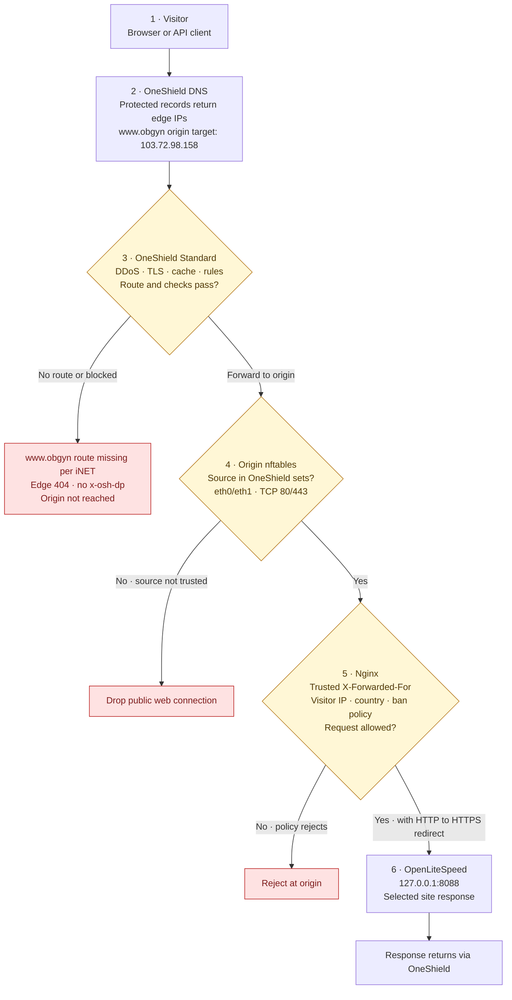
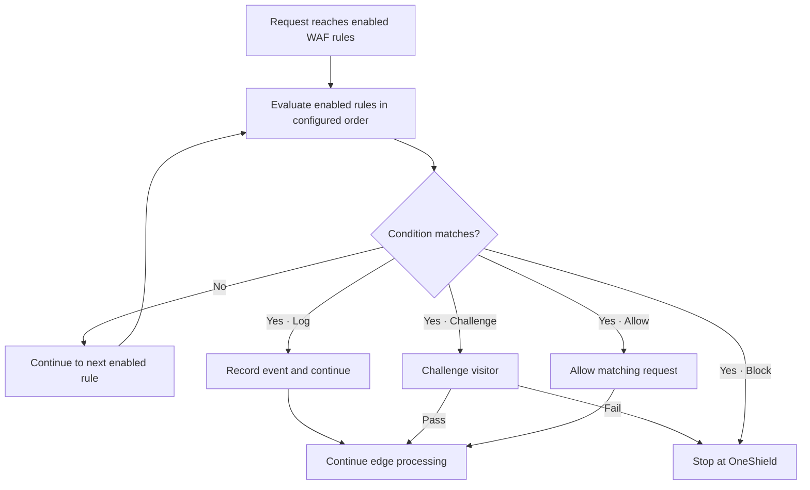

# Current OneShield request flow by layer

These diagrams follow the observed production path through OneShield and this
host's Nginx, nftables, CrowdSec, and OpenLiteSpeed layers. It replaces the
previous mode-comparison diagrams, which no longer matched the active origin
firewall.

The OnePortal page showed **Standard protection active** for `eaglesvn.club`
with DDoS, SSL, cache, and default rules. The `www.obgyn` DNS row is a protected
A record pointing to the production origin `103.72.98.158` (TTL 5 minutes).
Public DNS returns OneShield addresses for protected names; it does not expose
that origin target.

The diagram distinguishes the working edge path from the current nested-host
failure. On 2026-10-12, browser-style HTTPS checks returned 200 for
`eaglesvn.club`, `www.eaglesvn.club`, and `obgyn.eaglesvn.club`; they returned
404 for `www.obgyn.eaglesvn.club`. iNET reported that the latter hostname is
missing from the edge route inventory. Its 404 has no `x-osh-dp` header, so the
request does not reach this host. The exact order of OneShield's internal route
lookup and Standard checks is not documented; the edge branch below records the
observed dispatch outcome without asserting that internal ordering.

For a large interactive version, open the [full-screen diagram viewer](oneshield-request-flows.html).
The HTML page is generated from the Mermaid blocks below with
`npm run docs:oneshield-viewer`.

## Production request path

### What each layer does

| Layer           | Current behavior                                                                                                                                                                              | Evidence and boundary                                                                                                                            |
| --------------- | --------------------------------------------------------------------------------------------------------------------------------------------------------------------------------------------- | ------------------------------------------------------------------------------------------------------------------------------------------------ |
| Visitor         | Sends a request for one of the site hostnames.                                                                                                                                                | Public HTTPS checks were made with a Chrome user agent on 2026-10-12.                                                                            |
| OneShield DNS   | Protected records resolve to the edge pool. The portal's `www.obgyn` A target is `103.72.98.158`; this is hidden behind proxy answers.                                                        | `www.obgyn` is an enabled protected A record in the `eaglesvn.club` zone. There is no separate child DNS zone.                                   |
| OneShield edge  | Standard protection is active. Three tested hostnames reach a dataplane and return 200. The `www.obgyn` hostname returns the edge 404.                                                        | iNET reported that `www.obgyn` is absent from its route inventory; the 404 lacks `x-osh-dp`. Exact internal edge-rule order is unknown.          |
| Origin firewall | `renew_oneshield_origin` allows public TCP 80/443 only from the configured OneShield IPv4 and IPv6 sets on `eth0` and `eth1`. Other source addresses are dropped.                             | nftables table is loaded; `renew-ssl-oneshield-origin-firewall.service` is enabled and active. The allowlist must track iNET's published ranges. |
| Nginx           | Recovers the visitor IP from `X-Forwarded-For` only when the peer is trusted; applies permanent web-IP and country rules; redirects HTTP to HTTPS; proxies allowed requests to OpenLiteSpeed. | `oneshield-realip.conf`, `permanent-web-attack-map.conf`, vhost rules, and live `nginx -T` output.                                               |
| OpenLiteSpeed   | Serves the selected virtual host behind Nginx on `127.0.0.1:8088`.                                                                                                                            | Active Nginx vhosts proxy to this local listener.                                                                                                |
| CrowdSec        | Reads origin events. The synchronizer keeps qualifying HTTP/AppSec attack IPs in a durable file, Nginx map, and nftables set; its timer runs every 30 seconds.                                | `renew-permanent-web-attack-bans.timer` is active. Requests stopped at OneShield never reach this origin detection path.                         |

The Nginx visitor-IP map is the ban check for normal proxied requests because
nftables sees the OneShield proxy as the packet source. The permanent nftables
set is a network-layer backstop for source addresses that reach the host
directly or traverse other covered paths. The origin firewall separately
rejects direct public web requests outside the OneShield ranges.

## Origin detection and persistent bans

This is the feedback path through the origin security layer. It shows why
attacks blocked at OneShield do not enter CrowdSec's persistent-ban flow.

```mermaid
flowchart TB
    subgraph EDGE["OneShield edge"]
        BLOCK[Edge block or failed challenge]
        STOP[Request ends at OneShield]
        NOLOG[No origin request log<br/>or CrowdSec alert]
        BLOCK --> STOP --> NOLOG
    end

    subgraph ORIGIN["Origin event and detection layers"]
        REACH[Request passes edge and origin firewall]
        LOGS[Nginx access logs and CrowdSec AppSec events]
        CS[CrowdSec qualifying HTTP probe,<br/>brute-force, or exploit alert]
        TIMER[One-shot synchronizer every 30 seconds]
        STATE[Durable IP state and explicit release list]
        MAP[Generate visitor-IP map and reload Nginx on change]
        NFT[Refresh permanent nftables address set]
        NGINX[Nginx checks recovered visitor IP<br/>on proxied requests]
        FW[Firewall set checks source address<br/>at the network layer]
        REACH --> LOGS --> CS --> TIMER --> STATE
        STATE --> MAP --> NGINX
        STATE --> NFT --> FW
    end

    classDef edgeStop fill:#fee2e2,stroke:#b91c1c,color:#7f1d1d
    classDef security fill:#fff7d6,stroke:#b7791f,color:#543b05
    class BLOCK,STOP,NOLOG edgeStop
    class CS,TIMER,STATE,MAP,NFT security
```

The `renew-permanent-web-attack-bans.timer` runs a oneshot service every 30
seconds. Qualifying CrowdSec HTTP remediation alerts and CrowdSec AppSec
virtual-patching alerts enter the persistent list, except trusted OneShield
proxy sources. That list drives the Nginx visitor-IP map and the nftables
address set. The edge-stop arrow means the origin receives no request or event;
it does not mean a synthetic event loops back into OneShield.

The nested-host 404 is an edge route problem. The portal's protected A target
is already the correct production origin (`103.72.98.158`), and the origin
firewall allows OneShield to reach that server. Changing the origin target to
`103.56.163.145` would point at the wrong machine; iNET needs to add or repair
the `www.obgyn.eaglesvn.club` edge hostname route.

## WAF rule action flow

This describes how an enabled OneShield WAF rule's configured action handles a
matching request. The active domain mode and rule list can vary by hostname;
confirm them in OnePortal before treating a specific custom rule as enabled.

iNET documents four WAF actions: Log records a match, Challenge asks the visitor
to pass a check, Block stops the request, and Allow permits the matching
request. Rule order matters: a broad Allow placed above a block can make that
lower block ineffective for matching traffic. Rate-limit rules have separate
Ban, Block, or Challenge actions and configured edge durations; they do not
create the origin's persistent CrowdSec ban. For false positives, identify the
matching event before scoping an exception to the intended source and route.
See iNET's [WAF rule guide](https://developers.inet.vn/docs/oneportal/oneshield-waf-rules),
[WAF templates](https://developers.inet.vn/docs/oneportal/oneshield-waf-rules-mau-co-san),
[rate-limit guide](https://developers.inet.vn/docs/oneportal/oneshield-gioi-han-request),
and [IP Lists guide](https://developers.inet.vn/docs/oneportal/oneshield-cai-dat-ten-mien-danh-sach-ip).

## Performance and security practices

- Keep cache enabled for fingerprinted static assets and genuinely public pages. Bypass authenticated, personalized, cookie-dependent, admin, and API responses unless cache keys and invalidation are deliberately configured.
- Use narrow WAF and rate-limit rules on login, password reset, expensive search, and API routes. Start in Log where available, review matches, then use Challenge or Block with scoped conditions.
- Keep OneShield's proxy ranges synchronized between `deploy/oneshield/origin-firewall.nft` and `/etc/nginx/snippets/oneshield-realip.conf`. iNET says the ranges can change; validate Nginx and reload the firewall table after an update.
- Keep TLS valid on both visitor-to-edge and edge-to-origin connections. Nginx already redirects HTTP to HTTPS, so avoid enabling a second redirect at OneShield unless the origin redirect is intentionally removed.
- Track edge status, origin status, 4xx/5xx rates, cache hit ratio, p95 latency, and challenge/block counts separately. Edge blocks do not appear in origin logs without a verified OneShield event export.
